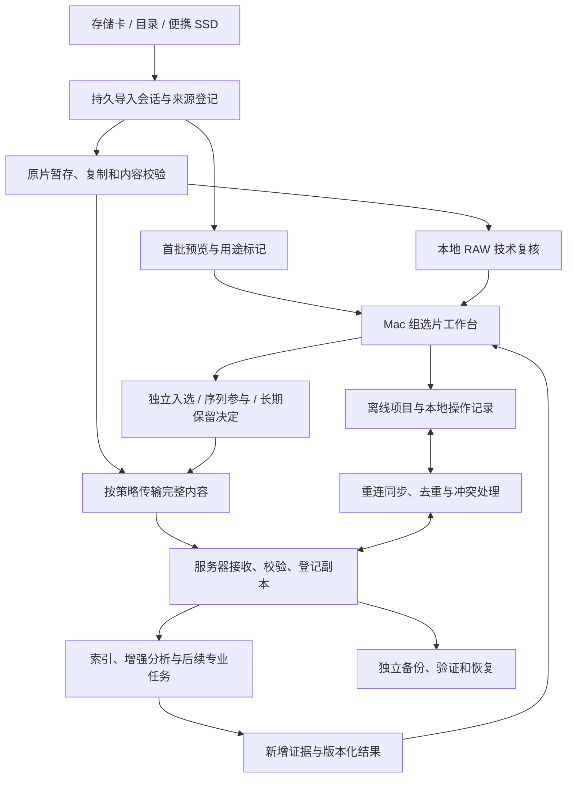

# RAWMaster 客户端与服务端工作流程

> 实施进展（2026-10-21）：用户已授权实现 M1 客户端；最新状态与实际证据见 [M1 验收记录](../../specs/001-local-culling/validation.md)。以下“本次仅规划”等文字描述该文档最初的研究轮次。

状态：规划方向与主线已确认 / 规格细化中；版本：0.3；更新日期：2026-10-21。

这是产品与系统职责规划，不是已经实现的协议。特性 ID 见 [02](02-feature-portfolio-draft.md)，交付顺序见 [03](03-roadmap-and-decisions-draft.md)。以下完整流程在 M3 形成基础闭环，显影和专业处理随 M5 增加；M1 只交付本地导入与人工选片。

## 1. 贯穿一次拍摄的协作流程

扫描、复制、浏览、分析和上传可以交错推进。箭头表达数据前提，不表示必须先完成整批再进入下一步。服务器做 RAW 复核前必须已有完整且校验通过的原片；仅有预览时只能返回相应层级的建议。

## 2. 本地先行，服务器接续

| 步骤 | Mac 客户端责任 | 服务端责任 | 用户可看到的结果 |
|---|---|---|---|
| 建立会话 F001 | 选择库/项目、源与工作位置；登记逐文件状态 | F006 后可提供暂存目的地 | 会话持续存在，区分源可见和已有受管副本 |
| 首批可浏览 F001/F002 | 从已可读文件提取预览；允许人工分组与用途保护 | 不阻塞本地浏览 | 素材逐步出现；明确预览来源及原片状态 |
| 复制与校验 F001 | 保持源只读；暂存未完成文件；验证后登记副本 | 接收端同样先暂存后校验 | 磁盘满/拔盘可暂停，完整项不重复建立 |
| 用途与证据 F003/F004 | 当前帧/组优先复核；类型不明时采用保守建议 | 原片到达后运行增强分析 | 可查看比较区域、统计、版本与未知状态 |
| 人工审阅 F002 | 键盘、组比较、批量决定与撤销；决定本地持久化 | 保存已同步决定；新增建议不覆写决定 | 可随时恢复排除项；序列参与独立控制 |
| 归档与备份 F006 | 按策略排队传输；展示各位置状态 | 校验、归档、独立备份、周期校验及恢复 | “服务器已有”和“独立备份完成”分别显示 |
| 离线与重连 F007 | 按项目准备内容；记录离线修改；保留冲突 | 接收去重操作并汇总可用副本 | 离线范围真实；重连不静默丢决定 |
| 历史库 F008 | 从一致副本接入组织、版本、历史外观并对账 | 可承接原片/档案及统一索引 | 缺失、不支持、仅封存可逐项查阅 |
| 后续处理 F009/F010 | 输入和引擎齐全时本地运行，输出绑定版本 | 接续已具备依赖的长任务 | 本地/远端各有状态，结果不覆盖旧作品 |

## 3. 原片落在哪里

| 方式 | 适用情况 | 数据责任与异常行为 |
|---|---|---|
| 复制到 Mac/便携 SSD（M1 优先） | 有足够工作空间，希望离线带走拍摄 | 先创建可验证工作副本；源拔出后不影响已有完整项 |
| 原地接入已有目录（M1 已确认） | 原片本来已在受管工作盘，无需再次搬运 | 建立来源/内容/位置关系；盘掉线只改变可用性，不删除资产。启用前需明确外部修改检测与独立副本责任 |
| 分批暂存再归档（M3） | 整次拍摄大于本地可用空间 | 每批先校验并按归档策略确认可回取副本，再允许释放非离线固定内容；不能将未上传项当普通缓存清掉 |
| 服务端暂存目的地（M3） | 工作站直接使用服务器容量 | 客户端负责会话与交互，服务器负责接收校验；断网后继续已有本地素材，尚未传输部分等待源和连接 |

2026-10-21 体验复核已确认原地接入与复制导入均进入 M1。原地接入不能与“完整受管副本已建立”混为一谈，必须细化引用身份、外部变化及掉盘重连契约，见 07。SMB/NFS 可以是内容位置候选；具体支持协议和挂载恢复在 F006 计划中确定。运行中的目录数据库由所属进程本机持有，通过服务接口交换业务变化。

源设备上的预览可供先看；只有源上的唯一原片在移除源后不可用。系统不因一次筛选完成就暗示可以格式化存储卡；本轮也不规划自动格式化功能。

## 4. 筛选、用途与保管是三个决定

| 决定 | 状态含义 | 不应连带发生的操作 |
|---|---|---|
| 独立照片是否入选 | 未决定 / 保留 / 排除 | 排除独立照片不自动移出叠栈、延时等序列 |
| 是否参与某个序列 | 按组及处理版本保存参与状态、顺序、权重 | 某任务不用不代表其他任务不用，也不代表原片可删 |
| 原片是否长期保留 | 未决定 / 长期保留 / 待处理策略 | 暂存或排除标记不直接触发物理删除 |

普通连拍允许推荐多张，不用“相似”直接推导可删除。延时先看时间连续性；HDR 先看曝光档；全景/焦点堆栈先看覆盖；星空、星轨及校准帧先确认用途。规则尚不支持时标为未评估，不能显示已检查完整性。

2026-10-21 用户已确认首版采用人工批量确认，排除项保留恢复入口；后续自动排除废片为明确需求，见 F003.R07–R10。按项目启用，通过分类型验证后执行，保留原因及批量撤销，不覆盖人工保留或破坏必要序列。到期清理与物理删除仍是独立策略，未因自动排除需求而获得启用。

## 5. 上传优先级与序列闭包

| 素材 | 建议默认策略（待确认） |
|---|---|
| 人工确认保留、当前正在使用 | 优先上传，完成内容校验后才登记服务器完整副本 |
| 待复核且确需服务端分析 | 用户/项目策略允许时上传到暂存区；优先级低于当前交互 |
| 完整专业序列 | 按任务输入清单包含必要成员及校准输入，不能只传代表帧 |
| 已排除但仍参与某序列 | 继承序列输入需求；独立照片排除不阻止必要上传 |
| 已排除且无其他用途 | 默认留本地可恢复暂存；是否上传及保留期由项目策略决定 |
| 原片损坏、缺失、解码不支持 | 单列技术状态；允许归档可校验字节，不冒充分析成功 |

长期保留策略与序列输入冲突时，生成待处理项，不自动删去依赖。M3 的任务输入检查只保证已声明成员和文件齐全，不保证专业合成效果；后者属于 M5。

## 6. 独立记录的状态与转换

| 维度 | 规划状态 | 转换条件 |
|---|---|---|
| 单文件接入 | 发现 → 暂存中 → 校验中 → 受管可用；可暂停/失败 | 只有完整副本且校验通过可进入受管可用；失败保留原因和恢复位置 |
| 分析 | 未分析 → 预览初筛 → RAW 复核；未知/不适用/技术失败 | 每项结果关联内容和算法版本；可重分析，不能修改人工决定 |
| 各位置副本 | 缺失 / 暂存 / 已校验 / 不可用 / 校验异常 | 分位置独立登记，掉线不等于删除，上传完成不等于备份完成 |
| 独立备份 | 未覆盖 / 排队 / 验证完成 / 异常 | 关联目标、时间和覆盖清单，恢复时核对原片及项目关系 |
| 离线准备 | 未请求 / 准备中 / 所选级别就绪 / 不完整 | 内容被移除或依赖缺失后重新评估，不能保留虚假的就绪标记 |
| 任务 | 排队 / 运行 / 等输入或连接 / 暂停 / 成功 / 失败 / 已取消 | 结果发布前核对输入快照与任务身份；过期结果保留来历，不替代当前版本 |

这些是领域状态草案，具体持久化和协议待 `data-model.md` / `contracts/` 细化。分析“未知”是有效结果，解码失败是执行问题；任务重试不能把二者抹成同一种坏片标记。

## 7. 离线与重连

| 已准备内容 | 可用能力（随里程碑交付） | 不能暗示的能力 |
|---|---|---|
| 元数据与缩略图 | 已缓存范围检索、评分、旗标、集合整理 | 已搜索全服务器；能复核原始高光/对焦 |
| 足够质量的预览 | 比较与人工选片，显示预览精度限制 | 预览等同于 RAW 细节或最终输出 |
| 完整原片及所需依赖 | 已交付的 RAW 复核；M5 后编辑、导出与相应序列任务 | 尚未支持的机型/处理类型已经可用 |

F007 正式设计前至少决定以下冲突规则；本轮提出的处理方向尚待确认：

| 变化 | 建议处理方向 | 必须验证的边界 |
|---|---|---|
| 同一操作重复发送 | 使用稳定操作身份，一次有效应用 | 超时后重试、重连与乱序到达 |
| 两端修改不同字段 | 无业务矛盾时按字段合并 | 字段依赖、缺失前置对象 |
| 两端修改同一评分/旗标 | 保留双方值与来源，显式解决 | 不仅按到达时间覆盖 |
| 编辑配方同时变化 | 保留版本分支 | 历史外观和依赖不能丢失 |
| 组成员或用途变化 | 保留版本并重新检查序列完整性 | 撤销、移出、重排的并发组合 |
| 一端排除，另一端保留/恢复 | 保留冲突或人工选择，禁止触发文件删除 | 删除意图、排除决定与内容副本分别处理 |
| 分析迟到或基于旧输入 | 保存来源，标记过期，不覆盖当前决定 | 同一资产新输入版本、人工锁组 |

具体合并策略是 F007 的设计输入，尚未定义完整同步协议；不能据此宣称并发安全已证明。

## 8. 各阶段演示脚本（未来验收步骤）

1. **M1**：从真实混合拍摄开始导入；整批完成前浏览；手动标记延时；断网批量选片并撤销；复制中拔盘后继续；核对源 hash 与人工决定。
2. **M2**：比较同组锐度与 RAW 曝光证据；查看未知项；纠正自动分组；验证暗场/HDR/延时不会被普通规则确定淘汰。
3. **M3**：归档一个精选项目及其必要序列；中途断网重试；检查服务器和独立备份两种状态；离线修改后重连，展示冲突并恢复一个项目。
4. **M4**：接入两个旧库副本，包含同原片不同虚拟副本；跨库检索；展示历史外观、数量/关系对账及缺失项；保持近期 Lightroom 工作流。
5. **M5**：同一配方两端导出并按容差比较；延时任务中断后恢复；再按专项验收增加深空或地景星空能力。

以上脚本尚未执行。2026-10-21 用户已确认规划方向与主线；本次仅记录确认和配置，没有启动应用、插件或验证原型编码。
