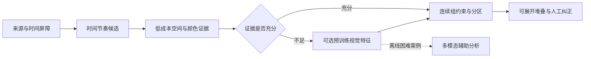

# 自动分组算法：现状、CV/机器学习与多模态方案

2026-10-24。现状根据仓库dev-4源码与实际冻结验证；候选能力依据下列官方资料核对。候选方案尚未在RAWMaster上测量或接入，不把研究方向当作质量承诺。

## 建议

优先评估“时间与来源硬约束 + 空间/CV证据 + 小型边界分类器”的本地混合方案。预训练视觉编码器用于增强困难边界，多模态大模型先用作离线分析与辅助标注。当前样本适合复现和回归，尚不足以证明训练出的模型具备泛化能力。

## 当前实际算法

目前没有训练模型、神经网络embedding或多模态推理。实现是有界流式状态机，组合拍摄元数据、低分辨率图像距离、长期锚点和间隔节奏拟合。生产应用尚未接入此检测器。核心源码：[读取](../../Sources/RAWMasterImaging/SequenceCaptureReader.swift)、[特征](../../Sources/RAWMasterImaging/SequencePreviewFeature.swift)、[配置与预处理](../../Sources/RAWMasterImaging/SequenceObservation.swift)、[检测状态机](../../Sources/RAWMasterImaging/SequenceDetector.swift)、[周期证书](../../Sources/RAWMasterImaging/SequenceIntervalEpisode.swift)。

### 1. 输入与屏障

保留会话完整文件名自然序，每个文件一个asset；失败项不从清单中删掉。读取原始EXIF时间、亚秒原字符串/精度、时区偏移（缺失时不猜UTC）、曝光、make/model、方向。来源需可核验的设备证据，或绑定完整清单的用户同设备声明；同机型不能当同一台机身。来源矛盾、时间回拨/无法区分的精确重复时间、损坏、缺少预览等形成屏障，不跨过它们强行成组。

### 2. 图像特征

RAW只用内嵌预览，最长边最多160px，不因检测自动解码完整RAW。把转正图绘制为32×32 sRGB，提取RGB各16桶直方图、归一化空间亮度1024项及64bit差值指纹。三个距离分别为直方图L1差/6、亮度RMS差/6、指纹Hamming差/64。低纹理/低对比图另判缺少信息，不能只凭纯色相同证明连续。

### 3. 连拍

局部稠密间隔默认不超过0.6秒，还考虑时间精度及曝光占用；同时要求直方图≤0.16、亮度≤0.23、指纹≤0.55。局部只有指纹单项失败时，允许使用强亮度≤0.115及原锚指纹上限0.7的受限救援，直方图门不放宽。

每组保留首帧与有界代表锚点，当前默认3个、更新步长8，锚门0.35/0.28/0.7，防止仅靠逐张相似无限漂移。暂停最长12秒，左右各3帧支持，以3×3比较的逐指标中位数及锚检查决定桥接；普通桥接门0.23/0.26/0.65。桥接只有直方图单失败时，才可用0.35上限与更强亮度≤0.13救援。中位数是鲁棒统计，不是分组正确概率。

### 4. 间隔拍摄

在有界窗口内寻找至少4张稳定种子，周期范围1秒至24小时。枚举相邻间隔除以1–4步的周期候选，要求至少两次直接基础周期支持；每间隔最多允许3张缺帧、连续缺帧间隔最多2次，累计缺失比例≤0.5。时间容差为max(0.1秒, 周期×8%)并计入原时间精度。除了局部间隔，还相对固定起点检查全局相位，周期可行区间随证据收紧。

长暂停可形成多个相位段，但保持首次稳定周期参考和全组周期可行区间交集，不允许每次重启任意漂移。暂停须超过旧段可解释的缺帧上限，且≤min(12×首次周期,3600秒)，左右稳定/弱支持和视觉锚证据同时成立。最多12帧回看；启动首帧补入用固定3代表和7次比较逐指标MAX，普通直方图门0.23，直方图单失败可救到0.35，亮度仍≤0.13、指纹≤0.65，时间跨度仍≤3个参考周期。

稳定间隔段允许日落等光照渐变，不对每帧都附加一次全局颜色硬门。冲突仍可保留散片或不足覆盖，不删除或排除原片。默认引擎管理预算64MiB不含输入清单、系统图像框架和完整进程RSS，不能当作整个应用的内存承诺。

## 已知失败说明了什么

已见14/48/123张连拍与427张间隔已完整恢复。新193张连拍却输出368–411、412–572两组：411/412为0.451秒内的局部颜色门误拒，560/561为4.506秒暂停的普通桥接误接；后者是用户确认的选片边界。正组自身还有更长合法暂停。因此只调整一个时间阈值，不能同时处理两类错误。确切数值和原始证据见[能力缺口](11-sequence-detection-quality-gap.md)。

本轮查看560/561的JPEG代理可见鸟类主体姿态和背景构图发生变化，而两帧主体仍接近画面中央。这个观察不新增标签，但提示候选特征不能只比较全图场景相似或主体绝对中心坐标；需对照相机运动、相对背景位置、姿态以及两侧窗口的上下文。是否足以改善分组仍须实验。

“相同场景/同一主体”“同一次物理快门序列”和“用户希望放在同一组选片”是不同关系。视觉模型也不能保证从两个看起来相同的画面推断用户任务意图。当前以用户已标逻辑组为目标，不在失败后改写真值。

## 可选技术与价值

| 方案 | 在本场景的价值 | 局限与成本 | 建议角色 |
|---|---|---|---|
| 分块梯度/结构残差、关键点匹配+RANSAC、稀疏光流 | 把相机整体移动与局部主体移动分开，保留位置证据；减少单纯颜色变化造成的断组 | 光流依赖外观/运动假设；重复纹理、低纹理、遮挡、长暂停会失败；全局背景匹配强也可能掩盖主体变化 | 第一轮CV基线 |
| Apple Vision前景掩膜、光流及图像相似特征 | 本地系统框架路线；掩膜可分开前景/背景，比较位置、面积、轨迹及其可靠性 | 前景不是“用户想选的主体”；小主体、天空/水面、边缘目标不一定稳定；系统修订版本必须记录 | 与轻量CV做对照 |
| DINOv3局部patch特征，或LightGlue学习匹配器 | 对曝光/色彩变化提供比单一直方图更有表达力的特征；局部对应点保留几何证据 | 不能只用全图余弦相似度；模型部署、缓存、许可与M4耗时都需实测；同背景不同任务仍可能相似 | 困难边界的增强层 |
| 逻辑回归/GBDT/小MLP的边界分类器 | 融合时间、节奏、CV和embedding；输出经校准的合并/切分证据，替代部分手调阈值 | 当前明确负边很少且样本高度相关，易学到场景或相机捷径；概率需独立校准 | 有足够独立标注后训练 |
| 多模态视觉语言模型，如Qwen3-VL | 理解“主体从画面中心移出”等描述；辅助分析困难边界、形成可审阅的候选解释 | 较高推理/内存成本、可能臆测主体或位置、输出随prompt/版本变化；它的解释不是精确坐标测量或概率 | 离线辅助标注/困难样本复核 |

OpenCV官方给出光流的运动与亮度假设，以及用特征对应点和RANSAC估计几何关系的方法；这里建议把它们作为可测对照，而不是假定已能解决本项目。[光流](https://docs.opencv.org/4.x/d4/dee/tutorial_optical_flow.html)、[特征与单应估计](https://docs.opencv.org/4.x/d1/de0/tutorial_py_feature_homography.html)。

Apple Vision提供图像相似比较、前景实例掩膜和光流请求；官方特别说明光流资源开销较高，应一次创建一个请求。可以先在本机评估系统路线，不必先加入独立训练依赖。[Vision](https://developer.apple.com/documentation/vision)、[前景掩膜](https://developer.apple.com/documentation/vision/vngenerateforegroundinstancemaskrequest)、[光流请求](https://developer.apple.com/documentation/vision/vngenerateopticalflowrequest)。

DINOv3官方提供密集特征及21M参数ViT-S/16等小型骨干；它仍需按自己的模型许可取得和分发权重，不能视为普通代码宽松许可证。LightGlue匹配稀疏局部特征，其代码及权重为Apache-2.0，而搭配的SuperPoint等组件另有条款。小型预训练编码器值得实验，但不能据参数量推断本机帧率。[DINOv3](https://github.com/facebookresearch/dinov3)、[模型许可](https://github.com/facebookresearch/dinov3/blob/main/LICENSE.md)、[LightGlue](https://github.com/cvg/LightGlue)。

CLIP学习图文语义关联，适合场景/概念相似性；本项目需要的精细主体位置边界并非其训练目标，不能直接用“语义相似”替代分组判断。Qwen3-VL官方说明多图像/视频和空间理解能力，并有2B/4B等型号；这些是候选能力，不是RAWMaster准确率证据。[CLIP论文](https://arxiv.org/abs/2103.00020)、[Qwen3-VL](https://github.com/QwenLM/Qwen3-VL)。

## 推荐的混合流程与实验顺序

以上是候选研发架构，图中的堆叠/纠正仍按005的B/C阶段实施。时钟/来源硬屏障、不可读/未完成覆盖和人工保护不得由模型分数绕过。

1. **先比较证据，不立即训练。** 用这次JPEG回归集运行现状基线，再评估空间分块、相机运动补偿、前景分离、Apple Vision特征以及小型DINO局部特征的消融结果；同样的输入、标签和资源预算，记录误并/漏分/整组/覆盖和原因。
2. **再学习边界。** 若特征确实可分，用小分类器融合特征；输入既含相邻边，也含暂停两侧窗口和固定锚点。序列分区必须处理整组一致性与渐变漂移，不能仅用二元相似图的连通分量无限传递。
3. **模型只增证据。** 本地缓存键包含原片或JPEG内容hash、缩放/方向配方、模型/系统revision和特征版本；限制内存、并发和工作单元，交互预览优先。M4上分别测冷启动、模型加载、P50/P95每边耗时、整会话耗时、峰值RSS和取消恢复，不预填虚构预算或性能结果。
4. **多模态放在困难案例。** 默认离线本地，不为每对照片调用大模型；若未来选择云端，须由用户明确发起并说明上传内容。固定模型/提示/采样，保留可拒绝的结构化结果。辅助标签需人工复核，不能把模型生成的标签当独立验收真值。
5. **按会话/拍摄任务划分数据。** 六段不是上千独立场景，连拍相邻帧不能随机分到训练和验证。RAW与其JPEG代理、同一拍摄的DNG/JPG必须始终同split。现有资料已用于开发，后续独立评估先冻结版本再一次运行；未标上下文不当负例，0188未知不用于已知边界。

保留相邻边precision/recall、已知负边零误并、整组精确恢复、类型覆盖与unknown分别计量；JPEG行为基线、人工质量门、RAW格式与性能验证是三种不同证据。跨OS的ImageIO/Vision差异需要显式记录和审查，不静默更新golden。

## 本轮边界

本文最初交付数据集/回归、版本化发布和方案研究。后续用户已授权并完成[空间 CV 首轮实验](13-spatial-cv-experiment.md)：消除了 1 条已知误并，但 Sony 组内断点从 1 增至 17，质量未达标。默认检测器不变，未训练或下载模型，A 质量门仍未通过，自动堆叠与导入整合继续关闭。
