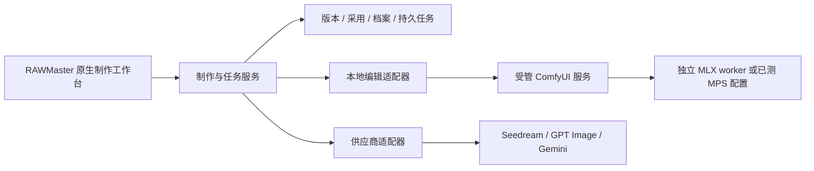

# 下一批研发计划：原生制作工作台与可替换 AI 后端

2026-10-30。根据用户最新要求与独立实验重新规划。**本轮仅更新研发计划，不开始正式客户端编码、数据库迁移、构建、安装或云 API 付费调用。** 后台可使用 ComfyUI；RAWMaster 的产品界面由原生 SwiftUI/AppKit 提供，不嵌入或要求操作 ComfyUI 网页。

> 实施状态更新：用户后续已明确要求“请开始交付这一批研发内容”。现已进入018交付，前文“仅更新计划”及文末实施限制描述的是原规划回合；不再代表当前授权。实现、实际验收与尚未通过的发布门统一记录在 [018规格](../../specs/018-native-editing/spec.md) 和 [018验证记录](../../specs/018-native-editing/validation.md)。

## 1. 本批交付目标

让用户在已有项目中完成：选中一张照片 → 基础初修 → 选择本机或已配置云服务进行 AI 编辑 → 比较候选 → 明确采用 → 导出成片。原片、基础版本、AI候选和采用版本分别保留；AI失败不阻止基础初修与导出。

沿用当前工作台的项目栏、单张画布、胶片条、比较视图、外部副本入口和原文件复制。当前单张“导出照片”实际仍是原文件复制，不能视为成片渲染。现有 `CIRAWFilter` 固定细节显示也不等于可编辑显影已经交付。本批补的是制作配方、版本/任务档案、原生AI交互及成片输出。

既有导入、初筛、分组、检索/标签、序列编辑与延时视频保持各自验收状态；它们的已交付能力不重新立项。006 T05b质量深化继续独立追踪，不把AI制作效果当作分组/清晰度/曝光质量通过的证据。

## 2. 研究结论如何影响产品决策

| 已有证据 | 本批采用方式 | 尚未通过的门 |
|---|---|---|
| Qwen2.1 Turbo MLX q4约1.04MP六图暖中位数69.2秒、峰值22.1GiB；Comfy工作流适配的三次暖请求中位数67.7秒、观测峰值22.4GiB | 作为本机非商业研究评估候选；保留Comfy MPS替代执行配置 | 本次仅M4 Max/128GB，不推导其他内存机型支持，不承诺每张约一分钟 |
| Comfy API/前端出图、三场景RGBA像素一致、串行队列、取消、故障恢复、显式卸载通过 | 可将队列和工作流藏在后端，前端使用稳定业务命令 | 当前是工作流级MLX子进程适配，不是原生KSampler的MLX后端；产品任务持久化、统一内存管理未完成 |
| 原版VAE的单鸟2像素周期成分可在无DiT重建中复现；同latent的texture-fix解码使岸边幅度降低约85% | 保留原版结果；修复解码作为可选实验配方，冻结decoder版本 | 不叫无损恢复；有残余纹理和细节改变，具体层/训练原因与跨图库效果未确认 |
| 约4.15MP单鸟MPS诊断440.6秒、57.6GiB | 原生输出尺寸、预计等待与资源限制进入能力档案 | 不是全尺寸RAW交付证据，不以插值回原图像素伪装为原生高分辨率 |
| 独立uv/CPython/wheelhouse运行时安装原型已做空缓存、离线、带空格路径、损坏wheel不切活动版本等验证 | 延续版本化运行时与模型分离的安装方式 | 原型未包含最新MLX适配与texture-fix；签名、公证、新Mac和最低配置验收待做 |
| Seedream、GPT Image、Nano Banana/Gemini已形成配置/任务设计，未实际调用 | 本批加入三家供应商适配与原生配置 | 账号权限、精确模型版本、真实返回/取消/费用语义均需逐家联调 |

Qwen2.1 Turbo采用研究许可，商业使用需单独授权；texture-fix也不是商业授权替代方案。因此当前候选不直接变成商业发行默认模型。许可未解决时，可以交付通用制作底座、基础初修/导出及已验收云适配，但本地AI发布条件仍单独未通过，不把其他路径写成“本地AI已完成”。[模型许可](https://huggingface.co/Qwen/Qwen-Image-2.1-Turbo/blob/main/LICENSE)

证据：[18模型与集成记录](18-comfyui-ai-backend-evaluation.md)、[19安装与供应商方案](19-ai-runtime-and-cloud-providers.md)、[独立集成报告](/Users/robinqu/Workspace/RAWMaster-Lab/comfy-20261030/integration-qwen21/report.html)。上述数字是特定配置的工程观察，不是冻结的产品SLA或盲测画质排名。

## 3. 原生界面与操作流程

保留当前工作台布局，在单张制作上下文内切换“初修 / AI精修 / 版本”，不把整个应用导航改造成模型工具。中央仍是照片，右侧为所选阶段的操作，下方沿用胶片条；版本/候选区与已有组选片比较明确区分。浅色、深色、跟随系统、键盘操作与窄窗口继续验收。

| 区域/入口 | 用户实际看到的内容 |
|---|---|
| 初修面板 | 曝光、白平衡、拉直/裁切、逐项复位、保存版本；只显示支持的相机/镜头校正，缺profile明确未应用 |
| AI精修面板 | 当前输入版本、自然增强/电影调色等编辑意图、可编辑描述、本机/云端执行位置、生成按钮 |
| 服务选择 | 主界面只选“本机”或已配置云方案；设置中可见供应商、实际模型、下载空间、凭证、可用能力与实验状态 |
| 任务状态 | 准备、排队、生成、保存、取消中、失败或结果待核对；无可靠进度的阶段不伪造百分比。生成时可继续翻片 |
| 候选比较 | 原图/基础版本/当前采用/候选的并排或前后切换，100%同步查看与实际像素；“采用此版本”“保留候选”“放弃” |
| 版本与导出 | 版本来源、父版本和恢复；“复制原文件”与“导出成片”分开；导出明确所选版本、尺寸、格式、色彩和放大状态 |

不要求用户粘贴节点JSON、连接端口、选采样器/调度器、手工加载VAE或维护Python环境。ComfyUI网页与节点调试留在独立开发工具，不嵌入产品WebView，也不放入常规高级设置。

易用性不等于隐藏重要选择：本机/云端、上传目标、实际模型/版本、可能费用、输出像素与实验性限制仍可查看。量化、工作流与decoder指纹保存在任务快照和诊断中。像“纹理优化（实验）”这样的选项只有在用户能理解其效果与细节变化时才开放，不直接以VAE参数名呈现。

首版不提供伪通用的“强度”滑杆。只有某个执行配置支持该控制、语义明确并通过样本后才显示；蒙版、参考图、多轮对话同样按能力开放。当前风格来自已测提示配方，不能把它宣传为已验证的风格LoRA或主体保护保证。

## 4. 特性拆分与验收

以下N20编号用于本次增量，映射既有008任务，不替换历史任务状态。

| ID / 优先级 | 特性与范围 | 可验收结果 | 依赖与008映射 |
|---|---|---|---|
| N20-01 / P0 | 制作版本、档案与任务底座：输入快照、不可变版本、候选/采用分离、持久job/attempt、输出hash、故障对账与备份恢复 | 输入变更后旧结果仍属于旧父版本；重启不丢已采用图；成功回调不自动采用；不改变原片/纳入/评分/已审状态 | 先冻结当前主线合同与迁移；T01、T08–10、T20 |
| N20-02 / P0 | 原生制作工作台与最小初修：复用现有浏览/比较，增加初修、AI描述、候选及版本；冻结真实RGB模型输入 | 一张实际RAW能保存基础版本、复位和恢复；预览/保存/输出引用同一配方；AI等待中正常翻片；没有Comfy网页或节点操作 | N20-01、RAW/ICC研究子门；T06、T11、T12b、T14、T16 |
| N20-03 / P0 | 本地运行时与资源管理：引导安装、下载/空间/进度、版本化uv环境、离线wheelhouse、模型分包、健康检查、修复/回滚、MLX worker监管 | 干净测试目录可从客户端启用；安装失败保留旧环境；取消/崩溃/退出不遗留worker；内存压力不继续启动新GPU任务 | 与N20-02基于冻结合同推进；T09、T13及19安装范围 |
| N20-04 / P0 | 单张本地AI闭环：内部Comfy模板编译、已测MLX q4配置、原生输出校验、可选纹理修复、候选采用 | 从RAW的保存版本生成候选；在100%检查主体/文字/几何/毛发；过期结果不覆盖当前采用；模型/decoder/模板可追溯，支持断网运行 | N20-01–03、本地质量/许可/输出门；T07、T13–14、T16b、T22 |
| N20-05 / P1，本批包含 | 三家云编辑与配置：Seedream、GPT Image、Nano Banana/Gemini；Keychain凭证、模型/区域档案、能力/费用/提交状态 | 三家使用同一原生候选流程，分别完成真实编辑联调；本地Comfy不可用时云流程仍能运行；未知结果不自动重复付费请求 | N20-01–02和共同provider合同后，可与本地运行时独立推进；扩展T09、T13–14、T22 |
| N20-06 / P0基础、P1补齐 | 成片导出与外部回流：先基础版本JPEG，再TIFF/ICC、AI候选导出及已有外部副本结果关联 | 导出使用明确采用/指定版本，不冒充RAW或原始动态范围；失败/磁盘满/冲突不覆盖已有文件；外部结果显式归入版本 | 基础JPEG依赖N20-01–02即可；完整交付再依赖04/05及外部/色彩子门；T15、T17–19、T20 |

### N20-03的安装与生命周期细化

- 主应用包、Comfy运行时、MLX运行时与模型包分别版本化，避免将mflux/PyTorch依赖强塞进同一环境。 uv管理独立环境，活动指针只在校验/冒烟通过后切换。
- 构建机固定Python ABI、arm64 wheels、节点与锁文件；安装优先离线同步，用户不用打开终端执行pip，不在客户机器临时解依赖或编译sdist。
- 模型下载分段/断点、大小及SHA校验，已校验文件可复用；模型放置盘可选，预检下载、展开、临时文件的峰值空间。
- DNS/TLS/代理、缺wheel、ABI错误、磁盘满和校验失败分别恢复。提供阶段重试、认可备用源、离线包与旧版本回滚；不关闭TLS校验，不修改系统Python。
- RAWMaster任务管理器统一监管Comfy宿主及MLX worker。当前实验中Comfy `/free`不释放外部worker的问题必须补齐：任务取消、空闲、内存压力、服务退出均有真实资源汇合证据；普通RAW查看优先，不能用“暂停”文字代替尚未停止的native调用。
- 本地GPU首版串行生成。服务仅监听loopback；只终止本应用拥有的实例，不复用或杀死用户自行运行的ComfyUI。内部取消须对应任务身份，避免全局interrupt误伤别的工作。
- 新运行时包重新覆盖MLX适配与模型组合，完成签名、公证、全新Mac安装和支持配置检查后才作为正式分发证据；旧原型成功不自动覆盖新包。

### N20-05的云服务细化

供应商适配器直接调用对应API，不通过Comfy节点间接上传或保存key。普通用户配置供应商与已支持模型；高级配置保留区域、精确模型ID及受支持endpoint，调整目标域名需重新绑定凭证。Nano Banana保存真实Gemini模型标识，不把系列名当API模型ID。

同一任务快照冻结输入渲染图、Prompt、已支持条件与provider配置；只上传明确选择的图像，不上传RAW或整组。生成前可见目标与费用状态；本地失败不自动切云。费用未知显示未知，不记为零。

提交超时与断线可能是结果未知，而非确定失败。按供应商能力查询/核对；无幂等或查询保证时不盲重试生成请求。取消请求与远端取消/计费分别记录；结果归档并解码/hash校验后才成功，不能只保存临时URL。精确接口能力在实施时按版本复核，不假设三家都有seed、mask、strength或异步轮询。

三家均做请求构造/错误/限流/未知结果测试；配置了可用账户及调用额度后逐家做真实编辑联调。mock通过不是已支持该供应商的交付证明。供应商可独立验收，未通过者保持明确不可用，不阻塞已通过路径。

## 5. 后台合同与兼容性

界面提交“创建编辑候选”这样的业务意图，不提交任意Comfy图。内部能力档案将意图编译为固定版本工作流/提示配方；任务同时冻结模板、节点、模型和decoder身份。业务状态与Comfy prompt_id、临时队列/history分开；连接恢复、重复/过期回调及异常退出由RAWMaster的job/attempt对账。

工作流和节点升级先做能力握手及合同/真实模型冒烟。缺少能力时返回可操作原因，不让原生界面因节点名、输入字段或Comfy前端版本变化而改变。保留已完成产物，不能通过升级模板重新解释旧版本。

当前主线业务schema为6，并有017的可选索引及降级限制。实施前读取最新主线，由同一Store负责人分配实际迁移号，不能直接假定为7。新制作数据不进入拍摄组成员或原片审阅分母；恢复验证覆盖一致SQLite快照及作品档案字节。

## 6. 交付顺序与退出条件

1. **A：原生制作底座。** 冻结合同与能力档案，完成N20-01、N20-02的基础初修/版本/比较，交付N20-06基础JPEG。可以使用fake provider验证UI/故障状态，但不称为AI已接入。
2. **B：本地AI评估试用。** N20-03受管运行时 + N20-04真实链路；在用户授权实施后的隔离库完成真实RAW→输入渲染→候选→采用→导出，满足许可范围和下列G2/G3后才开放试用。
3. **C：多引擎与完整交付。** N20-05三家真实供应商逐家验收，并补齐N20-06的AI导出、TIFF/ICC及外部回流；最后做恢复、性能和原生界面回归。云适配研发可在共同合同冻结后与B重叠，不依赖Comfy安装成功。

| 门 | 必须证明什么 |
|---|---|
| G1 数据/原生体验 | 原片不变、采用显式、版本可恢复；所有核心动作在RAWMaster内完成；翻片/比较不被AI阻塞；原任务状态不被制作改写 |
| G2 摄影与色彩 | 用实际RAW渲染和独立留出照片检验，不复用开发代理作为独立验收；覆盖肤色、羽毛、文字、直线、逆光/夜景；RGB/ICC/方向/裁切/alpha策略与真实输出像素明确 |
| G3 本地运行时/模型 | 许可适用于目标使用范围；安装/回滚、断网、取消/故障/空闲卸载与支持机型预算通过；M4 Max结果不外推最低配置 |
| G4 云服务 | 逐供应商真实提交/结果归档/错误/未知状态/费用及凭证保护通过；不靠关闭本地服务证明云内容质量 |
| G5 成片/恢复 | 保存版本、重启、DB+档案恢复、同名冲突/磁盘满、导出原子发布与原生尺寸/位深/ICC实测通过 |

G2在运行前冻结样本角色、最低原生交付像素、允许编辑程度与人工拒收规则，再做独立评价；不在计划里编造采用率或宣称默认能保持身份。首轮AI只开放经过验收的原生输出尺寸，若仅满足预览则明确限预览，不能自动放大后开放“原尺寸成片”。透明输出原样归档，摄影显示/JPEG背景合成策略另行冻结并记录，不能静默丢弃alpha。

具体日历工期在正式规格/合同和实施资源确定后估算；本计划先固定依赖、分段交付和验收，不用模型数量推算工作量。A或某一供应商通过可单独交付，但不因此把整个008、全部本地质量门或三家API都标为完成。

## 7. 本批不扩展的范围

不做通用节点编辑器、任意模型/插件市场、用户自己维护pip、整组无人值守AI与自动采用、未经验证的局部重绘/主体锁定、逐帧生成式延时、完整PS级图层、完整多库同步或Lightroom迁移。现有延时功能继续维护；新增去闪烁/星轨/全景/景深合成另批。已有006质量深化不取消，但不作为这次单张制作闭环的全局前置门。

## 8. 规划状态与接口来源

本次修订覆盖旧008中“首轮仅本地，云只留接口”的未来范围；现在提议将三家云适配纳入本批。其余版本、原片保护、初修/AI独立验收原则继续沿用。T07的独立实验可作为研究证据，T13已有实验适配可复用；两者都不自动标为生产完成。是否开始正式实现仍以用户后续实施指令为准，本次不启动安装/迁移或修改应用源码。

官方接口依据：[Comfy服务HTTP/WS路由](https://docs.comfy.org/development/comfyui-server/comms_routes)、[uv环境锁定与同步](https://docs.astral.sh/uv/pip/compile/)。正式实现时继续固定版本，并按[19](19-ai-runtime-and-cloud-providers.md)逐家复核供应商能力与配置。
