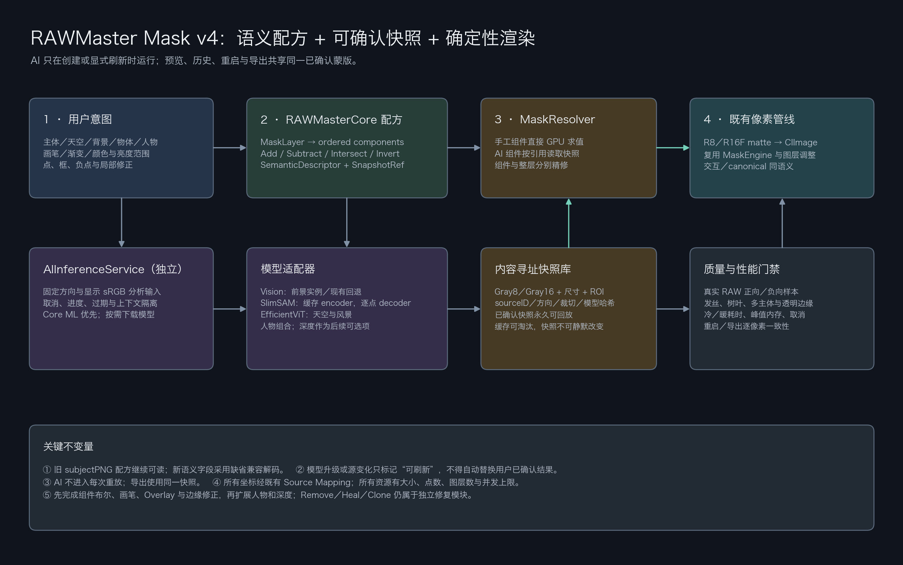

# Camera Raw、Lightflow 与 RAWMaster Mask 功能调研及 AI 技术方案

> 调研日期：2026-11-21。范围是蒙版创建、组件组合、可视化、边缘处理、局部调整、AI 生命周期与批量工作流。Remove／Heal／Clone 属于修复模块，不计入调整画笔蒙版。这里的“完整”指本次官方文档与指定 Lightflow 发布构建中可观察的公开功能，不包含未公开实验或无法从产物证明的内部能力。

## 执行摘要

RAWMaster 当前已经具备真实可渲染、可持久化的四类蒙版：线性渐变、径向渐变、亮度范围和 Vision AI 主体；支持图层启停、反转、不透明度、排序、删除，以及曝光、高光、阴影、饱和度四项局部调整。AI 主体在创建时生成一次长边 512 的 RGBA PNG，之后历史、重放和导出直接读取该像素结果。这一设计的突出优点是**确定性、离线可回放和模型调用边界简单**，但它目前更接近“单层基础蒙版”，尚未形成 Camera Raw 或 Lightflow 那样的组件式蒙版工作台。[DevelopmentMaskModelsV3](kimi-cite://text?path=%2FUsers%2Frobinqu%2FWorkspace%2Fgithub%2Frobinqu%2FRAWMaster%2FSources%2FRAWMasterCore%2FDevelopmentMaskModelsV3.swift&text=case%20linear%2C%20radial%2C%20range%2C%20subject "citation") [DevelopmentSubjectMaskGeneratorV1](kimi-cite://text?path=%2FUsers%2Frobinqu%2FWorkspace%2Fgithub%2Frobinqu%2FRAWMaster%2FSources%2FRAWMasterImaging%2FDevelopmentSubjectMaskGeneratorV1.swift&text=vision-foreground-instances-v1%2Fpng8-max512 "citation")

最重要的差距并不是少几个 AI 按钮，而是缺少五个共同底座：**Mask 内 Add／Subtract／Intersect 组件、可修边的调整画笔、既有蒙版 Overlay 与几何编辑、组件／整层边缘精修、AI 过期与显式重算**。建议先补这些底座，再按“主体／背景 → 点选物体 → 天空／风景 → 人物部位 → AI 深度”的顺序扩展。模型侧保留 Vision 作为无下载默认路径，以 SlimSAM 做点／框提示物体分割，以 EfficientViT-Seg 做场景解析；IS-Net 与 ViTMatte 分别作为主体质量和边缘精修的 A/B 候选，不应未经真实 RAW 样本验收就替换现有路径。

目标架构采用**语义配方＋已确认快照**：配方记录目标、实例、prompt、模型版本和源绑定，快照保存实际灰度蒙版。预览、撤销、重启和导出始终读取同一快照；只有新建、同步到另一张照片或用户显式刷新时才运行模型。这样既避免每次导出重推理的不稳定性，也解决当前 PNG 固化后无法安全重算、无法逐张同步的问题。



## 1. 证据范围与判定口径

Camera Raw 的功能以 Adobe 2026-06-18 更新的官方 Masking 页面为主，AI 状态以 2026-08-27 的官方页面为主；跨照片 AI 同步用 Lightroom Classic 2026-11-10 文档补充，并在相应位置标明，不把 Classic 的独有界面自动归入 Camera Raw。Adobe 公开资料能证明产品行为，但不能证明其内部网络结构、训练集或推理硬件，因此本报告不会把“Adobe Sensei”进一步演绎成某个具体模型。[Camera Raw Masking](kimi-cite://web?url=https%3A%2F%2Fhelpx.adobe.com%2Fcamera-raw%2Fdesktop%2Fedit-and-enhance-images%2Fmasking-and-local-adjustments%2Fmasking.html "citation") [Camera Raw AI Edit Status](kimi-cite://web?url=https%3A%2F%2Fhelpx.adobe.com%2Fcamera-raw%2Fdesktop%2Fai-and-generative-features%2Fai-edit-status.html "citation") [Lightroom Classic Masking](kimi-cite://web?url=https%3A%2F%2Fhelpx.adobe.com%2Flightroom-classic%2Fdesktop%2Fprocess-and-develop-photos%2Fmasking.html "citation")

Lightflow 的公开首页只说明它是本地浏览器照片编辑器，不能用来建立完整 Mask 清单。本报告沿用项目中已下载的 `2d41ab1 · 2026-11-11` 发布构建，静态读取编辑器、AI Worker 和模型清单。下文“已确认”表示发布产物中存在明确 UI、配方字段和调用路径；它不等于本轮对每项功能做了运行时摄影质量验收。原 REA 报告也明确保留静态分析 unknown，故“没有找到”不会被写成“产品绝对不存在”。[Lightflow 官方首页](kimi-cite://web?url=https%3A%2F%2Flightflow.dev%2F "citation") [既有 Lightflow REA 范围说明](kimi-cite://md-line?path=%2FUsers%2Frobinqu%2FWorkspace%2Fgithub%2Frobinqu%2FRAWMaster%2Fspecs%2F024-jpeg-display-proxy%2Flightflow-rea.md&line=5&text=%E7%9B%AE%E6%A0%87%E6%98%AF%E8%A7%A3%E9%87%8A%20Lightflow%20%E5%9C%A8%E6%B5%8F%E8%A7%88%E3%80%81%E7%BC%A9%E6%94%BE%E5%92%8C%E7%BC%96%E8%BE%91%E4%B8%AD%E7%9A%84%E9%80%9F%E5%BA%A6%E6%9D%A5%E6%BA%90 "citation")

| 对象 | 本次证据快照 | 可支持的结论 | 不支持的结论 |
| --- | --- | --- | --- |
| Camera Raw | Adobe 官方功能与 AI 状态文档 | 公开工具、参数、组合与更新工作流 | 私有模型名称、网络结构、训练数据、实际耗时 |
| Lightflow | `2d41ab1` 发布 JS／Worker／模型目录 | 工具清单、配方结构、模型组合、缓存与回退路径 | 未运行项目的普遍识别率、边缘质量或性能排名 |
| RAWMaster | 当前未提交工作区源码、测试与 025 验收记录 | 已实现模型、真实像素路径、UI 与已知开放问题 | AI 主体正向摄影质量、复杂蒙版性能或全输入资格 |

## 2. Mask 完整功能清单与 RAWMaster 差异

### 2.1 创建工具与选择目标

Camera Raw 的公开创建入口覆盖六类 AI 选择——Subject、Sky、Background、Landscape、Objects、People——以及 Brush、Linear／Bidirectional Gradient、Radial Gradient、Color／Luminance／Depth Range。Lightflow 的发布 UI 同样覆盖这些主要类别，并额外提供 Saturation Range、Hue Range 和 From Node。RAWMaster 当前只有四类，且 `range` 实际仅为亮度范围；修复画笔虽能涂抹，但不会生成可附加曝光等参数的 Mask，不能计为 Brush Mask。[Camera Raw Masking](kimi-cite://web?url=https%3A%2F%2Fhelpx.adobe.com%2Fcamera-raw%2Fdesktop%2Fedit-and-enhance-images%2Fmasking-and-local-adjustments%2Fmasking.html "citation") [Lightflow 发布编辑器](kimi-cite://text?path=%2FUsers%2Frobinqu%2FWorkspace%2Fgithub%2Frobinqu%2FRAWMaster%2Foutput%2Flightflow-research%2Fsite%2Fassets%2Findex-zP4kU_H7.js&text=QP%3D%5B%7Bid%3A%22subject%22%2Clabel%3A%22Select%20Subject%22 "citation") [RAWMaster 蒙版面板](kimi-cite://text?path=%2FUsers%2Frobinqu%2FWorkspace%2Fgithub%2Frobinqu%2FRAWMaster%2FSources%2FRAWMaster%2FPhotosMaskControls.swift&text=Label(%22AI%20%E4%B8%BB%E4%BD%93%22%2CsystemImage%3A%22person.crop.rectangle%22) "citation")

下表是创建层的逐项对照。“部分”只表示存在同域能力，不表示参数、交互或摄影质量等价。Camera Raw 人物官方总页仅列举 Hair、Skin、Teeth 等例子，因此表中没有虚构其未列全的子项；Lightflow 的九项目标则直接来自发布代码。

| 创建能力 | Camera Raw | Lightflow `2d41ab1` | RAWMaster 当前 | 主要差异 |
| --- | --- | --- | --- | --- |
| AI Subject | 自动分析主体 | IS-Net 主体 | Vision 前景实例合并 | RAWMaster 无主体实例选择、质量尚未正向验收 |
| AI Sky | 有 | 有，场景解析 | 无 | 新增独立天空入口 |
| AI Background | 有 | 有，与主体共用 IS-Net | 可手工反转主体代替 | 缺独立语义、失效与重算 |
| AI Landscape | Sky、Snow、Architecture、Vegetation、Water、Natural Ground、Artificial Ground、Mountains | Sky、Vegetation、Water、Architecture、Mountains、Natural Ground 六组 | 无 | Lightflow 少 Snow／Artificial Ground 独立入口；RAWMaster 全缺 |
| AI Objects | 粗刷或矩形框提示 | 点、框、正／负点提示，SlimSAM | 无 | 点选物体是最高价值新增项之一 |
| AI People | 检测人物并选择身体部位 | All／单个人物；Entire Person、Face Skin、Body Skin、Eyebrows、Eye Sclera、Lips、Teeth、Hair、Clothes | 仅全部前景主体 | 缺逐人、逐部位和人物选择 UI |
| Brush Mask | Size、Feather、Flow、Density、Auto Mask、擦除 | 同左，双 brush preset、笔画清除 | 无；Retouch 画笔不算 | 所有 AI 蒙版都需要它做人工修正 |
| Linear Gradient | 有 | 有，角度与羽化、可编辑控制线 | 有 | 当前只能创建，既有几何编辑待补 |
| Bidirectional Gradient | 有，可翻转方向 | 发布清单未见同名独立类型 | 无 | Camera Raw 差异项 |
| Radial Gradient | 椭圆、羽化、内外 | 椭圆、宽／高／角度／羽化／内外 | 有椭圆、羽化、反转 | 缺旋转和既有图层画布编辑 |
| Color Range | 点／框采样，最多 5 个样本，Refine | 点／框采样，最多 8 个样本，Refine | 无 | 不应把现有亮度 Range 改名冒充 |
| Luminance Range | 点／框、范围与亮度图 | Low／High、两端独立 Feather、采样 | 有上下限与统一 Feather | 缺采样、独立端羽化、亮度图 |
| Saturation Range | Camera Raw 页面未列 | Low／High、两端 Feather、采样 | 无 | Lightflow 扩展项，后置 |
| Hue Range | Camera Raw 页面未列 | Hue、Width、Feather、照片取色 | 无 | Lightflow 扩展项，后置 |
| Depth Range | 仅含深度信息的照片 | AI 相对深度估计，Near／Far／Feather | 无 | 两种深度来源必须区分，最后实施 |
| From Node | Camera Raw 页面未列 | 复用其他 grading node 的 Mask | 无节点系统 | 不建议为对标而引入整套节点系统 |

### 2.2 组件组合、图层管理与画布交互

Camera Raw 和 Lightflow 都把一个 Mask 视为可包含多个组件的容器。组件可以来自不同工具，并通过 Add、Subtract、Intersect 组合；组件自身可启停、反转和调不透明度，整层还可再次反转。RAWMaster 的数组排序只是多个独立调整图层的执行顺序，不是一个 Mask 内的布尔组件树，因此目前无法表达“人物主体 ∩ 亮度范围 − 画笔排除区域”这种常见工作流。[Camera Raw Masking](kimi-cite://web?url=https%3A%2F%2Fhelpx.adobe.com%2Fcamera-raw%2Fdesktop%2Fedit-and-enhance-images%2Fmasking-and-local-adjustments%2Fmasking.html "citation") [Lightflow 组件模型](kimi-cite://text?path=%2FUsers%2Frobinqu%2FWorkspace%2Fgithub%2Frobinqu%2FRAWMaster%2Foutput%2Flightflow-research%2Fsite%2Fassets%2Findex-zP4kU_H7.js&text=DX%3De%3D%3E(%7Bid%3Azo(%22m%22)%2Cop%3Ae%2Cinvert%3A!1%2Copacity%3A1%2Cenabled%3A!0%7D) "citation")

RAWMaster 已有的优点是图层事务、撤销／重做和持久化路径完整，最多 32 层且验证唯一 ID；但 UI 没有重命名、复制、复制并反转，也没有既有线性／径向图层的移动、旋转、缩放手柄。画布当前只在新建手势中画出线或椭圆，并未显示选中蒙版的真实 alpha。025 的开放任务也明确列出径向原生拖拽、移动既有图层、复杂多层手势和多层性能尚未闭合。[RAWMaster 图层验证](kimi-cite://text?path=%2FUsers%2Frobinqu%2FWorkspace%2Fgithub%2Frobinqu%2FRAWMaster%2FSources%2FRAWMasterCore%2FDevelopmentMaskModelsV3.swift&text=public%20static%20let%20maximumLayers%3D32 "citation") [025 待解决任务](kimi-cite://md-line?path=%2FUsers%2Frobinqu%2FWorkspace%2Fgithub%2Frobinqu%2FRAWMaster%2Fspecs%2F025-editing-workspace%2Ftasks.md&line=24&text=P1%20%C2%B7%20%E8%92%99%E7%89%88%E4%B8%8E%E6%80%A7%E8%83%BD%E6%B7%B1%E5%BA%A6 "citation")

| 能力 | Camera Raw | Lightflow | RAWMaster 当前 |
| --- | --- | --- | --- |
| Mask 内多组件 | Add／Subtract／Intersect | 同左，组件可排序 | 无 |
| 组件启停／反转／不透明度 | 有组件反转与组合管理 | 三项均有 | 仅整层反转、不透明度、启停 |
| 整层反转／复制并反转 | 有 | 整层反转；组件可复制 | 有反转；无复制 |
| 重命名 | Mask 与组件 | 节点重命名，组件按目标命名 | 模型有 `name`，UI 无重命名 |
| 删除／空蒙版清理 | 有，含批量空蒙版清理 | 组件与整层删除 | 有整层删除，无空层批清理 |
| 既有几何编辑 | 有点、线、手柄和工具显示 | 有点、线、旋转与缩放手柄 | 仅新建拖拽；既有编辑待补 |
| 多蒙版总开关 | 有 | 组件／节点状态完整 | 只有逐层启停 |

### 2.3 Overlay、蒙版检查与边缘精修

Camera Raw 提供 Color Overlay、Color Overlay on B&W、Image on B&W、Image on Black、Image on White、White on Black 等视图，并可设置颜色、亮度、不透明度、未选区域和 pin 显示。Lightflow 提供 Color Overlay、White on Black、Black on White、Matte over Gray、High Contrast，六种叠加颜色、Overlay 不透明度及 pins 策略。RAWMaster 当前没有等价的真实蒙版检查视图，这使 AI 漏选、孔洞和低对比半透明边缘很难在调整前被发现。[Camera Raw Masking](kimi-cite://web?url=https%3A%2F%2Fhelpx.adobe.com%2Fcamera-raw%2Fdesktop%2Fedit-and-enhance-images%2Fmasking-and-local-adjustments%2Fmasking.html "citation") [Lightflow Overlay 清单](kimi-cite://text?path=%2FUsers%2Frobinqu%2FWorkspace%2Fgithub%2Frobinqu%2FRAWMaster%2Foutput%2Flightflow-research%2Fsite%2Fassets%2Findex-zP4kU_H7.js&text=Ec%3D%5B%7Bvalue%3A%22color%22%2Clabel%3A%22Color%20Overlay%22 "citation")

Lightflow 的 Matte Finesse 明显超出 Camera Raw 公开的两项 Feather／Edge：组件和整层分别有清黑、清白、黑白截断、Blur Radius、In／Out Ratio、Shrink／Grow／Open／Close、Iterations、Smooth、Denoise、Post-Filter、Key by Tone，以及可选 Refine Hair (AI)。RAWMaster 不应一次复制全部参数，但最低可用集合应包括整层／组件 Feather、Expand／Contract、Smooth、Clean Black／White、边缘查看和局部 Refine Edge；这些能力同时服务手工和 AI 蒙版，复用价值高于单个新模型。[Lightflow Matte Finesse](kimi-cite://text?path=%2FUsers%2Frobinqu%2FWorkspace%2Fgithub%2Frobinqu%2FRAWMaster%2Foutput%2Flightflow-research%2Fsite%2Fassets%2Findex-zP4kU_H7.js&text=It%3D%7BpreFilter%3A%7Bkey%3A%22preFilter%22%2Clabel%3A%22Pre-Filter%22 "citation")

| 精修／检查能力 | Camera Raw | Lightflow | RAWMaster 当前 |
| --- | --- | --- | --- |
| 彩色叠加与黑白 matte | 多种模式 | 五种模式 | 无真实 alpha Overlay |
| Feather | 有 | 组件与整层高斯羽化 | 手工类型有；AI 主体无 UI，核也未对 subject 应用 feather |
| 扩边／缩边 | Edge | Morph Grow／Shrink | 无 |
| 孔洞／斑点清理 | 公开页未列同等完整组 | Clean Black／White、Denoise、Open／Close | 无 |
| 图像引导边缘 | Add／Subtract 与 Feather／Edge | Post-Filter、Refine Hair AI | 无 |
| 按色调调整 mask 强度 | 可用 Luminance Range 组合 | Shadow／Midtone／Highlight 直接键控 | 无；可用新组件体系实现 |

### 2.4 局部调整参数差距

Camera Raw 当前官方页面列出 Feather、Edge，以及 Exposure、Contrast、Highlights、Shadows、Whites、Blacks、Curves、Temp、Tint、Hue、Saturation、Color、Texture、Clarity、Dehaze、Grain、Color Grading、Sharpness、Noise Reduction、Moiré Reduction、Defringe。RAWMaster 只有 Exposure、Highlights、Shadows、Saturation 四项，即使不增加任何 AI 类型，局部调整表达力也仍有明显差距。[Camera Raw Masking](kimi-cite://web?url=https%3A%2F%2Fhelpx.adobe.com%2Fcamera-raw%2Fdesktop%2Fedit-and-enhance-images%2Fmasking-and-local-adjustments%2Fmasking.html "citation") [RAWMaster 局部参数模型](kimi-cite://text?path=%2FUsers%2Frobinqu%2FWorkspace%2Fgithub%2Frobinqu%2FRAWMaster%2FSources%2FRAWMasterCore%2FDevelopmentMaskModelsV3.swift&text=public%20var%20exposure%2C%20highlights%2C%20shadows%2C%20saturation%3A%20Double "citation")

建议按既有全局运算的可复用程度分批，而不是新建一套互不一致的局部算法。第一批加入 Contrast、Whites、Blacks、Temp、Tint、Vibrance；第二批加入 Curves、Color、Hue、Texture、Clarity、Dehaze；第三批再处理 Sharpness、Noise Reduction、Grain、Moiré、Defringe 和 Color Grading。点运算可融合进现有 Mask kernel；空间滤波应先计算明确 ROI 的 adjusted image，再以 matte 合成，不能无意间为每层引入多个全尺寸 60MP 中间帧。

| 调整组 | Camera Raw | RAWMaster 当前 | 推荐实现方式 |
| --- | --- | --- | --- |
| 基础明暗 | Exposure、Contrast、Highlights、Shadows、Whites、Blacks | Exposure、Highlights、Shadows | 扩展同一有序点运算 kernel |
| 颜色 | Temp、Tint、Hue、Saturation、Color | Saturation | 复用全局颜色数学与版本，不重新定义同名滑杆 |
| 曲线／分级 | Curves、Color Grading | 无 | 独立局部参数结构，复用曲线求值器 |
| 局部效果 | Texture、Clarity、Dehaze、Grain | 无 | 空间运算与 matte 分离，受控 ROI＋缓存 |
| 细节／光学 | Sharpness、Noise Reduction、Moiré、Defringe | 无 | 最后实施，逐项做 RAW／非 RAW 资格 |

### 2.5 AI 生命周期、批量与跨照片

Camera Raw 的 AI Edit Status 会标示需要更新的 AI 操作，允许单项 Refresh 或 Update All；官方推荐顺序中 Masking 位于 HDR、修复、镜头模糊、裁切、自适应配置和全局调整之后。Lightroom Classic 的复制、同步和 Auto-sync 会在每张目标照片上重新计算 AI Mask，而不是把源照片的像素蒙版直接粘到所有照片。RAWMaster 当前没有 AI 状态、逐张重算或同步语义。[Camera Raw AI Edit Status](kimi-cite://web?url=https%3A%2F%2Fhelpx.adobe.com%2Fcamera-raw%2Fdesktop%2Fai-and-generative-features%2Fai-edit-status.html "citation") [Lightroom Classic AI 批量](kimi-cite://web?url=https%3A%2F%2Fhelpx.adobe.com%2Flightroom-classic%2Fdesktop%2Fprocess-and-develop-photos%2Fmasking.html "citation")

Lightflow 发布代码也采用语义目标＋缓存结果：matte 与照片版本关联，可 Recompute AI Masks，并缓存到本地；模型按需下载、校验 SHA-256、保存到 OPFS，WebGPU 失败可回退 WASM。还提供人物／物体跨照片跟随所需的 Face Identity 与 Appearance 模型。RAWMaster 应借鉴其生命周期，但不必引入浏览器式模型管理复杂度；macOS 原生应用可用 Core ML、应用支持目录和内容寻址快照实现同样的明确边界。[Lightflow matte 缓存与刷新](kimi-cite://text?path=%2FUsers%2Frobinqu%2FWorkspace%2Fgithub%2Frobinqu%2FRAWMaster%2Foutput%2Flightflow-research%2Fsite%2Fassets%2Findex-zP4kU_H7.js&text=AI%20matte%20refresh%20failed "citation") [Lightflow AI Worker](kimi-cite://text?path=%2FUsers%2Frobinqu%2FWorkspace%2Fgithub%2Frobinqu%2FRAWMaster%2Foutput%2Flightflow-research%2Fsite%2Fassets%2FcpuWorker-DaXiU2P4.js&text=const%20D%3D%7BortVersion%3A%221.27.0%22 "citation")

## 3. RAWMaster 当前实现的真实边界

### 3.1 已有架构与可保留优势

`DevelopmentMaskEngineV3` 以 source-normalized 坐标按图层顺序执行四类蒙版，输出仍是 RGBA Float；交互代理与 canonical renderer 都调用同一 Mask 阶段，Mask 位于高级细节之后、修复和最终几何之前。非主体类型用 1×1 占位采样源，避免无关的整帧第二依赖。这些基础应保留，不需要为 AI 扩展推翻现有渲染管线。[DevelopmentMaskEngineV3](kimi-cite://text?path=%2FUsers%2Frobinqu%2FWorkspace%2Fgithub%2Frobinqu%2FRAWMaster%2FSources%2FRAWMasterImaging%2FDevelopmentMaskEngineV3.swift&text=mask-v1%2Flinear-radial-range-subject%2Fordered-f32%2Fsource-normalized "citation") [DevelopmentRendererV3](kimi-cite://text?path=%2FUsers%2Frobinqu%2FWorkspace%2Fgithub%2Frobinqu%2FRAWMaster%2FSources%2FRAWMasterImaging%2FDevelopmentRendererV3.swift&text=image%20%3D%20try%20DevelopmentMaskEngineV3.apply "citation")

当前 Vision 请求直接读取原始 capture 并应用 EXIF 方向，不读取当前曝光、白平衡或修复后的画面；它取第一个 observation 的 `allInstances`，生成 scaled mask 后缩到长边 512，再以 RGBA8 PNG 存进配方。Apple 官方 API 本身支持实例集合与 generateScaledMaskForImage，因此“逐实例选择”和“保留更高分辨率”可以先在现有框架内改善，无需立即下载第三方模型。[Apple generateScaledMaskForImage](kimi-cite://web?url=https%3A%2F%2Fdeveloper.apple.com%2Fdocumentation%2Fvision%2Fvninstancemaskobservation%2Fgeneratescaledmaskforimage(forinstances%3Afrom%3A) "citation") [DevelopmentSubjectMaskGeneratorV1](kimi-cite://text?path=%2FUsers%2Frobinqu%2FWorkspace%2Fgithub%2Frobinqu%2FRAWMaster%2FSources%2FRAWMasterImaging%2FDevelopmentSubjectMaskGeneratorV1.swift&text=VNGenerateForegroundInstanceMaskRequest() "citation")

### 3.2 需要优先关闭的正确性与质量开放项

当前 `subjectPNG` 是图层内唯一 AI 资产，但没有随层保存 `sourceContentID`、源尺寸／方向、模型 ID／哈希、prompt 或分析输入版本；`validateLocalSource` 的源绑定检查也没有覆盖 masks。这意味着现有快照确定性很强，却缺少证明“这张蒙版属于这个源、这个方向和这次模型语义”的完整元数据。新增架构应补绑定，而不是继续向 PNG 旁边堆无版本字段。[DevelopmentMaskLayerV3](kimi-cite://text?path=%2FUsers%2Frobinqu%2FWorkspace%2Fgithub%2Frobinqu%2FRAWMaster%2FSources%2FRAWMasterCore%2FDevelopmentMaskModelsV3.swift&text=public%20var%20subjectPNG%3A%20Data%3F "citation") [DevelopmentRendererV3 源绑定](kimi-cite://text?path=%2FUsers%2Frobinqu%2FWorkspace%2Fgithub%2Frobinqu%2FRAWMaster%2FSources%2FRAWMasterImaging%2FDevelopmentRendererV3.swift&text=try%20p.localEdits.validate(expectedSource%3Abinding) "citation")

025 验收只证明了 AI PNG 的存储回放和风景无主体降级，明确没有通过主体正向摄影质量、边缘质量、多主体或性能资格。报告因此不建议马上叠加多个模型；第一优先级是建立含明确人物／前景主体的真实 RAW 测试集，区分无主体、不支持、取消和真实错误，并记录生成耗时、PNG 大小、峰值内存和导出一致性。[025 开放任务](kimi-cite://md-line?path=%2FUsers%2Frobinqu%2FWorkspace%2Fgithub%2Frobinqu%2FRAWMaster%2Fspecs%2F025-editing-workspace%2Ftasks.md&line=16&text=P0%20%C2%B7%20AI%20%E4%B8%BB%E4%BD%93%E6%AD%A3%E5%90%91%E8%B5%84%E6%A0%BC "citation")

## 4. AI 自动创建 Mask 的实现分析

### 4.1 Camera Raw：可确认的是产品语义，不是私有模型

Adobe 将 Subject、Sky、Background、Landscape、Objects、People 标为 AI 自动选择，并允许用任意手工工具 Add／Subtract；Objects 通过粗刷或矩形提供用户提示，People 先检测所有人再选择人或部位，Landscape 先分析再让用户勾选元素。由此可确认它采用的是“自动分析／提示 → 语义蒙版 → 通用组件修正 → 局部调整”的工作流，而不是每个按钮都产生不可修改的位图。[Camera Raw Masking](kimi-cite://web?url=https%3A%2F%2Fhelpx.adobe.com%2Fcamera-raw%2Fdesktop%2Fedit-and-enhance-images%2Fmasking-and-local-adjustments%2Fmasking.html "citation")

本轮没有可验证的 Adobe 内部网络或模型包证据，因此不建议以“还原 Camera Raw 算法”为技术目标。可复用的是其产品契约：AI 结果可修正、具有状态、能重算、能按目标照片同步，并与其他 AI 操作有明确先后顺序。具体模型选择应以 RAWMaster 的本地质量／性能测试为准。

### 4.2 Lightflow：多模型分工与可回退管线

Lightflow 的 AI Worker 清单明确列出模型、输入、预处理、权重地址、字节数、SHA-256、后端和许可说明。与 Mask 直接相关的模型如下；表中大小是发布清单声明的 ONNX 文件字节数换算，不是未来 Core ML 包大小，也不是运行时内存。[Lightflow 模型清单](kimi-cite://text?path=%2FUsers%2Frobinqu%2FWorkspace%2Fgithub%2Frobinqu%2FRAWMaster%2Foutput%2Flightflow-research%2Fsite%2Fassets%2FcpuWorker-DaXiU2P4.js&text=Q%3D%5B%7Bid%3A%22isnet-general%22%2Ctask%3A%22subject%22 "citation")

| 功能 | Lightflow 模型与组合 | 输入／输出证据 | 发布包文件量 |
| --- | --- | --- | ---: |
| Subject／Background | IS-Net general-use (DIS) | 1024×1024 RGB；sigmoid 前景图 | FP16 88.1 MB |
| Sky／Landscape | EfficientViT-Seg B2，ADE20K 150 类 | 短边 512；softmax 语义类别 | FP32 61.4 MB |
| Objects | SlimSAM-77 | 长边 1024；encoder 一次，prompt decoder 多次；3 个候选＋IoU | FP16 合计 20.7 MB |
| 人物检测 | D-FINE small COCO person | 640×640；300 queries 与框 | Q8 11.2 MB |
| 人脸与五官 | YuNet＋MediaPipe Face Landmarker | 人脸检测；478 点含 iris | 约 0.23＋4.92 MB |
| 人物部位 | MediaPipe Selfie Multiclass | 256×256；背景、头发、身体皮肤、面部皮肤、衣服、其他 | FP32 16.5 MB |
| AI Depth | Depth Anything V2 Small | 相对逆深度，归一化后 1 为近 | FP16 49.6 MB |
| 发丝／边缘 | ViTMatte Small | RGB＋trimap，输出 alpha；guided filter 回退 | Q8 27.5 MB |

各目标的调用链在发布代码中有明确映射：Subject／Background → IS-Net；六个风景目标 → EfficientViT；Object → SlimSAM；小五官 → 人检测＋YuNet＋Face Landmarks；整人／头发／皮肤／衣服再加入 Selfie Multiclass 与 SlimSAM。发丝精修先对粗 mask 构造确定前景、确定背景和未知边界带，再调用 ViTMatte，失败时走 guided filter，并只把精修结果混合回边界区域。[Lightflow 目标到模型映射](kimi-cite://text?path=%2FUsers%2Frobinqu%2FWorkspace%2Fgithub%2Frobinqu%2FRAWMaster%2Foutput%2Flightflow-research%2Fsite%2Fassets%2Findex-zP4kU_H7.js&text=function%20Gj(e)%7Breturn%20e%3D%3D%3D%22subject%22%7C%7Ce%3D%3D%3D%22background%22 "citation")

### 4.3 模型证据对 RAWMaster 的实际意义

SlimSAM 官方支持点、框等提示，77% 剪枝版约 9.1M 参数；其最适合 RAWMaster 的价值是“用户指定对象”，不是无提示主体检测。实现时必须把 image embedding 按照片缓存，否则每次点击都运行 encoder 会破坏交互体验。三个候选 mask 可按预测 IoU 选默认项，同时允许用户切换候选、添加负点或框选重试。[SlimSAM 官方仓库](kimi-cite://web?url=https%3A%2F%2Fgithub.com%2Fczg1225%2FSlimSAM "citation")

EfficientViT 官方提供 ADE20K 权重和 ONNX 导出说明，适合用一次场景解析派生多个风景按钮；其公开的 Jetson／A100 性能不能外推到 macOS。IS-Net 官方代码为 Apache-2.0，但官方也区分学术模型与 general-use 权重，不能把公开 benchmark 直接当成摄影主体保证。ViTMatte 则证明 trimap→alpha 的两阶段边缘路线合理，但仍需局部 ROI、模型回退和真实头发／树叶测试。[EfficientViT Seg](kimi-cite://web?url=https%3A%2F%2Fgithub.com%2Fmit-han-lab%2Fefficientvit%2Fblob%2Fmaster%2Fapplications%2Fefficientvit_seg%2FREADME.md "citation") [IS-Net／DIS 官方仓库](kimi-cite://web?url=https%3A%2F%2Fgithub.com%2Fxuebinqin%2FDIS "citation") [ViTMatte 官方仓库](kimi-cite://web?url=https%3A%2F%2Fgithub.com%2Fhustvl%2FViTMatte "citation")

Core ML Tools 官方支持转换 PyTorch 等模型、压缩权重并在 CPU／GPU／Neural Engine 上执行，因此 RAWMaster 应优先做 Core ML 转换 spike，而不是首先嵌入另一套通用 ONNX Runtime。Depth Anything V2 Small 还已有 Apple 官方 Core ML 模型包与 Swift 集成说明；它输出单目相对深度，不能宣传为真实距离。任何具体模型仍需通过转换后数值对照、支持算子、冷启动和内存验收。[Core ML Tools](kimi-cite://web?url=https%3A%2F%2Fapple.github.io%2Fcoremltools%2Fdocs-guides%2Fsource%2Foverview-coremltools.html "citation") [Apple Depth Anything V2 Small Core ML](kimi-cite://web?url=https%3A%2F%2Fhuggingface.co%2Fapple%2Fcoreml-depth-anything-v2-small "citation")

## 5. 适合 RAWMaster 的目标技术方案

### 5.1 配方：从“一种 kind”升级为“有序组件＋语义引用”

保留 `DevelopmentMaskLayerV3` 的图层身份、排序、启停、整体反转、不透明度和 adjustments，在下一版中新增 `components` 与整层 `refine`。旧线性、径向、亮度范围在解码时视为单个组件；旧 `subjectPNG` 视为带固定快照的单个 semantic 组件。这样不需要重写历史事务，也不会让旧配方失去确定性。

逻辑模型建议如下，实际 Swift 可采用带显式 `schemaVersion` 的 Codable enum 或扁平化 struct；无论选择哪种，都必须限制组件数、笔画点数、采样数、prompt 数、图片字节和总资源，并继续走 `setMasks` 原子事务。

```text
MaskLayer
  id / name / enabled / inverted / opacity / adjustments / refine
  components: [MaskComponent]        // 有序，不是多个独立调整层

MaskComponent
  id / operation(add|subtract|intersect) / enabled / inverted / opacity
  source:
    brush(strokes, size, feather, flow, density, autoMask)
    linear(...) / radial(...) / color(...) / luminance(...)
    semantic(SemanticMaskDescriptor)

SemanticMaskDescriptor
  schemaVersion / target / instanceIndex / prompt(points, negativePoints, box)
  provider / modelID / modelVersion / modelSHA256
  sourceContentID / sourceSize / exifOrientation / analysisInputVersion
  confirmedSnapshot: MaskAssetReference
```

`MaskAssetReference` 指向内容寻址的 Gray8／Gray16 资产，记录 SHA-256、像素尺寸、ROI、方向和采样版本。蒙版不是颜色照片，不应再借用带颜色空间的 RGBA PNG 作为长期内部格式；为了兼容旧配方可继续读取 PNG，但新资产使用单通道压缩格式，并在渲染缓存中转为 R8／R16F 纹理。快照引用必须属于当前源，缺失时显示“需要重新计算”，不能静默换成另一张图的结果。

### 5.2 渲染：先解析一次 matte，再执行局部调整

新增 `MaskResolver` 负责把组件解析为 source-space matte，手工组件在 GPU 直接求值，semantic 组件只读取已确认快照。组件自身先应用 invert 与 opacity，再按固定数学组合；整层最后应用 invert、refine 与 opacity。建议把组合语义写成可测试的纯函数，例如首个组件作为初始值，后续 Add 使用概率并集 `a + b − a·b`，Subtract 使用 `a·(1−b)`，Intersect 使用 `a·b`；若产品决定采用其他 UI 语义，也必须固定版本和边界测试。

解析结果进入现有 MaskEngine 后，点运算仍可在单 kernel 内融合；Texture、Clarity、Dehaze、Sharpness 等空间运算则采用 `adjusted = operator(source)`、`out = mix(source, adjusted, matte)` 的两输入结构，并限制 adjusted 的 ROI。每层只解析一次复杂 matte，避免 Add／Subtract 每个组件都重复运行空间调整。AI 推理绝不进入该同步渲染路径，从而维持取消、历史、预览和导出的可控性。

### 5.3 AI 输入、缓存与刷新

模型输入应固定为**已按 EXIF 定向、固定中性显影、显示参考 sRGB 的分析图**，而不是当前 HDR 线性中间帧或用户拉高曝光后的结果。这样全局色调滑杆不会不断使 AI 缓存失效。裁切可作为分析 ROI，prompt 和输出仍通过既有 source mapping 转回原始定向坐标；旋转、镜像、源文件变化和修复导致的像素变化必须产生明确的重新映射或“可刷新”状态。

缓存键至少包含 `sourceContentID + analysisInputVersion + semanticDescriptor + modelSHA256 + refinementVersion`。创建或刷新完成后，先把结果写成不可变快照，再原子更新配方引用；晚到结果必须通过当前 editing context 和请求 ID 丢弃。预览缩略图可从快照确定性派生，最终导出仍引用同一快照，不在导出时重新选择模型或重新推理。

批量复制只复制 SemanticDescriptor，不复制源照片的灰度资产。目标照片进入有界后台队列，逐张推理、显示进度、允许取消，并在完成后保留各自快照。模型升级不自动改变旧作品：旧模型快照继续回放，用户显式刷新后才产生新快照和新历史项。

### 5.4 模型与运行时选择

RAWMaster 是 macOS 15 原生应用，当前 Package 已分离 Core、Imaging、AI 和 App。建议新增独立的 `RAWMasterMaskAI` 目标承载 Core ML／Vision 模型适配、模型目录和快照服务，避免把本地蒙版推理混入现有云 AI provider，也避免 App 直接操作模型细节。Core 只保存可序列化描述，Imaging 只消费 matte，App 只编排用户意图和状态。

| 优先级 | 能力 | 默认实现 | 备选／降级 | 选择理由 |
| --- | --- | --- | --- | --- |
| P0 | 主体 | 保留 Vision，暴露实例、提高快照分辨率 | IS-Net Core ML A/B | 无下载、现有路径最短；先用真实样本证明是否需要换模型 |
| P0 | 背景 | 主体快照的整体反转或独立 semantic 目标 | 同左 | 无需新增模型，但要有独立生命周期 |
| P1 | 点选物体 | SlimSAM-77 Core ML，缓存 encoder | 保留点／框与手工 Brush | 用户意图明确、通用性最高 |
| P1 | 天空／风景 | EfficientViT-Seg B2 Core ML | 先仅 Sky，天空失败可手工修正 | 一次推理派生多类，避免多个单类模型 |
| P2 | 边缘精修 | 局部 guided／joint-bilateral＋Expand／Feather | ViTMatte Small 可选高质量路径 | 无模型也可用；避免整幅高分辨率 matting |
| P2 | 人物 | 检测＋Selfie Multiclass＋必要的 SlimSAM | 先整人／皮肤／头发／衣服 | 小五官需要 landmark 精度，后置 |
| P3 | AI 深度 | Apple Core ML Depth Anything V2 Small | 内嵌深度图单独支持 | 相对深度无硬边，不是核心首发能力 |

模型按需下载时必须展示名称、用途、大小、许可和下载状态，固定版本与 SHA-256；AI 总开关关闭时不下载、不加载、不运行，但保留已确认快照。Core ML 转换流程应进入可重复构建脚本，保存源权重 commit、转换参数、数值对照样本和第三方 notices，不能只提交一个来源不明的 `.mlpackage`。

## 6. 分阶段实施与验收门禁

### 6.1 推荐顺序

以下顺序刻意把蒙版底座放在模型数量之前。M0 与 M1 完成时，即使没有新增模型，现有 AI 主体也会因 Overlay、画笔修正和边缘控制而真正可用；M2 之后再引入 SlimSAM 和场景解析，新增功能只需产出 semantic 组件，不必反复改渲染架构。

| 里程碑 | 交付范围 | 必须通过的退出门禁 |
| --- | --- | --- |
| M0 · 当前资格闭合 | Vision 正向／负向样本、源绑定、模型版本、取消与错误分类 | 真实人物／物体 RAW；方向、裁切、缩放、重放、导出一致；记录冷／暖耗时与资产大小 |
| M1 · Mask 组件底座 | Add／Subtract／Intersect、Brush、真实 Overlay、既有几何编辑、基础 Feather／Expand | 已知小图逐像素布尔结果；笔画／组件资源上限；撤销、排序、失焦、晚到结果测试 |
| M2 · 主体与背景升级 | 实例选择、高分辨率快照、AI 状态与显式刷新、局部 guided edge | 多主体、发丝、透明／低对比边缘；旧 `subjectPNG` 配方不变回放 |
| M3 · Objects | SlimSAM 点／框／负点、候选选择、encoder 缓存、按需模型安装 | 首次与后续 prompt 分开测量；取消、模型缺失、转换数值与跨方向测试 |
| M4 · Sky／Landscape | EfficientViT 一次分析、多目标创建、与 Brush／Range 相交 | 树叶、电线、倒影、阴天、无天空负样本；不要求支持无证据的类别 |
| M5 · People／Depth／高级 Matting | 人物基础部位、ViTMatte 可选精修、AI 深度最后 | 多人、小脸、遮挡、侧脸；相对深度与内嵌深度分开；完整许可与内存门禁 |

### 6.2 验收矩阵与测量口径

建立一个人工确认的蒙版测试集，覆盖单主体、多主体、多人、侧脸、遮挡、发丝、树叶、透明物体、低对比天空、夜景、高 ISO、竖拍、镜像和裁切。对自动分割记录检出率、人工修正时间、边界错误案例；若建立像素标注，再计算 IoU 与 boundary F-score。不得用“模型成功返回”代替摄影质量通过，也不得用风景无主体样本证明整个 AI 功能合格。

性能至少分别记录模型下载、模型编译／加载、冷推理、暖推理、快照编码、蒙版上传、交互帧和 canonical 导出；报告 P50、P95 与峰值内存，而不是只给一次墙钟。复杂多层必须单独测，不能沿用无蒙版的交互成绩。所有快照都要做重启后渲染与导出一致性测试，模型不可用时已确认快照仍应可显示和导出。

### 6.3 明确不建议的路线

不建议把 Camera Raw 的私有算法“逆向猜测”为某个开源模型，也不建议一次引入 Lightflow 的全部模型和 Matte Finesse 参数。前者没有证据，后者会在基础交互、质量基准和快照架构尚未稳定时放大维护面。Lightflow 的价值在于已经验证了一条清晰的**多模型分工、语义缓存、边缘二阶段和推理回退**路线，而不是要求 RAWMaster 使用相同浏览器运行时。

同样不建议每次导出都重新推理，或只把 512 PNG 改成更大 PNG 后就宣布完成。前者破坏可重复导出和批量稳定性，后者只改变分辨率，不解决多主体、组合、修正、过期和跨照片语义。RAWMaster 最有竞争力的路线是保留当前确定性优势，同时把 AI 变成**可检查、可修正、可刷新、可逐张重算的本地语义组件**。
