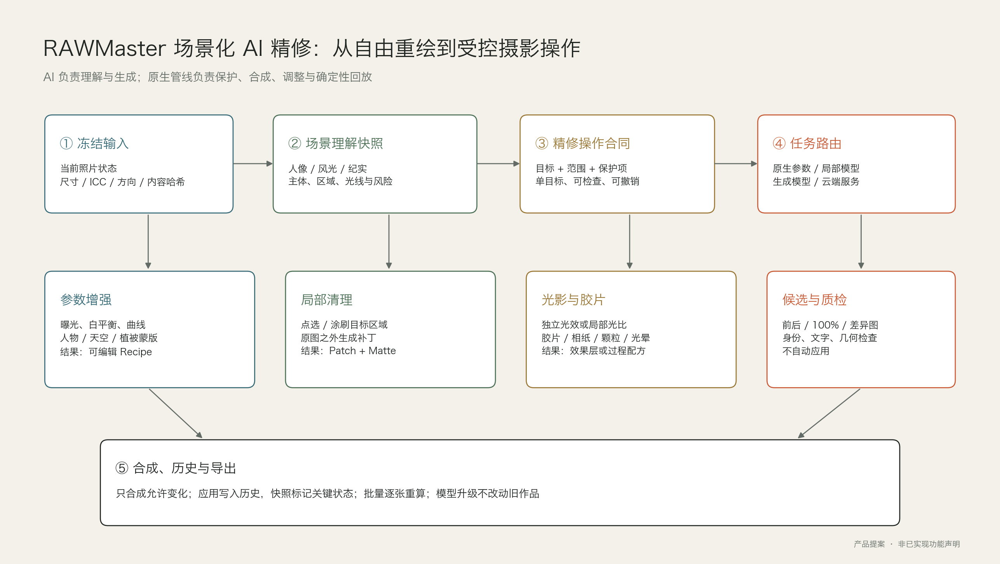

# RAWMaster 场景化 AI 精修产品规划

**2026-11-22 范围更新。** 本期右栏交付直接选择的智能预设。首批七张覆盖人像（逆光人物提亮、明暗黑白人像）、风光（天空压高光、暮色冷暖）、纪实（中性还原、克制黑白、同组参考配平）。[摄影社区调研](../research/photography-community-preset-styles.md) · [编码前体验设计](../../specs/030-ai-retouching/ux-design.md)。七张卡定位为 Adaptive。生成式路线包含跨场景去干扰、人像灯位／参考用光、五类风光风格迁移，独立走候选审阅。[用光与风格的规格](../../specs/030-ai-retouching/generative-editing.md) · [竞品、实测与归档图](../research/generative-retouching-field-review.md)。[五场景卡片与验收](../../specs/030-ai-retouching/scene-presets.md) · [030 产品规格](../../specs/030-ai-retouching/spec.md) · [联合研发计划](24-mask-preset-retouch-roadmap.md) · [生成模型实测](../../specs/030-ai-retouching/research.md)

日期：2026-11-21。状态：产品与技术路线提案，不代表功能已经实现或发布门已通过。本轮只形成规划，不修改生产代码、模型、资料库或安装应用。Patch＋Matte、胶片吞吐与五类场景实现的源码／实测依据见[实现复核](../research/dreamer-spektrafilm-implementation-review.md)；真实 A7R5 RAW 的 GPU、本地模型与 PixelPatch 续研见[续研报告](../research/ai-retouching-gpu-local-pixel-review.md)；FLUX.3 Klein 的 Q8 本机性能、原生 ROI 与低频光色 PoC 见[高分辨率实测报告](../research/flux3-klein-highres-poc.md)。

## 执行摘要

用户在编辑视图选择摄影场景和要解决的问题。右栏场景卡说明会改什么、范围在哪里、应保留什么。选区、亮度信息及用户选中的张数可以帮助排列卡片。执行从用户点选、调节或选取参考张开始。

采用后得到与任务相符的原生参数、可修蒙版或有序的局部补丁。原片、历史、快照和全尺寸导出沿用现有链路。低频光色、独立光效和完整胶片过程作为后续成像研究，分别验其色彩、尺度与回放。



## 1. 为什么现有方向需要调整

### 1.1 当前产品已经具备的正确底座

RAWMaster 当前以标题栏“资料库 / 编辑 / 导出”组织主任务；编辑视图内，左侧已经承载 RAW 摘要、滤镜、快照与线性操作历史，右侧承载具体调整工具。用户通过历史回退操作，通过快照保存和恢复关键状态，不需要再增加一套面向用户的“版本”导航。[编辑视图左侧栏](kimi-cite://text?path=%2FUsers%2Frobinqu%2FWorkspace%2Fgithub%2Frobinqu%2FRAWMaster%2FSources%2FRAWMaster%2FEditingLeftSidebar.swift&text=Filters%2C%20named%20snapshots%20and%20linear%20history%20share%20one%20vertical%20tool%20stack. "citation")

既有 AI 实验链路仍提供编辑意图、自由描述、本机或云端执行位置与生成候选；现有实现只有“自然增强、电影调色”两个提示配方，主体仍是文本框。[当前 AI 面板](kimi-cite://text?path=%2FUsers%2Frobinqu%2FWorkspace%2Fgithub%2Frobinqu%2FRAWMaster%2FSources%2FRAWMaster%2FNativeEditingViews.swift&text=Picker%28%22%E7%BC%96%E8%BE%91%E6%84%8F%E5%9B%BE%22 "citation") 请求模型也以 `prompt` 和供应商配置为中心，尚未表达场景、目标区域、保护合同或输出合成方式。[AIEditRequest](kimi-cite://text?path=%2FUsers%2Frobinqu%2FWorkspace%2Fgithub%2Frobinqu%2FRAWMaster%2FSources%2FRAWMasterCore%2FEditingModels.swift&text=public%20var%20prompt%3A%20String "citation")

这部分不需要推翻。底层档案与任务模型已经冻结输入、源快照、配方、供应商档案和实际图像产物，能够支持“候选不自动应用”和“旧结果不覆盖新草稿”。新一代设计应扩展业务意图，并把已应用操作接入现有历史与快照，而不是另建一套脱离作品档案的 AI 工具或重新暴露版本管理。

同时，原生初修已覆盖大量参数、修复和局部蒙版，滤镜系统正在收敛 hover、收藏、强度与暖预览性能。它们是场景化精修最重要的差异化资产：很多摄影调整根本不需要经过扩散模型，AI 只需决定“在哪里、用什么参数、做到什么程度”。[025 工作台范围](kimi-cite://md-line?path=%2FUsers%2Frobinqu%2FWorkspace%2Fgithub%2Frobinqu%2FRAWMaster%2Fspecs%2F025-editing-workspace%2Fspec.md&line=16&text=%E5%B7%B2%E5%AE%9E%E7%8E%B0%E5%8A%9F%E8%83%BD%E9%9C%80%E6%B1%82 "citation") [028 滤镜生命周期](kimi-cite://md-line?path=%2FUsers%2Frobinqu%2FWorkspace%2Fgithub%2Frobinqu%2FRAWMaster%2Fspecs%2F028-filter-experience%2Fspec.md&line=29&text=%E5%8A%9F%E8%83%BD%E5%B7%AE%E8%B7%9D%E7%9A%84%E4%BA%A4%E4%BB%98%E5%88%86%E5%B1%82 "citation")

### 1.2 自由 Prompt 的根本问题不是“提示词不够好”

已有实测已经显示，开放整图编辑会把色调、纹理、主体数量和场景尺度混在一次生成里。Klein 在自然增强中曾新增人物或动物；Qwen 系列虽然更好地保持主要构图，仍会重绘脸部、头发、衣物、羽毛和地面纹理。短指令能减少部分失败，却不能把整图生成变成无损调色。[模型实测与画面观察](kimi-cite://md-line?path=%2FUsers%2Frobinqu%2FWorkspace%2Fgithub%2Frobinqu%2FRAWMaster%2Fdocs%2Fplanning%2F18-comfyui-ai-backend-evaluation.md&line=32&text=%E7%94%BB%E9%9D%A2%E8%A7%82%E5%AF%9F%E4%B8%8E%E5%80%99%E9%80%89%E9%80%89%E6%8B%A9 "citation")

因此体验优化不能停留在“多准备几条 Prompt”或“增加强度滑杆”。通用强度没有稳定的跨模型语义，保护人物、只改光线也只是生成目标而非技术保证。真正的产品边界应建立在像素合成上：不允许改变的区域继续使用原图，允许改变的区域才接收候选；只加光时提取光效而不是覆盖整图；只调色时优先输出参数或胶片过程，不请求模型重画照片。

当前 018 已验证真实 RAW 到本地 AI 候选的工程闭环，但独立肤色、羽毛、文字、直线、逆光夜景质量评价未完成，本地模型商业许可与最低配置预算也未通过。这些边界支持“先收窄任务、再逐操作开放”，不支持扩大为任意摄影修图承诺。[018 验收边界](kimi-cite://md-line?path=%2FUsers%2Frobinqu%2FWorkspace%2Fgithub%2Frobinqu%2FRAWMaster%2Fspecs%2F018-native-editing%2Fvalidation.md&line=53&text=G2%20%E6%91%84%E5%BD%B1%E4%B8%8E%E8%89%B2%E5%BD%A9 "citation")

## 2. 两个参考产品真正值得借鉴什么

### 2.1 Dreamer：把生成变成可验收、可贴回的任务

Dreamer 围绕当前画面记录目标、作用范围、保护项与参考图用途。局部修饰可以读取已确认的选区，生成任务先确认范围，返回的结果可继续调整。发布包里人像和固定风格还有可直接运行的像素实现。[Dreamer 官方发布](https://github.com/2771096196/PSAI-Dreamer/releases/tag/v2.2.2-macos-arm64) · [固定版本源码复核](../../specs/030-ai-retouching/source-review.md)

| Dreamer 机制 | RAWMaster 应吸收的产品契约 | 不建议照搬 |
| --- | --- | --- |
| 整图 / 当前选区范围醒目 | 每次操作冻结目标范围；选区外默认保持原像素 | 把 PS 选区概念原样复制成另一套工具 |
| 单一修饰目标 | 每张卡对一个结果负责，用户可单独调强度与范围 | 把多个独立目标绑定为一次生成 |
| 生成前 Review | 在清理候选卡展示目标、保护区、实际裁片和费用 | 每个普通滑杆都要求额外确认 |
| 局部 / 整图 / 光效分别贴回 | 用 Patch、Light Layer、Full Image 区分风险与合成 | 所有候选都保存成扁平整图 |
| 已有结果可再次贴回 | 更换蒙版、强度或合成方式不重新生成、不重复计费 | 调整 Amount 就重新调用模型 |
| 本地校色、对齐与传统光效 | 能由确定性算法完成的步骤不消耗生成模型 | 所有摄影效果都包装成 AI |

对 RAWMaster，圈选、强度、检查区域和采用应直接体现在卡片和画布上。一个已选人物、一张参考照或一个涂抹区域就足以明确下一步。

### 2.2 SpektraFilm：风格是可解释过程，不是一句风格词

SpektraFilm 从线性、场景参考的相机图像出发，模拟负片曝光、显影、相纸打印与扫描，并把胶片、相纸、 coupler、颗粒、光晕、扫描锐化等放在不同过程阶段。它的重要产品价值是**同一风格具有稳定的内部结构和物理尺度**，而非仅把一张参考照片的颜色映成 LUT。[SpektraFilm 官方仓库](kimi-cite://web?url=https%3A%2F%2Fgithub.com%2Fandreavolpato%2Fspektrafilm "citation")

其 darktable 集成进一步说明了可用的产品分层：默认只选择胶片，相纸自动匹配，其余控制按胶片、打印、颗粒、光晕和扫描分组；画幅会影响颗粒与光晕尺度，数据包有固定身份，旧编辑不会因为下载新数据包而自动改变外观。[darktable SpektraFilm 文档](kimi-cite://web?url=https%3A%2F%2Fdocs.darktable.org%2Fusermanual%2Fdevelopment%2Fen%2Fmodule-reference%2Fprocessing-modules%2Fspektrafilm%2F "citation")

| SpektraFilm 机制 | 对 RAWMaster 的启发 | 首版界面表达 |
| --- | --- | --- |
| Film → Print → Scan | 风格是一条有序过程，不同控制不可混成统一饱和度 | 普通页只显示胶片、强度与输出预览 |
| 胶片默认匹配相纸 | 默认配方应由作者调通，而非从空白参数开始 | 相纸默认“随胶片”，高级页才展开 |
| 画幅与输出尺度影响颗粒 | 颗粒、光晕不能随导出尺寸简单拉伸 | 输出尺寸 / 画幅进入配方指纹 |
| Preview 与最终 Scan 分开 | 慢过程允许低成本探索，最终质量另行验收 | 复用交互代理与 canonical 导出分工 |
| 数据包身份固定 | 模型、胶片数据和算法升级不得重解释旧作品 | 保存引擎、数据包、参数和哈希 |
| 场景参考线性输入 | 胶片不是任意放在 sRGB 末尾的普通滤镜 | 明确接入点、色彩空间和 tone-mapper 顺序 |

许可必须作为独立发布门。SpektraFilm README 声明代码为 GPLv3，JSON profile 与 LUT 也有各自许可；不能因为“开源可参考”就直接把代码、配置或 LUT 复制进商业客户端。实施前应在“兼容开源集成、与作者合作取得授权、依据公开原理独立实现并完成法律审查”之间做明确决策，并将代码、数据和“方法启发”分别审查。

## 3. 新产品模型：场景、操作、保护、结果四层分开

### 3.1 场景不是滤镜分类，而是默认保护策略

在「编辑」右栏打开「智能预设」，选择人像、风光、纪实、街拍／旅行或建筑／城市。仅利用已经就绪的分析和用户选择显示建议原因，首次分析可以明确发起或跳过。切换场景改变推荐顺序，严格纪实仍由照片来源与策略决定。

| 场景 | 首要目标 | 默认允许 | 默认禁止 / 高风险 |
| --- | --- | --- | --- |
| 人像 | 身份与肤质自然，光线服务人物 | 曝光、肤色、局部清理、轻度肤质、分区光比 | 改脸、改五官、身体塑形、重画发丝与衣料 |
| 风光 | 空间层次、光色与材质可信 | 天空 / 植被 / 水面等分区、去雾、杂物清理、胶片 | 新增人物动物、改变山体与建筑几何、无提示换天 |
| 纪实 | 内容与事件真实，整组一致 | 裁切、曝光、白平衡、降噪、镜头与克制色彩 | 内容增删、生成式移除、换天、重构光线 |
| 街拍 / 旅行 | 现场氛围与画面干净 | 按纪实或创意模式选择；默认保留现场结构 | 未明确授权的路人移除、招牌文字变化 |
| 建筑 / 城市 | 直线、透视、材质与边界准确 | 几何、局部光比、玻璃反光与分区调整 | 生成式改变窗户、边缘、标识和空间尺度 |

“纪实严格模式”应是明确的产品模式，而不是一句 Prompt 保护词。该模式下生成式按钮不可用，操作历史可导出内容未增删的处理记录；若用户切换到创意模式，应显示明确状态，不把结果继续标为严格纪实。

### 3.2 一次精修操作必须有结构化合同

每个操作卡回答六个问题：**改什么、在哪里改、必须保留什么、由哪类引擎执行、返回什么形态、如何验收**。例如“移除背景右侧路人”对应目标 `remove`、范围为用户涂刷并扩展的物体及阴影、保护项为其余画面、执行类为生成式局部编辑、结果为 Patch＋Matte、验收为纹理 / 透视 / 接缝检查。

每张卡只暴露与摄影目的相关的控件，例如目标人物、保护区域、曝光量或参考张。生成引擎所需指令由已选清理操作和模板版本生成。

### 3.3 结果形态决定风险与可编辑性

| 结果形态 | 适用操作 | 可继续调整 | 主要保护机制 |
| --- | --- | --- | --- |
| Recipe Patch | 自动曝光、肤色、天空、植被、去雾、局部光比 | 原生滑杆、Mask、Amount、撤销 | 不生成新像素；全流程可重放 |
| Generative Patch＋Matte | 大面积移除、复杂补全、局部修复 | 范围、羽化、候选、合成强度 | 区域外原图；区域内原图与候选可控合成 |
| Generated Tone Field | 平滑整图光色、暖化、冷化、低频明暗氛围 | Tone Field Amount、sigma、候选、撤销 | 只迁移低频差分；原生高频来自原图，禁止语义与几何编辑 |
| Light / Effect Layer | 补光、轮廓光、局部氛围、可分离光效 | 光强、颜色、蒙版、高光保护 | 冻结原图，只叠加允许的新效果 |
| Film Process Recipe | 胶片、相纸、颗粒、光晕、扫描风格 | 胶片、强度、过程参数、输出尺度 | 不重画内容；数据包与算法版本固定 |
| Full Image | 换景、自由创意、强风格化 | 作为独立生成候选资产 | 默认不用于普通精修；明确高风险，应用后写入历史 |

## 4. 分场景能力规划

| 摄影场景 | 先解决哪件事 | 卡片与质量边界 |
| --- | --- | --- |
| 人像 | 使逆光面孔可读，或用黑白表现眼神和轮廓 | 「逆光人物提亮」「明暗黑白人像」首发。混光下用「肤色去偏」，「自然肤质」另验毛孔与妆容。多人要求在画布点选或手工作范围 |
| 风光 | 平衡亮天与前景，或加强原有的日落光色 | 「天空压高光」「暮色冷暖」首发，已有范围、渐变和画笔可离线完成。可选自动天空与「水面明暗」随后按类别开放。远山先手选，原尺寸检查山脊、倒影、树梢 |
| 纪实 | 既能解释一张照片的处理，也能交付一组一致的照片 | 「中性还原」「克制黑白」「同组参考配平」首发。按祖先来源审查严格纪实，换光张交给人判断 |
| 街拍／旅行 | 把人物从暗处提出来，同时保住环境文字和氛围 | 「人物融入环境」「夜街灯牌控光」复用局部调整。选区外的路人和店面可在原图对照中核查 |
| 建筑／城市 | 校正立面或整理窗内外明暗 | 「立面垂直校正」先展示网格与裁切。「窗景与室内光比」分层保护窗棂和标牌，专项样片通过后开放 |

Dreamer 的人像有可执行配方，风光与建筑主要提供保护指引，纪实有确定性风格。RAWMaster 自行定义纪实来源规则、旅行组合与建筑摄影验收。每张卡的触发条件、产物、手动替代、检查位置与负责人详见[场景预设产品规划](../../specs/030-ai-retouching/scene-presets.md)与[实现证据](../research/dreamer-spektrafilm-implementation-review.md)。

## 5. 编辑视图内的智能修图入口

### 5.1 右栏按摄影场景直接选卡

标题栏继续使用「资料库 / 编辑 / 导出」。左栏管理滤镜与已保存预设、快照、历史，右栏处理当前照片。画布承载人物点选、遮罩叠加、修边与前后对照。

```text
编辑 › 智能预设 › 人像
逆光人物提亮
目标     人物 1     在画布上更换
范围     人物蒙版   显示叠加 / 修边
调整     曝光       阴影
检查     背景高光   发丝与衣领 100%
操作     查看原图   应用到照片
```

若还没有范围，卡片提供「准备选区」和手工工具。右侧采用的蒙版可回到原蒙版面板编辑，保存为个人预设则出现在左栏。批量卡让用户选择参考张、要配平的字段和要采用的照片。「纹理区局部清理」从画布或相应场景进入独立候选审阅。[现有工作区与接入约定](../../specs/031-preset-browser/plan.md)

### 5.2 预览、候选、应用与历史

非生成操作直接复用滤镜的 transient hover / 键盘预览，点击后才写入历史；生成操作先冻结输入与范围，再创建候选。默认不追求一次生成多张，本地与云端都显示实际张数、输出尺寸和费用状态，用户可以追加候选而不是盲目重试。

候选检查提供四种固定视角：**前后、100% 关键区域、只显示变化、Mask / 接缝**。人物自动跳到面部和发丝 ROI，风光跳到天空边缘与建筑直线，清理任务跳到 Patch 边界。自动差异图只能帮助检查，不能宣称能可靠判断身份或新闻真实性。

用户确认候选后使用“应用到照片”。应用会产生一条历史记录，例如“智能修图 · 移除背景路人”，并保存该操作所需的不可变输入、候选资产、Mask 与合成配方；点击历史可回到操作前后，需要长期标记时再显式创建快照。未被选择的候选留在本次生成记录中，不进入左侧快照或历史主导航，也不形成用户需要管理的“版本”列表。

单张参数型场景卡采用时写一条可展开的历史。批量按照片分别记录实际完成的应用与跳过原因，异步清理只在明确采用候选时写入。恢复历史读取配方、确认蒙版与已归档候选。

对已有候选调整 Mask、光效强度、胶片强度或校色不应重新生成；这些后续调整分别形成新的历史项。只有目标语义、模型输入或必须重绘的内容变化时才创建新生成任务。

### 5.3 模型与服务选择降级为执行详情

普通界面显示“本机 / 云端、预计等待、实际输出尺寸、费用状态”，不要求用户理解 sampler、VAE、步数或量化。每个操作配方维护已验收的引擎路由，例如原生 Metal、Vision / Core ML、本地 Comfy / MLX、云端编辑服务。高级详情可以查看实际模型与版本，但“更强模型”不能绕过该操作的质量和许可门。

本地失败不自动切云；云端不自动扩大上传范围。整组批处理不得因为其中一张失败就把全部照片切换到另一模型，否则同一组会出现不可解释的风格差异。

## 6. 配方与运行时架构

### 6.1 建议的业务对象

```text
SceneAnalysisSnapshot
  scene / confidence / evidence / subjects / regions / lighting
  sourceContentID / analysisInputVersion / modelIdentity

OperationPlan                         // 从已选场景卡和当前照片生成
  planID / scenePolicy / baseRevision / operations / protection
  previewKind / executionClass / providerPolicy / promptTemplateVersion

RetouchOperationSpec
  intent / target / protection / outputKind
  nativeRecipePatch / semanticMaskDescriptors / filmRecipe

PixelPatchOperationV1                 // 本地／云端共用新增像素合同
  id / kind / sourceBinding / sourceGeneration / baseRecipeFingerprint
  candidateArtifactRef / nativeSize / colorSpace / alphaPolicy
  matteDescriptorRef / confirmedMatteSnapshotRef
  roiInOrientedSource / resamplingChain / blendMode / opacity / enabled
  provider / modelIdentity / promptTemplateVersion / candidateID / qualityReview

GeneratedToneFieldOperationV1         // 仅平滑光色，不承载语义／几何编辑
  id / sourceBinding / sourceGeneration / baseRecipeFingerprint
  lowResolutionInputRef / lowResolutionCandidateRef / colorSpace
  blurSigma / resamplingChain / amount / enabled
  provider / modelIdentity / promptTemplateVersion / candidateID / qualityReview

RetouchPass
  operationSpec / historyItemID / candidateArtifactIDs
  selectedCandidateID / compositeRecipe / actualOutput / cost / provenance
```

像素生成请求由卡片 ID、版本、目标与范围确定。`operationSpec` 保存具体的字段和保护规则，模板指令留在生成适配器内部。采用时把候选资产的不可变引用及合成参数关联到照片历史，用户可以继续更改羽化和强度。

Patch 首版可以是完整候选帧＋Matte，由合成器保证区域外不变；ROI 裁剪同时是存储／性能优化和原生高分辨率生成路径。现有小尺寸 `DevelopmentPatchReference` 不直接承担完整生成候选的资产预算；PixelPatchOperation 使用独立的内容寻址档案与资源上限。GeneratedToneFieldOperation 保存低分辨率输入／候选和差分参数，不保存一张无法解释的扁平 Full Image；Amount 调整只重放合成。AI Mask 使用“语义描述＋已确认快照”：预览、重放和导出读取同一快照，新建、同步到另一张照片或用户显式刷新时才重新推理。胶片和生成模型也遵循同一原则：模型或数据包升级不自动改变旧作品，刷新必须产生新历史项。

### 6.2 原尺寸与色彩按编辑类型路由

当前 AI 输入约 1MP，TIFF16 容器也不能把 8-bit 生成结果变成原始 16-bit 细节。首个生成式局部版本可以只开放经过验收的预览或限定区域，不应把插值回 RAW 尺寸冒充原尺寸精修。FLUX.3 Klein 官方最高 4K，本机 Q8 实测 1024² 编辑为 188.0s、1008×672 光色编辑为 96.1s，明确属于异步任务而不是普通滤镜。[FLUX.3 本机实测](../research/flux3-klein-highres-poc.md#3-本机真实速度与内存)

**局部内容增删优先使用原生 ROI＋PixelPatch＋Matte。** 本次已在 61MP 工作图上验证候选无重采样贴回、区域外 8-bit 最大差为 0 和确定性回放；但候选把 5 只鸟生成为 6 只并重绘太阳、云层和地平线，宽幅羽化后出现明显矩形区块。因此工程承载方式成立，模型质量门未通过，区域外不变不能替代区域内语义、纹理和接缝验收。[ROI 与 PixelPatch PoC](../research/flux3-klein-highres-poc.md#4-poc-a原生-roi-生成pixelpatchmatte)

**平滑整图光色可以使用低频生成差分＋原生细节保留。** 1008×672 候选只负责光色决策，系统将模糊后的差分场应用到原生 RGB；对最终量化 8-bit 输出的高频平均绝对差为 \(6.5302×10^{-5}\)，一张样本的构图与地貌在审阅尺度保持。它只能处理平滑光色，不能用于物体增删、身份或精确几何；当前 Python 后处理与 PNG 写出首轮另需 52.7s，生产 Metal／ICC／16-bit 路径仍待验证。[Generated Tone Field PoC](../research/flux3-klein-highres-poc.md#5-poc-b低频生成差分原生细节保留)

**整图结构重绘仍需要独立的后置研究。** 低分辨率全局指导、重叠分块、接缝检测、EXIF 方向与裁切映射、ICC / alpha 策略和全局一致性尚未完成实际 PoC，不能从单个 ROI 的成功外推。Dreamer 已把“原尺寸分块、预览分辨率、缓存复用、文档位深与颜色配置”作为独立工作流，而非普通生成参数，这一点应与 RAWMaster 的 canonical 导出共同设计。[Dreamer 原尺寸与贴回](kimi-cite://web?url=https%3A%2F%2Fthoudreamer.com%2F "citation")

### 6.3 SpektraFilm 必须采用双速渲染，而非直接接入参考管线

不能把 SpektraFilm 简单当作现有九个 LUT 滤镜后的第十个 LUT。其过程需要明确的场景参考线性输入，并在部分集成中承担 tone mapper 角色。RAWMaster 应先验证“RAW 显影 → 场景参考工作空间 → 胶片 / 打印 / 扫描 → 显示参考输出”的阶段位置，以及与现有曝光、曲线、Mask、颗粒、光晕和导出的顺序，避免重复 tone mapping 或重复颗粒。

本机固定版本实测中，640px 预览暖中位数约 194ms，6MP 完整处理约 10.0s，24MP 约 42.4s，不能直接承担滤镜交互。真实 A7R5 RAW 续测进一步得到：约 61MP 完整参考管线约 107.17s，Numba CPU LUT 约 683ms，Core Image GPU LUT 约 20.7ms；2400×1600 GPU 预览约 1.80ms。GPU 与 CPU 三路线性结果的 8-bit 最大差为 1，但这仍不是 RAWMaster 生产画布或完整胶片效果通过证明。[实现与吞吐复核](../research/dreamer-spektrafilm-implementation-review.md#3-spektrafilm-执行吞吐与滤镜资格) [A7R5 续测](../research/ai-retouching-gpu-local-pixel-review.md#2-a7r5-实测结果与-gpu-优化路线)

胶片滤镜应采用以下两级路径：

1. hover／Amount 使用预热 LUT 或 Metal 等价路径，只承诺颜色与明暗基础预览；LUT 烘焙和预热不得在连续浏览时同步发生。
2. 点击后保留 last-known-good，并异步生成包含颗粒、halation、coupler 与扫描质感的 settled 结果；导出使用固定参数、随机种子和数据包的 canonical 路径。

SpektraFilm 的 `preview_mode` 和 `lut_mode` 会关闭若干空间、随机或全图效果，因此快速预览不能冒充完整结果。若某配方的预览／完整质感差异未通过验收，该配方只能先进入智能修图的异步操作，不能进入普通滤镜目录。

## 7. 批量与个人配方

批量精修分两级。**同源配方**复制参数、操作目标和风格，但每张重新分析 Mask 与场景；**同组一致性**额外选取一张用户已确认的参考照片，约束后续照片的曝光、白平衡、肤色或胶片强度范围。生成式 Patch 仍逐张人工复核，不做无人值守自动应用。

用户应用结果后，可以把当前操作保存为“我的精修配方”。配方保存场景适用条件、操作子集、默认保护和作者信息，不只保存最终 Prompt。用户对候选的保留、放弃及返修原因可用于改进本地推荐排序，但默认不上传原图或私人反馈；模型学习与云端同步另需明确授权。

滤镜侧的收藏、目录和 Amount 可以逐步扩展到胶片与个人配方，但要区分三类对象：普通 Recipe Preset、带语义 Mask 的 Adaptive Recipe、包含生成操作的 Retouch Recipe。后两者不能只复制静态参数，导出 Lightroom XMP 时也必须列出无法兼容的部分，不能把 AI 操作伪装成 Adobe 可重放字段。

## 8. 分阶段路线图

| 阶段 | 交付结果 | 放行依据 |
| --- | --- | --- |
| D0 | 评审七张卡、左栏预设、蒙版修边和组照交互及视觉稿 | 设计走查、键盘和最小窗评审完成后进入新增功能编码 |
| R1 | 三场景七张卡、旧配方回放、可修蒙版和纪实参考张入口 | 单张节时、无模型风光、严格纪实、组照复核、三场景选卡均可独立演示 |
| R2 | 为天空卡增加可选自动范围，新增水面、肤色与街拍卡。自然肤质、远山、建筑按卡做专项试用 | 自动类别须有正负 RAW 样本、边界质量与手工对照。几何和文字在原尺寸导出检查 |
| G1（承接 R3） | 跨场景去干扰，先做污点和简单背景遮挡，反光与瑕疵分别验证 | 029 标记／有序修复，逐图检测，原尺寸接缝、硬保护及离线回放 |
| G2 | 人像按灯位预设或独立参考换光；局部补光继续由原生卡交付 | 换灯实拍对，光向、投影、同一人和衣物文字对拍 |
| G3 | 五种风光按场景匹配摄影风格，以湖泊和城市先验参考迁移及同底模风格包 | 摄影作品依据、权重权利、同底模开关对照、地形与物体核对 |

胶片基础色调与完整质感沿用 031 的预设和成像专项。按 028 的窗口与辅助功能口径验收左栏。跨团队任务、依赖和回退条件见[联合研发计划](24-mask-preset-retouch-roadmap.md)。

## 9. 质量指标与发布门禁

按预设记录首次可用率、主动操作与等待时间、手工修边、保护区变化及导出一致性。生成另记录候选的拒绝与重试。使用独立冻结的样片和评分表，按 030 SC-01 至 SC-05 与 SC-07 判定。[验收指标](../../specs/030-ai-retouching/spec.md)

| 质量域 | 必测样本 | 必须记录的失败 |
| --- | --- | --- |
| 人像 | 不同肤色、年龄、多人、侧脸、遮挡、发丝、妆容、衣料、逆光 | 身份变化、蜡像皮肤、毛发 / 五官 / 衣服重绘、边缘渗漏 |
| 风光 | 树叶、电线、低对比天空、水面、雪景、建筑、夜景、高 ISO | 新增主体、重复纹理、天空光晕、直线 / 山体变化、过度饱和 |
| 纪实 | 事件连拍、人群、标识文字、混合光、整组导出 | 严格模式下任何内容增删、文字变化、组内不一致 |
| 局部 Patch | 简单与复杂背景、阴影、反射、规则纹理、边缘接触主体 | 接缝、透视错误、影子遗留、区域外像素变化 |
| 光影 | 单 / 多光源、轮廓光、透明与半透明边缘、高光 | 光向冲突、脏边、高光爆掉、原图细节被覆盖 |
| 胶片 | 灰阶、ColorChecker、肤色、蓝天、绿色、高饱和、多个输出尺寸 | 重复 tone mapping、色域截断、颗粒随尺寸错误、旧配方变色 |
| 工程 | RAW / JPEG、方向、裁切、ICC、alpha、取消、断网、恢复、模型缺失 | 晚到覆盖、自动应用、重放漂移、未知结果重复计费、资源未汇合 |

每个生成操作至少要有“区域外不变”的像素验证；涉及人物身份、文字或几何的自动检测只能作为风险提示，最终仍需 100% 人工检查。发布材料必须区分“已验收操作”“实验操作”和“不支持的创意任务”，不能用某一个成功案例代表模型普遍可靠。

## 10. 实施入口

场景卡由 030 管理，个人预设及目录由 031 管理，两者共用已有编辑与采用链路。每项卡片达标后单独开放，摄影师可以在同一画布微调或退回手工调整。[卡片产品规划](../../specs/030-ai-retouching/scene-presets.md) · [精修任务清单](../../specs/030-ai-retouching/tasks.md) · [滤镜预设规格](../../specs/031-preset-browser/spec.md)
