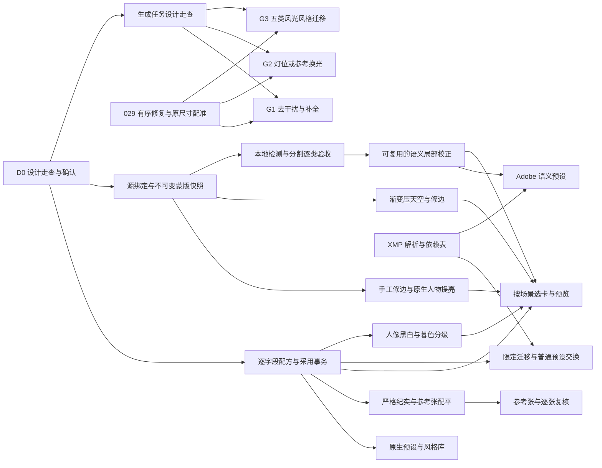

# RAWMaster 联合研发计划 · AI 蒙版、滤镜预设与 AI 精修

2026-11-22 · 031 滤镜预设、027 AI 蒙版已交独立 Release · 030 已归档待研发

滤镜预设和 AI 蒙版已可在主工作区的独立 Release 包试用。编辑器相关功能回归 94 项、独立 MaskAI 功能回归 27 项全部通过。负责 Camera Raw 基础编辑的会话交付对齐结果后，再将两项功能接入该版本并执行联合性能验收。[功能、实测与试用入口](../../specs/031-preset-browser/feature-validation.md)

智能修图本轮交付产品、交互、技术和 PoC 的本地规格。下文三场景首发、批次与人力估计供后续 030 启动时使用。参见[集成验收单](../../specs/031-preset-browser/integration-validation.md)与[智能修图交接](../../specs/030-ai-retouching/handoff.md)。

Agent 对话式修图已移出研发排期。右侧「智能预设」通过选卡、点选范围、参数调节和参考张选择完成精修。

后续 030 首批使用已交付的左栏，在右栏提供人像、风光和纪实共七张智能预设。 人像可选局部补光或明暗黑白，风光可选压天空或调暮色，纪实可选现场彩色、黑白或参考张配平。三类场景均可在本地离线完成。左栏已可预检和迁移第三方资源。后续批次按导入的内容逐项扩大适用面，并以现有天空、水面选区制作新卡。组照例外直接在参考张预设的逐张清单处理。另设去干扰、人像换光与五类风光风格迁移三条研发线。首批七卡属于 Adaptive；各生成任务在设计与画质验收后独立开放。[生成专项规格与样稿](../../specs/030-ai-retouching/generative-editing.md)。景深和 RAW Profile 继续按原专项验收。[预设产品规格](../../specs/031-preset-browser/spec.md) · [五个摄影场景的卡片目录](../../specs/030-ai-retouching/scene-presets.md)

## 三个入口各解决什么问题

| 用户从哪里开始 | 用户拿到什么 | 同一份工作的后续入口 |
| --- | --- | --- |
| 左栏「滤镜与预设」 | 搜索、收藏、临时试看、套用、保存。首发有原片和九个 Classic Filters，以及可调整强度的原生子集预设。迁移后逐项解释支持程度 | 用户修改过的风格可保存为新版本。已保存的「压天空」引用语义目标。点击它会打开本张已有选区，或由用户发起准备 |
| 现有蒙版面板与画布 | 看见实际覆盖，选择人物、反相为背景、画笔加减或组合区域，调整曝光/颜色。选区、手修和强度都能重开 | 右栏「逆光人物提亮」得到同一层可手改的调整。应用到下一张时重新找人，保留可重复使用的参数 |
| 右栏「智能预设」 | 人像、风光、纪实、街拍／旅行、建筑／城市按可用能力出卡。拍摄者选择任务、在画布定范围，直接预览参数。纪实卡可指定参考片，列出换光等需要判断的照片 | 批量逐张接受或跳过，严格纪实保留记录。普通创作版本中的去干扰、人物换光与风光重绘分别审阅候选，明确采用后写入本张有序修复记录 |

一次有变更的采用只写一条历史，带命令 ID 和所需的冻结资产。批量采用按照片独立结算，失败张可以重做。目录收藏属于用户，编辑历史属于照片。两个面板只持有工作中的选择或预览意图。[编辑工作区](../../specs/025-editing-workspace/spec.md) · [共享数据契约](../../specs/031-preset-browser/plan.md)

## 立项时的证据与投入依据

| 板块 | 当前证据 | 据此安排的第一笔开发投入 |
| --- | --- | --- |
| 编辑与渲染 | 固定滤镜已有主图 hover、收藏、九种风格、canonical 输出。028 暖 AppKit p50/p95 为 27.367/34.061 ms，目标 20/33 ms。工作树已有八色 HSL、更多局部参数和设备深度散景。固定 Sony 样片的实验性同核心 FlashRaw 代理/全尺寸对照 p99 通道差为 2/255，相对 CIRAW 全尺寸为 72/255 | 改造现有左栏与呈现协调器，补窗口验收。任何需要几何或高精度色彩一致的工作先固定解码器、输入矩形、位深与 ICC，分开验证代理和真实导出。[028 验收](../../specs/028-filter-experience/validation.md) · [近期渲染数据](../research/camera-raw-parity/performance-data.json) |
| AI 蒙版 | 026/027 有可运行的本地服务和不可变快照。独立套件 27 项通过。一次真实 RAW 从已备分析代理起算，主体冷建 1.58 秒、快照命中 1.77 毫秒。当前生产主体为合并的 Vision 结果。标注样本的天空/水面/山体平均 IoU 各为 0.822/0.956/0.343 | 先做真实覆盖、修边和冻结回放，再将检测、分割和缓存接入主工程。主体/背景可先走系统 Vision，明示多人合并。天空、水面与人物部位逐类取样，远山自动选区暂留实验。[独立套件](../../specs/027-mask-ai-raw-integration/service-validation.md) · [性能快照](../../experiments/MaskAI/Validation/Performance/performance-results.json) · [分类实测](../../specs/030-ai-retouching/mask-validation.md) |
| 滤镜与预设 | 两个源根实核 78 个 XMP、72 个可浏览条目。19 个普通项均有 Look 或相机基底依赖。内置 53 个的构成为 38 项语义、13 项景深、2 项 Adaptive Profile | 原生保存与可解释迁移先产生价值。以自制 Basic XMP 贯通严格读写。按实际资源逐项升级支持，以独立的 RAW Profile 和深度样片验收复杂项。[迁移与依赖核验](../../specs/031-preset-browser/validation.md) |
| AI 精修 | 1MP 配对实验中，FLUX.3 Q8 本机 MLX 单次 153–210 秒，Seedream 5.5 北京端点单次至本地写图约 10–15 秒。两者均能清理湖面目标，也都在补光时重画了面部细节 | 人像补光、风光光比、纪实配平均交给原生参数与蒙版。需要新像素的任务分成 G1/G2/G3。后续本机试验中，三次本机人像换光都没达到指定方向，湖景蓝调改变了右上云纹。北京 5.5 双输入的人像和湖景分别耗时 10.82／13.31 秒，人像同样未得到指定光向。将这些样例纳入首轮拒收演练。[新增实测](../research/generative-retouching-field-review.md)。[生成对照](../../specs/030-ai-retouching/research.md) · [Dreamer 场景配方与验证](../../specs/030-ai-retouching/source-review.md) |

## 迭代顺序与交付责任

031 与 027 的独立功能、基础编辑交付、联合验收是当前三个连续里程碑。下图与批次表说明后续智能修图的技术依赖。届时 D0 先确认对应设计，再安排各条路径。左栏与各项技术可独立试用；对外称为首批智能预设时，三场景七张卡都要通过验收。[社区取样](../research/photography-community-preset-styles.md) · [体验、视觉和走查脚本](../../specs/030-ai-retouching/ux-design.md)。角色用于认领工作。首轮以两周为一个复盘周期，耗时从领取工作计算。样片取得时间、目标机内存、Adobe 实机与成像专家容量在第 0 批登记，届时再估各专项日历日期。

| 批次与主责 | 进入条件、工作项 | 可验收的交付物与放行决定 |
| --- | --- | --- |
| **D0 · 编码前设计评审**。产品、设计主责，成像、编辑器、QA 会审 | 030 T023 交社区选型、七卡、交互与视觉稿；T020 用人像、无模型风光、纪实组照及左栏样片做人机走查 | 按 UX-D0 逐项记录是否通过、阻塞点、复测与负责人。后续代码只在相应设计决定完成后启动 |
| **0 · 基线与夹具**。Core、QA、Imaging | D0 期间可冻结样本、记录既有行为。通过设计评审后做 031 T002/T003、030 T005 的身份与源坐标约定和 028 T-021/T-023 复测。QA 冻结同一旧工程、61MP Sony、竖幅/镜像 RAW、JPEG、双人/无人物、天空/无天空、12 张换光序列和缺档的迁移库。记录授权及原始哈希，难取得的专项样片单列 | 以一份自有稀疏预设和一个旧主体 PNG 给三个团队建立共同夹具，记录现有临时预览与一次采用的可观察结果。产出当前窗口/引擎基线和每类样片清单。未取得原尺寸人像/雪景只推迟相应类别 |
| **1A · 试风格、存自己的预设**。编辑器主责，Core/Imaging 配合 | 031 T003–T008。先交 Classic Filters 与搜索收藏，再交原生子集、Amount、Undo 与重开。依赖新的字段/事务接口和既有 028 hover | 真实窗口用键盘选风格并撤销，打开 1,075 行目录产生的滤镜缩略图请求为 0。保存 50% 强度后换片不破坏原调整。窗口和辅助功能未达门时可先内测，默认入口的切换由 028 T-021/T-023/T-025 和 031 V1/V2/V5 决定 |
| **1B · 修好本张人像**。蒙版/Imaging 主责，编辑器配合 | 030 T005 → T006 → T007。先打通系统 Vision 主体/背景和画笔加减交，配合 030 T017 的右栏直接入口，让「逆光人物提亮」写入同一命名蒙版与原生曝光；T021 交「明暗黑白人像」及可调混色。多实例无法区分时要求确认范围 | 摄影师能看见、修正发丝/衣领、调强度、撤销并断网导出。至少 6 名摄影师做人像手工对照，时间中位数缩短 ≥30%，盲评可交付率持平或更高。与 1D 的风光手工任务分别计时、盲评。模型快照命中点选 p95 ≤250 ms，暖滑杆 p95 ≤50 ms。按所用路径实测，低内存与冷启动另记 |
| **1C · 纪实参考张配平**。Core/策略主责，精修编辑器配合 | 030 T008 → T009，配合 030 T017 首批卡片。先交「中性还原」「克制黑白」，再由「同组参考配平」计算逐图曝光/白平衡，显示参考、可采用、换光待复核与跳过。复用采用记录，最小版本仅含全局参数，可与 1B 并行 | 12 张混合光线任务主动时长中位数较手工缩短 ≥30%。换光、缺人、已含内容改写的来源可逐项查看或跳过。严格模式内容改写执行 0 次，跨片位图复用 0 次。单张/批量有回执且可撤销 |
| **1D · 修好本张风光**。成像与编辑器主责，QA 配合 | 030 T022＋T017。已有手工范围或线性渐变＋画笔接局部高光；暮色接原生阴影／高光色轮。自动天空可随后接入同一张卡 | 断网且未装可选模型也能完成两卡并撤销。天空在边缘、剪切、无天样本上验收，暮色复核冷暖与倒影。与 1B、1C 一同完成三场景 SC-07，再发布首批智能预设 |
| **2A · 迁入和交换**。Core/格式主责，QA 配合 | 解析与 fixture 可在第 0 批后开始。031 T009 → T010 负责迁移，T009/T011 → T012 负责普通 XMP。开放迁移依赖全局内容库，开放应用依赖字段映射 | 有实际计数、逐项依赖、重启续办/去重和撤销。基础 XMP 在 Lightroom Classic 回读，用户清楚哪些项只可浏览、哪些字段可显式部分应用。导出优先保真度已验证的组。[验收 V3/V4](../../specs/031-preset-browser/validation.md) |
| **2B · 分区与可复用语义预设**。AI/蒙版主责，Core/格式配合 | 027 T08–T10 与 030 T010/T011 接入同一本地服务，031 T013/T014 和 030 T018 共享快照。先主体/天空各贯通一个 Adobe 样本，再做 18 个 Subject/Sky 的字段覆盖。风光的水面、山体和肖像部位分批评审 | 支持的目标从任一入口得到同一编辑结果。无目标提示跳过，多人要求选人。每类有正负 RAW 标注、边界、100% 原尺寸审阅和手修耗时。未达标类别可手选范围执行原生预设，导入项保留限制原因 |
| **分项扩展 · 其余场景卡**。精修编辑器、Imaging、QA | 030 T018 在 2B 的主体/天空/水面之后，分项试用肤色和街拍／旅行卡。030 T019 用独立样片核对自然肤质、远山和建筑／城市两项。复用右栏入口、局部算子与几何控制 | 街拍检查人物环境关系和招牌文字，建筑检查窗框直线、可用裁切、窗内外光比，肤质检查毛孔和妆容。按每张卡的适用条件开放，未达标样例保留手工入口。[预设目录与验收](../../specs/030-ai-retouching/scene-presets.md) |
| **G1 · 去干扰与局部生成清理**。Imaging/修复主责，AI 适配器开发配合 | 029 有序修复节点 → 030 T013 原尺寸 Patch/Matte 与回放 → T014 北京 Seedream 5.5 或 T015 可选本地 ComfyUI/FLUX.3 → 每引擎各做 T016。留出集可提前采集 | 纹理清理每个拟开放任务 ≥30 张留出图、两位评审共同接受首候选 ≥80%。保护区变化、身份或文字失真拒收。核对实际裁片授权、费用未知恢复、原尺寸导出、离线重开。未通过的引擎或任务继续关闭 |

**生成专项的开工顺序。** 产品／设计先完成 030 T025，QA 与摄影师同时准备留出 RAW。029 与蒙版工程在 T026 交付可保留、可复用的干扰标记，T027 分别验证污点、路人遮挡、玻璃反光与面部瑕疵。在共享 T013 补丁合同上，摄影棚与成像领取 **G2／T028**，用同机位换灯与独立参考验收光向；内容与模型工程领取 **G3／T029**，按雪山、森林、城市、湖泊、海边登记摄影依据与权重，优先试湖泊和城市。T030 验证每个后端的输入角色，T031 以 SC-08/09/10 逐类决定试用，退出一项不阻塞另外两项。严格纪实延续原生白名单。成本与日期在样片和人力确定后排。[专项任务与依赖](../../specs/030-ai-retouching/tasks.md) · [摄影师与风格配置](../research/landscape-photographers-and-lora.md)

**成像专项可平行领取。** 031 T015 先验静态 Look，能解除 12 个普通预设的库内依赖，仍要逐项验证其余字段。T016 用现有设备深度和散景核对 13 项 Lens Blur。T017 的 RAW 前端、DNG 表重放、SDR/HDR、逐图生成和 AP12 导出分别审查。三项均可在取得对应样本后开始准备，任何一项的结论只影响该类资源。胶片质感先验确定性基础色调，颗粒与光晕按全尺寸结果另行收录。[预设专项任务](../../specs/031-preset-browser/tasks.md) · [胶片与 GPU 的既有证据](../../specs/030-ai-retouching/source-review.md)

**030 后续排期假设。** 027/031 完成联合验收后，再决定 030 的实际启动日期。假设 Core、编辑器、Imaging/AI 各有一位可投入的工程师，QA 与摄影师能参与复盘。先完成 D0，再启动工程迭代。首个两周以旧片回放、左栏与三场景的可操作切片为演示目标。第二个迭代安排 1A/1B 的窗口与导出验证、1D 的无模型风光验收和 1C 的 12 张参考组对照。下一轮通过 R1 验收后再扩 2A 迁移、2B 自动类别。若只有一条工程线，按配方与采用、三场景原生卡、参考张例外、外部格式与模型的顺序实施。以上是容量假设，D0 走查与实拍验收日期待排。

## 共同接口与上线责任

| 交接 | 交付方 → 消费方 | 用什么证明能接 |
| --- | --- | --- |
| 配方、版本与策略 | Core → 目录、蒙版、场景卡、参考张批量 | 省略与显式零、同一修订采用两次只记一次、过期计划拒绝、撤销/重开、批量分张结算。明确列出工具、来源、排除字段，严格纪实沿祖先链检查克隆与生成 |
| 分析、快照与坐标 | 027/030 → Imaging、031、逐图预设 | 每个目标带源/方向/有效区域、实际依赖的模型哈希和算法版本。手工修正引用冻结快照，取消无残留。快照、场景概率、对象 embedding 分开计数。跨片只传语义/参数，原片缺目标有回执 |
| 临时显示与成片 | 编辑器/Imaging → 三个入口及导出 | 只有当前源、修订、展示代次与 token 匹配的帧可显示。锁定前缀、色彩和几何后分别核对 FlashRaw 代理、全尺寸预览、配方重算导出和归档导出。单独启用局部节点时，在相同坐标和色彩空间比较其输入与输出，遮罩为零处的像素差须为零 |
| 资源与恢复 | 存储/AI → 历史、导出、批处理 | 原始 XMP、快照、静态表和生成候选以类型、版本、SHA 分开持有。删除目录项、卸载模型、更新映射器后旧作品仍能离线导出。远端接单状态未知时保留回执，重复采用不重复写入 |

## 后续启动 030 时的领工单

| 开工顺序 | 谁来做 | 评审时现场演示 |
| --- | --- | --- |
| 对应设计评审通过后的第 1 天 | QA/摄影与 Imaging 领取 031 T002、028 T-021/T-023。Core 领取 031 T003，蒙版开发领取 030 T005 的旧 V3 兼容和源绑定 | 用同一张 Sony 复现窗口基线，用两张换位照片说明哪些值能复制、哪些必须逐片计算。冻结首批样片并标记仍欠的原尺寸素材 |
| 第一份接口评审后 | 编辑器领取 031 T005，存储领取 T004，蒙版画布领取 030 T006，精修策略领取 030 T008，右栏按 030 T017 接入同一采用接口，成像同步领取 T021/T022 的黑白人像、天空与暮色样片。格式开发有容量时可独立启动 031 T009 | 曝光预设 hover 后离开，磁盘与历史零写入。旧主体 PNG 上画一笔减选可撤销。严格纪实接到含克隆的草稿，执行次数为 0 |
| 生成专项的首轮，和原生卡并行 | 产品／摄影领取 T025，以真实坏例确认灯位、参考用途和允许改写的区域。029 领取 T026，棚拍和风光内容分别为 T028/T029 冻结实拍对、夜景文字和船客保护样本 | 摄影师在样稿中拒绝一张错光候选、一张重画云或列车的候选。团队按该专项的样片、保护渲染节点和运行时选定下一轮实验 |
| 迭代复盘 | 产品、摄影、QA 共同看 1A/1B/1C/1D 首次端到端样例，由各主责分别登记结果 | 用三场景七张首发卡核对原尺寸成片、真实等待与主动操作时长、撤销和断网回放，同时按 030 SC-07 记录错选卡或错看作用范围的步骤。合格增量独立进入内测，记录阻塞的具体样片、资源或指标，再排下一批 |

验收资料按能力列出源哈希、软件/解码器版本、硬件、样本数、冷暖口径、原始指标和失败例。支持表是发布开关的依据。发现回归时只关闭有问题的映射、类别或生成服务，旧配方按冻结资产回放，目录可切回既有固定滤镜入口。产品负责摄影师节时与可交付率，QA 负责独立复算与实机签收，各技术主责负责对应路径的成片与恢复。[031 验收矩阵](../../specs/031-preset-browser/validation.md) · [030 效果与恢复标准](../../specs/030-ai-retouching/spec.md)
