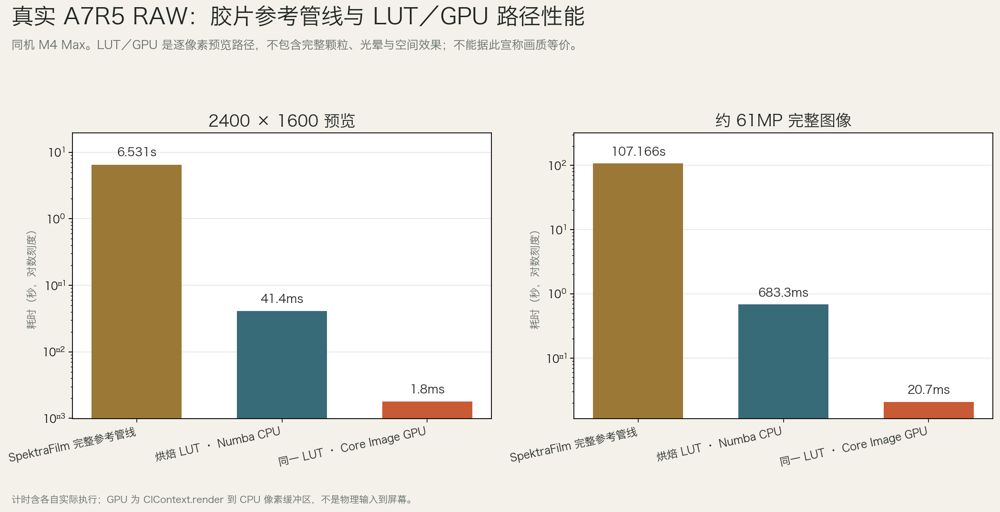

# RAWMaster 智能修图续研：A7R5 胶片 GPU 实测、本地模型与新增像素合同

日期：2026-11-21。范围：在上一轮的 Dreamer／SpektraFilm 实现复核基础上，进一步验证胶片模拟的真实 RAW 性能与 GPU 路径，评估本地模型替代云端图片 API 的可行性，并为 RAWMaster 设计支持生成式新增像素的最小产品／渲染合同。本轮使用独立研究代码和资产，没有修改生产源码、真实资料库或安装应用。

## 执行摘要

**胶片 GPU 路径已经在真实 A7R5 RAW 上验证可行。** 对同一张 Sony ILCE-7RM5 RAW 的线性 ProPhoto 显影结果，完整 SpektraFilm 参考管线在约 61MP 上耗时 107.17s；烘焙 LUT 的 Numba CPU 热执行为 683ms；同一 LUT 经 Core Image `CIColorCube` 的 GPU 热执行为 20.7ms，2400×1600 预览则为 1.80ms。原生 GPU 路径有明确的滤镜吞吐潜力，但完整颗粒、光晕和空间过程仍需另行实现或异步渲染。

**Dreamer 不是纯 API 产品。** 它的快捷生成主要走云端模型，但发布包同时包含本地选区模型和 ComfyUI／Klein LoRA 厚涂流程。RAW​​Master 的本地生成可以继续使用现有 ComfyUI／MLX worker，但本地模型只能按操作逐项验收，不能把“本地可运行”当成“可以无损替代 GPT Image”。

**RAW​​Master 不需要引入完整 PS 图层系统。** 当前已有源内容绑定、有序局部修复和 `DevelopmentPatchReference`。新增像素可通过独立的 `PixelPatchOperation` 承载：不可变候选资产＋Matte＋ROI＋合成模式＋来源指纹。它进入现有历史、快照和导出，但不成为用户需要管理的另一套版本或图层导航。



## 1. 真实 A7R5 RAW 测试协议

### 1.1 输入身份与解码边界

本次使用工作区已有研究副本 `DSC05994.ARW`，文件 69,488,640 字节，SHA-256 为 `8f96d2fd4fa0c76741ee09b486a4a5e17c8c893ce714060f2fe65eb34c891e1c`，与此前 RAWMaster 的固定 Sony 样本一致。使用 rawpy 执行相机白平衡、禁用自动亮度与自动缩放、线性 ProPhoto RGB、16-bit 解码，再转 Float64。[CPU 实测记录](kimi-cite://text?path=%2FUsers%2Frobinqu%2FWorkspace%2Fgithub%2Frobinqu%2FRAWMaster%2Foutput%2Fresearch%2Fai-retouching-rea%2Fa7r5%2Fa7r5-cpu-benchmark.json&text=%22status%22%3A%20%22complete%22 "citation")

rawpy 输出尺寸是 **9566×6374、60.97MP**，而不是既有 Core Image 路径记录的 9504×6336。两者反映不同解码／裁切边界，因此本报告不会把这次 GPU 结果写成与既有生产画布完全同尺寸、同水位的比较。RAW 解码本身耗时约 1.77s，已和后续滤镜执行分开记录。

### 1.2 LUT 与参考管线不是同一个质量域

LUT 使用固定 SpektraFilm 源码 `3bb2c2d2801ff68b92019cf1dbcbb133d60832bc`，Kodak Portra 400＋Portra Endura，33³ 网格，输入线性 ProPhoto、输出 sRGB。实际烘焙耗时约 0.358s。LUT 模式按照源码关闭空间、随机和全图效果，因此它是基础颜色／明暗路径，不包含完整颗粒、halation 和扫描质感。

为避免把自动曝光差异误认为胶片质感差异，输出对照另行使用固定相机曝光与固定打印曝光。对齐输入尺度后，完整空间／随机管线与三路线性 LUT 的 8-bit MAE 为 **2.018／255**，p99 为 7.06，最大局部差为 53.03。该差异应进入预览／完整质感验收，而不能隐藏在“GPU 加速无损”的宣传中。[对齐曝光对照](kimi-cite://text?path=%2FUsers%2Frobinqu%2FWorkspace%2Fgithub%2Frobinqu%2FRAWMaster%2Foutput%2Fresearch%2Fai-retouching-rea%2Fa7r5%2Fa7r5-reference-fixed-comparison.json&text=%22scope%22 "citation")

## 2. A7R5 实测结果与 GPU 优化路线

### 2.1 实测性能

| 图像与路径 | 冷运行 | 暖运行中位数 | 计时含义 |
| --- | ---: | ---: | --- |
| 2400×1600，完整参考管线 | 6.531s | 未重复 | 包含完整空间／随机效果，不含 RAW 解码 |
| 约 61MP，完整参考管线 | **107.166s** | 未重复 | 一次 canonical 成本观察；process lifetime RSS 高水位约 34.7GB |
| 2400×1600，Numba CPU LUT | 45.4ms | **41.4ms** | 实际 A7R5 图像、真实 Portra LUT |
| 约 61MP，Numba CPU LUT | 636.9ms | **683.3ms** | 完整图像逐像素插值 |
| 2400×1600，Core Image GPU LUT | 11.58ms | **1.80ms** | `CIContext.render` 到 CPU 像素缓冲区，不是屏幕呈现 |
| 约 61MP，Core Image GPU LUT | **2.203s** | **20.72ms** | 冷运行包含 TIFF 读取／图构建／shader 准备；暖运行复用已准备路径 |

完整参考管线的主要阶段为 `filming.develop` 50.62s 与 `scanning.scan_print` 36.82s。即使改成 `lut_mode`，也只是把空间／随机效果关闭，并没有等于烘焙 LUT 的高速执行。真正的加速来自“提前烘焙＋硬件 LUT 插值＋缓存”，不是简单地打开一个调试开关。[原始性能记录](kimi-cite://text?path=%2FUsers%2Frobinqu%2FWorkspace%2Fgithub%2Frobinqu%2FRAWMaster%2Foutput%2Fresearch%2Fai-retouching-rea%2Fa7r5%2Fa7r5-cpu-benchmark.json&text=%22referenceFull%22 "citation") [GPU 原始记录](kimi-cite://text?path=%2FUsers%2Frobinqu%2FWorkspace%2Fgithub%2Frobinqu%2FRAWMaster%2Foutput%2Fresearch%2Fai-retouching-rea%2Fa7r5%2Fa7r5-gpu-benchmark.json&text=%22timingBoundary%22 "citation")

### 2.2 GPU 输出正确性核对

首次比较曾使用 Numba 三次插值，与 Core Image 结果存在明显局部差异。进一步改用标准三路线性插值后，GPU 与 CPU 的 8-bit MAE 为 **0.660／255**，p95、p99 和最大值均为 1 个 8-bit 码值。这说明 Core Image 路径能够忠实执行同一 LUT；同时也说明 LUT 插值算法必须写入配方与验收合同，不能在不同后端随意切换。[插值对照](kimi-cite://text?path=%2FUsers%2Frobinqu%2FWorkspace%2Fgithub%2Frobinqu%2FRAWMaster%2Foutput%2Fresearch%2Fai-retouching-rea%2Fa7r5%2Fa7r5-gpu-interpolation-comparison.json&text=%22trilinear%22 "citation")

这项核对只覆盖 LUT 应用，不覆盖完整胶片管线。GPU 结果不是空图，且与 CPU 三路线性输出基本一致；但 RAWMaster 的生产 AppKit 画布、滤镜强度混合、资源生命周期和最终导出仍需另行验收。

### 2.3 可选 GPU 路线的取舍

| 路线 | 当前证据 | 适合承担 | 主要限制 |
| --- | --- | --- | --- |
| Core Image `CIColorCube`／原生 3D LUT | 本次真实 A7R5 实测最快且与三路线性 CPU 对照一致 | hover、Amount、缩略图、基础颜色预览 | 不含空间、随机与全图过程 |
| 自定义 Metal 全阶段管线 | 与现有原生渲染技术栈一致 | 颗粒、coupler、halation、扫描和最终导出 | 需要逐阶段数值对照、PRNG、FFT／滤波和资源预算 |
| vkdt Vulkan `filmsim` | 已有独立 GPU 实现，支持多种胶片过程，但不是像素等价承诺 | 作为完整 GPU 移植参考 | 本次未在 macOS 实测；算法和实现存在差异 |
| `spektrafilm-rs`／wgpu | ART 官方集成文档说明其默认使用 GPU | 作为跨平台完整实现候选 | 本次未构建或测量，不能填入性能数字 |
| Python 参考管线 | 本次已测，结果可作为正确性参考 | 正确性 oracle、离线研究、低频后台任务 | 约 61MP 需要 107s，不适合直接交互 |

ART 官方文档同时提供 LUT 与 Rust／wgpu 路线，说明“烘焙”和“完整 GPU 实现”可以并存。[ART 集成说明](kimi-cite://web?url=https%3A%2F%2Fartraweditor.github.io%2FSpectralFilmSimHowto.html "citation") vkdt 的实现则说明完整胶片过程可以在 GPU 上表达，但其文档也明确存在为效率更换模型等差异，不能拿来替代 RAWMaster 的像素验收。[vkdt filmsim](kimi-cite://web?url=https%3A%2F%2Fjo.dreggn.org%2Fvkdt%2Fsrc%2Fpipe%2Fmodules%2Ffilmsim%2Freadme.html "citation")

### 2.4 推荐的双速架构

- **交互层**：预先烘焙并缓存固定配方的 LUT，使用 Core Image 或 Metal 三路线性纹理采样；强度与原始图在 GPU 合成。冷 shader、LUT 加载和首次图构建单独记录。
- **质感层**：颗粒、halation、coupler 扩散与扫描效果按固定参数异步计算。短期可走参考实现，长期用 Metal／wgpu 完整路径替换，但必须逐阶段对照。
- **权威层**：保存引擎、LUT、数据包、参数、随机种子和色彩空间身份。预览、历史与导出不得因为后端切换而静默改变既有外观。
- **资源层**：60MP 全尺寸 Float32 中间帧需要严格预算。参考管线本次 lifetime RSS 高水位约 34.7GB，不能外推为所有机型的可用性，也不能让其在后台无预算常驻。

## 3. Dreamer 的本地模型实现可能性

### 3.1 先修正“Dreamer 只依赖 API”的理解

Dreamer 的快捷选区生成默认使用 Nano Banana Pro 等云端服务，源码中的默认候选数为 3，并保留 Prompt 锁定、生成记录和重复贴回。[快捷生成合同](kimi-cite://text?path=%2FUsers%2Frobinqu%2FWorkspace%2Fgithub%2Frobinqu%2FRAWMaster%2Foutput%2Fresearch%2Fai-retouching-rea%2Fdreamer-release%2Fextracted%2FDreamer%2Fpanel%2Fcore%2Fselection-fast-flow.js&text=DEFAULTS%3DObject.freeze "citation")

但同一发布包还有两条本地路径：

1. 本地选区引擎包含 BiRefNet、Sapiens、SAM、GroundingDINO、ViTMatte、Depth Anything 等模型目录；
2. 厚涂功能可连接本机 ComfyUI，使用 Klein 基础模型与惠绘／暖树 LoRA，保存模型、Prompt、强度和 1–10MP 输入配置。[本地厚涂配置](kimi-cite://text?path=%2FUsers%2Frobinqu%2FWorkspace%2Fgithub%2Frobinqu%2FRAWMaster%2Foutput%2Fresearch%2Fai-retouching-rea%2Fdreamer-release%2Fextracted%2FDreamer%2Fpanel%2Fcore%2Fthick-paint-runtime.js&text=const%20STYLE_PROFILES "citation")

因此本地化的难点不是“有没有本地运行时”，而是**主生成链能否在保留构图、身份、文字和原始细节的前提下，按操作提供稳定结果**。

### 3.2 本地模型选择必须沿用已有实测边界

| 本地候选 | RAWMaster 已有本机观察 | 许可／产品边界 | 推荐角色 |
| --- | --- | --- | --- |
| Klein 4B／MLX q4，短指令 | 约 1MP 暖中位数 30.2s、峰值 footprint 约 9.7GiB；长指令曾出现新增主体 | 官方 4B 为 Apache-2.0；当前质量样本很小 | 轻量局部编辑研究候选，不作为无人审核默认 |
| Qwen2.1 Turbo／MLX q4 | 约 1MP 暖中位数 69.2s、约 22.1GiB；宏观内容保持较好但纹理仍重绘 | Qwen Research License，商业使用需另行授权 | 画质研究参考，不是当前商业默认 |
| LongCat Edit Turbo／MPS | 约 90.2s、约 36.5GiB；测试样本主要构图保持较好 | 官方 Apache-2.0 | 内容保持对照候选，速度需优化 |
| Qwen2511＋Lightning／MPS | 约 71.7s、约 91GiB | 许可与资源需分别核对 | 不作为普通 Mac 常驻路径 |

这些数字来自已有 JPEG 代理和小样本实验，不是 A7R5 全尺寸生成成绩。[既有模型实测](kimi-cite://md-line?path=%2FUsers%2Frobinqu%2FWorkspace%2Fgithub%2Frobinqu%2FRAWMaster%2Fdocs%2Fplanning%2F18-comfyui-ai-backend-evaluation.md&line=128&text=%E8%BD%BB%E9%87%8F%E5%80%99%E9%80%89%E5%AE%9E%E6%B5%8B%E5%AE%8C%E6%88%90 "citation") Klein 官方确认 4B 支持单／多参考图编辑且为 Apache-2.0，但官方硬件成绩不能替代本机结果。[FLUX.2 官方仓库](kimi-cite://web?url=https%3A%2F%2Fgithub.com%2Fblack-forest-labs%2Fflux2 "citation") LongCat 官方提供编辑模型与 ComfyUI 路径，同样不能代替本次产品级验收。[LongCat 官方仓库](kimi-cite://web?url=https%3A%2F%2Fgithub.com%2Fmeituan-longcat%2FLongCat-Image "citation") Qwen2.1 官方模型卡仍标为 Qwen Research License。[Qwen2.1 Turbo](kimi-cite://web?url=https%3A%2F%2Fhuggingface.co%2FQwen%2FQwen-Image-2.1-Turbo "citation")

### 3.3 哪些 Dreamer 能力可以本地化

| 能力 | 本地实现判断 | 必要补充 |
| --- | --- | --- |
| 场景分析、人物／物体／风光 Mask | **可本地实现** | Vision／Core ML；沿用语义描述＋确认快照；真实 RAW 已有初步正向证据 |
| 参数型智能预设 | **不需要生成模型** | 本地分析＋原生 Recipe，最容易离线交付 |
| 生成式移除／补全 | **研究上可行** | 本地 Klein／Qwen 等输出候选，再由 RAWMaster 用 Matte 合成；不能让模型自行决定全图变化 |
| 补光／轮廓光 | **可行但需二次处理** | 本地生成候选后，以冻结原图提取正向光能，保留独立光效资产 |
| 场景预设选择 | **可与像素模型解耦** | 本期从明确的选卡、目标、强度和保护条件生成已知的原生调整或局部候选请求。[场景规划](../../specs/030-ai-retouching/scene-presets.md) |
| 原尺寸复杂合成 | **尚未证明** | 需要原生 ROI／分块、接缝、ICC、身份与几何质量门，不能把 1MP 结果插值冒充成片 |

核心结论是：本地模型可以替代**像素生成器**，但不应该替代 RAWMaster 的任务、蒙版、历史和合成合同。云端与本地都返回候选资产，后续由同一个 PixelPatch 流程处理。

## 4. RAWMaster 如何支持“产生新像素”

### 4.1 不需要完整图层系统，需要有序像素操作

当前 Core 已有 `DevelopmentLocalEditSourceBinding`、有序 `DevelopmentLocalEdit` 和 `DevelopmentPatchReference`；当前渲染顺序为 Mask → Local → Geometry。局部修复已经在工作图像上按源坐标执行，且保留来源指纹和操作顺序。[局部模型](kimi-cite://text?path=%2FUsers%2Frobinqu%2FWorkspace%2Fgithub%2Frobinqu%2FRAWMaster%2FSources%2FRAWMasterCore%2FDevelopmentLocalEditModels.swift&text=public%20struct%20DevelopmentPatchReference "citation") [渲染顺序](kimi-cite://text?path=%2FUsers%2Frobinqu%2FWorkspace%2Fgithub%2Frobinqu%2FRAWMaster%2FSources%2FRAWMasterImaging%2FDevelopmentRendererV3.swift&text=DevelopmentLocalEngineV3.apply "citation")

但当前小 Patch 的 16MB 单项／64MB 总量预算不适合完整生成候选，因此不应直接把生成图硬塞进旧字段。建议增加独立的像素操作集合和资产预算：

```text
PixelPatchOperationV1
  id / kind(remove|fill|generatedLight|fullImageCreative)
  sourceBinding / sourceGeneration / baseRecipeFingerprint
  candidateArtifactRef / nativeSize / colorSpace / alphaPolicy
  matteDescriptorRef / confirmedMatteSnapshotRef
  roiInOrientedSource / resamplingChain
  blendMode(normal|linearDodge|custom) / opacity / enabled
  provider / modelIdentity / promptTemplateVersion / candidateID
  createdAt / qualityReview
```

它表达的是“在某个已冻结工作图像上，把某个候选资产按 Matte 和合成模式应用”，而不是一个可以任意移动、变形、嵌套的 PS 图层。首版甚至不需要用户看到“图层”这个词。

### 4.2 渲染与坐标合同

生成式 Patch 与 Light 操作可和现有局部修复共用 **Mask／Local 之后、最终 Geometry 之前** 的有序阶段。每个操作读取已确认资产和 Matte，按 oriented-source 坐标映射到当前工作图，执行普通 Mask 合成或线性加法光效，再由现有最终几何统一裁切、旋转和翻转。

对于普通 Patch，可使用 `CIBlendWithMask` 或等价 Metal 合成；对于光效，使用明确的线性光加法或 `CILinearDodgeBlendMode` 对照路径。ROI callback 只读取当前渲染瓦片需要的候选区域和 Matte，避免每个局部操作都常驻一张完整 60MP 候选。完整候选帧可作为首版实现，ROI 裁剪与内容寻址缓存随后优化。

如果候选缺失、尺寸／方向不匹配、源内容改变或重采样链未声明，渲染必须明确失败或标记需要更新，不能静默跳过操作，也不能把低分辨率候选插值成“原生全尺寸”。

### 4.3 蒙版、历史与快照如何协作

| 行为 | 产品与技术结果 |
| --- | --- |
| 用户点选／涂刷目标 | 生成或更新 Matte 草案，尚不修改照片 |
| 生成候选 | 保存候选资产与生成记录，不写照片历史 |
| 应用到照片 | 追加 PixelPatchOperation，写入一条历史 |
| 编辑 Matte／不透明度 | 只改变合成，新增历史项，不重新生成 |
| 切换候选 | 替换候选资产引用，新增历史项，不重新计费 |
| 撤销／恢复历史 | 移除或恢复操作引用，不调用模型 |
| 创建快照 | 保存操作和资产引用，不复制像素资产 |
| 导出 | 使用同一候选与 Matte；模型离线或已卸载不影响成片 |
| 修改上游状态 | 操作保留原 baseRecipeFingerprint；必要时显示“基于较早状态”，不自动重生成 |

AI Mask 与 PixelPatch 的 Matte 可以共享同一底层资产格式和坐标映射，但 UI 不必把所有 PixelPatch 都伪装成普通参数蒙版。生成式移除应出现在修复／智能修图的操作详情中；需要修边时进入相同的蒙版编辑界面。

### 4.4 需要保留的人工检查

Patch＋Matte 只能保证“区域外不变”，不能保证区域内内容正确。生成式移除仍需检查纹理、透视、阴影和反射；光效需要检查光向、脏边、高光与原图细节；人物操作需要检查身份、发丝和衣料。区域外像素不变可以成为硬性自动测试，区域内摄影质量必须逐操作验收。

## 5. 对产品方案的后续修订

1. 胶片滤镜继续保留在左侧，但使用本次验证的 LUT／GPU 快速路径；完整质感以 settled 状态和 canonical 任务呈现。
2. 智能修图的本地与云端服务共用 OperationPlan 和候选资产，不分别发展出 API 结果与本地结果两套作品结构。
3. 新增像素由 PixelPatchOperation 承载，不新建完整图层面板，不恢复版本导航；历史、快照和导出保存引用。
4. 本地生成优先开放“局部移除／补全”研究入口；人像厚涂、补光和自由创意按独立样本门逐步开放。
5. R0 的数据底座需要同时包含 OperationPlan、PixelPatchOperation、生成资产目录与历史关联；R2 的局部清理验收必须覆盖真实 RAW、原生 ROI、历史恢复、离线导出和模型不可用时的既有结果回放。
