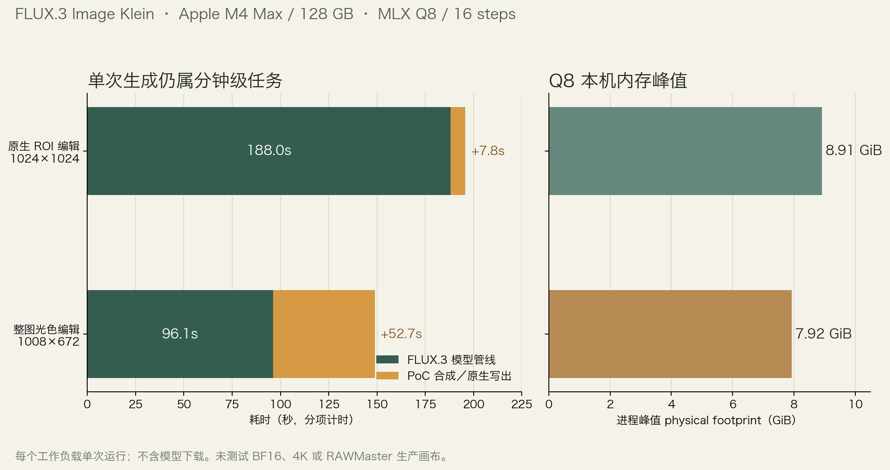
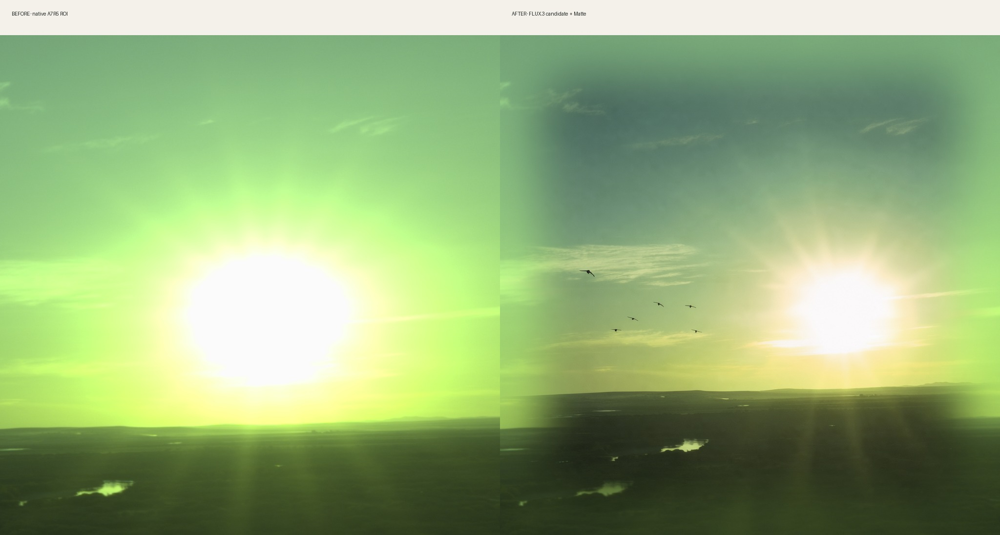
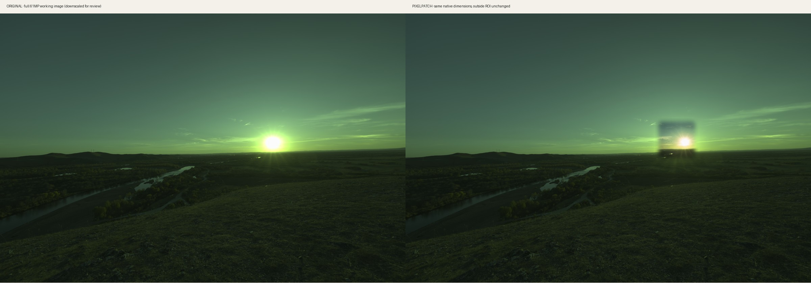
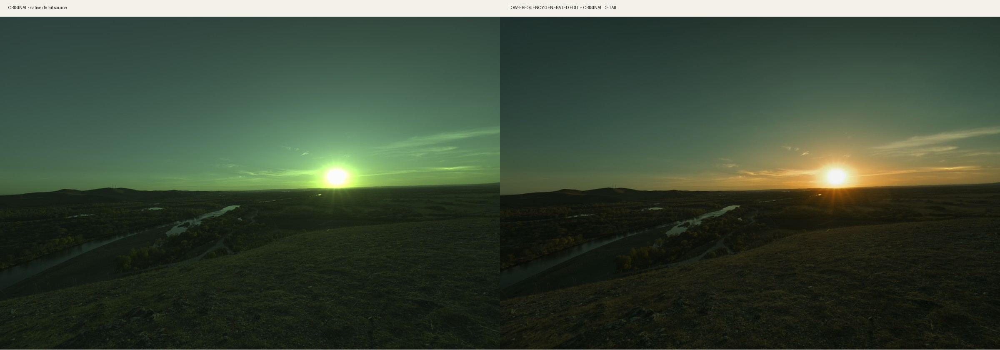
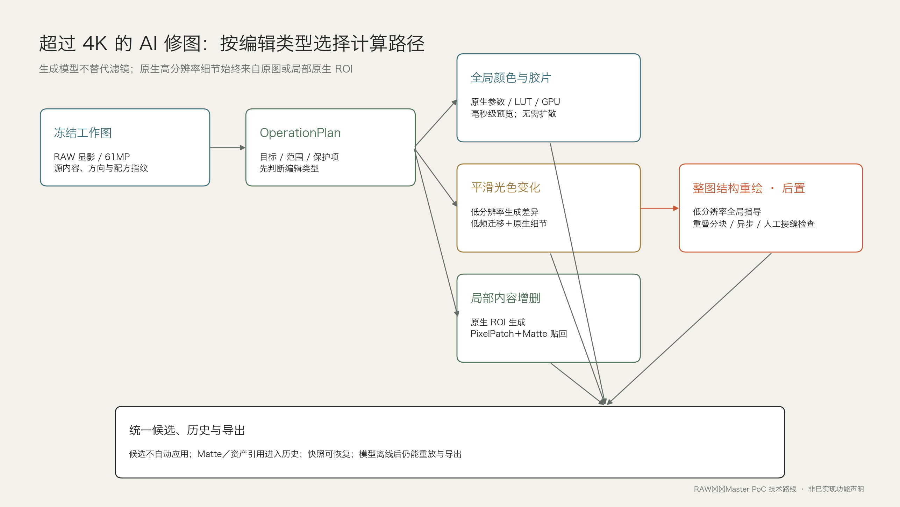

# FLUX.3 Image Klein 本地性能与 A7R5 高分辨率编辑 PoC

日期：2026-11-22。范围：验证 FLUX.3 Image Klein 能否承担 RAWMaster 的本地 Dreamer 式生成能力，记录 Apple Silicon 上的真实速度与内存，并针对模型最高 4K、生成远慢于普通滤镜的限制，实测“原生 ROI＋PixelPatch＋Matte”和“低分辨率光色编辑＋原生细节保留”两条路线。本轮只修改研究资产与规划文档，没有修改 RAWMaster 生产渲染器、资料库或安装应用。

## 执行摘要

**FLUX.3 Image Klein 可以作为本地候选生成器，但本次结果不足以证明它能完整替代 Dreamer 的云端生成服务。** 官方模型支持 16 步蒸馏生成、最多 10 张参考图、bounding boxes 和最高 4K 输出；本机 Q8 已能完成真实照片编辑，内存也不是 128 GB M4 Max 的瓶颈。真正的限制是分钟级等待、区域内内容保持和精确指令一致性。它应进入右侧“智能修图”的异步任务链，不应进入左侧普通滤镜的 hover 或实时 Amount 路径。[FLUX.3 官方仓库](kimi-cite://web?url=https%3A%2F%2Fgithub.com%2Fblack-forest-labs%2Fflux-3-image-klein "citation")

两项 PoC 必须分开判断。**原生 ROI 的像素合同通过，但本次生成候选的摄影质量不通过。** 1024×1024 原生裁切在不缩放的情况下生成并贴回 9566×6374 工作图，区域外 8-bit 最大差为 0，两次合成的像素 SHA-256 完全相同；但是模型生成了 6 只鸟而不是要求的 5 只，还重绘了云层、太阳和地平线，宽幅羽化 Matte 在全图中留下明显矩形变化。因此“Patch＋Matte 能保护区域外”成立，“模型已经能稳定执行局部内容增删”不成立。[PixelPatch 验证收据](kimi-cite://text?path=%2FUsers%2Frobinqu%2FWorkspace%2Fgithub%2Frobinqu%2FRAWMaster%2Foutput%2Fresearch%2Fflux3-klein%2Fpoc%2Fpixelpatch-receipt.json&text=%22outsideRoiMaxAbsDifference8bit%22 "citation")

**低频光色迁移在这一个 A7R5 样本上形成了可用的受限技术证明。** 模型只编辑 1008×672 代理，系统把生成图与输入图之间的平滑差分场迁移到原生 61MP RGB，而不是把生成像素直接放大。对最终量化 8-bit 输出的检查中，ROI 高频平均绝对差为 \(6.5302×10^{-5}\)，p99 为 \(1.4191×10^{-3}\)，视觉审阅中整体构图和地貌保持，绿色日光转为更暖的金色光。该路线只允许平滑光色变化，不能用于移除物体、身份编辑或精确几何；当前 Python 后处理与 PNG 写出首轮耗时 52.738 秒，生产色彩与性能尚未验收。[细节迁移收据](kimi-cite://text?path=%2FUsers%2Frobinqu%2FWorkspace%2Fgithub%2Frobinqu%2FRAWMaster%2Foutput%2Fresearch%2Fflux3-klein%2Fpoc%2Fdetail-transfer-receipt.json&text=%22highFrequencyMeanAbsDifference%22 "citation")

## 1. 测试合同与未覆盖范围

### 1.1 固定输入与运行身份

输入仍是同一张 Sony ILCE-7RM5 `DSC05994.ARW`，RAW SHA-256 为 `8f96d2fd4fa0c76741ee09b486a4a5e17c8c893ce714060f2fe65eb34c891e1c`。rawpy 线性 ProPhoto 工作图尺寸为 **9566×6374、60.97MP**。模型接收的是从该工作图派生的 8-bit RGB 显示代理：线性值乘 4、裁切到 0–1，再做 1/2.2 gamma。ROI 测试从原生工作图直接裁出 left 5888、top 2480、1024×1024 的区域，没有缩小或放大；光色测试输入为 1008×672，约 0.68MP。[ROI 元数据](kimi-cite://text?path=%2FUsers%2Frobinqu%2FWorkspace%2Fgithub%2Frobinqu%2FRAWMaster%2Foutput%2Fresearch%2Fflux3-klein%2Fpoc%2Froi-metadata.json&text=%22modelInputResampling%22 "citation")

本机为 **Apple M4 Max／128 GB 统一内存**，运行 MLX 0.32.4。推理运行时代码固定为 `a8a400745949770d4de3b18c31684169da4b0af5`，模型使用独立重打包的 `devin-lai/flux-3-image-klein-mlx-q8`，revision 固定为 `d9790a1ceaba200e8b773fb236f7c9fa754283a7`；完整模型组件约 9.58 GiB，运行前已通过组件 SHA-256 校验。模型包保留上游 FLUX Kommunity License，并不是 Apache 2.0 权重。[Q8 模型卡与来源](kimi-cite://web?url=https%3A%2F%2Fhuggingface.co%2Fdevin-lai%2Fflux-3-image-klein-mlx-q8 "citation")

### 1.2 提示、计时与样本限制

两个任务都使用 `q8-16`，即 transformer 与文本特征 8-bit、16 步官方蒸馏 schedule。该 MLX 包不包含官方 Prompt Upsampler，因此测试使用手写的完整目标场景 caption，明确构图、太阳、云层、地平线、河流、光色与保护要求，而不是只输入“加几只鸟”或“变暖和”这类短指令。这样符合官方“使用完整场景描述”的要求，但仍不能等同于已经加载官方 18.8 GB upsampler 的完整参考管线。[MFLUX 提示与运行说明](kimi-cite://web?url=https%3A%2F%2Fgithub.com%2Ffilipstrand%2Fmflux%2Fblob%2Fmain%2Fsrc%2Fmflux%2Fmodels%2Fflux3%2FREADME.md "citation")

每个工作负载只运行一次，均为新的独立进程；模型下载不计入生成时间。报告同时保留模型内部 `wall_seconds`、各阶段耗时、每步耗时、MLX active peak，以及 `/usr/bin/time` 的端到端进程时间和 peak physical footprint。**本机没有测试 BF16、4K、2048² 或连续暖运行分布，也没有执行 RAWMaster 生产画布、ICC、历史恢复或 canonical 导出。** 单张样本可以用于否定“实时”和证明工程机制，不能用于给出普遍首次可用率或最低支持内存。

## 2. 官方能力与外部性能基线

### 2.1 与 Dreamer 路线相关的能力

| 能力 | 官方现状 | 对 RAWMaster 的意义 |
| --- | --- | --- |
| Distilled / Base | 16 步无 CFG / 50 步 CFG；官方称蒸馏约快 6 倍 | 产品默认只研究 Distilled，Base 留给训练与研究 |
| 模型结构 | 5.6B 图像 transformer，MLX 文档记录 Qwen3-VL-4B 文本编码器 | 场景选卡与像素生成可分别实现，生成请求只消费已确认的图像和操作 |
| 参考图编辑 | 最多 10 张参考图 | 支持局部编辑、多参考合成，但参考图不锁定结构 |
| Bounding boxes | 支持目标框与编辑框 | 可辅助位置与尺度约束，但不是硬 Matte，也不保证区域外不变 |
| 最高分辨率 | 官方标为 up to 4K | 61MP RAW 不能简单整图送入；必须按任务路由 |
| Prompt Upsampler | 独立 9B VLM，MFLUX 记录模型约 18.8 GB | 完整官方体验还需额外内存与阶段耗时，本机 PoC 未包含 |
| 许可 | FLUX Kommunity License；符合规则的 Qualifying Users 可生成商业输出 | 年收入、关联方、分发与输出条款需独立法律审查，不能只看“开放权重” |

官方 B200 在 1024×1024、关闭 upsampler 时记录的峰值 GPU 显存为 BF16 31 GB、FP8 26 GB、NVFP4 25 GB；这些是 NVIDIA `nvidia-smi` 口径，不是本机统一内存结果。MFLUX 在 M4 Pro／64 GB、1024²、16 步上的记录则为 BF16 30.7 GB／6.4 秒每步、Q8 22.8 GB／7.0 秒每步、Q4 18.5 GB／7.0 秒每步，并明确“量化主要省内存，不加速”。两组数字都不能冒充本次 M4 Max 实测。[官方内存表](kimi-cite://web?url=https%3A%2F%2Fraw.githubusercontent.com%2Fblack-forest-labs%2Fflux-3-image-klein%2Fmain%2FREADME.md "citation") [MFLUX 量化表](kimi-cite://web?url=https%3A%2F%2Fraw.githubusercontent.com%2Ffilipstrand%2Fmflux%2Fmain%2Fsrc%2Fmflux%2Fmodels%2Fflux3%2FREADME.md "citation")

本次使用的是另一套预量化 MLX 运行时，文本、VAE、调度和内存统计均与 MFLUX 不完全相同，所以不能把本机约 8–9 GiB 峰值与 MFLUX 的 18–31 GB 直接解释为同一实现的优化幅度。它们共同支持的结论只有：本地运行可行，但不同后端必须分别做性能和质量验收；官方支持最高 4K也不表示 4K 在普通 Mac 上具有交互性。

## 3. 本机真实速度与内存

### 3.1 实测结果

| 工作负载 | 模型 wall | 进程 real | Denoise | 平均每步 | 峰值 physical footprint | 后处理与原生写出 |
| --- | ---: | ---: | ---: | ---: | ---: | ---: |
| 原生 ROI，1024×1024，16 步 | **188.013s** | 188.460s | 178.701s | 11.17s | **8.91 GiB** | 7.762s |
| 整图光色，1008×672，16 步 | **96.118s** | 96.270s | 88.448s | 5.53s | **7.92 GiB** | 52.738s |

ROI 任务的 encode、参考图编码和 decode 分别约 1.65、4.49 和 1.90 秒，绝大多数时间消耗在 178.70 秒 denoise。光色任务也呈现相同结构，88.45 秒 denoise 占模型管线的主要部分。因此“只优化模型加载”不会把该能力变成实时滤镜；即使后续复用常驻模型，16 步主体计算仍然是分钟级成本。[ROI 原始指标](kimi-cite://text?path=%2FUsers%2Frobinqu%2FWorkspace%2Fgithub%2Frobinqu%2FRAWMaster%2Foutput%2Fresearch%2Fflux3-klein%2Fpoc%2Fa7r5-roi-generated.metrics.json&text=%22denoise%22 "citation") [光色原始指标](kimi-cite://text?path=%2FUsers%2Frobinqu%2FWorkspace%2Fgithub%2Frobinqu%2FRAWMaster%2Foutput%2Fresearch%2Fflux3-klein%2Fpoc%2Fa7r5-full-light-generated.metrics.json&text=%22denoise%22 "citation")

这里的 8.91／7.92 GiB 是 macOS 进程 peak physical footprint，不是模型文件大小、MLX active bytes 或 NVIDIA 显存。它说明这两次 Q8 任务在 128 GB 机器上没有接近物理内存上限，但不能据此承诺 16 GB 或 32 GB Mac 可同时运行 RAWMaster、浏览器和模型。后续最低配置测试必须包括系统其他负载、连续生成的热状态、内存压力与取消后的资源释放。

### 3.2 产品交互结论

此前同一 A7R5 工作图的 Core Image GPU LUT 暖执行为 20.72ms，而本次两个生成模型管线分别为 96.1 和 188.0 秒，相差约 **4,600–9,100 倍**。这不是颜色滤镜与生成模型质量的对等比较，却足以确定交互类别：胶片和确定性颜色可以继续使用 hover、Amount 与即时预览；FLUX.3 只能作为有进度、可取消、保留 last-known-good 的后台任务。[A7R5 GPU LUT 实测](kimi-cite://text?path=%2FUsers%2Frobinqu%2FWorkspace%2Fgithub%2Frobinqu%2FRAWMaster%2Foutput%2Fresearch%2Fai-retouching-rea%2Fa7r5%2Fa7r5-gpu-benchmark.json&text=%22timingBoundary%22 "citation")

生成期间用户应能继续浏览其他照片或调整不依赖该候选的操作，回到当前照片时仍看到原图和任务状态。候选完成后先进入前后、100% 和变化范围检查，用户确认“应用到照片”才写入历史。不得自动应用晚到结果，也不得因为本地较慢就静默切换云端。

## 4. PoC A：原生 ROI 生成＋PixelPatch＋Matte

### 4.1 已通过的工程验证

该路线不把 61MP 全图缩小到模型上限，而是只处理摄影师实际要改的原生区域。候选保持 1024×1024，不进行 resampling；合成器读取原生工作图、候选与同尺寸 Gray8 Matte，以 48px 羽化的圆角矩形把候选贴回原坐标。输出尺寸保持 9566×6374，候选只影响 ROI，最终像素哈希可重放。

| 验证项 | 结果 | 判断 |
| --- | ---: | --- |
| 候选重采样 | none | 原生 ROI 路径成立 |
| 原生输出尺寸 | 9566×6374 | 不受模型整图 4K 上限约束 |
| 区域外最大 8-bit 绝对差 | **0** | 像素隔离通过 |
| ROI 内平均／最大 8-bit 绝对差 | 37.545／242 | 区域内发生了大面积变化 |
| 两次合成像素 SHA-256 | `22c68062…4e802b7ca86` | 确定性回放通过 |
| PixelPatch 合成脚本耗时 | 7.762s | 研究脚本可运行，生产性能未验收 |

### 4.2 未通过的候选质量与接缝检查

视觉审阅确认模型理解了“太阳左侧加入远处飞鸟”的大方向，但结果中可数到 **6 只鸟**，不是 Prompt 要求的 5 只；原有云层、太阳轮廓和地平线也被重绘。这说明完整 caption 和参考图只能引导模型，不能充当内容保持合同。本次没有为了得到更漂亮的结果反复抽卡，因此该失败被保留为真实样本，而不是用另一次成功种子替代。

全图概览还显示太阳附近出现明显矩形区块。原因不是区域外合成错误，而是候选在整个 ROI 内都发生了较大颜色与内容变化，48px 通用羽化无法把这种全局重绘变成局部编辑。后续实现需要把“候选生成”和“变化提取”分开：由用户 Matte、目标实体和保护区域限制真正应用的像素，并提供只显示变化、边界和 100% 接缝检查；若无法提取可信的局部变化，应拒收候选，而不是扩大羽化掩盖问题。

因此该 PoC 的准确结论是：**原生 ROI＋PixelPatch 是有实际证据的高分辨率承载方式，但 FLUX.3 的这一候选不能进入自动应用或默认智能预设。** 区域内语义正确性、纹理、透视和光色连续性仍是独立发布门。

## 5. PoC B：低频生成差分＋原生细节保留

### 5.1 方法与实测证据

光色任务先在 1008×672 代理上生成更暖的金色日光，再计算 `blur(generated_low - input_low, sigma=2)`，把平滑 RGB 差分场 bicubic 放大到 9566×6374，最后执行 `nativeRGB + 0.75 × delta`。输出使用原生工作图的高频信号，不直接放大生成像素，也不把 0.68MP 候选伪装成 61MP 原生生成。

| 验证项 | 结果 | 解释 |
| --- | ---: | --- |
| 模型输入 | 1008×672 | 只承担低频光色决策 |
| 原生输出 | 9566×6374 | 细节来自原图 |
| 直接放大生成像素 | false | 不是普通超分或整图替换 |
| 高频平均绝对差 | **0.0000653021** | 最终量化 8-bit 输出归一化到 0–1；高频几乎不变 |
| 高频 p99 绝对差 | **0.0014191121** | 包含最终 8-bit 量化误差 |
| 模型／后处理耗时 | 96.118s／52.738s | 仍是异步路线 |

这张样本的视觉结果符合“更暖、保留构图”的目标，河流、地平线、太阳位置和地表结构在审阅尺度下保持一致。高频指标不是主观摄影质量分，也不能证明所有颜色都准确；它只验证该算法没有从生成候选引入明显高频细节。原生 16-bit 线性色彩、饱和截断、色域、不同照片结构和生产 Metal 实现仍需另行验收。[细节迁移方法记录](kimi-cite://text?path=%2FUsers%2Frobinqu%2FWorkspace%2Fgithub%2Frobinqu%2FRAWMaster%2Foutput%2Fresearch%2Fflux3-klein%2Fpoc%2Fdetail-transfer-receipt.json&text=%22method%22 "citation")

### 5.2 必须限制的能力范围

低频路线适合“整体更暖”“高光略偏金”“平滑明暗氛围”等变化，不适合要求生成新边缘的任务。物体移除、增加人物、改变五官、换天、透视修正和精确文字都需要新的高频或几何信息，模糊差分场无法表达；如果模型在代理中改变物体而系统只迁移低频差分，结果可能只是给原物体染上一层颜色，而不是完成语义编辑。

建议把它保存为独立的内部 `GeneratedToneFieldOperationV1`，记录低分辨率输入／输出资产、源指纹、sigma、Amount、色彩空间和重采样链，而不是把结果存成一张不可解释的 Full Image。界面仍留在“智能修图”的光影操作中，不新增面板或图层概念；应用后进入现有历史，后续调整 Amount 只重放差分合成，不重新调用模型。

当前 52.738 秒后处理包含未优化的 NumPy／SciPy 全尺寸数组处理、61MP PNG 编码与磁盘写出，不能外推为 Metal 性能。后续可以把差分模糊、放大与加法迁移到 GPU，并避免完整 PNG 中间帧，但在真实生产画布测得数据前，不承诺毫秒级或实时预览。

## 6. 超过 4K 的可行路由

| 编辑类型 | 推荐路径 | 本轮证据 | 产品状态 |
| --- | --- | --- | --- |
| 全局颜色、胶片、黑白 | 原生 Recipe／LUT／GPU，不使用扩散 | A7R5 GPU LUT 已有 20.72ms 实测 | 普通滤镜路线，继续完成生产验收 |
| 局部内容增删、复杂补全 | **原生 ROI 生成＋PixelPatch＋Matte** | 区域外差 0、原生尺寸与回放通过；本候选语义和接缝失败 | 可进入工程实现，模型质量按操作验收 |
| 平滑整图光色 | **低分辨率生成差分＋原生高频** | 一张 A7R5 代理与 61MP 合成通过受限 PoC | 实验能力，限制在光影／色调操作 |
| 整图结构重绘、换景、自由创意 | 低分辨率全局指导＋重叠分块生成＋接缝处理 | **本轮没有实际分块 PoC** | 后置研究，不承诺实时或原尺寸质量 |
| 直接放大生成图作为原生成片 | 不推荐 | 原生高频并不来自生成模型 | 不作为“支持 61MP”的宣传口径 |

整图结构分块不能被写成“既然 ROI 成功，所以全图分块也一定成功”。ROI 只有一个明确边界且区域外有原图保护；全图结构重绘需要处理大量块间的物体连续性、透视、重复纹理、光向、颜色和随机种子一致性，还要防止全局指导与每块局部生成互相漂移。其等待时间会随块数增长，且必须有全局拒收和人工接缝检查。

如果未来确实需要自由创意整图，可以另行验证统一低分辨率 guide、重叠 tile、固定坐标与源指纹、边缘带合成和全局质量门。它应属于独立创意任务和异步导出流程，不应阻塞 R1 的可信增强、R2 的局部清理和胶片 MVP。

## 7. 对现有产品方案的修订

1. **编辑入口。** 胶片模拟在左侧滤镜，FLUX.3 的候选从右侧已选的局部清理操作发起，画布显示涂抹范围与接缝。[场景卡](../../specs/030-ai-retouching/scene-presets.md)
2. **按结果形态路由，而不是按是否使用 AI 路由。** Recipe／LUT 走实时路径；PixelPatch 和 GeneratedToneField 走异步候选路径；自由整图结构重绘保持后置。
3. **智能预设必须显示真实任务属性。** 包括目标 ROI、模型输入尺寸、原生合成方式、预计等待、执行位置和保护项，不把生成型操作包装成普通滤镜。
4. **候选默认不应用。** PixelPatch 的区域外差 0 只是硬性自动门；区域内内容、数量、身份、云层、几何和接缝仍需人工确认。
5. **历史保存操作与资产引用。** 应用、修改 Matte、调整 Tone Field Amount、撤销和快照恢复都不重新生成；模型离线或卸载后仍可回放已确认结果。
6. **本地与云端共用合同。** FLUX.3、ComfyUI 或云端 API 都只是候选提供方，不能分别发展出不同的作品结构或绕过同一质量门。
7. **许可仍是发布门。** FLUX Kommunity License 对商业使用的资格与条件需要完整审查，不能因 Q8 重打包可下载就默认可直接随商业客户端分发。

## 8. 下一轮最小验证清单

| 优先级 | 验证 | 通过后才允许的产品动作 |
| --- | --- | --- |
| P0 | 把 PixelPatch 接入真实 Mask／Local／Geometry 顺序，测试方向、裁切、历史、离线导出和资源释放 | 开启真实 RAW 的局部生成工程分支 |
| P0 | 用固定样本集分别测试移除、补全、局部新增，记录首次可用率、数量错误、纹理和接缝 | 决定 FLUX.3 是否进入具体智能预设 |
| P0 | 对 GeneratedToneField 做线性 16-bit、ICC、色域和 Metal 生产实现对照 | 从研究脚本升级为受限光影操作 |
| P1 | 在 32／64 GB Mac 上测连续任务、热状态、取消、内存压力和官方 upsampler 成本 | 定义最低配置与模型下载策略 |
| P1 | 补测 2048²／4K 与 BF16 或官方 FP8 参考路径 | 给出完整分辨率／精度／速度矩阵 |
| 后置 | 全局 guide＋重叠分块结构重绘 | 仅在独立创意功能立项后开展 |

**最终判断：FLUX.3 Klein 足以进入 RAWMaster 的本地生成候选层，但不足以单独证明 Dreamer 式体验已经可复制。当前最可行的方案不是把整图 61MP 交给模型，而是让原生 Recipe、PixelPatch 和 Tone Field 分别承担适合自己的编辑；模型只在需要新像素或低频光色决策时异步运行。**
