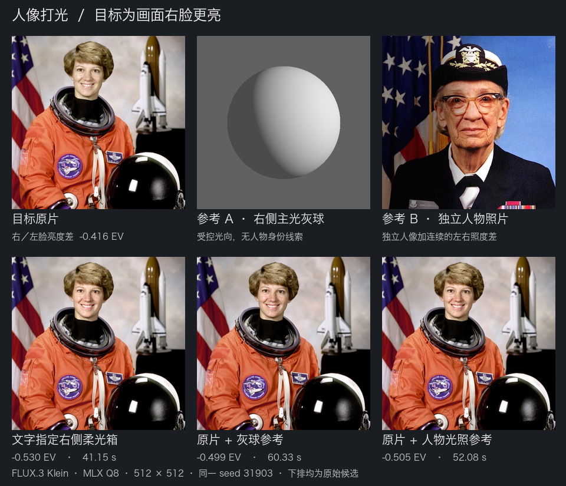
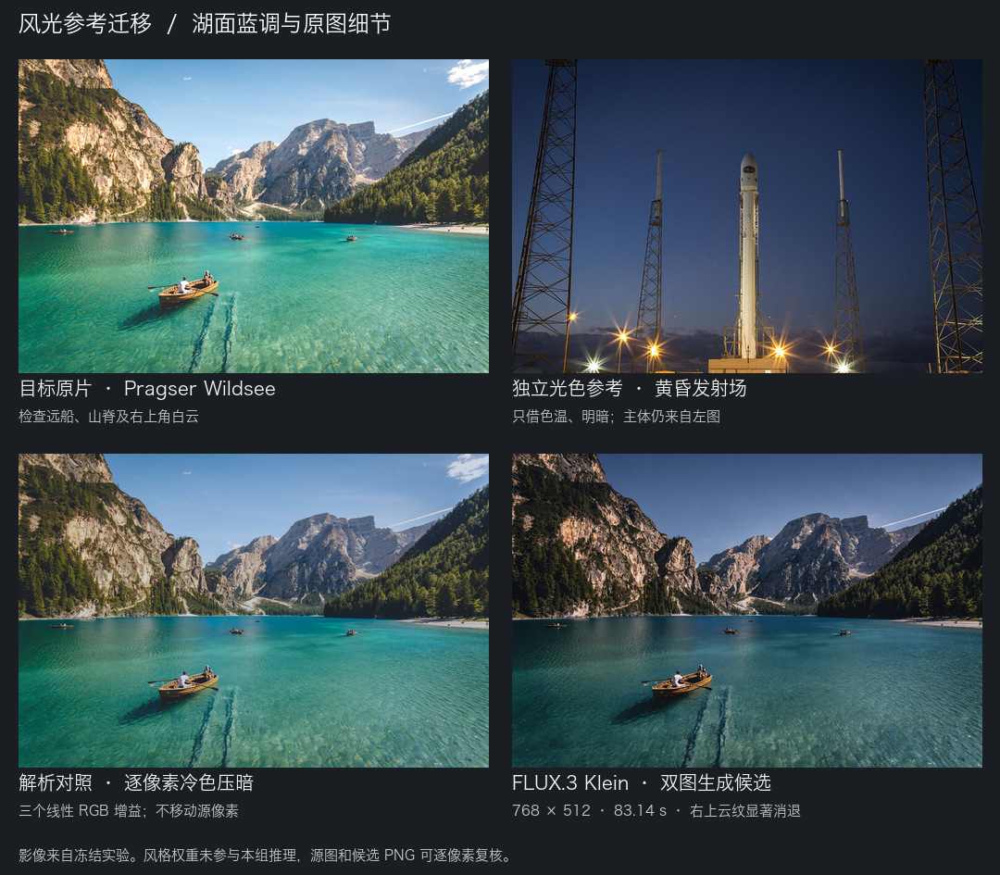
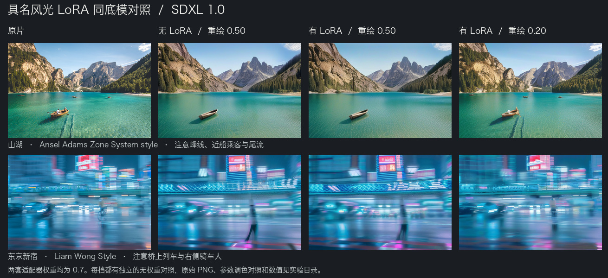
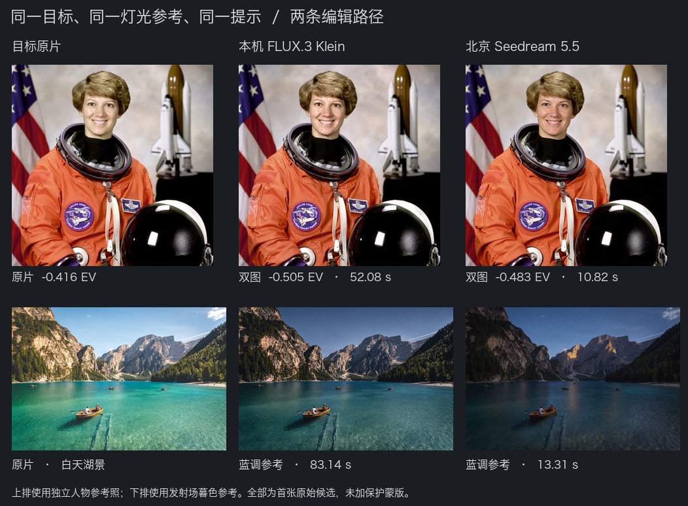

# 从调参数到编辑像素：去干扰、人物打光与风光风格迁移

2026-11-22 · RAWMaster 030 实地调研与可复算 PoC · [生成式产品规格](../../specs/030-ai-retouching/generative-editing.md) · [风光作者与模型版本目录](landscape-photographers-and-lora.md)

为逆光脸提亮、压天空高光、按参考张配平，用现有蒙版和 GPU 算子就能交付。摄影师要求移走路人并补出身后水纹、让鼻影从另一边投下、或让林间光穿过已有树列时，输入照片里缺少目标像素或目标光照。值得为这些任务分别设计生成、检查和回退。本机已跑通文字指令和「目标＋一张参考」编辑；下面的人像与湖景说明了「能出图」到「可采用」之间具体差在哪里。

## Camera Raw 如何处理跨场景干扰

| 用户面对的画面 | Adobe 实际交互 | 对 RAWMaster 的设计含义 |
| --- | --- | --- |
| 一组小光圈风景的传感器污点 | 触发 Dust 后会自动检测并移除，用户能查看、删除误判点、补点并改笔刷大小。把设置粘贴给其他照片会逐张重新检测。 | 在「修复 → 去干扰」分开显示「检测到」和「已采用」。先验证本地小斑点检测加邻域修复。用星点、飞鸟、雀斑作负样本。[官方 Dust 帮助](https://helpx.adobe.com/camera-raw/desktop/ai-and-generative-features/remove-dust.html) |
| 旅行照片中不希望保留的路人 | People 在检测到的干扰人物上显示覆盖和每人图钉。选图钉按 Delete 是从待移除名单排除该人。确认 Remove 后才生成处理结果，可查看变体。 | 用户点名「保留」或「移除」，允许补影子和反光的范围。点人和改边立即响应，补全遮挡处异步执行。无法决定谁是主角时必须让用户选。[官方 People 帮助](https://helpx.adobe.com/camera-raw/desktop/ai-and-generative-features/remove-people.html) |
| 隔着橱窗或车窗拍摄的叠影 | Reflections 有 Preview、Standard、Best 等质量；滑杆通常 +100 偏透射、0 原片、−100 偏反射，两层可能判反。Adobe 披露过以合成叠影训练分解模型。 | 先研究输出透射与反射两个解释的专用方法，交给用户认层并连续混合。用有／无玻璃的同机位照片验证。湖面、镜面构图和眼镜负样本独立验收。[操作帮助](https://helpx.adobe.com/camera-raw/desktop/ai-and-generative-features/remove-reflections.html) · [Adobe 成像团队的技术说明](https://blog.adobe.com/en/publish/2024/12/12/removing-window-reflections-adobe-camera-raw) |
| 人像临时痘印和永久标记混在一起 | Blemishes 支持多人，Amount 处理临时瑕疵，Fade 控制永久特征的淡化。Adobe 文档给出 Fade 默认 50，并有 Restore 与 Remove 画笔。 | 逐人处理。RAWMaster 提议永久标记默认保留，先对临时斑点做小范围修复，在毛孔、妆容、痣和雀斑上检查。[Adobe Blemishes](https://helpx.adobe.com/camera-raw/desktop/ai-and-generative-features/remove-blemishes-from-photos.html) |
| 无规则物体或多张照片各有零散干扰 | Remove 的对象检测与生成填充可分别选择，遮挡物附带的阴影与反光可扩刷。Mark for Removal 支持先标记、保存、稍后执行，同一构图可复制标记。 | 029 保存源坐标意图、用户排除区和检测版本。批量区分「逐张检测」和「复制同机位标记后复核」。先标不计费，每张采用自己的修复资产。传统 Heal/Clone 仍能手动接管。[移除物体](https://helpx.adobe.com/camera-raw/desktop/ai-and-generative-features/remove-tool-acr.html) · [标记后批处理](https://helpx.adobe.com/camera-raw/desktop/ai-and-generative-features/mark-areas-for-removal-in-camera-raw.html) · [修复工具](https://helpx.adobe.com/camera-raw/desktop/ai-and-generative-features/enhanced-spot-removal-tool-camera-raw.html) |

Adobe 文档能支持的是上述操作和公开的反射分解方法。Dust、People、Blemishes 的内部生成器和运行位置没有在这些来源中得到同等程度的披露。RAWMaster 可让小污点走确定性邻域取样，露出大面积背景才试生成补全。当前严格纪实策略只接受批准的原生操作，污点替换也保持关闭。

大面积补全可以沿用 029 已定位的 LightFlow 路由做公平对照：取同一源裁片和 Matte，对比邻域取样、本机 LaMa 以及通用生成首候选。LaMa 的公开实现采用快速傅里叶卷积。玻璃反光可用 ICCV 2023 的 DSRNet 双分支分离作为本地候选，先检查透射、反射与残差再考虑光滑混合。这两个开源项目用于下一轮对照，本轮没有测其 macOS 运行表现。[029 修复管线调研](../../specs/029-repair-tools/spec.md) · [LaMa 作者实现](https://github.com/advimman/lama) · [DSRNet 作者实现](https://github.com/mingcv/DSRNet)

**污点基线也做了小试。** 在同一张 768 × 512 实景上注入 8 个已知位置的乘性高斯暗斑，分别覆盖天空、湖面和山地。双尺度亮度差加纹理抑制找到其中 6 个（匹配半径 6 px），同时给出 289 个未匹配候选；无注入的同图也报出 291 个位置。原照没有真实污点逐点标注，这些数值只能说明自然纹理足以淹没这一简单规则。产品先交付可复核标记，再以真实传感器污点、同镜头连拍与星空负例评估专用检测。直接全自动替换的依据不足。[注入和检测脚本](../../specs/030-ai-retouching/poc/dust-probe.py) · [实际读数](../../specs/030-ai-retouching/evidence/generative-followup/repair/dust-injection.json)

## Dreamer 下载版：用户从哪里得到新像素

读取下载目录的商业发布清单、两份手册和可读 JS，对发布包用 REA 做静态模块分析。发布清单为 **2.2.2**，手册首页自称 **2.0.0**，交互训练页标为 **2026-08**。以下把手册操作同 Photoshop 宿主实现对应起来。发布包暴露任务准备、贴回和图层操作，无法据此认定每个远端编辑器的专有网络、模型版本或训练数据。[本机用户手册](/Users/robinqu/Downloads/Dreamer/userGuide/index.html) · [实战训练页](/Users/robinqu/Downloads/Dreamer/userGuide/guide.html) · [对应发布页](https://github.com/2771096196/PSAI-Dreamer/releases/tag/v2.2.2-macos-arm64) · [既有源码调研](dreamer-spektrafilm-implementation-review.md)

| 用户操作及手册定位 | 发布包中的证据 | 值得复用的产品能力 |
| --- | --- | --- |
| 基础模式选任务、范围、保留项，快速模式把当前选区直接送出并贴回。见 basic-flow、images、pasteback | `panel/core/basic-mode-state.js::compilePrompt` 从结构化字段形成指令。`panel/core/reference-input-state.js` 的 GRS 路径最多 6 张输入，含 1 张目标及最多 5 张参考。 | 让同一结构化卡明确「改什么／保留什么／参考图供什么用」。目标、身份、光照、风格用途须分开，实际可传张数由提供方能力决定。[基础模式实现](/Users/robinqu/Downloads/Dreamer/panel/core/basic-mode-state.js) · [参考图状态](/Users/robinqu/Downloads/Dreamer/panel/core/reference-input-state.js) |
| 在已有选区修改内容，按候选贴回新层、修边，必要时以半透明对齐。见 pasteback、align | `host/ps-io.js` 的 `calculateMinimalSquareRegion`、`encodeSelectionMaskRle`、`createGroupAndMask`、`applyReturnFeatherMaskToLayer` 覆盖裁片、选区编码、组蒙版与边界。`host/agent-bridge.js` 的 `paste_back` 校验贴回载荷。 | 用户得到的是可重新检查的像素层。RAWMaster 保存裁片到源图的坐标、候选与 Matte，采用前看 100% 接缝；移动了脸或边线就拒收。切换已归档候选无需再出图。[图像与图层代码](/Users/robinqu/Downloads/Dreamer/host/ps-io.js) · [宿主桥接](/Users/robinqu/Downloads/Dreamer/host/agent-bridge.js) |
| 人像里设置主灯、补灯、轮廓、顶光及环境光。见 lighting、portrait | `LIGHT_ROLES`、`LIGHT_FIXTURE_TYPES`、`createLightGuides`、`readLightGuides` 读写灯位、朝向、色温、颜色、强度和灯具，并组织画布导引；桥接有 `lighting_add_layer`。 | 把「右上柔光」「发丝逆光」做成可看懂的灯位条件；移动导引是设置输入，是否真的改变鼻影、眼神光及发丝由候选验收。导引代码本身不能证明物理渲染已完成。[灯位实现](/Users/robinqu/Downloads/Dreamer/host/ps-io.js) |
| 换背景、合成道具、按方向扩图。见 scene 和训练页的分轮案例 | `calculateDirectionalOutpaint`、`prepareDirectionalOutpaintCanvas` 准备画布与分区，`directional_outpaint_paste_back` 回贴单方向结果。手册要求复查透视、接触阴影、主光和接缝。 | 这些案例证明部分任务需要生成原来不存在的内容。当前三条产品线只取其「范围、保护、候选、贴回」机制。Dreamer 的确定性肤色、柔肤、纪实黑白配方仍可供快速预设参考。[训练案例](/Users/robinqu/Downloads/Dreamer/userGuide/guide.html) · [原生操作复核](../../specs/030-ai-retouching/source-review.md) |

快速选区代码的默认配置可直接读到 `nano-banana-pro`、4K 与每单元 3 张。GRS 参考输入注释同时列 GPT Image 与 Nano Banana。另一个本地厚涂工作流经 Comfy 设置页向检查端点提交主／次 LoRA 和次权重强度。这些是具体配置和工作流入口，4K 或三张默认值不代表每个服务都能实际交付；RAWMaster 借用参考角色与候选机制，云端仍仅采用指定的 Seedream 5.5。[快速选区默认值](/Users/robinqu/Downloads/Dreamer/panel/core/selection-fast-flow.js) · [本地工作流检查](/Users/robinqu/Downloads/Dreamer/panel/core/local-workflow-setup.js) · [本次核对文件、SHA 与行号](../../specs/030-ai-retouching/evidence/generative-followup/dreamer-release-index.json)

## 安涂声 ATC 的人像用光入口

实际取得《PS无损打光更新了兄弟们！》公开演示（126.41 秒，1280 × 720），按场景切换抽帧并检查控制面板与 Photoshop 图层。00:21 附近可见预设列表，00:27–00:39 展示一键造光和发丝提亮，00:41–00:52 为午后／夕阳，00:52–01:04 切左右侧光，01:10–01:24 切补光／闪光，01:30–01:46 展示轮廓／体积光，末段出现斑驳光与前后比较。右侧可见命名结果图层。最有价值的设计是让摄影师先选**想要的光型**，然后在同一张脸上比较。[演示原帖](https://www.xiaohongshu.com/explore/6af94e59000000002903d51a)

「根据另一张参考照片迁移用光」来自用户提供的使用说明。视频里看到「光色同步」控件，但这些画面没有展示从独立人像参考输入到成功迁移的完整流程。给定淘宝 SKU 匿名访问转到登录页，无法独立确认商品说明、价格、后端或视频宣称的「无损」。参考用光仍是明确的产品需求，下面单独测试。研究对照可用 IC-Light 的前景／背景条件打光、LumiNet 的原片与独立参考光照接口。二者的输入和授权应各自核查。[商品入口](https://item.taobao.com/item.htm?id=971983230091&skuId=5922853660333) · [IC-Light 官方实现](https://github.com/lllyasviel/IC-Light) · [LumiNet 作者项目](https://luminet-relight.github.io/)

## 本机实测：预设与双图人像打光

Apple M4 Max、128 GiB、MLX 0.32.4、FLUX.3 Image Klein Q8、16 步、seed 31903，每个条件运行一次独立进程。目标为 NASA 的 Eileen Collins 512 × 512 原片。三次分别指定右侧柔光箱、加入合成的右上受光灰球、加入另一位人物的受控右侧光参考。第三种参考取美国海军 Grace Hopper 照片，裁方后在线性空间施加连续的左右照度差，仍含真实脸、衣领和背景。所有提示均要求只转移光照并保留身份。两块脸颊以原图固定坐标测量线性 Rec.709 亮度，定义 EV = log₂(画面右脸 / 画面左脸)。本题要求右脸更亮，EV 应大于 0。[原照说明](https://scikit-image.org/docs/stable/api/skimage.data.html#skimage.data.astronaut) · [参考照冻结来源](https://github.com/matplotlib/matplotlib/blob/v3.10.7/lib/matplotlib/mpl-data/sample_data/grace_hopper.jpg) · [脚本和测量区域](../../specs/030-ai-retouching/poc/relight-check.py)

| 输入路线 | 右／左脸 EV | 三块背景的平均绝对 RGB8 差 | 进程端到端 / 引擎内 wall |
| --- | ---: | ---: | ---: |
| 原片 | −0.416 | 0.00 | — |
| 文字右侧柔光 | −0.530 | 4.44 | 41.15 / 36.41 s |
| 原片 + 灰球 | −0.499 | 5.73 | 60.33 / 60.16 s |
| 原片 + 独立人物参考 | −0.505 | 5.56 | 52.08 / 51.96 s |

三张未经合成的首候选都没有反转这两块脸颊的明暗；放大还能看到制服徽章重画。相同的整体曝光乘数在未剪切时会保留原有脸颊亮度比。局部渐变当然能改变这个读数，真实打光还须验证鼻影、眼神光、皮肤纹理和保护区。一个人、一个种子、二维参考上的照度编辑只能暴露失败样例，不能估计总体成功率。下一步用同模特同机位、只换灯位的实拍对，分别验光向、光质和身份。优先试「估计低频光照变化并在原图纹理上合成」，保留完整候选供创作版选择。[未筛选图、提示与进程记录](../../specs/030-ai-retouching/evidence/generative-followup/relight/runs.json) · [像素指标](../../specs/030-ai-retouching/evidence/generative-followup/relight/measures.json)



## 本机实测：湖泊蓝调参考迁移

同一模型与种子，768 × 512，以 Pietro De Grandi 湖景为目标，以 SpaceX 黄昏发射场为光色参考。要求保留山脊、树、船、人、尾流及构图。另做逐像素线性 RGB 冷调压暗对照（增益约 0.598、0.660、0.762），用于观察坐标与边线保持。该对照是解析基线，没有模拟 RAWMaster 完整 RAW 管线或将两路总亮度强行配平。生成耗时 **83.14 秒**，引擎内 83.02 秒。湖面和天空明显转暗，主要山形和近船仍可辨，右上白云纹理大幅消退。[湖景原作](https://unsplash.com/photos/three-brown-wooden-boat-on-blue-lake-water-taken-at-daytime-T7K4aEPoGGk) · [光色参考来源](https://scikit-image.org/docs/stable/api/skimage.data.html#skimage.data.rocket) · [原始输入输出及提示](../../specs/030-ai-retouching/evidence/generative-followup/landscape/runs.json)

| 与同位置源图比较 | 主船边缘相关 | 远船 | 山体 | 右上云纹 | 全图线性亮度中位数 |
| --- | ---: | ---: | ---: | ---: | ---: |
| 原片 | 1.0000 | 1.0000 | 1.0000 | 1.0000 | 0.27719 |
| 逐像素冷调 | 0.9998 | 0.9997 | 0.9999 | 0.9999 | 0.18284 |
| FLUX.3 双图参考 | 0.7162 | 0.6438 | 0.8143 | **0.0767** | 0.08272 |

用线性亮度 Sobel 梯度幅值图在四个固定矩形计算 Pearson 相关。该读数受重绘、对比度变化及轻微错位共同影响，用来定位疑点。右上天空的视觉变化与读数一致。若摄影师只要冷色，原生路径已足够；若希望生成原片没有的雾光、湿地反光或水流拖影，要让用户指定允许改变的区域并检查结构。此组只测试参考图迁移，未加载 LoRA。五种场景的作者依据、可复用配置和兼容层另有目录。[复算脚本](../../specs/030-ai-retouching/poc/scene-style-check.py) · [区域与数值](../../specs/030-ai-retouching/evidence/generative-followup/landscape/measures.json) · [摄影师与 LoRA](landscape-photographers-and-lora.md)



## 社区 LoRA 在匹配底模上的实测

从九个登记候选中选了**两个真实的 SDXL 权重**，逐文件核对完整 SHA-256 与发布平台一致，在同一 Apple M4 Max 上运行 SDXL 1.0 图生图。一个是 Kappa_Neuro 的 Liam Wong Style，用 Kznrhsd 公开的东京新宿雨夜追拍；另一个是 wfarer 的 Ansel Adams Zone System style，用冻结湖景作历史风格对照。摄影作品、权重上传者、适配器训练声明和本次评测用的源照片都分别记录。测试照片中心裁成 768 × 512。东京源片本来就带运动模糊，查看列车和骑车人的结构即可，不以辨认模糊文字作评分。[Liam Wong 版本](https://civitai.com/models/73318?modelVersionId=153894) · [Ansel Adams 版本](https://civitai.com/models/747293?modelVersionId=835690) · [东京原片与 CC0 声明](https://commons.wikimedia.org/wiki/File:雨の新宿大ガード.jpg) · [SDXL 官方底模](https://huggingface.co/stabilityai/stable-diffusion-xl-base-1.0)

每张源图做四次推理。固定底模 revision `462165984030d82259a11f4367a4eed129e94a7b`、同一条含作者触发词的提示、seed 31903、Euler、CFG 5、20 个调度步骤。两档图生图重绘强度为 0.50／0.20，实际分别执行 10／4 步。每档各跑一次无适配器、一次加载权重 0.7。两条作者卡都没有给出本次采用的工作强度，0.7 是实验选择。另保存了逐像素黑白和冷暖夜色对照。权重装载走独立的本机 Diffusers／MPS 实验环境，完整文件留在研究缓存；没有接入 RAWMaster、FLUX.3 或 Seedream。[录入的版本与文件头](../../specs/030-ai-retouching/evidence/generative-followup/lora-inventory.json) · [推理脚本](../../specs/030-ai-retouching/poc/landscape-lora-check.py)

| 目标与实拍内容 | 重绘 0.50，在相同底模上开关权重 | 降至重绘 0.20 后 | 对产品的判断 |
| --- | --- | --- | --- |
| 山湖 · 黑白分区 | 无／有 LoRA 的平均 RGB 色差跨度分别为 53.00／48.86（灰度应为 0），成片仍是彩色。两路都重画峰形并把载人近船改为空船。挂载后近船区域与源图边缘相关 0.298，逐像素黑白为 1.000 | 挂载后近船边缘相关升至 0.586，尾流可见，但色差跨度回到 57.67。开关权重的全图平均绝对 RGB8 差由 9.75 降至 4.54 | 这组配置无法交付「黑白分区且保住船客」。黑白与影调可直接用原生；只有光照关系本身需要重建时再试生成。[0.50 收据](../../specs/030-ai-retouching/evidence/generative-followup/lora/zone/runs.json) · [0.20 收据](../../specs/030-ai-retouching/evidence/generative-followup/lora/zone/low/runs.json) |
| 东京 · 雨夜霓虹 | 配对候选的平均绝对 RGB8 差为 9.56。挂载后可见青色灯带和加强的品红反光。两路都把横向列车窗带重画成发光装饰，原来的骑车人变为直立人影。挂载后桥上区域边缘相关 0.178 | 开关权重的平均差降至 4.09，挂载后桥上区域边缘相关升至 0.391，骑车人区域由 0.387 升至 0.517。仍需放大检查 | 保留此权重作相同底模的研究对照。下一轮只覆盖路面水光，硬保护列车、骑车人和文字，在不同夜景上盲评风格辨识度。[0.50 收据](../../specs/030-ai-retouching/evidence/generative-followup/lora/neon/runs.json) · [0.20 收据](../../specs/030-ai-retouching/evidence/generative-followup/lora/neon/low/runs.json) |

两张图上，0.50 时管线单次耗时 8.80–18.00 秒，0.20 时 3.95–4.49 秒。计时从进入管线到输出，同进程先跑无权重再跑有权重，首次编译会影响耗时，不能据此说加 LoRA 会提速。边缘相关用固定坐标 Sobel 梯度幅值；色差跨度取每像素 RGB 最大减最小再平均。两项都不能代替摄影师辨认风格。此次证明有两套配置能在匹配底模真加载并改变结果，仍缺少足够多的保形原片、盲审及产品级分发许可。[全量指标](../../specs/030-ai-retouching/evidence/generative-followup/lora/comparison.json) · [对照脚本](../../specs/030-ai-retouching/poc/compare-lora-pairs.py)



## 云端证据与复现

前次 1 MP 单输入测试中，北京 Seedream 5.5 湖面补全的两次写图用时 10.56／14.76 秒，人像局部提亮为 10.30 秒。本次又对北京端点实际发起 **2 次**请求，输入与本机双图实验逐字节相同，顺序固定为目标、独立人物照／黄昏参考。复用同一提示，均首张返回 HTTP 200，回执确认型号 `doubao-seedream-5-5-261028`、2 张输入、1 张输出。人像云端输出 1024 × 1024、湖景 1248 × 832，按 Lanczos 缩回原目标的 512 × 512／768 × 512 网格才比较。同尺寸下云端还原细节的能力仍需等分辨率、等预算的另测。[前次单输入对照](../../specs/030-ai-retouching/research.md) · [北京方舟 API](https://docs.volcengine.com/docs/ark/image-generation-api?lang=zh)

| 双图任务 | 本机 FLUX.3 Q8 | 北京 Seedream 5.5 | 摄影师实际会看到什么 |
| --- | --- | --- | --- |
| 独立人像参考光 | 52.08 s，右／左脸 −0.505 EV，背景平均差 5.56 | **10.82 s**，右／左脸 **−0.483 EV**，背景平均差 4.33 | 原片 −0.416 EV。两者都返回目标人物，均未在这个样本上把右脸变得比左脸亮。Seedream 图面部整体更暗。收到了第二张图不能作为自动迁移光向的验收依据。[云端回执](../../specs/030-ai-retouching/evidence/generative-followup/beijing/portrait.json) |
| 湖景蓝调参考 | 83.14 s，主船／山体／白云边缘相关 0.716／0.814／0.077，全图亮度中位 0.0827 | **13.31 s**，同三处 **0.760／0.452／0.302**，全图亮度中位 0.0278 | 两者都产生蓝调。Seedream 在岩壁上生成更明显的暖光与水面呼应，整体更暗，部分天空云纹仍可见。FLUX 的山体边缘更接近源图。应由摄影师判定新光是否符合意图，硬保护由本机合成保证。[云端回执](../../specs/030-ai-retouching/evidence/generative-followup/beijing/lake.json) |

上述时长是各端本次一次出图至写盘。云端包括网络；账单金额没有查询。没有交换双图顺序、重复取样或测服务 p95。这批结果足以支撑「目标＋参考」的输入合同与错误候选演练，尚不足以承诺人像参考光或风光保形已达到发布质量。[两端同网格读数](../../specs/030-ai-retouching/evidence/generative-followup/beijing/paired-measures.json) · [实际请求脚本](../../specs/030-ai-retouching/poc/seedream-reference-check.py)



已归档原始输出、参考图、源摘要、逐步耗时和权重 manifest SHA。离线复算可把证据目录复制到临时目录，再运行下列命令。重新推理时从对应 runs.json 取该 case 的 prompt，按 references 的顺序重复传 `--image`，使用其中的 width、height 和 seed。例：`flux-klein --model-dir <已校验的Q8路径> --preset q8-16 --prompt-file <该提示文本> --width 512 --height 512 --seed 31903 --image source.png --image light-photo.png --out new.png`。无需访问云端。[运行环境与权重版本](../../specs/030-ai-retouching/flux-validation.md)

```sh
SPEC=specs/030-ai-retouching
PY=output/research/ai-retouching-rea/spektra-venv/bin/python
CHECK=$(mktemp -d)
cp -R "$SPEC/evidence/generative-followup/relight" "$CHECK/"
cp -R "$SPEC/evidence/generative-followup/landscape" "$CHECK/"
"$PY" "$SPEC/poc/relight-check.py" measure "$CHECK/relight"
"$PY" "$SPEC/poc/scene-style-check.py" "$CHECK/landscape"
cmp "$CHECK/relight/measures.json" "$SPEC/evidence/generative-followup/relight/measures.json"
cmp "$CHECK/landscape/measures.json" "$SPEC/evidence/generative-followup/landscape/measures.json"
cp -R "$SPEC/evidence/generative-followup/lora" "$CHECK/"
"$PY" "$SPEC/poc/compare-lora-pairs.py" "$CHECK/lora" "$CHECK/landscape/lake.png"
cmp "$CHECK/lora/comparison.json" "$SPEC/evidence/generative-followup/lora/comparison.json"
"$PY" "$SPEC/poc/dust-probe.py" "$CHECK/landscape/lake.png" "$CHECK/dust.json"
cmp "$CHECK/dust.json" "$SPEC/evidence/generative-followup/repair/dust-injection.json"
"$PY" "$SPEC/poc/measure-cloud-reference.py" "$SPEC/evidence/generative-followup" "$CHECK/paired.json"
cmp "$CHECK/paired.json" "$SPEC/evidence/generative-followup/beijing/paired-measures.json"
```

重跑 LoRA 时使用 Python 3.12、torch 2.5.1、Diffusers 0.35.2、transformers 4.46.3、PEFT 0.17.1、safetensors 0.4.5 与 MPS。给 `landscape-lora-check.py` 传 `--case zone` 或 `--case neon`、`--img2img-strength 0.5` 或 `0.2`、`--base` 本地官方 fp16 Diffusers 目录、`--adapter` 已核对摘要的 safetensors、`--input` 已归档源 PNG 及独立的 `--output`。脚本对每档先跑同提示无权重，再加载 LoRA，核对整文件哈希。其他七个社区配置的证据级别见目录。
