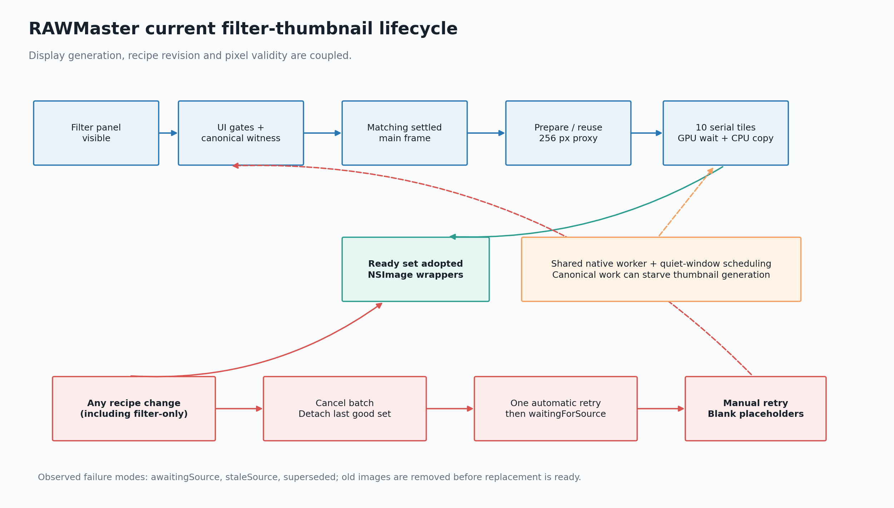
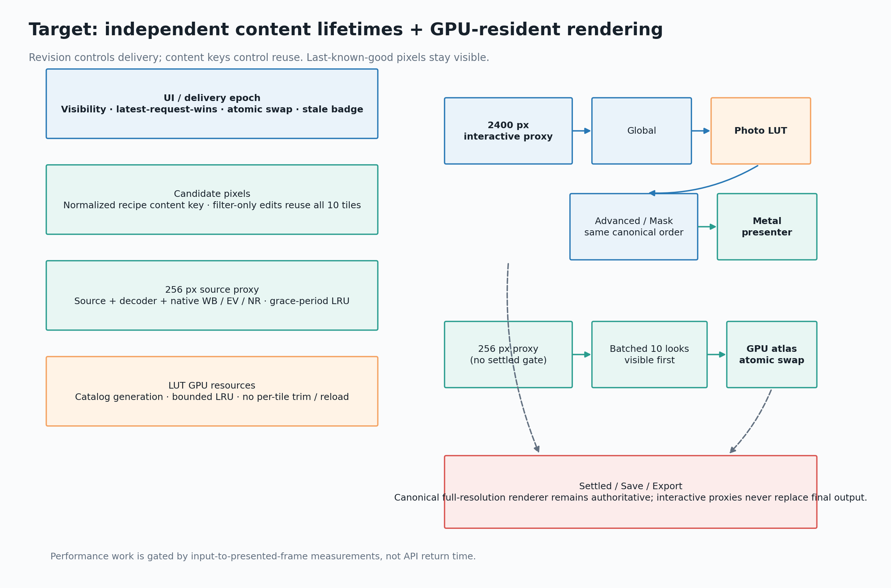
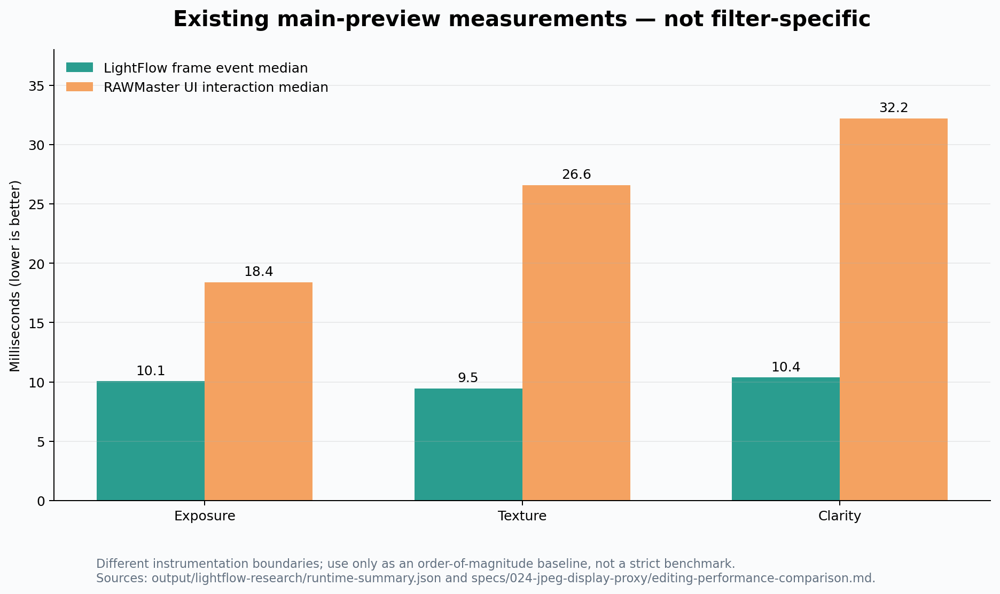

# LightFlow、Camera Raw 与 RAWMaster 滤镜渲染及预览生命周期调研

## 执行摘要

本次调研得到的最重要结论是：**RAWMaster 当前的滤镜卡顿与缩略图频繁失效，首要原因不是 64³ LUT 数学本身，而是滤镜没有进入已有的 2400 px 交互代理，以及缩略图的像素生命周期被错误地绑定到主图 revision / settled 帧 / UI 展示代次。** 任何有效滤镜都会让 `PreviewInteractiveProxyV3` 返回 `.canonical(.filter)`，使主图交互重新执行完整 canonical 显影；任何配方变化又会取消缩略图批任务并撤下旧图，即使只是选择另一个滤镜或调整滤镜强度、候选缩略图的像素实际上不变。[[^12^]](kimi-cite://text?path=%2FUsers%2Frobinqu%2FWorkspace%2Fgithub%2Frobinqu%2FRAWMaster%2FSources%2FRAWMasterImaging%2FPreviewInteractiveProxyV3.swift&text=if%20p.filter.enabled%2Cp.filter.selection%20!%3D%20.original%2Cp.filter.intensity%20!%3D%200%7Breturn%20.canonical(.filter)%7D "citation") [[^15^]](kimi-cite://text?path=%2FUsers%2Frobinqu%2FWorkspace%2Fgithub%2Frobinqu%2FRAWMaster%2FSources%2FRAWMaster%2FEditingThumbnailPresentation.swift&text=func%20recipeChanged()%20%7B "citation")

建议把改造顺序固定为：**先接通滤镜交互代理，再拆分缩略图内容键与展示代次，随后消除 LUT 反复加载和十张候选的串行同步，最后才试验 3D 纹理硬件三线性采样。** 滤镜缩略图生成不应以“当前主图已有同 revision 的非近似 settled 帧”为正确性前提；256 px 代理本来就能独立、确定性地从已验证源生成。settled hook 可以保留为减少 RAW 解码的优化，但不应成为缩略图永远等待的门槛。旧缩略图应保留到新图原子替换，只有真实源内容、解码契约、滤镜资源或滤镜前配方变化才使对应内容层失效。

LightFlow 的速度主要来自完整架构，而非某个神秘滤镜函数：FlashRaw 负责传感器解码，Rust/WebGPU 负责显影，GPU 上保留 RGBA16F/32F 源图、分级纹理与渲染缓存；配方和视图分离，按需绘制，融合程序空闲预热，缩放重呈现已有帧，100% 只补当前细节瓦片。[[^2^]](kimi-cite://md-line?path=%2FUsers%2Frobinqu%2FWorkspace%2Fgithub%2Frobinqu%2FRAWMaster%2Fspecs%2F024-jpeg-display-proxy%2Flightflow-rea.md&line=27&text=Lightflow%20%E7%9A%84%E6%A0%B8%E5%BF%83%E4%B8%8D%E6%98%AF%E2%80%9C%E6%AF%8F%E4%B8%AA%E6%93%8D%E4%BD%9C%E9%83%BD%E8%B0%83%E7%94%A8%E4%B8%80%E6%AC%A1%E5%BF%AB%E9%80%9F%20FlashRaw%20RGBA%20%E8%A7%A3%E7%A0%81%E2%80%9D%EF%BC%8C%E8%80%8C%E6%98%AF%EF%BC%9A "citation") 本轮没有发现足够证据证明 LightFlow 有与 RAWMaster 九个 Photos 风格滤镜对应的固定 3D LUT 面板，因此不能把其预设系统或输入传输函数 LUT 误写成同类滤镜实现。

**当前不能宣称滤镜速度已经与 LightFlow 一致。** 现有性能数据不是滤镜专项，且 RAWMaster 与 LightFlow 的计时边界不同。报告最后给出了可执行的达标定义：支持域内暖路径主图滤镜 p50 ≤ 16 ms、p95 ≤ 33 ms，滤镜切换/强度变化不得再触发 canonical fallback；当滤镜阶段是唯一语义差异时，不得重建缩略图代理或候选位图，缓存命中应在一帧内呈现。只有完成同机、同 RAW、同画布的 input-to-presented-frame 验收后，才可宣称“几乎无感”。

## 1. 研究范围与证据等级

本轮直接阅读了 RAWMaster 的滤镜内核、资源仓库、主图交互代理、canonical 渲染器、缩略图引擎、预览服务、UI 展示状态机及相关测试，并实际运行了 `testWholeRecipeFilterFallbackIsChargedCanonicalAndReportsClosedReason`。该测试通过，确认“有效滤镜导致 canonical fallback”是当前代码的既定行为；测试总耗时约 4.352 秒包含多次渲染和测试固定流程，**不能当作单帧滤镜耗时**。[[^19^]](kimi-cite://text?path=%2FUsers%2Frobinqu%2FWorkspace%2Fgithub%2Frobinqu%2FRAWMaster%2FTests%2FRAWMasterImagingTests%2FPreviewInteractiveProxyTests.swift&text=func%20testWholeRecipeFilterFallbackIsChargedCanonicalAndReportsClosedReason()async%20throws "citation")

LightFlow 部分使用仓库已有的发布构建 `2d41ab1 · 2026-11-11` 静态 REA、WGSL 片段和同一张 Sony 9504 × 6336 RAW 的运行时记录。静态发布产物能证明其中包含某种接口或着色器，但不能单独证明每次运行都执行该路径；运行时记录能证明该次样本，但不能外推到全部设备。Camera Raw 没有进行私有二进制逆向，功能与 GPU/缓存行为以 Adobe 官方文档为准，具体私有 shader、缩略图队列和缓存键仍属未知。

| 证据层级 | 本报告如何使用 | 不能推出的结论 |
| --- | --- | --- |
| RAWMaster 当前源码与测试 | 确定实际路由、阶段顺序、缓存键、取消与退休条件 | 不把单次测试总时长当作帧率 |
| LightFlow 发布 JS/WASM/WGSL | 确定 GPU 显影、缓存、预热、按需帧和瓦片结构 | 不声称恢复了完整 Rust 源码或私有算法 |
| LightFlow 同 RAW 运行时样本 | 给出已有暖路径数量级和冷启动风险 | 不与 AppKit draw return 直接计算严格领先百分比 |
| Adobe 官方文档与技术博客 | 整理 Profile/Preset、Adaptive、GPU 与前级缓存能力 | 不声称知道 Camera Raw 私有滤镜调度实现 |
| 本报告提出的目标架构和门禁 | 作为实施与验收方案 | 不表示这些改造已经完成或已经达标 |

## 2. RAWMaster 当前滤镜实现

### 2.1 LUT 数据与主图算法

RAWMaster 当前提供原片及鲜明、鲜明暖色、鲜明冷色、反差色、反差暖色、反差冷色、单色、银色调、黑白，共十个候选。每个非原片滤镜包含 1%、25%、50%、100% 四个 64³ Delta LUT 平面，每个平面是 512 × 512 的 RGBA32F 图集。主图内核先把扩展线性 RGB 限制到立方体定义域并做 sRGB 编码，再手工完成八节点三线性插值；强度位于两个平面之间时继续线性插值。单色和黑白对超出色域的 residual 有专门处理，低 alpha 旁路并保留源 alpha。[[^11^]](kimi-cite://text?path=%2FUsers%2Frobinqu%2FWorkspace%2Fgithub%2Frobinqu%2FRAWMaster%2FSources%2FRAWMasterImaging%2FDevelopmentPhotoFilterEngineV3.swift&text=static%20let%20operatorVersion%3D%22photo-filter-v1%2Fobserved-delta64 "citation")

这套实现已经是 GPU `CIKernel`，不是 CPU 对主图逐像素执行 Swift 循环。真正的性能问题是它所在的路由：有效滤镜被交互代理明确排除，拖动强度或切换滤镜会走完整 canonical 图。canonical 阶段顺序是 Global 后应用 Photo Filter，然后才执行 Texture/Clarity、Dehaze、Mask、Local 和 Geometry。接入代理时必须保持同一顺序，不能把 LUT 随意追加到整个 suffix 末尾。[[^21^]](kimi-cite://text?path=%2FUsers%2Frobinqu%2FWorkspace%2Fgithub%2Frobinqu%2FRAWMaster%2FSources%2FRAWMasterImaging%2FDevelopmentRendererV3.swift&text=image%20%3D%20try%20DevelopmentPhotoFilterEngineV3.apply(p.filter%2Cto%3Aimage) "citation")

资源规模也解释了为什么“全部预加载”不是默认答案。实际 bundle 中有 36 个载荷，总计 **144 MiB**；单个平面 **4 MiB**，仅九个 100% 平面就有 **36 MiB**，已经超过资源仓库的 32 MiB 全局 charge 上限。首次建立 catalog 能力时，会读取、校验并哈希全部有效载荷，后续 catalog 调用还会检查文件 stamp。这些严格校验有安全与正确性价值，但不应在热路径重复执行。

| 项目 | 当前数值或行为 | 工程含义 |
| --- | --- | --- |
| LUT 维度 / 表示 | 64³、线性 Delta、RGBA32F | canonical 精度较高，但带宽与驻留成本高 |
| 强度平面 | 1 / 25 / 50 / 100% | 非节点强度最多需要两张表 |
| 全部载荷 | 144 MiB | 冷启动验证成本不可忽略 |
| 仅 100% 平面 | 36 MiB | 不能全部 F32 常驻于当前 32 MiB 上限 |
| ready target / 总上限 | 16 MiB / 32 MiB | 应有明确 LRU 与预热优先级 |
| 主图手工插值 | 每表八节点，最多两表 | 可试验 3D 纹理，但需数值差分 |
| 有效滤镜的交互路由 | canonical fallback | 当前最大主图性能问题 |

### 2.2 缩略图算法与资源路径

滤镜缩略图使用最长边 256 px 的线性预乘 F32 源代理，输出目标是 192 px，十个候选共享同一份代理。代理指纹只包含源绑定、generation、解码契约、缩略图版本，以及 RAW 原生曝光、白平衡和降噪，因此从数据设计看，它**本来就允许跨颜色、曲线和滤镜后缀调整复用**。[[^17^]](kimi-cite://text?path=%2FUsers%2Frobinqu%2FWorkspace%2Fgithub%2Frobinqu%2FRAWMaster%2FSources%2FRAWMasterImaging%2FPreviewNativeSource%2BThumbnails.swift&text=Closed%20native-input%20key.%20Suffix%20recipe%2Fsummary%20changes%20do%20not%20reopen%20RAW%3B%20native%20WB%2FEV%2FNR%20do. "citation")

实际执行却把候选拆成十个独立 native step，每一步构建 suffix、渲染并等待 `CIRenderTask.waitUntilCompleted()`，managedImage 模式再复制到 CPU backing，最后包装为十个 `NSImage`。每次有效滤镜候选的 `withSuffix` 结束还会 `trimReady()`，使下一候选可能重新读取和验证约 4 MiB 的 100% LUT。缩略图位图本身很小，整组 192 × 128 RGBA8 理论像素不足 1 MiB；主要成本来自重复 LUT I/O、图构建、任务同步、CPU 搬运和生命周期重启，而不是位图容量。[[^18^]](kimi-cite://text?path=%2FUsers%2Frobinqu%2FWorkspace%2Fgithub%2Frobinqu%2FRAWMaster%2FSources%2FRAWMasterImaging%2FDevelopmentThumbnailEngine.swift&text=defer%7Bcontext.clearCaches()%3Bif%20active%7BDevelopmentPhotoFilterResourceStore.shared.trimReady()%7D%3Bheld%3Dnil%3Bfor%20t%20in%20tickets%7Bt.release()%7D%7D "citation")

## 3. LightFlow：功能与速度来源

### 3.1 能确认的功能边界

LightFlow 官网将产品定位为在浏览器本地运行、基于 WebGPU 的专业照片校正与调色工具。[[^1^]](kimi-cite://web?url=https%3A%2F%2Flightflow.dev%2F&text=Professional%20photo%20correction%20and%20colour%20grading%2C%20running%20locally%20in%20your%20browser%20with%20WebGPU. "citation") 发布包中能看到 `preset.save`、`preset.delete`、`preset.setFavorite`、`preset.reload` 等命令，说明其开发预设具备保存、删除、收藏和重载语义。但“预设”是配方管理概念，不等于单个固定风格滤镜；本轮没有逐项运行时验收这些 UI，也没有找到九个固定 Photos 风格滤镜的一一对应实现。

发布 WASM 中确实保留了名为 `lut` 的 WGSL 纹理，但完整片段显示它用于 sRGB、Gamma、PQ、HLG 等**单通道输入传输函数解码**，并不是风格滤镜的 3D RGB LUT。因此，对 LightFlow 滤镜实现的严谨结论是：可以确认其通用 GPU 调色引擎与预设管理，不能在当前证据下断言其使用与 RAWMaster 相同的固定 Delta LUT 架构。

### 3.2 已验证的渲染结构

LightFlow 的 Worker 请求 FlashRaw 输出 normalized f16 CFA，随后由自己的像素引擎完成去马赛克、白平衡、颜色矩阵、镜头 warp/gain 和高光处理。源缓存区分 draft/full，full 可以复用先前保留的传感器结果；这与“每次编辑重新解码 RAW”是完全不同的数据生命周期。GPU 中间结果使用 RGBA16F/32F，渲染缓存、guide 数据和源缓存分别有预算与淘汰路径。[[^2^]](kimi-cite://md-line?path=%2FUsers%2Frobinqu%2FWorkspace%2Fgithub%2Frobinqu%2FRAWMaster%2Fspecs%2F024-jpeg-display-proxy%2Flightflow-rea.md&line=43&text=%23%23%23%20%E8%BE%93%E5%85%A5%E6%A0%BC%E5%BC%8F "citation")

编辑循环中，`viewerFrame` 的视图输入与配方 JSON 分离，只有 `editSeq` 改变才发送新配方；`viewerTick` 返回是否需要绘制，没有变化就不重复生成图像。`compileDemanded` 先满足当前帧需要的程序，空闲时逐步预热其他程序；provisional frame 可使用 fused programs。缩放可调用 `viewerRepresent` 重呈现已有帧，100% 查看补当前区域细节瓦片。导出则走独立瓦片路径并等待 guide render，保留最终输出的一致性。

| LightFlow 机制 | 对 RAWMaster 的启示 | 不应照搬的部分 |
| --- | --- | --- |
| 传感器解码与调整后缀分离 | 滤镜和强度变化只重算后缀 | 不必先重写完整 RAW 显影 |
| GPU 源图、分级纹理、渲染缓存 | 复用 2400 px 代理与 LUT 纹理 | 全尺寸金字塔的内存预算不能直接复制 |
| 配方序号与视图状态分离 | 缩放、选中态、hover 不应使像素缓存失效 | UI revision 不应进入所有像素键 |
| `need` 驱动按需绘制 | 相同输入不重复 render | rAF 本身不是性能问题，重复工作才是 |
| 融合程序与空闲预热 | 面板出现时预热滤镜 shader | 冷路径仍需独立验收 |
| 重呈现与原生细节瓦片 | 缩放只更新变换，细节按 ROI 补 | 与滤镜缩略图优化分开实施 |
| 独立导出瓦片 | canonical 保存/导出继续作为权威输出 | 不用交互近似替代最终成片 |

## 4. Camera Raw 功能差异

### 4.1 Profile、Preset 与 Adaptive 是三种不同能力

Camera Raw 的 Profile 是显影基础，不改变其他编辑滑杆的数值；Adobe Raw、Camera Matching 主要服务 RAW 基础渲染，Artistic、B&W、Modern、Vintage 等创意 Profile 也适用于 JPEG/TIFF。部分 Profile 提供 Amount，Profile Browser 支持网格/列表、彩色/黑白过滤、收藏以及悬停在主图上预览；DCP/XMP Profile 和 Preset 可以导入。[[^5^]](kimi-cite://web?url=https%3A%2F%2Fhelpx.adobe.com%2Fcamera-raw%2Fdesktop%2Fedit-and-enhance-images%2Ftone-and-color%2Fadjust-color-rendering-camera-camera.html&text=Profiles%20allow%20you%20to%20control%20the%20colors%20and%20tonality%20in%20your%20photos%2C%20providing%20a%20foundation%20for%20your%20edits. "citation")

Preset 则是预保存的一组调整，可包含曝光、对比度、调色、锐化等。当前官方文档列出 Favorites、User、Adaptive、Portraits、Auto+、Seasons、Style、Subject、Video 以及 Color/Creative/B&W/Curve/Grain/Optics 等类别，支持 Amount、子集保存、更新和删除用户预设。[[^6^]](kimi-cite://web?url=https%3A%2F%2Fhelpx.adobe.com%2Fcamera-raw%2Fdesktop%2Fedit-and-enhance-images%2Ftone-and-color%2Fpresets.html&text=Presets%20in%20Adobe%20Camera%20Raw%20are%20pre-saved%20adjustment%20settings%20that%20can%20be%20applied%20to%20photos%20instantly. "citation") 这与 RAWMaster 当前“九个固定 LUT + 强度”不是同一产品层级。

Adobe Adaptive 又进一步：AI 根据照片生成 SDR/HDR look，色调使用 Profile Gain Table Map，颜色使用全局、天空、主体三个 3D RGB lookup table，并伴随内部近似 mask。官方示例中的 PGTM 是 128 × 96 个空间单元、共 12,288 条单调亮度曲线。它是图像自适应的局部/区域/全局系统，不应被理解为一张固定 64³ LUT。[[^7^]](kimi-cite://web?url=https%3A%2F%2Fblog.adobe.com%2Fen%2Fpublish%2F2024%2F10%2F14%2Fthe-adobe-adaptive-profile&text=An%20RGBT%20is%20a%20three-dimensional%20lookup%20table "citation")

| 功能维度 | RAWMaster 当前 | Camera Raw | 差异判断 |
| --- | --- | --- | --- |
| 固定创意风格 | 9 个观测 Delta LUT + 原片 | 多组 Creative Profiles 与大量 Presets | RAWMaster 范围窄但结构简单 |
| 基础 RAW Profile | 无独立 Profile 体系 | Adobe Raw、Camera Matching、Legacy | 缺少相机匹配与基础显影选择 |
| 图像自适应 Profile | 无同类固定滤镜能力 | Adaptive Color / B&W，SDR/HDR | 需要 AI 分析、PGTM、RGBT、mask，非小功能 |
| 配方预设 | 当前滤镜不覆盖完整配方管理 | 子集保存、用户预设、收藏、推荐、ISO 默认 | 应作为独立产品需求，不混进 LUT 内核 |
| 强度 | 0–100，节点间线性插值 | 部分 Profile 与 Preset 支持 Amount | 不同类别的 Amount 语义并不统一 |
| 主图悬停预览 | 点击后应用 | Profile/Preset 可悬停主图预览 | 可低成本改善滤镜试用体验 |
| 浏览与管理 | 两列固定网格 | 网格/列表、过滤、收藏、导入 | 固定十滤镜阶段不必全部照搬 |
| 自定义格式 | 内置封闭 catalog | DCP/XMP 导入 | 涉及兼容层与版权/色彩契约 |
| 非 RAW 创意风格 | 支持已接入图像源 | Creative Profile 支持 RAW/JPEG/TIFF | 概念接近，色彩管线不同 |
| HDR/局部自适应 | 当前固定 LUT 有 HDR residual 规则 | Adaptive 明确支持 SDR/HDR 与区域语义 | 不能仅凭 HDR 数值不灭失就称功能等价 |

### 4.2 Camera Raw 的渲染公开事实

Adobe 官方确认，Process Version 5 的大多数编辑调整可由 GPU 加速；显示、编辑图像处理、Open/Save 是不同层级。ML 功能也使用 GPU，但这不公开具体 Profile shader，也不证明每个操作都有相同耗时。[[^8^]](kimi-cite://web?url=https%3A%2F%2Fhelpx.adobe.com%2Fcamera-raw%2Fdesktop%2Ftroubleshoot%2Facr-gpu-faq.html&text=Using%20Process%20Version%205%2C%20most%20adjustments%20are%20GPU%20accelerated. "citation")

Lightroom/Camera Raw 的缓存说明同样强调前级复用：缓存命中时可以跳过早期处理，预览分 Minimal、Embedded、Standard、1:1 等质量层，较大 1:1 预览有独立保留策略。[[^9^]](kimi-cite://web?url=https%3A%2F%2Fhelpx.adobe.com%2Flightroom-classic%2Fdesktop%2Ftechnical-support%2Fperformance-guidelines%2Foptimize-performance-lightroom.html&text=Lightroom%20Classic%20checks%20the%20cache%20for%20the%20original%20image%20data%20and%20can%20skip%20early-stage%20processing%20if%20the%20image%20data%20is%20cached. "citation") 这与本报告提出的“源代理、候选位图、UI 代次分离”方向一致，但不能据此声称 Adobe 的内部键设计与本方案相同。

## 5. 当前预览生命周期的核心问题

### 5.1 为什么经常提示失效或需要重新生成

当前链路先要求 UI 处于可交互、非比较、非裁切、非分析、非手势状态，再要求主图存在同 session、同 sourceGeneration、同 revision、同 recipe fingerprint、同 presentationID、同 quality 的非近似 settled/detail 帧。缩略图服务还要求 `thumbnailIsSettled` 或完全匹配的 settled 在途任务；adopt 时再次验证。任何一个条件变化都会返回 `awaitingSource`、`staleSource` 或 `superseded`。[[^16^]](kimi-cite://text?path=%2FUsers%2Frobinqu%2FWorkspace%2Fgithub%2Frobinqu%2FRAWMaster%2FSources%2FRAWMasterImaging%2FDevelopmentPreviewService.swift&text=guard%20thumbnailIsSettled(request)%20%7C%7C%20matchingSettledFlight(request)%20else%7Bthrow%20DevelopmentThumbnailError.awaitingSource%7D "citation")

这些检查可以防止旧源、旧配方和错误呈现模式被采用，但它们把“不能采用旧结果”和“不能独立生成正确的新结果”混为一谈。256 px 代理生成只需要已验证源和明确配方，并不逻辑依赖主图 settled 位图。把 settled hook 从强制前置条件降为可选快路径，即可消除大量人为等待，同时保留源身份、配方指纹和 generation 的严格校验。

UI 侧又在每次 `setRecipe` 中先调用 `recipeChanged()`，取消 child、detach 所有 sets、清空 attempts/errors，再把可见组置为 `waitingForSource`。新任务与主图、分析和直方图共享一个 native worker，并等待 quiet window；主图 canonical 可能持续数秒，新交互又会取消旧缩略图任务。同一内容键/见证失败后只自动重试一次，之后普通 refresh 不再启动，用户只能手动重试。历史交互日志和测试均覆盖了 `awaitingSource → waitingForSource` 路径，因此这不是凭空猜测。

### 5.2 根因优先级

| 优先级 | 根因 | 用户可感知结果 | 必要修复 |
| --- | --- | --- | --- |
| P0 | 有效滤镜被交互代理拒绝 | 切换滤镜、拖强度明显慢于曝光等操作 | 在 2400 px suffix 的正确阶段应用 LUT，支持域内不再 canonical fallback |
| P0 | 任意配方变化都 detach 全部缩略图 | 旧图消失、占位和等待反复出现 | 内容键决定是否重建；新图就绪前保留 last-known-good |
| P0 | 滤镜选择/强度也重建滤镜候选组 | 实际相同的十张图被重复生成 | 滤镜组像素键把当前 filter selection/intensity 归一化为中性 |
| P1 | 强制等待匹配 settled 主图 | 主图忙时缩略图一直等待 | 允许独立从源构建 256 px 代理；settled hook 仅作优化 |
| P1 | 单 worker + quiet window + 连续取消 | 缩略图调度饥饿 | 小任务独立预算/队列，latest-wins，可见候选优先 |
| P1 | 每个有效滤镜 tile 后清空 LUT ready cache | 下一候选重复读盘、哈希和上传 | 批任务持有表，跨批有界 LRU；不在热路径 trim |
| P1 | 冷 catalog 验证全部 144 MiB | 首次打开滤镜面板或源能力检查偏慢 | 每个 catalog generation 验证一次，后台预热，文件事件驱动复验 |
| P2 | 十张候选各自 GPU wait + CPU copy + NSImage | 整组延迟与主线程对象 churn | 批量 GPU 渲染、单 atlas/array、原子发布；最好直接 Metal 展示 |
| P2 | revision、historyKey、quality、展示 ID 混入像素复用 | 内容相同仍无法命中 | 交付身份与像素内容身份分开 |

需要保留的严格性也很明确：源字节内容、解码器与色彩管线版本、原生 WB/EV/NR、滤镜前配方、LUT catalog 版本、几何输出和实际显示尺寸仍应进入相应内容键。**revision 很适合决定“这个结果是否仍是当前请求”，却不适合决定“这份像素是否可以复用”。**

## 6. 推荐目标架构

### 6.1 P0：先解决主图滤镜快速路径

在 `PreviewInteractiveProxyV3.suffix` 中，于 `DevelopmentGlobalEngineV3.apply` 之后、advanced detail 与 mask 之前调用 `DevelopmentPhotoFilterEngineV3.apply`。对已经支持的滤镜、几何和其他后缀组合，移除 `.canonical(.filter)` 拒绝；不支持的组合仍按具体原因回退。这样滤镜和强度操作复用现有 2400 × 1600 代理，不重新打开 RAW、不执行全尺寸 canonical 前级。现有测试应从“断言 filter fallback”改成“断言支持域内 proxy、无 fallback、结果与 canonical 在既定误差内一致”，并保留不支持域的 fail-closed 测试。

滤镜缩略图也要复用同一阶段函数，避免主图和缩略图各自维护顺序。当前缩略图是在 suffix 之后额外应用 Photo Filter；当 suffix 开始原生支持滤镜后，必须同步移除这段重复应用，并重新验证 Texture/Clarity/Dehaze/Mask 与滤镜组合。 canonical 保存、导出和 settled 最终输出继续使用全尺寸权威渲染，交互代理只承担显示近似。

### 6.2 P0：重写缩略图生命周期，而不是增加重试次数

建议定义四个彼此独立的键：

| 层 | 内容键应包含 | 不应包含 | 退休策略 |
| --- | --- | --- | --- |
| LUT GPU 资源 | device、catalog version、look、plane、编码 | 照片 revision、UI visibility | 有界 LRU；内存压力或 catalog 变化清理 |
| 256 px 源代理 | sourceContentID、decoder、源尺寸/方向、native WB/EV/NR、proxy 版本 | 滤镜选择、强度、曲线、主图 revision | 当前源保留 + 短 grace period；按预算淘汰 |
| 候选位图 | 归一化滤镜前配方、proxy key、几何、目标尺寸、catalog/算法版本 | presented frameID、UI generation | 小组 LRU；原子替换 |
| UI 展示代次 | visibility、最新 request token、选中/hover 状态 | 不参与任何像素键 | latest-request-wins，旧任务只取消交付 |

对于滤镜组，先把配方中的 `filter` 归一化为关闭/original，再计算候选内容指纹。更稳妥的实现是直接对 `resolveCandidate` 产生的十份 `actualRecipe` 逐一计算指纹并组合成集合键，因为它能覆盖命令的派生副作用。在滤镜阶段是唯一语义差异时，选择鲜明、切换黑白或改变强度只更新主图和选中态，十张候选不应重建；如果滤镜命令同时暂停去朦胧或改变其他派生状态，则必须按实际候选配方变化重建，不能无条件复用。对于其他后缀变化，候选像素确实可能改变，但仍应显示旧图并加轻量“更新中”状态，等新组完整或按块就绪后原子替换，禁止先空白再生成。

`awaitingSource` 应被视为可恢复的瞬态：订阅匹配源代理或 settled 到达事件，使用有界退避，而不是一次自动重试后停在人工重试。`budgetUnavailable` 在内存压力解除后重试；`unsupportedGraph` 是稳定能力结论，不自动重试；真实 source invalidation 走源重验证；invalidEncoding 保留诊断并进入明确错误态。这样既能避免无限循环，也不会把正常调度等待表现成资源失效。

### 6.3 P1：消除 LUT 与候选渲染的重复工作

资源仓库应在 catalog generation 内缓存验证结果，热路径只获取已验证表，不在每个 tile 后 `trimReady()`。一个批任务需要的表应一次获取并持有到批结束，跨批使用有界 LRU。预热顺序建议是：当前选中滤镜、当前 hover、可见网格中的 100% 平面，再到非 100% 插值平面。若保持 F32，32 MiB 预算只能有选择地常驻；若实验 F16，交互路径九个 100% 表约 18 MiB，但量化误差必须重新验收，canonical 仍保留 F32。

候选渲染可先做一个低风险版本：同一 worker 调用内生成可见候选，复用 CIContext 与 LUT pair，按“原片/当前选中/可见项/其余”排序，一次任务返回进度，避免十个 actor/native step 往返。进一步版本使用一张 GPU atlas 或 2D array，在一个或少数 command buffer 中渲染十张图；自定义 Metal strip 直接采样纹理，可消除十份 CPU backing 和 NSImage 包装。如果保留 SwiftUI，也至少采用单次 atlas readback、共享 provider 和原子交换。

### 6.4 P1/P2：3D LUT 与帧调度实验

Metal 支持纹理线性采样，Core Image 也能与 Metal 共享资源；Apple 官方建议复用昂贵的 CIContext，并通过共享 Metal 资源避免 CPU/GPU 拷贝。[[^10^]](kimi-cite://web?url=https%3A%2F%2Fdeveloper.apple.com%2Flibrary%2Farchive%2Fdocumentation%2FGraphicsImaging%2FConceptual%2FCoreImaging%2Fci_tasks%2Fci_tasks.html&text=CIContext%20objects%20are%20expensive%20to%20create%2C%20so%20you%20do%20so%20only%20once%20and%20reuse%20it%20each%20time%20you%20process%20images. "citation") 因此可以编写独立 Metal compute/filter 实验，把 64³ 数据上传为 `texture3d`，用一次硬件三线性采样替代手工八节点读取；强度两平面之间再 mix。不要把该实验与主图代理接通混为一个变更，否则出现色差或性能回退时难以定位。

现有手工 F32 内核应保留为参考和 canonical 后备。硬件采样的坐标、边界、插值精度、RGBA16F/32F 格式、负值/超 1、预乘 alpha、Mono/Noir residual 和低 alpha bypass 都需要像素差分。只有误差、冷编译、GPU 时间和内存均通过门槛，才考虑把新实现推广到 settled/export。帧调度则借鉴 LightFlow：滤镜面板出现时预热管线，无配方或视图变化不重画，缩放只重呈现，hover 使用临时显示配方而不持久化、不重建缩略图。

## 7. 性能对齐：现有基线与达标定义

已有同 RAW 样本中，LightFlow 曝光帧完成约 6.77–12.68 ms，暖 Texture/Clarity/Dehaze 多为约 3.5–15 ms；首次 UI 驱动的细节调整曾出现多秒冷等待，因此冷路径不能被平均值掩盖。[[^3^]](kimi-cite://text?path=%2FUsers%2Frobinqu%2FWorkspace%2Fgithub%2Frobinqu%2FRAWMaster%2Foutput%2Flightflow-research%2Fruntime-summary.json&text=The%20first%20UI-driven%20detail%20adjustment%20exhibited%20a%20multi-second%20wait%3B%20subsequent%20programmatic%20warm%20edits%20completed%20in%20milliseconds. "citation") RAWMaster 2026-11-21 的现有主图复测中，曝光中位数 18.4 ms、Texture 26.6 ms、Clarity 32.2 ms；这些不是滤镜成绩，且计时到 AppKit 画布接受并返回 draw，和 LightFlow GPU-idle frame event 不完全同口径。[[^4^]](kimi-cite://md-line?path=%2FUsers%2Frobinqu%2FWorkspace%2Fgithub%2Frobinqu%2FRAWMaster%2Fspecs%2F024-jpeg-display-proxy%2Fediting-performance-comparison.md&line=94&text=%23%23%202026-11-21%20%E5%8F%8C%E6%A0%8F%E4%B8%8E%E5%AE%9E%E6%97%B6%E7%BC%96%E8%BE%91%E5%A4%8D%E6%B5%8B "citation")

因此，“与 LightFlow 一致”应落实为以下**建议验收门槛，而非现状描述**。暖路径以 60 Hz 一帧约 16.7 ms 为参照，p95 允许两帧；冷路径独立统计，不能用暖中位数抵消。主图要记录输入时间、render API 返回、GPU completion 和实际 drawable presented，缩略图还要记录首次可见候选、整组完成和空白帧数。

| 场景 | 建议门禁 | 必须同时成立的正确性条件 |
| --- | --- | --- |
| 暖滤镜切换 / 强度连续调整 | 主图 p50 ≤ 16 ms，p95 ≤ 33 ms | 支持域内 canonical fallback = 0；无全尺寸 RAW 重解码 |
| 首次使用某滤镜 | 单独报告，建议 ≤ 200 ms，禁止多秒冷等待 | shader 预热有效；数值与参考路径一致 |
| 滤镜组缓存命中 | 一帧内显示，无网络/磁盘/RAW 工作 | 候选内容键完全匹配 |
| 滤镜阶段为唯一语义差异的选择或强度变化 | 缩略图重建次数 = 0，proxy fill = 0 | 仅主图与选中态更新；派生配方变化不套用此门禁 |
| 滤镜前配方变化 | 旧图保留，无空白；首屏可见候选建议 ≤ 100 ms | 原子替换；旧结果不可冒充新内容 |
| 暖路径整组十候选 | 建议 ≤ 250 ms，按可见项渐进发布 | LUT 重复磁盘读取 = 0；不超资源预算 |
| 连续手势与 settled 并存 | 缩略图不被主图 canonical 长期饿死 | latest-wins；小任务有独立调度额度 |
| 保存 / 导出 | 不以交互帧门禁取代质量验收 | 仍使用 canonical 全尺寸输出 |

测试矩阵至少覆盖九个 look、0/1/25/37/50/100% 强度、滤镜单独使用、滤镜 + Texture/Clarity/Dehaze、滤镜 + Mask、裁切、RAW/JPEG、竖拍、HDR/超色域、透明像素、面板重进、窗口失焦、实际像素、快速连续调整和内存压力。性能样本分 cold、first-warm、steady-warm 三组，报告中位数、p95、最大值和离群原因；不能只给最快一次。

## 8. 分阶段实施清单

### 阶段 A：先补测量和回归护栏

为滤镜主图增加与现有曝光/颜色一致的性能 case，并记录 `interactiveProxyCanonicalFallbacks`、LUT payload 读取次数、proxy fills/hits、缩略图取消原因、settled 等待、GPU join、CPU copy 和空白帧。把当前 filter fallback 测试改造成新路由的验收护栏，同时保留 canonical reference 对拍。没有这些指标，不应先做 3D 纹理重写。

### 阶段 B：完成收益最大的两项 P0

先把滤镜加入 2400 px suffix 的正确位置，再把滤镜候选的内容键归一化并保留 last-known-good。完成后应直接看到：主图滤镜不再 canonical fallback；点击不同滤镜和拖动强度不再刷新十张候选；其他调整期间旧缩略图不消失。此阶段通常比 shader 微优化更接近用户所说的“几乎无感”。

### 阶段 C：解除 settled 门槛和 LUT 重载

让缩略图可以独立从已验证源生成 256 px 代理，settled native image 只作为免重复解码的 hook。代理采用 grace-period 保留，批任务持有 LUT，跨批有界 LRU，catalog 按 generation 验证。重试改为事件驱动、分类处理和有界退避，取消“一次失败后只能手动”的常态路径。

### 阶段 D：批处理、GPU 呈现与可选 3D 纹理

先批量化十候选并可见项优先，再评估 Metal atlas/array 直接呈现。只有 profile 证明手工三线性仍是主要瓶颈，才引入 `texture3d`；F16 只作为交互候选，必须和 canonical F32 分开验收。每个阶段独立可回退，避免同时改路由、数据格式、着色器和 UI 生命周期。

### 阶段 E：单独规划 Camera Raw 类产品能力

近期最有价值且范围可控的是主图 hover 预览、滤镜收藏和用户配方预设。Camera Matching、DCP/XMP 导入需要独立色彩契约；Adaptive Profile 需要 AI 分析、空间 PGTM、多个 RGBT 与内部 mask，是独立大型功能，不应被塞进本轮性能修复。LightFlow 式预设管理也可作为后续配方功能，而不是固定 LUT 面板的附属补丁。

## 9. 最终判断

RAWMaster 当前滤镜算法本身已有合理的 GPU LUT 基础，真正需要反思的是**把正确性验证、缓存复用、任务交付和 UI 展示合并成一个过强的生命周期**。这种设计在安全边界上很谨慎，却让正常的 revision 变化不断销毁仍可使用的内容，并让缩略图依赖一个它并不真正需要的主图 settled 结果。修复目标不是放松源与配方验证，而是把验证放到正确的内容层，把 latest-request-wins 留在交付层。

达到 LightFlow 式体验的现实路径是：**滤镜操作只改变 2400 px GPU 后缀；256 px 缩略图代理由源和前级条件决定；候选图由归一化内容键复用；LUT 在 GPU 有界常驻；候选批量渲染并原子替换；canonical 只在 settled、保存和导出时承担最终质量。** 在这条路径完成并通过上述门禁之前，最准确的表述是“已确定瓶颈和可实现方案”，而不是“已经确保与 LightFlow 同速”。
