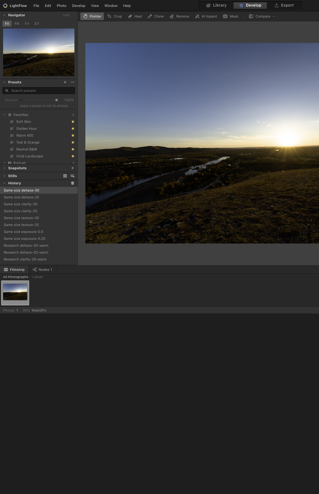
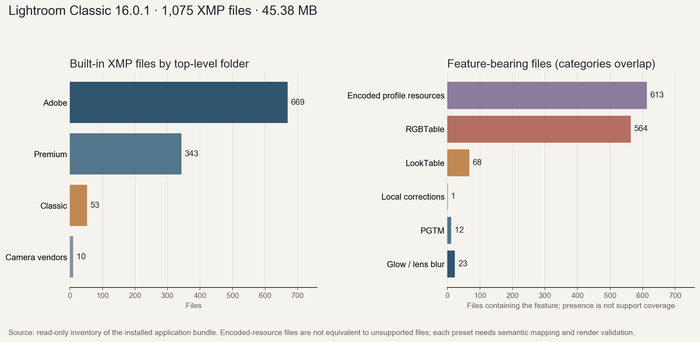
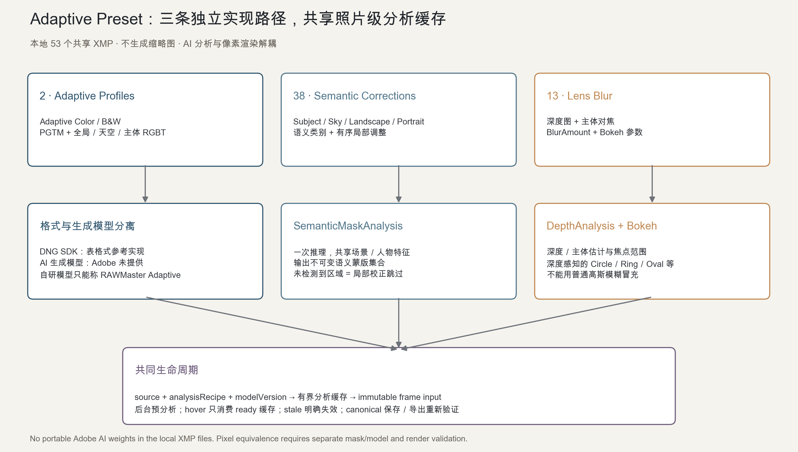

# LightFlow 风格预设目录树、Lightroom XMP 互操作与保存方案调研

**2026-11-22 实施接续。** 本文保留 11 月 21 日的资源盘点与方案演进。产品采用第 6.2 节的限定迁移口径，1,075 项用于研究和目录压力测试。当前工作树已支持原生八色 HSL、更多局部参数以及设备深度散景。后续实现按 031 的逐字段、逐来源验收决定开放范围。[修订后的产品规格](../../specs/031-preset-browser/spec.md) · [当前代码接点](../../specs/031-preset-browser/plan.md) · [联合排期](../planning/24-mask-preset-retouch-roadmap.md)

## 执行摘要

本轮只完成技术调研和方案设计，**没有修改生产代码，也没有把 Adobe 预设导入 RAWMaster 的运行库**。结论可以概括为：目录树和 hover 是对现有架构的低风险扩展；普通 XMP 全局调整子集是中等规模、可验证的兼容工程；把本机所有 Adobe 资源做到忠实渲染，则包含新的 Profile／RGB Table／局部校正渲染管线，不能与“解析 XML”混为一谈。

共享目录实测进一步收敛了导入范围：Lightroom 应用包与系统 Camera Raw 共有的 **1022 个 XMP 字节完全一致**，Lightroom 只额外提供 **53 个 Classic XMP**，不应重复导入或维护两份内置副本。53 个 Adaptive XMP 则必须拆成三条独立技术路线：**2 个 Adaptive Profile、38 个语义蒙版校正、13 个 Lens Blur**。它们可以共享照片级分析调度，但生成模型、渲染算子、缓存内容和像素验收均不同，不能以单一“Adaptive 滤镜”开关交付。

建议采用以下产品契约：

1. **界面不再生成滤镜预览图**，改为搜索框、Amount、Favorites、可折叠目录树和无缩略图预设行；Profiles 与 Presets 分根节点展示。
2. **所有本机资源都可建立索引，但只有明确支持的效果才可静默应用**。部分支持必须显示原因；严格模式下禁用部分应用，避免得到看似成功但风格错误的结果。
3. **预设是稀疏补丁，不是完整 Recipe**。应用时只覆盖预设包含的组，未包含组保持当前值；Amount 始终从应用前 Recipe 重算，不能累计缩放。
4. **保存采用双格式**：原生 `.rmpreset.json` 保存 RAWMaster 全部状态；Adobe `.xmp` 只导出明确兼容的 Camera Raw 子集，并在导出前列出包含／排除项。固定 LUT、AI Mask、修复笔刷等不能伪装成 Lightroom 可理解字段。
5. **除明确的本地迁移白名单外，本机 Adobe 内置资源采用只读索引**，不默认随 RAWMaster 分发。Adobe 官方明确其产品界面不允许导出内置 Lightroom Classic 预设，因此产品上也应把内置资源与用户预设分开管理。[Adobe Lightroom Classic 官方说明](kimi-cite://web?url=https%3A%2F%2Fhelpx.adobe.com%2Flightroom-classic%2Fdesktop%2Fprocess-and-develop-photos%2Fapply-presets.html "citation")
6. **后续迁移只复制 78 个 XMP**：Lightroom／Camera Raw 自带的全部 **53 个 Adaptive 资源**（2 Profile + 38 语义校正 + 13 Lens Blur），以及用户 `ImportedSettings` 目录现有 25 个 XMP；其余 1022 个非 Adaptive 内置 XMP、DCP 和 cube 均不复制。复制只解决本地资源所有权与可移植性，不等于对应渲染能力已经实现。

## 1. 证据与当前架构

### 1.1 LightFlow 的实际 UI 与行为

已有 LightFlow `2d41ab1` 发布构建截图显示，预设区位于左侧，顶部为标题、添加入口和更多菜单，下方依次是搜索框、Amount、Favorites 与文件夹。预设行只有小图标、名称和收藏星标，没有缩略图；下方继续排列 Snapshots、Stills、History。这与本次需求的目录树方向一致。



发布 JavaScript 不只是界面相似，还直接证明了交互契约：预设行 `onPointerEnter` 根据当前照片和预设构造临时编辑，`onPointerLeave` 清空；点击才应用，Enter／Space 提交，上下箭头在可见行之间移动焦点。[LightFlow 预设行事件](kimi-cite://text?path=%2FUsers%2Frobinqu%2FWorkspace%2Fgithub%2Frobinqu%2FRAWMaster%2Foutput%2Flightflow-research%2Fpreset-analysis%2Fkeyword-contexts.txt&text=onPointerEnter%3A()%3D%3Edn(o%3Fnull%3AKg(je(t)%2Ce%2C1%2Ct))%2ConPointerLeave%3A()%3D%3Edn(null) "citation")

LightFlow 的 `dn` 最终发送 `preview.set`，切换照片或离开预览时发送 `preview.end`，因此 hover 不是一次提交后的撤销，而是独立临时编辑状态。[LightFlow preview 生命周期](kimi-cite://text?path=%2FUsers%2Frobinqu%2FWorkspace%2Fgithub%2Frobinqu%2FRAWMaster%2Foutput%2Flightflow-research%2Fpreset-analysis%2Fkeyword-contexts.txt&text=n.executeNow(%7Btype%3A%22preview.set%22%2Cphoto%3At%2Cedit%3Ae%7D) "citation")

它还区分三种应用语义：Base 只设置基础校正，Node Group 添加到当前节点之后，Grade 替换调色但保留 Base。RAWMaster 首版没有节点图，不应照搬三种类型；可先实现“稀疏全局补丁”，未来再扩展局部组或节点预设。

| LightFlow 机制 | RAWMaster 应复用 | 首版不照搬 |
| --- | --- | --- |
| 无缩略图行与文件夹 | 目录树、搜索、收藏、Amount | Stills 等完整工作区 |
| 独立 preview.set / end | 临时 Recipe、独立 consumer、离开恢复 | 浏览器 Worker 协议 |
| 点击一次应用 | 一次原子事务、一个撤销记录 | 多照片批量应用，后做 |
| Amount 从预设前状态重算 | 保存 base Recipe、presetID、amount | 所有参数统一线性缩放 |
| Base / Group / Grade | 保留“应用范围”概念 | 首版不引入节点系统 |

### 1.2 RAWMaster 当前可复用基础

当前 `EditingLeftSidebar` 已经位于左侧，并同时容纳滤镜、快照和历史；只需用新的预设浏览器替换 `PhotosFilterControls`，不必重新设计工作区。[现有左侧栏](kimi-cite://text?path=%2FUsers%2Frobinqu%2FWorkspace%2Fgithub%2Frobinqu%2FRAWMaster%2FSources%2FRAWMaster%2FEditingLeftSidebar.swift&text=PhotosFilterControls(editing%3A%20editing%2C%20session%3A%20session%2C "citation")

上一轮已经完成独立 hover consumer、token、主图 revision／presentation 校验、交叉 hover、Escape 恢复和收藏持久化。这些能力可以从“固定滤镜 hover”泛化为“任意临时 Recipe hover”，主图预览和画布不需要另起一套生命周期。

现有命令层支持多组 `setParameters` 和 `applyAtomically`，能承载普通全局预设补丁；但 `DevelopmentRecipe` 本身是完整值，不包含“哪些组被预设显式包含”的信息，因此需要单独模型记录稀疏性。[现有命令模型](kimi-cite://text?path=%2FUsers%2Frobinqu%2FWorkspace%2Fgithub%2Frobinqu%2FRAWMaster%2FSources%2FRAWMasterCore%2FDevelopmentAdjustmentCommands.swift&text=case%20setParameters(DevelopmentAdjustmentParametersV3) "citation")

## 2. 本机 Lightroom 资源实测清单

### 2.1 版本、数量和分类

本机安装的是 **Lightroom Classic 16.0.1**。对应用包 `Contents/Resources/Settings` 的只读副本进行全量解析，共发现 **1075 个 XMP、45,379,024 字节，0 个 XML 解析失败、0 组重复内容 SHA**；另有 9 个 `.cube` 文件。用户 `Develop Presets` 目录目前没有实际预设文件。



| 维度 | 实测结果 | 产品含义 |
| --- | ---: | --- |
| Adobe / Premium / Classic | 669 / 343 / 53 | 目录树可沿用来源与 Group |
| Apple / Google / Samsung / Xiaomi | 4 / 2 / 2 / 2 | 属于相机相关 Profile，不应混入普通用户配方 |
| `crs:Group=Profiles` | **549** | 建议单独 Profiles 根节点 |
| 非 Profiles 组 | **526** | 包含 419 Normal、70 Look、37 个无 PresetType |
| Process 11.0 / 10.0 / 15.4 | 649 / 124 / 230 | 需要版本化映射 |
| ProcessVersion 缺失 | 72 | 依据其他字段与 Classic 规则处理，不可默认最新语义 |
| 声明 SupportsAmount | **834** | 声明存在不等于已知插值算法 |
| 声明 SupportsAmount2 | **135** | 需要单独实测 |
| 带任一编码 Profile 资源 | **613** | 需要资源解码与渲染能力评估 |
| Profiles 组之外仍带编码资源 | **67** | 普通预设列表中也不能忽略 Look 资源 |
| Glow／Lens Blur 相关文件 | **23** | 当前没有等价算子 |

以上数字来自本地逐文件清单，不把“字段出现”解释为“RAWMaster 不支持”，也不把“可解析”解释为“可渲染”。[覆盖统计](kimi-cite://text?path=%2FUsers%2Frobinqu%2FWorkspace%2Fgithub%2Frobinqu%2FRAWMaster%2Foutput%2Flightroom-preset-research%2Fcoverage-summary.json&text=%22total%22%3A%201075 "citation")

### 2.2 真实 XMP 证明格式不是一个扁平字典

普通 Creative 预设包含 `Shadows2012`、`Clarity2012`、HSL、Split Toning、Color Grading 和四个 `rdf:Seq` 点曲线。仅支持曝光和饱和度的解析器会丢掉这类预设的主要风格。[Creative XMP 示例](kimi-cite://text?path=%2FUsers%2Frobinqu%2FWorkspace%2Fgithub%2Frobinqu%2FRAWMaster%2Foutput%2Flightroom-preset-research%2Fbuiltin-settings%2FAdobe%2FPresets%2FCreative%2FCreative%20-%20Warm%20%26%20Moody.xmp&text=crs%3AToneCurvePV2012 "citation")

新的 Glow 示例使用 `Version=19.0`、`ProcessVersion=15.4` 和一组当前 RAWMaster 没有的方向性 Glow 参数。[Glow XMP 示例](kimi-cite://text?path=%2FUsers%2Frobinqu%2FWorkspace%2Fgithub%2Frobinqu%2FRAWMaster%2Foutput%2Flightroom-preset-research%2Fbuiltin-settings%2FPremium%2FStyle%20-%20Glow%2FDream.xmp&text=crs%3AGlow%3D%2280%22 "citation")

Look／Profile 文件还包含 `Table_<UUID>` 形式的长编码字符串，以及 `LookTable`、`RGBTable`、`RGBTables`、`ProfileGainTableMap` 引用。它们的编码、色彩空间、阶段和 Amount 规则必须依据 Adobe Profiles SDK 与实测确认，不能把字符串当 Base64 后塞进现有 Delta64 LUT。

### 2.3 本地 Lightroom／Camera Raw 共享副本对比

除应用包外，本轮还逐字节比较了系统级 `/Library/Application Support/Adobe/CameraRaw/Settings`。两处有 **1022 个相同相对路径**，这 1022 个文件的 SHA 与字节全部一致，差异文件和系统独有文件均为 **0**；Lightroom 仅多出 `Classic/` 下 **53 个 XMP**。因此本机资源不是“1075 + 1022”的两套预设，而是 **1022 个共享资源 + 53 个 Lightroom Classic 补充资源**。[共享副本逐路径比较](kimi-cite://text?path=%2FUsers%2Frobinqu%2FWorkspace%2Fgithub%2Frobinqu%2FRAWMaster%2Foutput%2Flightroom-preset-research%2Fshared-settings-comparison.json&text=%22commonIdenticalBytes%22%3A%201022 "citation")

按目录树用途拆分，549 个 Profiles 全部有相同系统副本；526 个非 Profiles 预设中，**473 个有相同系统副本，53 个仅随 Lightroom Classic 提供**。后者仍是可导入 Camera Raw 的 XMP，只是当前不在系统共享目录。用户级 Lightroom `Develop Presets` 没有实际预设，用户级 Camera Raw Settings 也只有索引数据、没有自定义 XMP；系统另有约 **872 MB CameraProfiles DCP**，属于相机基础 Profile，不纳入本次滤镜预设清单。

实现上应建立一个内容寻址索引：内置记录同时保存 Lightroom 相对路径、系统 Camera Raw 相对路径和 SHA，以内容 ID 去重；导入扫描顺序不再决定显示重复项。53 个 Classic 文件可在获得用户授权后从 Lightroom 应用包只读索引，但不应为了“同步 Camera Raw”而写入 Adobe 的系统目录。Adobe 升级时以应用版本和 SHA 做增量重扫，收藏始终指向稳定内部 ID，而非某个易变化的绝对路径。

### 2.4 本地可用预设分组清单

下表按 `crs:Group` 聚合全部 **1075 个 XMP**，包含 **55 个非 Profile 分组 + 1 个 Profiles 汇总行**，而不是只按文件路径猜测分类；“相同 Camera Raw 副本”表示同相对路径且字节一致，“Lightroom 独有”仅指共享目录现状，不表示格式不可导入。Adaptive 列是后续专项分析识别的 53 个文件。526 个非 Profile 预设和 549 个 Profiles 的名称、路径、PresetType、ProcessVersion、Amount 与资源标志分别见两份逐文件 CSV 清单。[非 Profile 逐文件目录](kimi-cite://text?path=%2FUsers%2Frobinqu%2FWorkspace%2Fgithub%2Frobinqu%2FRAWMaster%2Foutput%2Flightroom-preset-research%2Flocal-preset-catalog.csv&text=group%2Cname%2Cpath%2CsharedIdentical%2ClightroomOnly%2CpresetType%2CprocessVersion "citation"), [Profiles 逐文件目录](kimi-cite://text?path=%2FUsers%2Frobinqu%2FWorkspace%2Fgithub%2Frobinqu%2FRAWMaster%2Foutput%2Flightroom-preset-research%2Flocal-profile-catalog.csv&text=name%2Cpath%2CsharedIdentical%2CpresetType%2CprocessVersion "citation")

| Group | 总数 | 相同 Camera Raw 副本 | Lightroom 独有 | 编码资源 | Adaptive | 示例 |
| --- | ---: | ---: | ---: | ---: | ---: | --- |
| Profiles（独立根节点汇总） | 549 | 549 | 0 | 546 | 0 | Adobe Color、Adobe Portrait、Adobe Landscape |
| （无 `crs:Group`） | 6 | 6 | 0 | 6 | 0 | Google Pixel、Google Pixel Monochrome、Samsung Expert RAW |
| Adaptive | 2 | 2 | 0 | 2 | 2 | Adaptive B&W、Adaptive Color |
| Adaptive: Blur Background | 13 | 13 | 0 | 0 | 13 | Bubble、Bubble Swirl、Circle |
| Adaptive: Portrait | 1 | 1 | 0 | 0 | 1 | Adaptive - Polished Portrait |
| Artistic | 8 | 8 | 0 | 8 | 0 | Artistic 01、Artistic 02、Artistic 03 |
| Auto+: Retro | 11 | 11 | 0 | 0 | 0 | AR01、AR02、AR03 |
| B&W | 32 | 32 | 0 | 22 | 0 | B&W 01、B&W 02、B&W 03 |
| Classic - B&W Filter | 8 | 0 | 8 | 0 | 0 | Blue Filter、Blue Hi-Contrast Filter、Green Filter |
| Classic - B&W Presets | 7 | 0 | 7 | 0 | 0 | B&W Contrast High、B&W Contrast Low、B&W Look 1 |
| Classic - B&W Toned | 10 | 0 | 10 | 0 | 0 | Antique、Antique Light、Creamtone |
| Classic - Color Presets | 9 | 0 | 9 | 0 | 0 | Aged Photo、Bleach Bypass、Cold Tone |
| Classic - Effects | 7 | 0 | 7 | 0 | 0 | Grain - Heavy、Grain - Light、Grain - Medium |
| Classic - General | 6 | 0 | 6 | 0 | 0 | Auto Settings、Medium Contrast Curve、Punch |
| Classic - Video | 6 | 0 | 6 | 0 | 0 | Video B&W Classic、Video B&W High Contrast、Video Color Pop |
| Color | 6 | 6 | 0 | 0 | 0 | Color - Bright、Color - High Contrast、Color - High Contrast & Detail |
| Creative | 13 | 13 | 0 | 0 | 0 | Creative - Aged Photo、Creative - Cool Light、Creative - Cool Matte |
| Curve | 5 | 5 | 0 | 0 | 0 | Curve - Cross Process、Curve - Flat、Curve - Lift Shadows |
| Defaults | 10 | 10 | 0 | 0 | 0 | Adobe Color + Lens、Adobe Color + Lens + NR、Adobe Default |
| Film-Inspired | 12 | 12 | 0 | 9 | 0 | Film-Inspired 01、Film-Inspired 02、Film-Inspired 03 |
| Grain | 4 | 4 | 0 | 0 | 0 | Grain - Heavy、Grain - Light、Grain - Medium |
| Modern | 10 | 10 | 0 | 10 | 0 | Modern 01、Modern 02、Modern 03 |
| Optics | 3 | 3 | 0 | 0 | 0 | Optics - CA Correction、Optics - Lens + CA Correction、Optics - Lens Correction |
| Portraits | 13 | 13 | 0 | 0 | 0 | Portraits - Light Skin 01、Portraits - Light Skin 02、Portraits - Light Skin 03 |
| Portraits: Black & White | 12 | 12 | 0 | 0 | 0 | PB01、PB02、PB03 |
| Portraits: Deep Skin | 15 | 15 | 0 | 0 | 0 | PD01 Orange、PD01 Red、PD01 Yellow |
| Portraits: Edgy | 12 | 12 | 0 | 0 | 0 | PE01、PE02、PE03 |
| Portraits: Group | 8 | 8 | 0 | 0 | 0 | PG01、PG02、PG03 |
| Portraits: Light Skin | 11 | 11 | 0 | 0 | 0 | PL01、PL02、PL03 |
| Portraits: Medium Skin | 11 | 11 | 0 | 0 | 0 | PM01、PM02、PM03 |
| Premium/Adaptive - Landscape | 8 | 8 | 0 | 0 | 8 | Autumn01、Autumn02、Spring01 |
| Premium/Adaptive - Portrait | 11 | 11 | 0 | 0 | 11 | Darken Beard、Darken Eyebrows、Enhance Clothes |
| Premium/Adaptive - Sky | 9 | 9 | 0 | 0 | 9 | Blue Drama、Blue Hour、Blue Pop |
| Premium/Adaptive - Subject | 9 | 9 | 0 | 0 | 9 | Balance Contrast、Cool Soft、Glow |
| Seasons: Autumn | 12 | 12 | 0 | 0 | 0 | TM01、TM02、TM03 |
| Seasons: Spring | 12 | 12 | 0 | 0 | 0 | SP01、SP02、SP03 |
| Seasons: Summer | 11 | 11 | 0 | 0 | 0 | SM01、SM02、SM03 |
| Seasons: Winter | 10 | 10 | 0 | 0 | 0 | WN01、WN02、WN03 |
| Sharpening | 4 | 4 | 0 | 0 | 0 | Sharpening - Heavy、Sharpening - Light、Sharpening - Medium |
| Style: Black & White | 12 | 12 | 0 | 0 | 0 | BW01、BW02、BW03 |
| Style: Cinematic | 10 | 10 | 0 | 0 | 0 | CN01、CN02、CN03 |
| Style: Cinematic II | 8 | 8 | 0 | 0 | 0 | CN11、CN12、CN13 |
| Style: Film-Inspired | 12 | 12 | 0 | 0 | 0 | Film-Inspired - Bold B&W、Film-Inspired - Cool B&W、Film-Inspired - Deep Blue |
| Style: Futuristic | 12 | 12 | 0 | 0 | 0 | FT01、FT02、FT03 |
| Style: Glow | 10 | 10 | 0 | 0 | 0 | Glow - Amber Aura、Glow - Cinematic Flare、Glow - Cinematic Glow |
| Style: Vintage | 11 | 11 | 0 | 0 | 0 | Grain Off、VN01、VN02 |
| Subject: Concerts | 11 | 11 | 0 | 0 | 0 | CT01、CT02、CT03 |
| Subject: Food | 11 | 11 | 0 | 0 | 0 | FD01、FD02、FD03 |
| Subject: Landscape | 10 | 10 | 0 | 0 | 0 | LN01、LN02、LN03 |
| Subject: Lifestyle | 8 | 8 | 0 | 0 | 0 | LF01、LF02、LF03 |
| Subject: Travel | 10 | 10 | 0 | 0 | 0 | TR01、TR02、TR03 |
| Subject: Travel II | 8 | 8 | 0 | 0 | 0 | TR11、TR12、TR13 |
| Subject: Urban Architecture | 10 | 10 | 0 | 0 | 0 | UA01、UA02、UA03 |
| Video: Creative | 12 | 12 | 0 | 0 | 0 | VCR01、VCR02、VCR03 |
| Vignetting | 4 | 4 | 0 | 0 | 0 | Vignetting - Heavy、Vignetting - Light、Vignetting - Medium |
| Vintage | 10 | 10 | 0 | 10 | 0 | Vintage 01、Vintage 02、Vintage 03 |
| **合计** | **1075** | **1022** | **53** | **613** | **53** | 526 个非 Profiles + 549 个 Profiles |

## 3. Adobe 兼容契约应如何定义

### 3.1 Preset、Profile、Sidecar 是三种对象

Camera Raw 官方定义 Preset 为曝光、对比度、调色、锐化等预保存设置，支持创建时选择 Subset、更新用户预设和 Amount。[Camera Raw Presets](kimi-cite://web?url=https%3A%2F%2Fhelpx.adobe.com%2Fcamera-raw%2Fdesktop%2Fedit-and-enhance-images%2Ftone-and-color%2Fpresets.html "citation")

Profile 是显影基础，不改变其他编辑滑杆；创意 Profile 可以有 Amount，RAW 基础 Profile 与 Camera Matching 又具有不同适用范围。[Camera Raw Profiles](kimi-cite://web?url=https%3A%2F%2Fhelpx.adobe.com%2Fcamera-raw%2Fdesktop%2Fedit-and-enhance-images%2Ftone-and-color%2Fadjust-color-rendering-camera-camera.html "citation")

Sidecar XMP 则描述某一张照片的当前设置，可能包含 `RawFileName`、完整裁剪、局部笔刷和照片相关状态。**不能把任意照片 sidecar 当可移植预设导入**；导入器必须检查 Preset 元数据、忽略照片身份，并对局部／裁剪内容单独提示。

### 3.2 兼容等级必须分层

| 等级 | 可验收事实 | 不能由此推出 |
| --- | --- | --- |
| 文件兼容 | Lightroom Classic 能导入，名称、分组、UUID 和可见性正确 | 像素一致 |
| 参数兼容 | 包含字段在 Adobe UI 中显示为预期值，未包含字段不被导出器擅自重置 | 算法一致 |
| 行为兼容 | 点击、子集合并、Amount、RAW/JPEG 限制符合预期 | 所有照片视觉一致 |
| 像素兼容 | 固定源、固定 Process／Profile、固定输出下误差在既定容差内 | 全相机、全版本、全 HDR 一致 |

“保证和 Lightroom 兼容”首版应至少承诺**文件兼容 + 已导出字段的参数兼容**。像素兼容必须逐算子建立金色样本，不能跨不同显影引擎做无条件承诺。

### 3.3 Process Version 与字段版本

Adobe 官方说明 PV2012 与旧 PV 的 Highlights、Shadows、Whites、Blacks、Recovery、Fill Light、Brightness 等具有不同意义。[Adobe Process Version 相关说明](kimi-cite://web?url=https%3A%2F%2Fhelpx.adobe.com%2Fcamera-raw%2Fdesktop%2Fusing%2Fmake-color-tonal-adjustments-camera.html "citation")

映射器至少需要三个分支：PV2012 及后续的现代字段、PV2010／2003 的旧字段、以及 Process 15.4 新增效果。旧字段不能直接除以 100 后写入现代滑杆；无法证明转换时，应将该组标为不支持，而不是产生近似但无标记的效果。

### 3.4 XMP 保留与安全

XMP 官方定义的是可扩展数据模型、RDF 序列化和数组／结构体，而不是 Adobe 标签的静态列表。[Adobe XMP 规范入口](kimi-cite://web?url=https%3A%2F%2Fdeveloper.adobe.com%2Fxmp%2Fdocs%2Fxmp-specifications%2F "citation")

因此导入记录应同时保存：原始 XMP 字节、RDF 节点树、已映射补丁、未映射字段清单、内容 SHA 和映射器版本。更新映射器后可以重新编译；导出“原始 Adobe 预设”时可以复制原字节，避免解析—重建造成未知字段丢失。

## 4. 推荐界面：无预览图的预设目录树

### 4.1 布局

```text
Presets                                      +  ⋯
┌──────────────────────────────────────────┐
│ Search presets                           │
└──────────────────────────────────────────┘
Amount  ─────────────── 100%   （未应用时禁用）

★ Favorites                              6
▾ User Presets
    My Warm Portrait                     ★
    Travel Base
▾ Presets
  ▸ Color
  ▸ Creative
  ▸ B&W
  ▸ Premium …
▸ Profiles                             549
```

- 行高、缩进、图标、搜索与收藏参考 LightFlow，不生成任何候选位图。
- Favorites 是虚拟集合，同一预设仍保留在原目录；收藏 ID 不进入 Recipe。
- 文件夹行只展开／收起，不触发图片渲染；只有预设标题行触发 hover。
- 星标和更多菜单有独立 hit area，进入这些按钮不应意外应用预设。
- 支持状态用小图标和无障碍描述表示；当前照片不兼容时淡出，不用错误弹窗打断浏览。

SwiftUI `List + OutlineGroup` 已提供层级数据和渐进展开，展开时才求值内容，适合作为首版实现。[Apple OutlineGroup / WWDC20](kimi-cite://web?url=https%3A%2F%2Fdeveloper.apple.com%2Fvideos%2Fplay%2Fwwdc2020%2F10031%2F "citation")

索引必须在后台预先构建，不能依赖 OutlineGroup 的惰性求值在滚动时同步读取 XML。若真实 1075 行测试证明焦点、选择或刷新不稳定，再替换为 `NSOutlineView`，数据模型无需改变。

### 4.2 状态展示

建议区分三种状态，而不是只有一个“支持”布尔值：

| 状态 | 示例 | 行为 |
| --- | --- | --- |
| 已导入 | 文件 SHA、名称、Group 已进入库 | 可搜索、收藏、查看原始字段 |
| 当前照片可应用 | RAW/JPEG、CameraModelRestriction、Color/Mono、HDR 条件满足 | 行正常；不满足时淡出并解释 |
| RAWMaster 渲染支持 | 所有有效字段均能映射，所需 Look 资源可用 | 完整应用；部分支持需明确标记 |

默认采用**严格应用**：完整支持才直接点击应用。用户可以在详情中选择“仅应用已支持字段”，此时标题、hover 和最终提交都持续显示“部分预设”，并列出跳过字段。

## 5. 稀疏预设与应用事务

### 5.1 推荐模型

```swift
struct DevelopmentPresetV1 {
    let id: UUID
    var name: String
    var groupPath: [String]
    var origin: Origin              // adobeBuiltin / imported / rawMasterUser
    var contentSHA256: String
    var processVersion: String?
    var presetType: String?
    var amountSupport: AmountSupport
    var sourceRules: SourceRules
    var patch: DevelopmentRecipePatchV1
    var support: SupportReport
    var originalXMP: Data?
}

struct DevelopmentRecipePatchV1 {
    var light: DevelopmentLightV3?
    var color: DevelopmentColorV3?
    var whiteBalance: DevelopmentWhiteBalanceV3?
    var curves: DevelopmentCurvesV3?
    // 其他组同样可选；nil 表示预设不包含，不是 reset。
}
```

补丁编译后仍可使用现有命令和原子事务，但 `nil` 的语义必须保持为“不变”。不能先构造一个全零 Recipe 再覆盖当前配方，因为那样会把未包含的裁剪、颜色和局部调整意外复位。

### 5.2 点击与 Amount

点击时保存 `PresetApplicationSession(presetID, baseRecipe, amount=100, photoID)`，再用 `base + patch` 生成一次提交。Amount 改变时永远从同一 base 重算，历史记录按一个连续手势合并。用户随后调整其他控制时，可以保留预设名称作为来源标注，但 Amount 会话必须失效或重新取基线，避免把新编辑回滚。

Adobe 官方明确创建预设时可以选择是否支持 Amount；不适用的设置会禁用该选项。RAWMaster 应同样按字段计算 Amount 能力，而不是给所有预设统一显示滑杆。[Lightroom Amount 与保存行为](kimi-cite://web?url=https%3A%2F%2Fhelpx.adobe.com%2Flightroom-classic%2Fdesktop%2Fprocess-and-develop-photos%2Fapply-presets.html "citation")

首版仅对实测过的标量／曲线组启用 Amount；开关、Camera Profile、Mask、LookTable 和未知字段不被简单乘比例。`SupportsAmount2` 的公开算法证据不足，应建立 Adobe 对照探针后再支持。

## 6. 导入架构

### 6.1 处理流水线

```text
用户选择 XMP / ZIP，或启动限定范围迁移
  → 手工导入安全展开，或 migration allowlist 精确枚举
  → 有界读取 + RDF/XMP 解析，保留原始字节与未知节点
  → Preset / Profile / Look 依赖 / Sidecar 分类
  → Process Version + 字段映射
  → SourceRules / Amount / SupportReport / DependencyReport
  → SHA 校验后复制到内容寻址存储，生成不可变目录快照
```

普通手工导入和本次限定迁移都把文件复制到 RAWMaster 自己的 Application Support 内容库，外部文件之后移动或删除不影响已导入项。限定迁移不建立全量 Lightroom 应用包索引，也不因为发现外部 Look UUID 就额外复制被引用的内置资源；依赖是否缺失必须进入导入报告。

持续读取用户授权的外部目录时，应使用安全作用域书签、stale 处理和访问配对；UTType 只为文件选择器提供类型声明，不代替内容验证。[Apple UTType](kimi-cite://web?url=https%3A%2F%2Fdeveloper.apple.com%2Fdocumentation%2Funiformtypeidentifiers%2Futtype-swift.struct "citation")

### 6.2 后续迁移白名单：全部内置 Adaptive 与 ImportedSettings

本轮实测迁移集合固定为 **78 个 XMP、1,881,440 字节**。内置部分包含全部 **53 个 Adaptive 资源**：2 个 Adaptive Profile、38 个语义蒙版校正和 13 个 Lens Blur；ImportedSettings 则递归收集其中的 `.xmp`，忽略 `.DS_Store` 等非 XMP 文件。53 个内置文件均在系统 Camera Raw 中具有字节一致的共享副本。[内置 Adaptive 迁移清单](kimi-cite://text?path=%2FUsers%2Frobinqu%2FWorkspace%2Fgithub%2Frobinqu%2FRAWMaster%2Foutput%2Flightroom-preset-research%2Fbuiltin-adaptive-migration.json&text=%22xmpCount%22%3A%2053 "citation"), [用户预设与依赖分析](kimi-cite://text?path=%2FUsers%2Frobinqu%2FWorkspace%2Fgithub%2Frobinqu%2FRAWMaster%2Foutput%2Flightroom-preset-research%2Fprofile-migration-analysis.json&text=%22xmpCount%22%3A%2025 "citation")

| 来源 | 文件数 | 字节数 | 迁移行为 |
| --- | ---: | ---: | --- |
| Adaptive Color／Adaptive B&W | 2 | 209,441 | 复制到 RAWMaster 内容库，归类 Profiles/Adaptive |
| Subject 9 + Sky 9 + Landscape 8 + Portrait 12 | 38 | 245,780 | 复制为内置语义 Adaptive Presets，保留 MaskGroupBasedCorrections |
| Adaptive: Blur Background | 13 | 25,004 | 复制为 Lens Blur Adaptive Presets，保留 `crs:LensBlur` |
| 用户 `~/Library/Application Support/Adobe/CameraRaw/ImportedSettings` | 25 | 1,401,215 | 保留相对路径、原始 XMP、Name／Group／UUID 和 SHA |
| **合计** | **78** | **1,881,440** | 约 1.88 MB；53 内置 + 25 用户；用户文件均非 Adobe 内置字节副本 |

后续实现可直接读取统一机器可读清单；每项包含 sourceRoot、相对路径、SHA、content 目标路径、能力类型、显示分组和依赖，不依赖本报告重新推断白名单。[migration-manifest-v1](kimi-cite://text?path=%2FUsers%2Frobinqu%2FWorkspace%2Fgithub%2Frobinqu%2FRAWMaster%2Foutput%2Flightroom-preset-research%2Fmigration-manifest-v1.json&text=%22fileCount%22%3A%2078 "citation")

截图顶部的五组与本地清单一一对应：**Adaptive: Portrait 12、Sky 9、Subject 9、Landscape 8、Blur Background 13**，合计 51 个，再加 Profiles 中的 Adaptive Color／B&W 两个，形成完整 53 项。截图同时出现的 `Portraits:*`、`Auto+: Retro`、`Seasons:*`、`Style:*`、普通 `Subject:*` 和 `Video: Creative` 不属于这 53 个 Adaptive 资源，不因名称相似或同屏出现而纳入迁移。

ImportedSettings 的 25 个文件包含 **19 个 Normal 预设 + 6 个 Look XMP**，没有 PGTM 或 RGBTables，因此文件名中的“Adaptive”不等于 Adobe Adaptive Profile。RNI 的 6 个 Look 各内嵌一个 RGBTable，12 个普通／grainy 预设通过 Look UUID 指向这 6 个 Look；这 12 条依赖均能在白名单内部闭合。

| 用户内容 | 数量 | 结构与迁移后的支持约束 |
| --- | ---: | --- |
| RNI Aerochrome、Agfacolor、Ilford Delta、Kodak E 200、Kodak Portra、Polaroid 690 | 18 | 每组 Look + 普通 + grainy 三个文件；6 个 RGBTable Look 默认作为内部依赖，不与普通预设重复展示 |
| Fuji Pro 400H Emulation 1–4 | 4 | 普通预设，`CameraProfile=Adobe Standard`；需要验证现有 RAW 基础色彩是否满足，不能默认等价 |
| Alex Ruskman Kodachrome 64 | 1 | 普通预设，`CameraProfile=Camera Standard`；依赖相机匹配 DCP，而本计划不复制 DCP，缺失时标记限制 |
| Leica Q3 (DF 2023 Adaptive) | 1 | 普通预设，不是 Adaptive Profile；引用白名单外的 Adobe Color Look UUID，并含 2 个 ISODependent 节点 |
| M88-Fuji Classic Negative（教程版） | 1 | 普通预设，`CameraProfile=Adobe Standard`，保留原始中文 Name／Group |

迁移器应按以下规则落地：

- **只枚举白名单**。生产实现使用用户 home 相对路径，不硬编码当前用户名；内置侧按 53 条已审计相对路径和 SHA 精确枚举，不使用“名称包含 Adaptive”的模糊匹配。不得复制其余 **969 个共享非 Adaptive XMP、53 个 Classic XMP**、CameraProfiles DCP 或 9 个 cube。
- **先解析依赖再提交目录快照**。12 条 RNI 内部 Look 引用可闭合；Leica 的 Adobe Color 外部引用保留为 `missingExternalLook`，不得自动复制 Adobe Color，也不得静默丢掉 Look 后宣称完整应用。
- **CameraProfile、Look 与 AI 分析是三类依赖**。RNI UUID 指向可复制 Look；Adobe Standard／Camera Standard 是 RAW 基础渲染条件；51 个内置 Adaptive Presets 还需要第 13 节定义的照片级语义或深度分析，复制 XMP 本身不提供模型。
- **原始文件优先**。以 `content/<sha>.xmp` 原子写入并复核 SHA，manifest 保存来源路径、相对路径、UUID、Name、Group、PresetType、支持状态和依赖；原始 Adobe／用户文件永不原地修改。
- **增量只重扫同一白名单**。以后用户向 ImportedSettings 添加 XMP 时可以手动刷新该目录；53 个内置 Adaptive 文件按预期 SHA 检测版本变化。更新不引入其他内置资源类别，也不把白名单扩展成全量后台索引。
- **默认 UI 显示 53 个内置 Adaptive 和 19 个用户 Normal 预设，共 72 个可见项**；6 个 RNI Look 作为依赖资源隐藏在内部 Profiles/Looks 集合，需要调试时再显示。Favorites 指向稳定内部 ID，而不是外部路径。

本地复制不等同于获得再分发权：53 个 Adobe 内置资源只进入这台机器的用户内容库，不进入 RAWMaster 安装器、公共样例包或默认“导出我的预设”集合。

原始目录顺序不等于 Lightroom 实际 UI 顺序。迁移后的目录使用 `SortName + Group + localizedName` 确定性排序，Group 缺失时保留为空并归入 Imported，不用文件名覆盖 XMP 中真实 Name。

### 6.3 ZIP 与 XML 安全边界

ZIP 导入需要拒绝绝对路径、`..` 穿越、符号链接逃逸、嵌套压缩包和超限展开，并限制文件数、单文件大小、总展开字节和压缩比。XML 解析禁用外部实体与网络访问，限制节点深度、数组长度、文本长度和总属性数。所有错误按文件收集，导入完成后给出“成功／部分／失败”报告，不因一个坏文件中断其余文件。

## 7. 保存当前调整为预设

### 7.1 双格式是唯一稳妥的完整方案

**原生格式**负责完整往返：保存完整 Recipe、稀疏组掩码、原始 XMP（若来自导入）、固定滤镜资源版本、Mask 和必要派生数据。**Adobe XMP 格式**负责互操作：只写 Lightroom 能理解的字段，并使用稳定的 `crs:UUID`、Name、Group、ProcessVersion 和支持标志。

保存对话框应提供名称、Group、Camera Raw 风格 Subset 复选框、Amount 支持和格式说明。选择 Adobe XMP 时，固定滤镜、Brilliance、主体 PNG、局部修复等不兼容组默认不选；如果用户要求完整保留这些组，则引导保存原生格式，而不是静默排除。

### 7.2 Subset 映射建议

| 保存组 | Adobe 字段／容器 | RAWMaster 当前映射 | 首版建议 |
| --- | --- | --- | --- |
| Basic Tone | Exposure2012、Contrast2012、Highlights2012、Shadows2012、Whites2012、Blacks2012 | `light` | 支持导入／导出，逐字段校准尺度 |
| White Balance | Temperature、Tint、IncrementalTemperature／Tint | `whiteBalance` / legacy basis | 数值 WB 支持；中性灰／肤色源绑定状态不导出 |
| Vibrance / Saturation | Vibrance、Saturation | `color` | 支持，需像素金色样本 |
| Treatment | ConvertToGrayscale | `blackAndWhite` | 支持基础转换；Gray Mixer 需另验 |
| Point Curve | ToneCurvePV2012 + RGB 通道、Parametric* | `curves` | 保存点可映射；插值与参数曲线必须验证 |
| HSL / Color | Hue／Saturation／LuminanceAdjustment 八色 | `selectiveColor` 六槽 | 不宣称完整；需扩展八色与范围语义 |
| Color Grading | SplitToning、ColorGrade* | legacy color grading 能力 | 中期支持，阶段顺序需对拍 |
| Detail | Sharpness、Sharpen*、LuminanceSmoothing、ColorNoiseReduction* | `sharpen`、`noiseReduction` | 字段可转换，算法不宣称等价 |
| Effects | GrainAmount／Size／Frequency、PostCropVignette* | `effects`、`vignette` | 分算子支持 |
| Texture / Clarity / Dehaze | Texture、Clarity2012、Dehaze | `advancedDetail` | 可映射数值，需渲染对拍 |
| Optics / Transform | LensProfile*、Perspective*、Crop* | `geometry` 部分 | 默认不选；镜头 Profile 与透视需独立契约 |
| Masking | MaskGroupBasedCorrections 等 | `masks` 简版 | 不进入首个 Adobe 子集 |
| Local Retouch | PaintBasedCorrections | `localEdits` | 原生格式专用 |
| Fixed nine filters | 无普通 Preset 字段 | `filter` Delta64 | 原生格式；Adobe 方向见下文 |
| Brilliance / Adaptive | PGTM、RGBTables 等 Adobe Adaptive 另有语义 | RAWMaster 自有实现 | 不互相伪装，分别保留 |

### 7.3 固定滤镜如何获得 Adobe 兼容输出

短期最诚实的方案是把固定九滤镜保留在原生预设中，Adobe XMP 导出明确排除并提示。长期可研究把 Delta64 转成 Adobe Enhanced Profile 的 LookTable，再由 Preset 引用该 Profile；这可能提供 Lightroom 可读的“Profile + Preset”包，但需要确认编码、线性空间、输入输出传输函数、HDR residual 和 Mono／Noir 规则，并用 Lightroom 实测。它不是普通 XMP writer 的附带功能。

如果当前编辑包含固定滤镜，而用户选择“严格完整 Adobe 导出”，在 LookTable 导出尚未验收前应禁用该选项并解释原因；不能生成只有曝光和颜色、却仍使用原预设名称的误导文件。

## 8. Hover 快速预览设计

### 8.1 生命周期

```text
pointerEnter(preset)
  → 读取不可变 preset + 当前 admitted base Recipe
  → compose(base, patch, amount=100)
  → capability/source compatibility 检查
  → token + sourceGeneration + presentation + baseRevision
  → 独立 consumer，2400 px interactive proxy
  → latest-request-wins 发布临时 frame

pointerLeave / Escape / 点击其他控制 / 切照片 / 比较 / 裁切
  → 取消交付并清空临时 frame
  → committed Recipe、历史和持久化始终不变
```

现有固定滤镜 hover 可泛化为内部 `previewDevelopmentRecipe`，预设与固定滤镜共用同一实现。LightFlow 在 pointer enter 直接构造预览，因此首版不必加固定延迟；滚动产生的大量 enter／leave 由最新 token 和小型编译补丁缓存吸收。只有实测出现滚动抖动时才加入可配置 debounce。

### 8.2 缓存与性能

不再使用预览图意味着**不为 1075 个预设预渲染任何位图**。只缓存解析后的元数据、稀疏补丁和最近一次主图临时帧。编译补丁缓存以 `contentSHA + mapperVersion` 为键；主图仍以合成后的 Recipe、源代理、几何和输出尺寸为键。

当前真实 AppKit 暖滤镜基线仍是 p50 27.367 ms、p95 34.061 ms，没有达到 20／33 ms 门。[现有性能验收](kimi-cite://md-line?path=%2FUsers%2Frobinqu%2FWorkspace%2Fgithub%2Frobinqu%2FRAWMaster%2Fspecs%2F028-filter-experience%2Fvalidation.md&line=82&text=%7C%20%E6%9A%96%E8%B7%AF%E5%BE%84%20p50%20%7C%20**27.367%20ms**%20%7C%20%E2%89%A4%2020%20ms%20%7C%20**%E6%9C%AA%E9%80%9A%E8%BF%87**%20%7C "citation")

因此新 hover 的目标应先定为“不劣于对应手动调整，且不改 committed 状态”，再单独优化协调层。普通 Basic 预设可走代理；包含当前不支持算子的预设若会 canonical fallback，不能宣称快速 hover，应禁用或显示完整渲染等待状态。

## 9. 存储、版本与迁移

推荐使用独立的全局 `DevelopmentPresetStore`，而不是把预设表加入每个项目的 `LibraryStore`：

- `manifest.sqlite` 或原子 JSON 索引保存元数据、支持报告、来源、收藏与排序。
- `content/<sha>.xmp` 保存手工导入、25 个 ImportedSettings 文件和白名单内 53 个内置 Adaptive 资源的副本；其他内置项不进入迁移 manifest，也不保留后台索引。
- `native/<uuid>.rmpreset.json` 保存 RAWMaster 用户预设及版本历史。
- `mapperVersion` 升级时在后台重编译支持报告，不改原始文件。
- 固定滤镜收藏从 `editing.filterFavorites.v1` 迁移为指向特殊 Classic Filters 预设 ID 的收藏；保留一次回退兼容。
- 目录展开、搜索和 Amount 属 UI 状态；预设内容、收藏和 Recipe 不互相污染。

保存和更新采用临时文件 + fsync／原子替换；内置和导入源永不原地覆盖。相同 Group + Name 冲突提供 Replace／Duplicate／Rename，与 Adobe 的用户预期一致，但内部 ID 始终独立。

## 10. 影响面

| 模块 | 预计改动 | 风险 |
| --- | --- | --- |
| `EditingLeftSidebar.swift` | 替换滤镜网格为 PresetBrowser，保留快照／历史 | 低 |
| 新增 `PhotosPresetBrowser.swift` | OutlineGroup、搜索、Amount、支持状态、键盘和菜单 | 中，重点测 1075 行 |
| `EditingController.swift` | 通用临时 Recipe hover、应用会话、Amount、收藏迁移 | 中高，涉及 committed 状态 |
| `EditingPreviewCoordinator.swift` | 泛化 renderDevelopmentFilterHover | 低，现有协议可复用 |
| `EditingDevelopmentSession.swift` | 稀疏补丁原子应用、撤销合并、更新预设 | 中高 |
| Core 新模型 | Preset、Patch、SourceRules、SupportReport、原生 Codable | 中 |
| XMP 新模块 | RDF 树、版本化字段映射、writer、ZIP 与资源库 | 高，主要是语义和安全 |
| Imaging | 普通子集复用；Look／RGBTable 需要新阶段和资源租约 | 高／很高 |
| 缩略图模块 | UI 不再请求 `.filters`；可保留代码并弃用，无需立刻删除 | 低 |
| 存储 | 独立全局预设库，不改现有项目 user_version=7 | 中 |
| 测试 | 全量 1075 解析、字段金色样本、UI、hover、恶意 XML/ZIP、真实 Lightroom 验证 | 高但必要 |

固定九滤镜可以作为一个 “Classic Filters” 文件夹继续显示，因此“不再使用预览图”不意味着删除现有 Delta64 资源或滤镜功能。滤镜缩略图 Service 可先保留以维持兼容和测试，但生产 UI 不再启动它，冷代理和十候选成本自然消失。

## 11. 分阶段实施建议

以下工作量只是以熟悉当前代码的单个工程师、包含测试为基准的粗略量级，不是承诺日期。

| 阶段 | 范围 | 粗略量级 | 完成判据 |
| --- | --- | --- | --- |
| P0 技术尖刺 | 1075 全量解析；20 个代表 XMP 映射；Lightroom 导入导出对照；LookTable 解码可行性 | 3–5 天 | 明确普通子集和 Profile 编码边界 |
| M1 目录树 + 原生预设 | 无图目录树、搜索、收藏、通用 hover、稀疏补丁、原生保存、Amount 基础 | 1–2 周 | 无缩略图请求；hover 不写历史；完整原生往返 |
| M2 Adobe 普通子集 + 限定迁移 | XMP/ZIP 导入、XMP writer、78 文件白名单、依赖报告、基础字段和曲线 | 3–5 周 | 仅复制 53 内置 Adaptive + 25 ImportedSettings；Lightroom 实际导入；外部依赖不静默丢失 |
| M3 Look / RGBTable | 编码资源解码、Profile 阶段、Amount、色彩和 HDR 对拍 | 6–12 周，研究风险高 | 6 个 RNI RGBTable、2 个 Adaptive 静态 LookTable 与依赖图验收；不等于 Adaptive AI 已完成 |
| M4 Adaptive 语义校正 | 先做 Subject／Sky 18 个，再做 Landscape 8 个与 Portrait 12 个；完整局部字段、共享分析、缓存与 writer | 独立大型项目，内部再分两次验收 | 38 个分类正确；区域缺失 no-op；缓存 stale 正确；语义与局部像素分别通过 |
| M5 Adaptive Lens Blur | 13 个 Lens Blur 的深度、焦点、Bokeh 与 Reset | 独立大型项目 | 不用普通高斯替代；深度／焦点／散景／遮挡独立像素验收 |
| M6 Adaptive Profile | 按 AP0–AP12：对照资产、静态表解码、DNG 表重放、RAW/RIMM 前端、PGTM2／RGBTables、双动态范围、自研生成器与 DNG writer | 独立大型项目，研究风险很高 | 每个前置阶段独立验收；非 DNG 未满足前端契约时保持关闭；生成器与表重放不混称 |

最合理的首个生产交付是 **M1 + M2 的严格子集**：用户能得到完整目录树、指定 78 项的本地迁移、快速临时预览、普通 Lightroom 预设互操作和可靠的子集保存，同时明确看到哪些高级资源尚未支持。

## 12. 验收矩阵

| 类别 | 必须覆盖 |
| --- | --- |
| 本机清单（研究基线） | 1075 XMP 全部解析；549 Profiles 与 526 非 Profiles 分类；1022 个共享 SHA 去重、53 个 Classic 补充；9 cube 记录 |
| 限定迁移 | 78 XMP / 1,881,440 字节；53 内置 Adaptive + 25 用户文件；内置 2 Profile + 38 语义 + 13 Lens Blur；用户 19 Normal + 6 RNI Look；12 条内部 UUID 闭合、1 条外部 Adobe Color 明确缺失；其余 1022 个非 Adaptive 内置 XMP 零复制 |
| 普通预设 | Color、Creative、B&W、Curve、Grain、Optics、Sharpening、Vignetting、Classic 各代表样本；ImportedSettings 的 CameraProfile、ISODependent、中文 Name／Group |
| Process | 10.0、11.0、15.4、缺失版本；旧字段拒绝静默错配 |
| Look / Profile | RGBTable、LookTable、RGBTables、外部资源与缺失资源；Look UUID／Amount／Stubbed 与 CameraProfile 分开处理 |
| Adaptive 清单 | 53 = 2 Profile + 38 语义校正 + 13 Lens Blur；全部共享副本一致；AutoTone=0；支持状态不混报 |
| Adaptive 语义 | Subject／Sky／Landscape／Portrait 的检测、语义映射、局部字段、合成顺序、未检测区域 no-op；Facial Hair 缺口单独验收 |
| Adaptive Lens Blur | 深度、主体对焦、BlurAmount、五种 Bokeh 及 Swirl、Reset、前景／背景遮挡和 HDR 高光 |
| Adaptive Profile | PGTM／PGTM2 优先级与插值、RIMM／BaselineExposure／ActiveArea／opcode／warp、Semantic Mask 重采样、RGBTables 两种合成、LookTable HSV、SDR／HDR、Amount、overrange |
| AI 生命周期 | ready／analyzing／stale；缓存键与 generation；切照片、修复、方向、几何、Update AI Settings；取消和内存上限；SDR／HDR 成对结果 |
| Amount | 支持／不支持／SupportsAmount2、0／25／50／100、后续手动编辑；Profile Amount 与 Delta64 强度分开验证 |
| Source | RAW、JPEG、彩色／黑白、CameraModelRestriction、HDR／SDR 和缺失元数据；Adaptive 非 RAW 严格关闭 |
| 生命周期 | 快速交叉 hover、滚动、离开、Escape、点击、比较、裁切、原片按住、切照片、关闭 |
| 保存 | 子集 nil 不覆盖、重复名、更新、原子写入、原生完整往返、Lightroom 实际导入；语义 XMP 由 Lightroom 重算；Adaptive 派生表 generation 与 DNG 写出回读 |
| 安全 | XXE、深度／大小炸弹、ZIP 穿越、符号链接、坏 UTF、重复 UUID、资源缺失；Table 解压／维度／表数／Semantic Mask 内存上限 |
| 性能 | 1075 行压力测试；普通 hover 暖／冷分开；Adaptive hover 只消费 ready 快照；无滤镜缩略图任务；AI 模型、静态表和分析结果分别记账；资源和任务 union0 |

## 13. Adaptive Preset 技术方案

### 13.1 本地 53 个文件实际上是三种产品能力

本地 Adaptive 清单共 **53 个 XMP，全部能在系统 Camera Raw 共享目录找到字节一致的副本**。其中 38 个包含 `MaskGroupBasedCorrections`，13 个包含 `crs:LensBlur`，2 个包含编码 Profile 资源；`AutoTone` 文件为 **0**。因此不能把 Adaptive 解释为“自动色调按钮”，也不能因为都能放在一个文件夹就共用一种 renderer。[Adaptive 逐文件分析](kimi-cite://text?path=%2FUsers%2Frobinqu%2FWorkspace%2Fgithub%2Frobinqu%2FRAWMaster%2Foutput%2Flightroom-preset-research%2Fadaptive-preset-inventory.json&text=%22adaptiveCount%22%3A%2053 "citation")

| 类型 | 数量 | 本地完整名称 | XMP 中实际保存的内容 | 必需的新能力 |
| --- | ---: | --- | --- | --- |
| Adaptive Profile | **2** | Adaptive Color、Adaptive B&W | `PresetType=Look`、Version 18.0、Process 15.4、`ProfileGainTableMap=100`、`RGBTables=100` 及 LookTable／Table 引用 | 照片相关 AI 表生成；PGTM／RGBT 参考渲染；SDR／HDR 分支 |
| Subject 校正 | **9** | Warm Light、Warm Pop、Pop、Soft、Light、Vibrant、Cool Soft、Glow、Balance Contrast | 语义 Subject 名称、MaskSubType 与有序局部调整 | 主体分割、局部调整全字段、区域缺失处理 |
| Sky 校正 | **9** | Sunset、Blue Hour、Dark Drama、Blue Drama、Storm Clouds、Sunrise、Neon Tropics、Blue Pop、Golden Hour | 语义 Sky 名称与局部调整 | 天空分割及边缘质量 |
| Landscape 校正 | **8** | Winter01／02、Spring01／02、Autumn01／02、Summer01／02 | 每个预设 7–8 个有序语义区域校正 | 8 类 Landscape 共享场景分析、区域合成顺序 |
| Portrait 校正 | **12** | Gritty Portrait、Polished Portrait、Texture Hair、Whiten Teeth、Enhance Clothes、Glamour Portrait、Darken Eyebrows、Enhance Portrait、Smooth Face、Smooth Hair、Enhance Eyes、Darken Beard | 人物部位及多区域校正；Polished Portrait 含 9 个校正 | 人脸／身体／衣服／毛发等共享人物分析 |
| Lens Blur | **13** | Subtle、Strong、Circle、Circle Swirl、Bubble、Bubble Swirl、Geometric、Geometric Swirl、Ring、Ring Swirl、Oval、Oval Swirl、Reset Blur | `crs:LensBlur` 的深度／对焦／BlurAmount／Bokeh 参数 | AI 深度、主体对焦、深度感知散景；Reset 独立语义 |

语义校正不是把一张固定 PNG 蒙版随预设带到每张照片。Adobe 官方明确说明，Adaptive Subject、Sky、Portrait 在批量应用时会针对每张照片重新计算 AI 蒙版；Landscape 的官方类别也是 Natural Ground、Artificial Ground、Water、Vegetation、Architecture、Mountains、Sky、Snow 八类，与本地文件相符。[Lightroom Masking 与 Adaptive 说明](kimi-cite://web?url=https%3A%2F%2Fhelpx.adobe.com%2Flightroom-classic%2Fdesktop%2Fprocess-and-develop-photos%2Fmasking.html "citation")

本地字段统计还显示，38 个校正实际使用 Exposure、Contrast、Highlights、Shadows、Whites、Blacks、Clarity、Dehaze、Temperature、Tint、Texture、Saturation、Hue、Sharpness 等非零局部字段。现有生产 `DevelopmentMaskLayerV3` 只保存 Vision 主体 PNG 和较少局部调整，不能直接承载这些预设；应新增保留语义类别、顺序、校正版本和完整调整值的 `AdaptiveCorrection` 模型，而不是把未支持字段静默归零。[现有蒙版模型](kimi-cite://text?path=%2FUsers%2Frobinqu%2FWorkspace%2Fgithub%2Frobinqu%2FRAWMaster%2FSources%2FRAWMasterCore%2FDevelopmentMaskModelsV3.swift&text=public%20struct%20DevelopmentMaskLayerV3%3A%20Codable%2C%20Equatable%2C%20Sendable%2C%20Identifiable "citation")

### 13.2 三条渲染路径共享调度，不共享假装等价的算法



**Adaptive Profile：把“格式可渲染”和“Adobe 生成模型可复制”拆开。** DNG 1.7.1 定义 PGTM 在 RIMM 空间、BaselineExposure 之后以及 opcode／warp 之后执行，并规定半像素坐标、四点空间插值、增益曲线插值和 overrange 保留；这些足以实现表数据的参考 renderer。[Adobe DNG 1.7.1 规范](kimi-cite://web?url=https%3A%2F%2Fhelpx.adobe.com%2Fcontent%2Fdam%2Fhelp%2Fen%2Fphotoshop%2Fpdf%2FDNG_Spec_1_7_1_0.pdf "citation")

Adobe 公布的 Adaptive Profile 结构中，PGTM 为 **128 × 96、12,288 条亮度曲线**；RGBT 包含全局、天空和主体三张表，后两者使用内部近似蒙版，不能等同用户可编辑的 Sky／Subject 蒙版。SDR 与 HDR look 分别生成，修复后 AI 表可能过期并需要 Update AI Settings。**内置 XMP 只携带静态 LookTable 和启用值，不携带某张照片已经生成的 PGTM／RGBT**；应用后的照片相关表可保存进 DNG，sidecar 的具体序列化仍需用 Adobe 样本验证。无论内置文件还是生成结果都不包含可移植 Adobe AI 权重，公开博客和 DNG SDK 也不提供 Lightroom 的生成模型。[Adobe Adaptive Profile 技术说明](kimi-cite://web?url=https%3A%2F%2Fblog.adobe.com%2Fen%2Fpublish%2F2024%2F10%2F14%2Fthe-adobe-adaptive-profile "citation"), [Adobe DNG SDK 与 Profiles SDK](kimi-cite://web?url=https%3A%2F%2Fhelpx.adobe.com%2Fcamera-raw%2Fdesktop%2Fdng-and-file-formats%2Fdigital-negative.html "citation")

因此 M6 可以先验收“给定合法 PGTM／RGBT 输入后的确定性渲染”，再独立研究 RAWMaster 自己的照片相关表生成。自研结果可以命名为 RAWMaster Adaptive，但不能把静态表重放宣称为 Adobe Adaptive 像素兼容；没有合法表时也不得拿普通曲线或固定 LUT 冒充。

**语义蒙版校正：一次分析生成不可变语义集合，多次 preset 只改局部调整。** `SemanticMaskAnalysis` 应输出源坐标空间的 Subject、Sky、Landscape 和 Portrait 区域，以及每区域的覆盖率、置信度、模型版本和内容版本。一次 Landscape 场景分析应服务全部八类，人物编码和面部分析也应由同组预设共享；`experiments/MaskAI` 已覆盖八类 Landscape 和多数人物部位，可作为技术尖刺基础，但 Facial Hair 没有直接实现，必须单列为 Darken Beard 的缺口。

合成时按 XMP 中校正顺序应用，每项只读取自己的语义区域。未检测到目标区域时，该校正必须是 **no-op + 可见状态提示**，不能退化为全图蒙版，也不能用 Subject 代替 Facial Hair。Sky／Subject 等 MaskSubType 和 Landscape 50001–50008 等类别 ID 可以作为导入线索，但生产映射必须由文件对照与像素样本验证，不能仅凭整数大小猜名称。

**Lens Blur：深度、焦点和光学散景缺一不可。** Adobe 官方描述其使用 AI 深度图、主体对焦与多种 Bokeh；本地 13 个 XMP 与此一致。[Lightroom Lens Blur](kimi-cite://web?url=https%3A%2F%2Fhelpx.adobe.com%2Flightroom-classic%2Fdesktop%2Fprocess-and-develop-photos%2Flens-blur.html "citation")

实现应分为 `DepthAnalysis`、焦点范围解析和 depth-aware Bokeh renderer。Circle、Ring、Oval、Bubble、Geometric 及 Swirl 是不同卷积核／采样分布，不是给同一个高斯模糊换名字；Reset Blur 只重置该效果，不触发 AI。预览可以使用有界分辨率深度和散射近似，但 canonical 必须明确质量档位、边缘遮挡和 HDR 高光规则，并分别对拍。

### 13.3 预分析、缓存键与 hover 生命周期

Adaptive 的无感 hover 依赖**把昂贵分析移出 pointerEnter**。照片打开且预设面板可见时，后台按可见组和当前照片排队预分析；用户滚动目录时只更新 UI，不启动模型。hover 到来时若对应 `analysisSnapshot` 已 ready，则直接将语义区域、Profile 表或深度数据作为不可变 frame input 送入普通 proxy renderer；未 ready 时保留 committed frame 并显示“正在分析”，不得显示错误静态效果，也不得阻塞主线程。

建议缓存键至少包含：`sourceContentSHA / sourceRevision`、`analysisRecipeVersion`、方向与源几何、分析尺寸／scale、模型版本、色彩管线版本，以及需要的 Subject／Sky／Landscape／Portrait／Depth 类型。缓存值必须带完整键和状态，不允许“同照片所以可复用”的宽松命中。几何、源代理或模型变化后，旧结果通过 generation 失效；正在运行的旧任务可取消，已交付 UI 的旧帧由现有 token 丢弃。

AI worker 应独立于交互 renderer，先采用**单照片、单模型串行队列**，避免多个模型同时常驻。模型实例、分析中间张量和蒙版／深度结果分开记账、分别设上限；切照片时取消排队并释放不再需要的租约。Subject／Sky 可优先预分析，Landscape／Portrait 在对应目录展开或可见时触发，Lens Blur 与 Adaptive Profile 不阻塞普通全局预设 hover。

现有 MaskAI 实验数据说明了缓存的必要性，而不是生产性能承诺：首次 Landscape 场景分析 **727.468 ms**，共享场景后续类别 **27.138 ms**；Subject cold **1580.282 ms**，snapshot hit **1.770 ms**。实验最大 RSS 约 **3.54 GB**，并记录资源正常释放；生产必须重新测暖／冷、峰值内存和取消延迟，且不能把 27 ms 的后续分析误写成完整 hover 帧耗时。[MaskAI 实验性能记录](kimi-cite://text?path=%2FUsers%2Frobinqu%2FWorkspace%2Fgithub%2Frobinqu%2FRAWMaster%2Fexperiments%2FMaskAI%2FValidation%2FPerformance%2Fperformance-results.json&text=%22name%22%20%3A%20%22landscape.firstScene%22 "citation")

| 状态 | 主图行为 | 后台行为 | 禁止行为 |
| --- | --- | --- | --- |
| idle / 未分析 | committed frame | 面板可见时按优先级预分析 | 为 53 个候选各生成缩略图 |
| analyzing + hover | committed frame + 行内分析状态 | 复用／提升已有任务，不重复推理 | 用全图或固定蒙版伪造 ready |
| ready + hover | 临时 Recipe + ready 分析快照 | 仅执行有界 proxy 像素渲染 | pointerEnter 再跑模型 |
| 快速交叉 hover | latest-request-wins | 复用同一照片分析快照 | 每行释放并重建模型 |
| stale / source 改变 | 回退 committed，旧帧不发布 | generation 失效并重排队 | 使用旧深度或旧语义蒙版 |
| leave / Escape / 切照片 | 恢复 committed | 取消无用任务、按预算释放 | 写历史或污染持久化 Recipe |

### 13.4 AI 操作顺序、失效与保存兼容

Adobe 推荐的 AI 编辑顺序为 HDR → Denoise／Raw Details／Super Resolution → 各类移除／修复 → Lens Blur → Lens Profile → Crop／Transform → Adaptive Profiles → Global Adjustments → Masking。这意味着 Lens Blur、Adaptive Profile 和语义 Mask 不能全部塞进现有 Photo Filter 后缀；管线需要显式阶段和依赖，而不是按预设数组出现顺序临时拼接。[Adobe AI 编辑顺序](kimi-cite://web?url=https%3A%2F%2Fhelpx.adobe.com%2Flightroom%2Fweb%2Fedit-photos%2Fmanage-ai-edits.html "citation")

失效规则应与阶段依赖一致：源像素、方向或影响分析的修复变化使相关语义／深度／Profile 结果 stale；只改后续普通全局滑杆不应无条件重跑所有模型。用户执行 Update AI Settings 时创建新 analysis generation，保留 committed Recipe 的可解释状态；canonical 保存或导出前必须解析所有依赖为 ready 或明确失败，不能悄悄沿用旧分析。

Adobe XMP writer 对语义校正可写 `MaskGroupBasedCorrections`、语义名称／类别和局部字段，**不写 RAWMaster 的 PNG 来冒充可移植 AI 结果**；Lightroom 导入后会用自己的模型重新计算，因此文件／参数兼容不保证蒙版像素一致。Lens Blur 只在字段和顺序经过 Adobe 对照后开放 writer，深度图作为本地派生缓存，不伪装为 XMP 中的通用深度资产。

原生 `.rmpreset.json` 可保存 RAWMaster 自研 Adaptive Recipe、模型版本和分析引用；跨照片应用仍重新分析。若未来支持静态 DNG PGTM／RGBT 导出，必须标明这是某张照片生成的静态表快照，不等同 Adobe Adaptive Profile 的生成能力。任何无法验证的 Adobe 字段都保留原始 XMP 供原样再导出，而不是重建时丢弃。

### 13.5 实施拆分与像素验收

推荐先做 **Subject／Sky 的 18 个单区域预设**，验证分析缓存、no-op、局部字段和 hover，再扩展到 Landscape 的多区域共享场景及 Portrait 的人物部位。Lens Blur 和 Adaptive Profile 各自独立立项，不阻塞语义预设，也不以 M1／M2 的普通 XMP 完成度宣称其可渲染。

三条路径必须有独立金色样本：语义路径分别验证区域检测、合成顺序和局部算子；Lens Blur 验证深度、焦点、散景核及遮挡；Adaptive Profile 验证 PGTM／RGBT 插值、RIMM 阶段、SDR／HDR 和 overrange。另做 53 文件分类回归、未检测区域 no-op、缓存 stale／取消、Analysis 与 Recipe 保存往返，以及 Lightroom 实际重算后的字段检查。只有这些证据齐备后，支持报告才从“已索引”升级为“可应用”或“像素已验证”。

### 13.6 Adaptive Profile 缺失能力专项审计

结合当前生产代码重新检查后，M6 不能缩减成“增加 PGTM／RGBT 两个 Metal kernel”。两个内置 Adaptive XMP 分别只有一个 `Table_<LookTable UUID>` 编码块，字符数为 106,395／99,874；`ProfileGainTableMap=100` 与 `RGBTables=100` 是启用值，文件内没有逐照片 PGTM／RGBTables 结果。因此静态 LookTable 解码、照片级 AI 表生成和生成结果渲染是三个不同交付物。[Adaptive XMP 结构实测](kimi-cite://text?path=%2FUsers%2Frobinqu%2FWorkspace%2Fgithub%2Frobinqu%2FRAWMaster%2Foutput%2Flightroom-preset-research%2Fprofile-migration-analysis.json&text=%22ProfileGainTableMap%22%3A%20%22100%22 "citation")

当前 `DevelopmentAdjustmentsV3` 没有独立 Profile 选择或 Adaptive 分析引用，只有 `filter`；现有 `DevelopmentPhotoFilterEngineV3` 是在全局调整、Glow 之后执行的线性 sRGB Delta64 LUT。`DevelopmentColorEngineV3` 的 working space 是 extended linear sRGB，而 DNG PGTM 要求 RIMM；直接复用现有滤镜阶段会在错误色彩空间和错误顺序执行。[当前 Recipe 字段](kimi-cite://text?path=%2FUsers%2Frobinqu%2FWorkspace%2Fgithub%2Frobinqu%2FRAWMaster%2FSources%2FRAWMasterCore%2FDevelopmentAdjustmentsV3.swift&text=public%20struct%20DevelopmentAdjustmentsV3%3A%20Codable%2C%20Equatable%2C%20Sendable "citation"), [当前滤镜实现](kimi-cite://text?path=%2FUsers%2Frobinqu%2FWorkspace%2Fgithub%2Frobinqu%2FRAWMaster%2FSources%2FRAWMasterImaging%2FDevelopmentPhotoFilterEngineV3.swift&text=static%20let%20operatorVersion%3D%22photo-filter-v1%2Fobserved-delta64 "citation")

| 优先级 | 缺失能力 | 当前证据与风险 | 实现完成判据 |
| --- | --- | --- | --- |
| AP0 | Adobe 对照资产与参考可执行程序 | 本地只有内置 Profile XMP，没有“应用后”的逐照片 PGTM／RGBT／Semantic Mask 金色样本 | 用同一 RAW 在 Camera Raw 生成 SDR／HDR、Amount 梯度、更新前后样本，并导出含表的 DNG；DNG SDK 1.7.1 参考渲染可重复 |
| AP1 | Enhanced Profile XMP 资源解码器 | 当前没有 `Table_` 解码；RNI RGBTable 与 Adaptive LookTable 不是现有 Delta64 文件 | 有界解压／解码、维度与 PixelType 校验、UUID 引用完整性、内容 SHA；6 个 RNI RGBTable 和 2 个 LookTable 全部通过往返／SDK 对照 |
| AP2 | Look 依赖图与 Profile 数据模型 | `crs:Look` 是带 UUID／Amount／Stubbed 的结构，不能当 CameraProfile 字符串；Recipe 没有 Profile 阶段 | 新增独立 `DevelopmentProfileSelection` 与内部 Look 资源表；普通 preset 合并只覆盖 Look 引用，不复制或误置全局滑杆 |
| AP3 | 可控 scene-linear RAW 前端 | 当前 CIRAWFilter 的 `raw.exposure` 混合用户 EV，且输出不暴露 RIMM／ActiveArea／post-opcode 契约 | 分离 DNG BaselineExposure 与用户 Exposure；输出线性相机 RGB、ActiveArea、DefaultCrop、RawDataUniqueID 和 post-opcode／warp 几何证明 |
| AP4 | Camera RGB → XYZ(D50) → RIMM | FlashRaw C API 已暴露 Color／Forward／Calibration matrix 与 opcode 选项，但 Swift 封装没有 RIMM 输出或完整 Chapter 6 变换 | 支持 1／2／3 illuminant、CameraCalibration、ForwardMatrix、ReductionMatrix、HueSatMap 和白点插值；与 SDK 中间像素对拍 |
| AP5 | 静态 LookTable renderer | LookTable 是 ProPhoto HSV 2.5D／3D 表，具有 Linear／sRGB Value 编码；不能当普通 RGB cube | CPU 参考 + GPU kernel 验证 HSV 坐标、V 编码、插值、alpha、色域外延和 overrange；静态 Profile Amount 单独对拍 |
| AP6 | PGTM 与 PGTM2 | 当前无解析／优先级／GPU 实现；只实现 PGTM 会遗漏 DNG 1.7 HDR 表达 | 实现半像素 ActiveArea 采样、最多四表空间插值、MapInputWeights、增益曲线插值、非负增益和 overrange；PGTM2 优先于 PGTM |
| AP7 | Semantic Mask 存储与重采样 | 另一会话的用户 AI 蒙版不能替代 Adobe RGBTables 内部掩码；DNG 掩码有独立 IFD 与 MaskSubArea | 解码 SemanticName／InstanceID／MaskSubArea，按 uncropped mask area → ActiveArea 重采样，处理朝向、crop、多重实例和缺失掩码 |
| AP8 | RGBTables 合成 | 单 RGBTable 与多 RGBTables 是不同结构；Adaptive 的全局／天空／主体三表不能串成固定 LUT | 支持 1–20 表、Weighted Sum／Sequential、Background 权重、GammaEncoding、ColorPrimaries、GamutExtension 和表顺序；零掩码回退到 Background／identity |
| AP9 | RAW／彩色／黑白与 SDR／HDR 产品状态 | 当前 Recipe 无 HDR Edit Mode；若只做单路输出会丢失 Adaptive 的双 look 契约 | Adaptive 仅对 RAW 开放；Color／B&W 按 SupportsColor／Monochrome 和 ConvertToGrayscale 分流；一次分析保存成对 SDR／HDR 结果，切换不重新推理 |
| AP10 | Profile Amount | `SupportsAmount=True` 不等于已证明线性插值；LookTable、PGTM、RGBT 和 B&W 可能不是同一缩放 | 用 0／25／50／100 及 0／100 端点样本确定作用域和空间；未证明前只支持 0／100 或标为实验，不套用 Delta64 强度算法 |
| AP11 | 分析缓存、Recipe 指纹与资源租约 | 现有 Brilliance map cache 只能复用调度思想，不能存 PGTM／RGBT；现有 graphDescriptor 不含 Profile | 缓存键包含 RawDataUniqueID、decoder／camera-profile／opcode／WB／baseline、ActiveArea、模型和生成器版本；静态表与 AI 结果分开计费并进入 preview/export 指纹 |
| AP12 | 持久化、更新与 DNG 导出 | 仅保存内置 XMP 无法保存某张照片的生成结果；普通 XMP writer 不等于 DNG 表／掩码 writer | 原生格式保存选择 + analysis generation + 派生数据引用；canonical 必须 ready；DNG 导出写 PGTM2／RGBTables／Semantic Mask 并验证优先级与回读 |

Adobe 当前说明 Adaptive Profile 面向 RAW，Color 不支持 Monochrome RAW，B&W 版本支持 Monochrome；JPEG／TIFF 等非 RAW 不应在首版开放。[Camera Raw Adaptive Profile 适用条件](kimi-cite://web?url=https%3A%2F%2Fhelpx.adobe.com%2Fcamera-raw%2Fdesktop%2Fedit-and-enhance-images%2Ftone-and-color%2Fadjust-color-rendering-camera-camera.html "citation")

DNG 1.7 还明确 PGTM2 的优先级：**Camera Profile IFD 的 PGTM2 > IFD 0 的 PGTM2 > Raw IFD 的 PGTM**。RGBTables 则通过 Semantic Masks 对多张 RGB-to-RGB 表做 Weighted Sum 或 Sequential 合成，并带独立 gamma、primaries 和 gamut-extension 规则；这意味着“解析一张 LUT + 三线性插值”不足以完成 AP6–AP8。[Adobe DNG 1.7.1 规范](kimi-cite://web?url=https%3A%2F%2Fhelpx.adobe.com%2Fcontent%2Fdam%2Fhelp%2Fen%2Fphotoshop%2Fpdf%2FDNG_Spec_1_7_1_0.pdf "citation")

建议把生产图明确改成以下前缀，而不是在 `DevelopmentPhotoFilterEngineV3` 后面补丁式插入：

```text
RAW decode / linearization / black level
  → OpcodeList 1/2/3（含 warp）+ ActiveArea / DefaultCrop 描述
  → DNG BaselineExposure（不是用户 Exposure）
  → Camera RGB → XYZ(D50) → RIMM
  → 选择 PGTM2 / PGTM 并应用空间增益
  → Camera Profile 基础色彩 + 静态 LookTable
  → Semantic Masks + RGBTables（全局 / 天空 / 主体）
  → 转换到 RAWMaster 后续 working space
  → 用户 Exposure、Light／Color／Curves／局部调整等现有后置管线
```

DNG SDK 适合作为 AP0 的参考实现以及后续 DNG 表重放路径，Profiles SDK 用于 AP1 编码资源技术尖刺；二者都不是 NEF／CR3／ARW 等专有 RAW 的完整解码替代品。生产全格式支持需要在 FlashRaw 或另一 RAW 前端补齐 AP3–AP4 的可验证输出；在此之前应把非 DNG 标为未支持，而不是把 CIRAWFilter 的已显影 sRGB 输出近似当成 RIMM。

M6 内部建议按 **AP0 对照资产 → AP1–AP2 静态 Look／RGBTable → AP3–AP8 DNG 表重放与 RAW 前端 → AP9–AP11 双动态范围和产品生命周期 → 自研逐照片生成器 → AP12 DNG 写出** 推进。前三个阶段可以交付“静态 Enhanced Profile”和“重放 Adobe 已生成的 DNG 表”，只有最后生成器验收后才能把两个内置项标为 RAWMaster Adaptive；自研模型仍不能宣称恢复 Adobe 私有权重。

## 最终建议

可以立即推进目录树、通用 hover 和原生预设保存，不需要等待 Adobe 全格式研究完成。XMP 部分应以本机真实文件为测试库，先交付普通全局子集和严格支持报告；Profiles 与 Presets 在 UI 和数据模型中同时分开。保存必须保留原生完整格式，Adobe XMP 只承诺可验证子集。后续自动迁移严格限定为 **全部 53 个内置 Adaptive 资源 + ImportedSettings 的 25 个 XMP**，不再建立或复制其他内置目录。

与另一会话的分工应保持在渲染阶段边界：Camera Raw 全局调整和用户 AI 蒙版继续复用后置管线；本报告优先推进 **M6 的 AP0–AP2 对照资产、静态表解码和 Look 依赖图**，随后解决 DNG 表重放与 RAW／RIMM 前端。迁移集合中的 38 个语义预设和 13 个 Lens Blur 同为一等交付范围，分别按 M4／M5 完成照片级分析、缓存、局部渲染和独立像素验收，不能只导入标题后标记已支持。

Adaptive hover 性能来自预分析和 ready 快照复用，而不是降低模型质量或在 pointerEnter 临时推理；38 个语义校正、13 个 Lens Blur 和 2 个 Profile 必须分别通过像素验收。最需要避免的两个失败模式是：**把 1075 个文件可解析写成 1075 个效果可渲染**，以及**为了生成 Lightroom XMP 而静默丢掉固定滤镜、曲线、Mask 或局部修复**。只要这两点保持清晰，后续实现可以分阶段交付而不破坏现有编辑与 canonical 输出契约。
