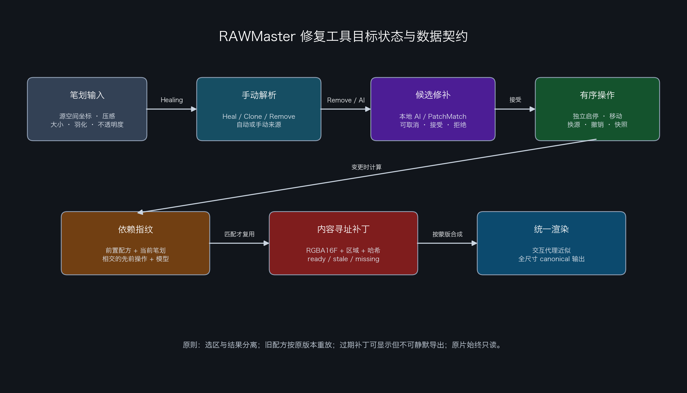

# 修复工具面板：Camera Raw / LightFlow 调研与 RAWMaster 实施规格

状态：Proposed  
日期：2026-11-21  
范围：Develop 的 Remove / Heal / Clone、红眼与局部修复的公共数据层、画布交互、自动来源、内容感知／AI 补丁、预览与 canonical 导出。  
交付原则：先让手动修复可编辑、语义真实且交互快速，再引入本地补丁生成；自动人物、瑕疵、反射与跨图批处理均独立验收，不作为首个增量。

## 执行摘要

RAWMaster 已具备可靠的修复事务基础：操作保存在源空间，按顺序重放，支持压感、来源点、单笔删除、分组启停、撤销／快照、内容身份校验和全尺寸 canonical 输出。当前主要问题不是“没有修复”，而是**已有笔划只能删除后重画，Erase 与 Heal 实际共用同一纹理转移算子，补丁引用尚无渲染实现，并且任何有效局部修复都会使交互代理回退 canonical**。这些问题分别对应交互、算法语义、AI 生命周期和性能，不能靠新增一个 AI 按钮解决。[局部数据模型](kimi-cite://text?path=%2FUsers%2Frobinqu%2FWorkspace%2Fgithub%2Frobinqu%2FRAWMaster%2FSources%2FRAWMasterCore%2FDevelopmentLocalEditModels.swift&text=public%20enum%20DevelopmentRetouchMode%3A%20String%2C%20Codable%2C%20Sendable%20%7B%20case%20remove%2C%20heal%2C%20clone%20%7D "citation") [局部渲染核](kimi-cite://text?path=%2FUsers%2Frobinqu%2FWorkspace%2Fgithub%2Frobinqu%2FRAWMaster%2FSources%2FRAWMasterImaging%2FDevelopmentLocalEngineV3.swift&text=float3%20healed%3Dd.rgb%2Fd.a-ld.rgb%2Fld.a%2Blt.rgb%2Flt.a "citation") [代理回退](kimi-cite://text?path=%2FUsers%2Frobinqu%2FWorkspace%2Fgithub%2Frobinqu%2FRAWMaster%2FSources%2FRAWMasterImaging%2FPreviewInteractiveProxyV3.swift&text=if%20DevelopmentLocalEngineV3.active(p.localEdits)%7Breturn%20.canonical(.local)%7D "citation")

目标面板采用 Camera Raw 易理解的 **Remove / Heal / Clone** 三种顶层模式；Remove 内部再选择“内容感知”或“本地 AI”，不另造与 Remove 并列、语义重叠的第四个画笔。近期必须交付：选中笔划的大小／羽化／不透明度、目标与来源拖动、单笔启停、覆盖层、快捷键、换来源、Visualize Spots，以及支持域内不触发 canonical fallback 的代理渲染。真正的 Remove 使用可确定的 PatchMatch 或经验证的本地模型；旧 `.remove` 操作继续按 `toolVersion = 1` 的原纹理转移算法重放，不得因名称升级而改变历史图像。



去干扰的产品范围与 030 联合维护。029 持有检测图钉、标记、源空间补丁及恢复；030 维护路人／阴影补全、反光与瑕疵的任务准入和候选审阅。[Camera Raw 逐项调研](../../docs/research/generative-retouching-field-review.md) · [跨场景交互与验收](../030-ai-retouching/generative-editing.md)

## 1. 证据范围与结论边界

本规格直接读取了 RAWMaster 当前面板、输入会话、数据模型、自动来源、Metal／Core Image 核、渲染顺序、代理路由和相关测试，因此“当前能力”均以源码为准，而不是根据界面截图推断。Camera Raw 部分采用 Adobe 官方文档，没有逆向其私有二进制，也不声称知道 Adobe 的采样、对象检测或 Firefly 私有实现。LightFlow 部分分析仓库已保存的发布构建 `2d41ab1 · 2026-11-11`，包括编辑器 JS、`inpaintGpu`、模型清单、WASM JS 接口和 WGSL 片段；这些产物能证明发布包包含相应路径，但不能替代所有设备上的运行时质量基准。[既有 LightFlow REA 范围](kimi-cite://md-line?path=%2FUsers%2Frobinqu%2FWorkspace%2Fgithub%2Frobinqu%2FRAWMaster%2Fspecs%2F024-jpeg-display-proxy%2Flightflow-rea.md&line=5&text=%E7%9B%AE%E6%A0%87%E6%98%AF%E8%A7%A3%E9%87%8A%20Lightflow%20%E5%9C%A8%E6%B5%8F%E8%A7%88%E3%80%81%E7%BC%A9%E6%94%BE%E5%92%8C%E7%BC%96%E8%BE%91%E4%B8%AD%E7%9A%84%E9%80%9F%E5%BA%A6%E6%9D%A5%E6%BA%90 "citation")

LightFlow 的关键发布文件仍是 `index-zP4kU_H7.js`、`inpaintGpu-Cp3ARYYv.js` 和 `lightflow_host_wasm.js`；本规格只把其中可读的界面字段、状态迁移、模型回退、坐标／尺寸常量与着色器作为证据。模型名称、SHA-256 和许可能证明该构建声明的固定产物身份，不能证明它们就是 RAWMaster 的最佳模型；实施前仍须在本机管线中比较质量、内存、冷启动和授权条件。

## 2. RAWMaster 当前实现盘点

| 维度 | 当前实际行为 | 保留／改造判断 |
| --- | --- | --- |
| 顶层工具 | 修复与红眼分开；修复提供 Erase / Heal / Clone | 保留分组，Erase 最终升级为真实 Remove；红眼复用公共笔刷基础设施但不混入对象移除 |
| 笔划 | 源空间归一化点、压力、半径、strength；确定性按 0.25 半径补 dab | 保留坐标和采样版本；新增羽化字段时给旧笔划默认 0.30 |
| 操作 | 最多 128 笔，具有 UUID、源内容 ID、toolVersion、来源点和可选 patch 引用 | 保留有序数组；新增 update / enable / move 命令，不能只支持 append / remove |
| 面板 | 模式分段、新笔划大小、处理／取消、来源清除、操作选择与删除 | 增加 Feather、Opacity、单笔开关、Refresh、Clear、Overlay 和选中项状态 |
| 画布 | 当前笔划路径、光标圆、来源十字、选中首点半径圆 | 改为完整选中轮廓、目标与来源手柄；当前只画首点圆会误导自由笔划范围 |
| 新笔划来源 | Option 点击设置绝对来源；Clone 无来源时阻止；其他模式可自动选源 | 保留；另支持选中项直接拖动来源，避免 Option 成为唯一修正入口 |
| 自动来源 | 3 个距离环 × 32 方向；颜色残差、均值与梯度评分；1536 px 代理加最多 8 个原生 512² 瓦片 | 作为 v1 基线保留；改为返回排序候选，以支持确定性 Refresh / `/` |
| Heal | `donor - lowpass(donor) + lowpass(target)` 的纹理转移，边缘固定 70%–100% 半径羽化 | 作为 `toolVersion = 1` 参考实现保留；新增可调羽化时升级算子版本 |
| Erase | 与 Heal 进入完全相同的纹理转移分支，仅模式元数据不同 | 不得继续把它描述为内容感知／生成式；新版本由 PatchMatch 或本地模型生成补丁 |
| Clone | 来源直接复制，按 coverage 与目标混合 | 保留；羽化和不透明度显式化 |
| 红眼 | 手动点击与自动检测均已实现，保护高光、蓝色与肤色，保留 alpha | 不在本轮重写算法；只复用大小、删除、覆盖层和键盘处理 |
| 顺序与几何 | Mask 后、Geometry 前执行局部修复；后续操作读取先前结果 | 保持顺序；AI 补丁也必须在这一阶段合成，不能把屏幕代理当成最终图 |
| 交互性能 | `DevelopmentLocalEngineV3.active` 时交互代理返回 `.canonical(.local)` | 必须增加明确的缩放渲染计划；不能只删除 guard，因为当前引擎要求输入 extent 等于原生源尺寸 |
| 补丁 | `DevelopmentPatchReference` 仅含哈希、字节数、源 ID、工具版本；resolved 校验明确拒绝 patch | 需要新的区域、像素格式、依赖指纹和算法身份；另建内容寻址存储与渲染路径 |

当前数据层对源内容、坐标、点数、dab 数和补丁字节数都有严格校验，且操作顺序不可交换；这些是有价值的正确性资产，不应为了引入 AI 而绕过。[操作校验](kimi-cite://text?path=%2FUsers%2Frobinqu%2FWorkspace%2Fgithub%2Frobinqu%2FRAWMaster%2FSources%2FRAWMasterCore%2FDevelopmentLocalEditModels.swift&text=public%20func%20validate(expectedSource%3A%20DevelopmentLocalEditSourceBinding%3F%20%3D%20nil)%20throws "citation") [顺序测试](kimi-cite://text?path=%2FUsers%2Frobinqu%2FWorkspace%2Fgithub%2Frobinqu%2FRAWMaster%2FTests%2FRAWMasterImagingTests%2FDevelopmentLocalEngineV3Tests.swift&text=func%20testOrderedOperationsReadPriorPrefixAndDoNotCommute() "citation")

## 3. 外部产品的可验证能力

### 3.1 Camera Raw：面板与审查工作流

Camera Raw 将 Remove、Heal、Clone 置于同一 Remove 面板。Heal 匹配来源的纹理、光照和明暗，Clone 直接应用来源；Remove 可用 Generative AI 或 Object Aware。共同控制包括 Size 与 Opacity，Feather 官方明确列在 Heal／Clone 路径。已有区域可 Refresh 或用 `/` 尝试其他自动采样；Visualize Spots 提供反相高对比视图和阈值，不是修复算法本身。[Camera Raw 修复工具](kimi-cite://web?url=https%3A%2F%2Fhelpx.adobe.com%2Fcamera-raw%2Fdesktop%2Fai-and-generative-features%2Fenhanced-spot-removal-tool-camera-raw.html&text=Use%20the%20Size%20and%20Opacity%20slider%20to%20adjust%20the%20brush%20size%20and%20mask%20opacity%20before%20brushing%20over%20the%20object%20you%20want%20to%20remove. "citation")

Generative Remove 还包含 Detect Objects、Add／Subtract、Show Overlay、Show Uncropped image 和三个变体；刷新产生新的一组三个变体并替换前一组。它依赖 Firefly 和网络，因此本规格只借鉴交互与候选审查，不把其云模型当作 RAWMaster 的实现依赖。[Generative Remove](kimi-cite://web?url=https%3A%2F%2Fhelpx.adobe.com%2Fcamera-raw%2Fdesktop%2Fai-and-generative-features%2Fremove-tool-acr.html&text=Adobe%20Camera%20Raw%20uses%20Adobe%20Firefly%20to%20generate%20three%20different%20variation%20options%20for%20you. "citation")

| Camera Raw 能力 | 对产品规格的启示 |
| --- | --- |
| Shift 连线、Shift 拖动约束方向、框选删除、Delete／Option 点击删除 | 长线与批量清理由输入层完成，不新增图像算子 |
| 目标／来源可移动，Opacity 可后调 | 操作必须是可更新值对象，而非追加后只读 |
| 未裁切视图可处理跨越裁切边的对象 | 修复坐标继续在完整源空间；显示裁切不能成为选区边界 |
| AI Edit Status 标记需要更新的设置，可逐项刷新 | 补丁保存输入依赖和 stale 状态，更新后必须审查 |
| Mark to Remove 先保存标记，之后批量生成 | 选区与结果是不同状态；`patch = nil` 可表示已标记但未生成 |
| Dust 按点刷新／删除；People 先显示 pin 再移除；Blemish 有 Amount／Fade 和 Restore／Remove | 自动干扰物是后续独立任务，不使用一个泛化 AI 强度冒充全部能力 |

Camera Raw 的 AI 编辑顺序把 Generative Remove、Content-Aware Remove、Heal、Clone 放在裁切与全局调整之前，并要求前置变化后的 AI 设置更新。RAWMaster 当前“Geometry 前、Global／Mask 后”的具体管线不同，不能照搬其阶段顺序；应借鉴的是**显式依赖和可更新状态**。[AI Edit Status](kimi-cite://web?url=https%3A%2F%2Fhelpx.adobe.com%2Fcamera-raw%2Fdesktop%2Fai-and-generative-features%2Fai-edit-status.html&text=The%20AI%20Edit%20Status%20button%20will%20have%20a%20yellow%20highlight%20when%20some%20AI%20settings%20need%20to%20be%20updated%20to%20render%20your%20photo%20properly. "citation")

### 3.2 LightFlow：发布产物中的修复系统

发布编辑器明确包含 Heal、Clone、Remove、AI Inpaint 四种模式，共享 Size、Feather、Opacity、覆盖层、Spots 列表、单笔启停、Retry、Delete、Clear 和 Done。默认新笔划大小为长边的 2%，羽化 40%，不透明度 100%；大小快捷键按 1.15 倍缩放并夹在长边的 0.2%–25%，羽化快捷键步进 10%。目标与来源都能在画布拖动，自由笔划显示实际路径，而不是仅显示首点圆。[LightFlow 面板证据](kimi-cite://text?path=%2FUsers%2Frobinqu%2FWorkspace%2Fgithub%2Frobinqu%2FRAWMaster%2Foutput%2Flightflow-research%2Frepair-analysis%2Feditor.reading-view.js&text=const%20Iv%3D%7Bheal%3A%22Heal%22%2Cclone%3A%22Clone%22%2Cremove%3A%22Remove%22%2Cinpaint%3A%22AI%20Inpaint%22%7D "citation") [LightFlow 默认值](kimi-cite://text?path=%2FUsers%2Frobinqu%2FWorkspace%2Fgithub%2Frobinqu%2FRAWMaster%2Foutput%2Flightflow-research%2Frepair-analysis%2Feditor.reading-view.js&text=retouch%3A%7Bsize%3A.02%2Cfeather%3A.4%2Copacity%3A1%2Cselected%3Anull%7D "citation")

其 Remove／AI 输入不是直接拿当前屏幕 JPEG：接口从当前修复操作之前的配方渲染全分辨率裁片，生成模型用 RGBA8 与同区域 matte，再把 8-bit 模型答案转回 half-float 源空间。模型自动路径依次尝试 LaMa、MI-GAN，最后 PatchMatch；WebGPU 失败有 WASM 回退。发布模型说明写明 LaMa 使用 512² 输入，并对放大结果恢复原照片高频细节；这些设计比“在低分辨率代理上补一块然后导出”更值得借鉴。[LightFlow 输入接口](kimi-cite://text?path=%2FUsers%2Frobinqu%2FWorkspace%2Fgithub%2Frobinqu%2FRAWMaster%2Foutput%2Flightflow-research%2Fsite%2F_b%2F20261111155800-2d41ab1%2Frust%2Fweb%2Flightflow_host_wasm.js&text=Renders%20the%20crop%20at%20full%20resolution%20and%20normalises%20it%20for%20the%20model "citation") [模型回退](kimi-cite://text?path=%2FUsers%2Frobinqu%2FWorkspace%2Fgithub%2Frobinqu%2FRAWMaster%2Foutput%2Flightflow-research%2Frepair-analysis%2Feditor.reading-view.js&text=for%20const%20s%20of%5B%22lama%22%2C%22migan%22%5D "citation")

| LightFlow 静态常量／机制 | 已观察到的含义 | RAWMaster 采用方式 |
| --- | --- | --- |
| 上下文扩展 `max(60% × 修补框长边, 160 px)`，长边 cap 3072 | 给模型周围结构，又限制大图成本 | 作为首个实验默认值，须用自有样本调参 |
| matte dilate 2 px | 避免孔洞边缘残留目标像素 | 纳入 Remove 预处理并做边缘测试 |
| 局部增益采样上限 256；全局／局部曝光增益择用 | 让模型输入亮度处于合理范围 | 在 RAWMaster 线性 sRGB 契约中重新定义并验证，不能直接复制矩阵 |
| 输出孔洞框外扩 `max(12%, 48 px)` | 补丁包含融合带而非仅洞中心 | 补丁 rect 必须大于或等于最终 matte 支持域 |
| Heal／patch 使用插值 log-ratio，限制 ±6 EV | 调整补丁色调与颜色以贴合目标 | 作为 v2 Heal／Patch 合成候选，和现有加性低通算法对拍 |
| 生成补丁可叠加坐标稳定颗粒 | 降低 AI 区域过于光滑的观感 | 放到后续质量增强，首版不得用噪声掩盖结构错误 |
| 先前且相交的操作进入 patch basis | 相关修复变化会使补丁失效，无关变化可复用 | 必须实现内容级依赖指纹，不能只用全 recipe revision |
| patch 存为内容寻址 half-float 资产 | 配方保存引用，像素独立缓存 | 扩展 Editing Archive；加载时校验尺寸、哈希、有限值与源身份 |

合成 WGSL 还证明其 Feather 是半径的软边比例，硬边保留约 1 px 抗锯齿；最终按 `matte × opacity` 混合。RAWMaster 可以采用同样的参数语义，但现有多 dab 的覆盖合成顺序与数值不同，必须另设算子版本并保留旧参考核。[羽化与合成证据](kimi-cite://text?path=%2FUsers%2Frobinqu%2FWorkspace%2Fgithub%2Frobinqu%2FRAWMaster%2Foutput%2Flightflow-research%2Fwgsl%2Fsegment-047-0060c061.wgsl&text=let%20m%20%3D%20clamp(textureLoad(matte%2C%20p%2C%200).r%2C%200.0%2C%201.0)%20*%20u.offset.w "citation")

## 4. 差异与优先级

| 能力 | RAWMaster 当前 | Camera Raw | LightFlow 发布构建 | 目标与优先级 |
| --- | --- | --- | --- | --- |
| 真实对象移除 | Erase = 纹理转移 | Object Aware／Generative AI | LaMa／MI-GAN／PatchMatch | **P1** 新增真实补丁 Remove，旧语义冻结 |
| 羽化 | 固定 30% 半径 | Heal／Clone 可调 | 全修复模式可调，默认 40% | **P0** 0–100%，默认 30% 保持 RAWMaster 旧观感 |
| 不透明度后调 | 数据层有 strength，面板未暴露 | 支持 | 选中项可调 | **P0** 选中项 0–100%，默认 100% |
| 选中项大小后调 | 无 | 支持 | 以新笔划大小为主，可创建圆点 | **P0** 支持统一半径笔划后调 |
| 目标／来源移动 | 仅新笔划 Option 选源 | 支持 | 支持，带连接线与手柄 | **P0** 支持；移动目标保留来源绝对位置 |
| 单笔启停 | 仅整组启停 | 以选中项管理 | 支持 | **P0** 每操作 `enabled` |
| 换来源 | 清除后重选 | Refresh／`/` | 可拖动来源，生成项可 Retry | **P0** 自动候选循环 + 手拖 |
| 完整覆盖层 | 当前笔划和首点圆 | Show Overlay | 路径、目标、来源、连接线 | **P0** 全路径、双环羽化、独立开关 |
| 快捷键 | Escape、Space；无修复专用快捷键 | 完整 | Q、H、大小／羽化等 | **P0** B、`[`／`]`、Shift 组合、V、`/`、Delete |
| Visualize Spots | 无 | 反相高对比 + 阈值 | 本轮未发现对应证据 | **P1** 作为显示滤镜，不写入配方 |
| 未裁切修复 | 源空间支持，但 UI 无专门模式 | Show Uncropped | 本轮未确认 | **P2** 显示未裁切源并允许跨裁切边涂抹 |
| 单笔补丁状态 | patch 引用存在但不可渲染 | AI Edit Status | Generating／Updating／Retry | **P1** marked／pending／ready／stale／failed |
| AI 变体 | 无 | 三个变体 | 当前发布路径每次生成一个补丁 | 按提供者能力显示；禁止伪造三个不同结果 |
| 自动尘埃／人物／瑕疵／反射 | 无；红眼是独立已有能力 | 分任务实现 | 有通用模型和对象／人物基础设施 | **P2+** 每个独立立项，反射不纳入普通画笔 |
| 交互代理 | 有局部修复即 canonical | 私有实现未知 | GPU 缓存与局部补丁 | **P0** 支持域内消除 `.local` 回退 |

## 5. 目标产品规格

### 5.1 面板结构与选中语义

面板标题统一为“修复”。首行是 Remove / Heal / Clone；Remove 下方显示“方法：内容感知／本地 AI”，只有完成对应提供者的真实验收后才启用。红眼仍保留现有入口，但共享键盘与操作列表样式。模式切换只改变下一笔的工具，不隐式改写已选中操作；若要改变选中项模式，必须通过明确命令并使不再兼容的 patch 失效。

| 控件 | 无选中操作 | 有选中操作 | 约束 |
| --- | --- | --- | --- |
| Size | 设置下一笔，默认沿用当前 40 px 半径 | 修改选中笔划半径 | 3…200 源像素且不超短边；内部仍存 `radiusInShortEdge` |
| Feather | 设置下一笔，默认 30% | 修改选中笔划及合成 matte | 0–100%；旧操作缺省 30% |
| Opacity | 设置下一笔，默认 100% | 修改选中操作 | 0–100%；0% 保留选中项但不产生像素变化 |
| 方法 | Remove 的内容感知／本地 AI | 显示当前算法，不允许静默切换 | 切换需重新生成并保留可撤销历史 |
| Refresh | 不可用 | 换下一组自动来源或重新生成补丁 | Heal／Clone 为确定性候选循环；AI 只有支持变体时才显示变体选择 |
| Overlay | 切换所有修复覆盖层 | 同左 | 仅 UI 状态，不进入配方、指纹或导出 |
| Spots | 显示全部修复操作 | 选中、启停、Retry、Delete | 顺序与配方数组一致，显示模式和状态 |
| Clear | 清空全部修复操作 | 同左 | 单次可撤销事务；不影响红眼，除非用户明确选择全部局部工具 |

“大小”在本规格中沿用当前界面数值的**半径语义**，避免已有 40 变成另一实际覆盖范围；辅助文字写成“源像素半径，缩放照片不会改变修饰范围”。未来若改成行业常见的直径语义，必须单独迁移 UI 与配方，不能在本轮混改。压感继续影响 coverage／强度，不改变记录半径；压力为 0 的抬笔点沿用当前峰值处理。

### 5.2 画布交互

1. **单击／拖动**：创建圆点或自由笔划。自由笔划显示完整路径、外半径和羽化内环；提交后选中该操作。
2. **Option 单击**：为下一笔设置来源。Clone 没有来源时继续提示，不生成零位移结果。
3. **拖动选中目标**：平移所有目标点；Heal／Clone 保持 `sourceSample` 的绝对源位置不变。Remove／AI 将当前补丁标为 stale，画布保留 last-known-good 并显示“需要更新”。
4. **拖动来源手柄**：仅改变来源；显示目标到来源的连接线。自动来源一经手拖即成为显式来源，后续 Refresh 才返回自动候选。
5. **Shift 单击**：从当前选中笔划末点或上一笔末点连接直线；新建时从第一点到当前点生成直线。**Shift 拖动**约束水平／垂直。
6. **Delete／Backspace**：删除选中操作。**Option 点击目标**删除该操作；**Option 拖动空白区域**框选并删除完整落在框内的操作。框选删除不得与 Option 单击选源混淆：只有拖动超过 3 个屏幕像素才进入框选。
7. **V**：切换覆盖层；覆盖层隐藏时仍允许列表选择。鼠标移出画布时只隐藏 hover 光标，不清除选中态。
8. **Escape**：先取消当前手势；再取消待处理生成；最后退出修复工具。取消不得删除已提交操作。
9. **Space**：保持当前平移行为，手势冲突时取消未提交笔划，不改变已提交内容。

Camera Raw 的 Cmd 圆点和来源拖动手势可作为后续补充，不与本轮 Option 语义同时上线。所有拖动以开始时的 frameID、源 generation、几何映射和配方前缀为准；发生源变化、真实几何变化或历史跳转时取消当前手势。纯缩放／平移只更新源到屏幕映射，不使操作或补丁失效。

### 5.3 快捷键与可访问性

| 按键 | 行为 |
| --- | --- |
| B | 进入／离开修复工具，并恢复最近模式 |
| `[` / `]` | 半径缩小／放大；有选中项时修改选中项，否则修改下一笔 |
| Shift + `[` / `]` | 羽化减少／增加 10 个百分点 |
| V | 显示／隐藏修复覆盖层 |
| `/` | 选中 Heal／Clone 时换自动来源；选中生成项时重新生成 |
| Delete / Backspace | 删除选中操作 |
| Escape | 按手势、生成、工具的顺序逐级取消 |

每个操作在列表中提供可读名称，例如“修复 3 · Heal · 已启用／需要更新”。所有图标按钮具备标签与键盘焦点；状态不能只靠颜色表达。自动任务必须在 100 ms 内出现进度与取消入口；模型下载、模型加载、输入渲染、推理、细节恢复、补丁写回分别报告，不能用单一旋转指示器掩盖长等待。

## 6. 数据、算法与生命周期契约

### 6.1 版本化操作模型

新增字段必须可选解码并给出冻结默认值，旧 JSON 保持逐像素重放。建议结构如下；名称可随代码风格调整，但语义不得省略：

```swift
public struct DevelopmentLocalEdit {
  // 既有：id、sourceContentID、tool、toolVersion、stroke、sourceSample、patch、retouchMode
  public var enabled: Bool                 // 解码缺省 true
  public var feather: Double?              // nil + toolVersion 1 = 旧固定 0.30
  public var sourceSelection: SourceSelection // .automatic(ordinal) / .manual
  public var fill: DevelopmentFillOperation? // 仅真实 Remove / AI 使用
}

public struct DevelopmentFillOperation {
  public var algorithmVersion: String
  public var provider: String              // patchmatch / coreml-lama / …
  public var modelIdentity: String?        // 固定模型 ID + 内容 SHA-256
  public var inputFingerprint: String      // 见 6.3
  public var patch: DevelopmentPatchReferenceV2?
}

public struct DevelopmentPatchReferenceV2 {
  public var sha256: String
  public var byteCount: Int64
  public var sourceContentID: String
  public var rect: NormalizedSourceRect
  public var pixelWidth: Int
  public var pixelHeight: Int
  public var pixelFormat: String           // 初版 linear-srgb-rgba16f-premultiplied
  public var basisFingerprint: String
}
```

新增 `.updateLocal(UUID, LocalMutation)`、`.setLocalEnabled(UUID, Bool)` 和必要的批量删除命令。所有命令先验证完整 prospective recipe，再原子提交并进入现有撤销／快照；拖动期间可按操作 ID 与字段 coalesce，松手形成一个历史项。`stroke.strength` 继续承载 Opacity，避免同一参数两份真源；`sourceSelection` 只描述来源决策，不改变 `sourceSample` 是绝对坐标这一事实。既有 `DevelopmentLocalEdit.patch` 只保留作 v1 兼容占位；v2 以 `fill.patch` 为唯一补丁真源，禁止两处同时非 nil。

当前 `DevelopmentLocalWorkEstimatorV1.requireResolved` 拒绝 patch，因此实现补丁时必须同时改 resolved 校验、work estimator、recipe 校验和归档读取。任何 `fill.patch` 非 nil 的操作若缺区域、格式、basis 或内容哈希都不得渲染。初版继续遵守每补丁 16 MiB、每配方补丁引用合计 64 MiB 的现有声明上限；超出时缩小补丁、分块存储或明确拒绝，不允许预算外分配。

### 6.2 手动 Heal／Clone 与 Feather

旧 `toolVersion = 1` 完全保留现有公式：`healed = donor - lowpass(donor) + lowpass(target)`，Clone 直接复制来源，alpha 不变。新 `toolVersion = 2` 才启用可调 Feather。每个 dab 的归一化距离为 `q = distance / radius`，羽化比例为 `f ∈ [0,1]`：

```text
f > 0：coverage = 1 - smoothstep(1 - f, 1, q)
f = 0：coverage = 1 - smoothstep(r - 0.5 px, r + 0.5 px, distance)
最终权重 = coverage × opacity × pressure
```

多 dab 的覆盖合成在 v2 初版继续沿用当前 `remaining *= 1 - weight`，避免同时改变羽化与叠笔数学。后续若改 max-coverage 或 partition-of-unity，必须另立版本并对长线、回头笔划和压感样本对拍。来源越界、低 alpha、非有限值、目标外 bitwise 不变等既有保护不得回退。

自动来源保留当前 96 环候选与原生复核机制，但接口改为返回按 `(score, candidateIndex)` 排序的候选列表。第一次选择最优，Refresh 选择下一个通过阈值且不与当前来源相同的候选，到末尾循环；列表和顺序由源、笔划、前置配方及算法版本确定，不使用随机数。用户手拖后记录 `.manual`，普通重渲染不得自动换源。

### 6.3 真实 Remove／本地 AI 补丁

Remove 的选区和生成分离：完成笔划先形成 `marked`，点击 Remove 或启用自动生成后进入 `pending`。 PatchMatch 是首个无模型依赖的候选实现；本地 AI 通过统一 `DevelopmentFillProvider` 接入。LaMa 可作为模型实验基线，但只有固定模型身份、许可、SHA-256、输入输出契约、资源预算和真实质量验收均通过后才在 UI 中启用。失败可回退到另一已验证提供者，必须显示实际使用的提供者；不允许把纹理转移 Heal 标记成“AI 移除成功”。

生成输入来自**当前操作之前**的 canonical 工作图，包含当前几何之前的完整源区域和已有前置操作。以笔划框为中心扩展上下文，实验初值采用 `max(60% × 框长边, 160 px)`，长边最多 3072；模型输入按其固定尺寸重采样，matte 与输入共享坐标。孔洞掩模膨胀 2 个模型输入像素；输出裁片至少覆盖膨胀后的洞和融合带，实验外扩 `max(12%, 48 px)`。这些数值是首轮实验默认值，不是对所有照片的质量结论。

模型输出经逆归一化回到扩展线性 sRGB，再以 RGBA16F 保存。合成时只修改 matte 覆盖区域，保留源 alpha，应用 Opacity 和 Feather；需要进行亮度／颜色匹配时优先试验边界环的 log-ratio 插值，并将增益夹在 ±6 EV。不得把当前屏幕代理、JPEG 预览或模型 RGBA8 直接当作 canonical 成片。高频细节恢复与颗粒匹配各自独立开关、独立样本验收，首版可不做。

```text
marked → pending → candidateReady → accepted / ready
             ├→ cancelled → marked
             ├→ failed → marked + 错误原因 / Retry
ready → stale（输入或相关前置操作变化）→ pending → ready
ready / stale → deleted（可撤销）
```

候选生成期间不写正式配方；接受时一次性追加／更新操作和 patch 引用，拒绝后保留原目标选区。若产品选择 LightFlow 式自动生成，也必须先以 transient 候选展示，只有接受或事务完成时才进入持久历史。提供者只产出一个确定性结果时，Variations 隐藏；未来扩散模型才允许显示真实的多变体与 seed。

### 6.4 补丁依赖、失效与导出

`inputFingerprint` 至少包含：源内容 ID、解码／颜色契约、当前操作之前的修复阶段配方、目标笔划、模式、羽化、提供者／模型身份、算法版本、输入区域，以及所有与目标或来源区域相交的先前有效操作。`basisFingerprint` 是生成时该输入的实际指纹；加载和重渲染时重算。无关且不 intersect 的后续编辑不应使补丁失效，纯视图、选中、覆盖层和 UI revision 永远不参与像素指纹。

stale 操作可在画布继续显示 last-known-good，但必须带“需要更新”标记；保存配方允许保留 stale，以便稍后刷新。**导出或其他最终成片不得静默使用 stale 或缺失补丁**：导出前提供“更新 N 项修复”，由用户更新、移除或明确保留旧结果；默认阻塞并给出可执行入口。源内容 ID 改变时旧补丁不得套到新源。窗口失焦、切图或取消不应删除已完成且内容键仍匹配的结果。

补丁进入 Editing Archive 的内容寻址存储，键包含像素哈希和格式版本；加载时验证字节数、尺寸、区域、哈希、有限浮点与 alpha。内存中只保留当前可见 ROI 和有限 LRU，磁盘资产大小不能直接当作常驻内存。垃圾回收只删除全库无引用的补丁，撤销／快照引用仍计入存活。

### 6.5 交互代理与 canonical 一致性

新增 `DevelopmentLocalRenderPlan`，把原生源空间操作解析到当前输入比例。原生尺寸为 `(W,H)`、代理比例为 `s` 时，输入 extent 必须为 `(0,0,W×s,H×s)`；点坐标乘 `s`，`radius_px = radiusInShortEdge × min(W,H) × s`，来源同步缩放。算子从 plan 读取 scale 和原生尺寸，不能通过篡改持久 `sourceBinding` 来冒充原生图。工作量按实际代理像素计费，元数据仍受原有限额约束。

`PreviewInteractiveProxyV3.support` 只有在该计划存在、操作版本受支持且补丁资源可用时才允许移除 `.canonical(.local)` 回退；不支持的 patch、projective 组合或非法数值继续 fail-closed。canonical 保存与导出继续走原生全尺寸。阶段顺序保持当前 `Global／Filter／Detail／Mask → Local → Geometry`，不得为图方便把修复挪到导出的另一阶段。[当前渲染顺序](kimi-cite://text?path=%2FUsers%2Frobinqu%2FWorkspace%2Fgithub%2Frobinqu%2FRAWMaster%2FSources%2FRAWMasterImaging%2FDevelopmentRendererV3.swift&text=image%20%3D%20try%20DevelopmentLocalEngineV3.apply(p.localEdits%2Cto%3Aimage%2Ccontext%3Acontext%2CcheckCancellation%3AcheckCancellation) "citation")

自动来源分析已有“1536 px 代理 + 最多 8 个原生 512² 瓦片”结构，可继续作为第一道缓存；新增以源、修复前配方、相交前置操作和算子版本为键的准备结果缓存。缓存命中不得绕过当前帧的交付校验，交付 latest-request-wins 与像素内容复用分离。

## 7. 分阶段实施与文件落点

| 阶段 | 工程任务 | 主要文件 | 完成门 |
| --- | --- | --- | --- |
| A / P0 数据与命令 | 加 `enabled`、Feather、来源决策、update／enable／批量删除；旧配方缺省值与算子冻结 | `DevelopmentLocalEditModels.swift`、`DevelopmentAdjustmentCommands.swift`、`DevelopmentLocalResolvedV3.swift` | 旧 fixture 解码与渲染不变；所有命令原子、可撤销、限额外失败 |
| B / P0 面板与画布 | 选中项 Size／Feather／Opacity、完整路径、目标／来源拖动、单笔启停、Overlay、Clear、快捷键 | `PhotosLocalAdjustmentControls.swift`、`EditingLocalInputSession.swift`、`PhotosLocalEditingCanvas.swift`、`EditingController.swift` | 第 5 节所有手势与选中语义通过 UI 测试；无重复历史写回 |
| C / P0 代理性能 | 实现缩放 RenderPlan、局部代理路由和缓存指标；保留 canonical 参考 | `DevelopmentLocalEngineV3.swift`、`PreviewInteractiveProxyV3.swift`、`DevelopmentRendererV3.swift` | 支持域内 `.local` fallback = 0；代理／canonical 差分与瓦片一致性过门 |
| D / P1 来源与污点视图 | 自动候选排序、Refresh／`/`、Visualize Spots 显示核与阈值 | `DevelopmentLocalAnalysisV3.swift`、面板／画布／预览显示层 | 换源确定、可循环；污点视图不写配方、不改变导出 |
| E / P1 真实 Remove | 先实现 PatchMatch provider，再评估 LaMa；补 matte、候选、取消、逆归一化与合成 | 新增 `DevelopmentFillProvider`、`DevelopmentPatchStore`、`DevelopmentPatchEngine`；接入 Local Analysis／Renderer | 内容感知结果不再复用 Heal 名称；失败／取消／重试／接受／拒绝均真实可验 |
| F / P1 补丁生命周期 | basis 指纹、stale／Updating、归档、LRU、导出前更新入口 | 数据模型、Archive、Renderer、Export、Undo／Snapshot | 相关前置变化正确失效，无关变化命中；stale 不会静默导出 |
| G / P2 干扰物与跨图 | Visualize 后的 Dust 自动检测优先；之后 People／Blemish；Mark to Remove 与同步另立规格 | 复用 MaskAI 检测、Local Edit 和批处理基础设施 | 每类独立质量样本、逐点审查和批量重检测；反射另立全局模型规格 |

A、B、C 可以共用数据设计评审，但合并提交应保持可回退：不要同时替换 Heal 数学、UI 坐标和缓存键。E 不得先做一个永远开启但无模型的开关；如果模型未就绪，Remove 只可显示已验收的 PatchMatch，AI 方法显示具体不可用原因。

## 8. 验收规格

### 8.1 功能与回归矩阵

| 场景 | 必须验证的结果 |
| --- | --- |
| 新建圆点／长线／回头线／压感 | 坐标、dab、覆盖层与导出一致；Shift 连线和轴向约束正确 |
| 选中项大小／羽化／不透明度 | 只改目标操作；0% 精确旁路；撤销／重做与快照一致 |
| 目标与来源拖动 | 自由笔划整体平移；目标拖动不移动来源；来源拖动不改变目标 |
| 单笔启停／删除／Clear | 后续有序操作按新前缀重算；红眼不被修复 Clear 误删 |
| 自动来源 Refresh | 顺序确定、排除当前候选、可循环；手拖来源不被普通渲染覆盖 |
| 几何与缩放 | 裁切／旋转／翻转映射正确；纯视图变化不重建补丁；跨裁切边模式不丢源区域 |
| AI 生命周期 | marked、pending、取消、失败、Retry、候选接受／拒绝、stale、更新、删除全部覆盖 |
| 持久化 | 旧 recipe 不变；新 recipe 重启后恢复；缺失／损坏／错源 patch fail-closed |
| 依赖失效 | 相交前置操作使 patch stale；不相关操作和 UI 变化不失效 |
| 导出 | 无 stale 静默输出；最终使用 canonical 全尺寸，而非代理或模型 RGBA8 |
| 资源与取消 | 达到点、dab、补丁、内存上限时明确失败；取消后无临时文件和任务泄漏 |

### 8.2 数值与图像质量

现有 Heal／Clone 的 Double 参考、alpha 保留、顺序不可交换、整图／瓦片一致性与非法输入测试必须继续通过。`toolVersion = 1` 旧样本要求 bitwise 或现有容差不变；v2 Feather 在 0%、30%、100% 及非整数半径下建立 CPU 参考。蒙版外像素 bitwise 不变，alpha 不变，所有输出有限；整图与分块最大通道差沿用当前 `2e-4` 验收量级，除非新算法另有更严格且经评审的数值契约。[现有参考测试](kimi-cite://text?path=%2FUsers%2Frobinqu%2FWorkspace%2Fgithub%2Frobinqu%2FRAWMaster%2FTests%2FRAWMasterImagingTests%2FDevelopmentLocalEngineV3Tests.swift&text=func%20testRetouchActualMetalMatchesDoubleReferenceAndPreservesAlphaOutsideMask() "citation")

代理质量以“原生 canonical 后缩小到同尺寸”为参考，在约定的 SDR 测试集上，修复 ROI 的编码 sRGB 平均绝对通道差建议不超过 `1/255`、p99 不超过 `4/255`；HDR／超色域另报线性误差，不能用 clamp 后的 SDR 指标掩盖。该数值是 v1 建议门，首次基线若发现代理结构本身不满足，应修管线或调整支持域，不得简单放宽到通过。

Remove／AI 建立固定正负样本：纯色天空、传感器尘点、皮肤瑕疵、电线、重复纹理、直线建筑、规则边缘、背景人物、阴影与水面倒影、跨裁切边对象。分别评价目标残留、边界接缝、结构连续、纹理／颗粒、身份保护和无关区域变化；PatchMatch、LaMa 和其他模型不得只用“成功返回图像”作为质量门。人物身份、文字与直线结构的失败样本必须保留，不能用增加噪声掩盖。

### 8.3 性能与资源门

在约定参考 Mac、同一 60 MP RAW、同一画布和固定配方上分别记录 cold、first-warm、steady-warm。输入事件、render 返回、GPU completion、实际 drawable presented 分开计时；模型下载、模型加载、输入 canonical 渲染、推理、补丁写回、最终导出分开报告，不能只用最快一次或测试总时长。

| 操作 | 初始性能门／观测要求 |
| --- | --- |
| 已有 Heal／Clone 的羽化、Opacity、来源拖动 | 支持域内 canonical fallback = 0，无 RAW 重解码；暖路径 p50 ≤ 33 ms、p95 ≤ 66 ms |
| 纯 Overlay、选中、缩放／平移 | 不执行修复像素重算；只更新覆盖层或视图变换 |
| 自动来源新笔划 | 暖缓存 p95 ≤ 500 ms；超时仍持续报告进度并可取消 |
| PatchMatch／AI | 首版先公布冷／热 p50、p95、最大值和峰值内存；达到交互预算后才默认自动生成 |
| 缓存命中补丁 | 无模型调用、无 RAW 重解码；当前 ROI 原子替换，无空白帧 |
| 导出 | 单独记录全尺寸耗时和内存；不得用交互耗时替代导出成绩 |

这些性能数值是本轮建议验收预算，不是对当前实现的成绩声明。若实际硬件基线不足，优先缩小代理支持域或调整调度；不能删除 cold 样本、取消错误或把 canonical fallback 计入“快速路径”。

## 9. 明确非目标与最终决策

- 不接入未披露的云端修复服务；本地 AI 默认不上传照片，模型来源、许可和哈希必须可查。
- 不把 Erase／Heal 纹理转移改名为 AI，也不制造无实际差异的三个变体。
- 不在本轮重写红眼算法、蒙版系统、RAW 解码器或完整 WebGPU 运行时。
- 不把 Reflection Removal 当作普通局部画笔；它是独立的全局分解任务。
- 不在首个增量承诺自动识别全部干扰物、跨图批量生成或 Lightroom XMP 修复兼容。
- 不改变旧操作语义；所有算法、羽毛化覆盖数学、补丁格式和颜色契约均带版本。
- 不以放宽源身份、几何映射、资源预算、alpha／finite 校验或 canonical 导出要求换取表面速度。

**推荐实施起点：A → B → C。** 这三个阶段不依赖模型，已经能消除当前最主要的功能与性能差距；随后以 D 完善手动工作流，再用 E／F 引入真正可审查、可失效、可恢复的 Remove 补丁。