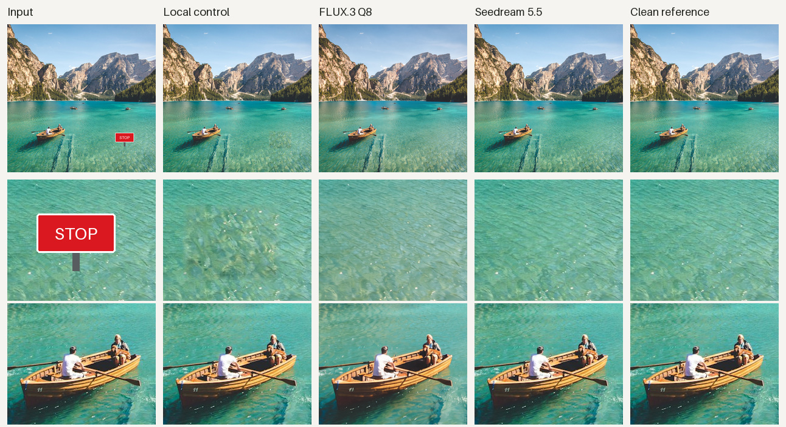
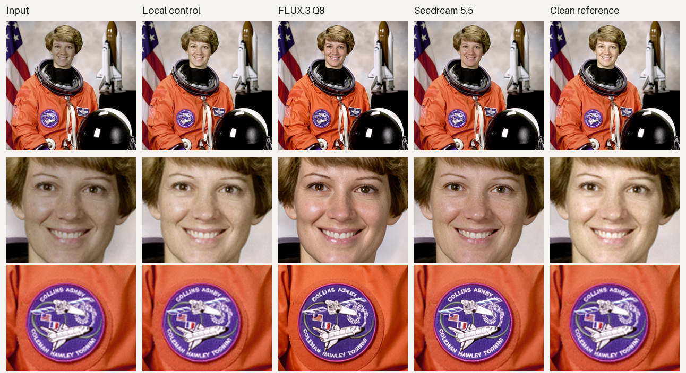

# 030 · FLUX.3 Image Klein 与 Seedream 5.5 精修评估

2026-11-22 · 公开照片同图对照、独立本机模型和真实北京方舟 API · 结论适用于下列任务与配置

**第一批预设应把人物、天空和水面变成可修的选区，再调用原生曝光、白平衡和色彩算子。** 在受控人像上，固定选区加 0.70 EV 比两种生成结果更接近干净参考，并保留了五官细节。需要补出原图中已被遮住的水面时，两种模型都能产生可供审阅的素材。Seedream 首张的水纹与邻域衔接更好、画外漂移更小。FLUX.3 在本机离线完成，可服务不愿上传的工作流。严格纪实选用可审计的原生配方。

后续已实测本机右侧柔光预设及两类光照参考，并用本机与北京 5.5 对同一人物和湖景做双图对拍。云端两次用时 10.82／13.31 秒；人物错光与湖景结构偏移均保留首张候选。本页的 1 MP、单输入比较与后续多图实验分别计时。[增补实验和原始样片](../../docs/research/generative-retouching-field-review.md)

## 实验与读数

两种引擎分别使用同一份 1024×1024 RGB PNG、同一条英文指令和相同的输出尺寸。干净参考、评分用 Matte 和保护区坐标仅供本地复核。湖景中人工加入一个红色 STOP 牌，人像中在椭圆软选区产生最深 −1 EV 的阴影。局部面积、方向和正确的参照像素因此已知。保留各次输出，湖景每家各重复一次。云端只收到这两张公开测试图，三次请求均显式关闭可见水印，以便逐像素比较。每张候选保留模型来源与收据。[输入及控制组生成](poc/fixtures.py) · [完整提示](poc/cases.json) · [样本来源与复现](quickstart.md)

- **目标误差**为目标内 RGB 对干净参考的平均绝对差（MAE，0–255，低为接近）。湖景测原牌面/柱实际遮住的 8,786 个像素，人像测 alpha ≥0.5 的 37,039 个像素。控制组已知选区，湖景取下方 126 px 的干净水面克隆，人像固定 +0.70 EV。它们衡量已有范围时参数工具能做到什么，未计算获取选区的时间。
- **裸候选漂移**为 Matte 完全为零的保护区中，任一 RGB 通道相对输入变化超过 8 级的像素比例。同时记录未设阈值的最大差。**最终合成**统一在线性 sRGB 混合，再回到 8-bit sRGB。硬保护看合成后最大差是否为 0。目标 MAE 不衡量波纹是否自然，也无法证明人脸身份相同。
- **接缝**在 Matte 非零范围边缘内外各约五像素的带状区与干净参考比 MAE，同时作 100% 目检。真实照片里通常没有干净参考，届时只能用画布差异、直线/文字保护和摄影师审阅。所有评分均从无损 PNG 计算。[评分代码](poc/evaluate.py) · [逐次数字、输入和输出哈希](evidence/paired-metrics.json)

## 实测画质

| 图片与处理 | 裸候选目标 MAE | 合成后目标 MAE | 裸候选保护区变化 >8 级 | 裸候选保护区最大差 | 合成后边界带 MAE |
| --- | ---: | ---: | ---: | ---: | ---: |
| 湖景输入（有牌） | 120.65 | 120.65 | 0% | 0 | 0.00 |
| 湖景本地取样克隆 | 16.39 | 16.39 | 0% | 0 | 2.76 |
| 湖景 FLUX.3 首张 | 13.03 | 13.03 | 74.616% | 136 | 1.38 |
| 湖景 FLUX.3 换种子复测 | 13.20 | 13.20 | 78.239% | 192 | 1.55 |
| 湖景 Seedream 首张 | 10.36 | 10.36 | 0% | 3 | 0.08 |
| 湖景 Seedream 复测 | 10.17 | 10.17 | 0% | 4 | 0.10 |
| 人像输入（脸部压暗） | 39.45 | 39.45 | 0% | 0 | 0.66 |
| 人像本地 +0.70 EV | 12.94 | 12.94 | 0% | 0 | 0.21 |
| 人像 FLUX.3 | 25.17 | 25.91 | 39.950% | 143 | 0.63 |
| 人像 Seedream | 27.17 | 28.09 | 1.605% | 96 | 0.66 |

**湖面清理。** 首张都清除了牌面与柱。简易克隆带入了更密、更亮的水底石纹。FLUX 首张生成了连贯水纹，也让裸候选整体偏暖，近船及乘客纹理变化。Seedream 保住了近船，标牌原位的波纹方向与周围相近。阈值栏的 0% 仍可伴随 3–4 级的区域外变化。将候选用本地 Matte 贴回后，保护区最大差为 0。用户有权在可接受的不同水纹中选择。有复杂倒影、建筑透视和关联阴影的移除仍要另测。[FLUX 湖景原图](evidence/flux/lake.png) · [Seedream 湖景原图](evidence/seedream/lake.png)

**人像补光。** 两个裸候选都提亮了脸，也让眼缘、牙齿、嘴唇和宇航服圆章出现原图没有的锐利细节或字形。局部贴回后，徽章恢复原像素，脸内发生的重画仍在。相对干净参考，选区平均线性亮度差从 −0.908 EV，分别到本地曝光 −0.273、FLUX −0.564、Seedream −0.634 EV。“只补光”应交付普通曝光滑杆和可编辑选区。用于生成试验的 512² 原照放大限制了对真实相机皮肤纹理的推断。[FLUX 人像原图](evidence/flux/portrait.png) · [Seedream 人像原图](evidence/seedream/portrait.png)

## 性能、使用量与稳定性

| 用例，单张 1024² | FLUX 本机 CLI / 模型管线 | Seedream HTTP / 解码落盘 | 云端结果 |
| --- | ---: | ---: | --- |
| 湖面移除，首次 | 210.29 / 205.66 s | 10.521 / 10.558 s | HTTP 200，1 输入、1 输出 |
| 人像补光 | 173.71 / 173.70 s | 10.281 / 10.304 s | HTTP 200，1 输入、1 输出 |
| 湖面移除，复测 | 153.45 / 153.44 s | 14.738 / 14.763 s | HTTP 200，1 输入、1 输出 |

FLUX 在 M4 Max、128 GiB 统一内存、macOS 27.0.1、MLX 0.32.4 上以 Q8 文本及图像模型和 FP16 VAE 离线跑 16 步。首个进程内请求含 4.36 s 权重校验，后续请求复用校验缓存。时间从 CLI 入口到 PNG 写出，模型下载另计。本机运行时按次加载/释放组件。该测量使用独立 MLX runner，集成 Comfy 节点后须再测。云端 HTTP 时间包含上传、网络、服务侧等待和返回完整 b64_json，第二个数截至本地解码、尺寸验证和写出，未含组成请求前的输入编码。无法从这些耗时拆出云端 GPU 时间。[本机软硬件与明细](flux-validation.md) · [方舟首张](evidence/seedream/lake.json) · [人像](evidence/seedream/portrait.json) · [湖景复测](evidence/seedream/lake-repeat.json)

三次本机请求的 MLX 活跃峰值均为 7.99 GiB，同一进程最高 footprint 由 8.78 升至 8.87 GiB。湖景使用不同种子复测，两张都清除了牌子，两种重建纹理都可在 100% 视图审查。云端的湖景复测使用相同输入和指令，回图哈希也不同。每种引擎只测两个任务、一次重复，未控制本机温度、系统页缓存或云端排队。[本机原始计时](evidence/flux/timings.json) · [FLUX 湖景复测](evidence/flux/lake-repeat.png) · [Seedream 湖景复测](evidence/seedream/lake-repeat.png)

为对比相同指令，本轮直接提供包含整幅场景、修改目标与保护项的完整描述。本机没有运行官方默认的 18.8 GB prompt upsampler，Seedream 的内部文本处理也不可观测。这里衡量的是这套 MLX Q8 配置。短中文指令经官方扩写后的质量、时延和内存仍需单独验证。[BFL 对编辑提示与扩写器的说明](https://huggingface.co/black-forest-labs/flux-3-image-klein/blob/main/README.md)

Seedream 运行三次，三次都返回 `doubao-seedream-5-5-261028`、HTTP 200、RGB PNG、1024×1024，每次回报 1 张输入、1 张生成图、4,096 output tokens。三次候选都未携带嵌入 ICC，检测到 PNG gamma/chromaticity。此次评测按 sRGB 解释。正式接入需明确 tagged/untagged 策略并验证工作色域转换。按当天北京公开价每张输入 ¥0.05、该输出尺寸每张 ¥0.13，三次合计估算 **¥0.54**。价格按张和像素档核算，实际账户账单未核对。此次样本可证明接口通达和图片可归档，无法估计月度可用率、限流概率或延迟 p95。[方舟计费](https://docs.volcengine.com/docs/ark/model-pricing?lang=zh) · [单图请求实现](poc/seedream.py)

三份原始方舟 PNG 均含 `caBX` 数据块。此次只核对数据块存在，签名有效性尚未验证。保留供应商原始字节供查验，最终局部合成的照片另存操作来源及所引用的候选 SHA。

## 图像模型的技术要求与路由

| 摄影需求 | FLUX.3 Image Klein（本地） | Seedream 5.5（北京方舟） | 产品决策 |
| --- | --- | --- | --- |
| 单图编辑、可控目标与硬保护 | 官方有参考图与位置框，本机 Q8 CLI 接收图文。湖面首张的范围外有明显漂移 | 官方支持交互编辑、参考图及 RGBA。湖景范围外漂移很小，人像徽章仍被改写 | 统一由本地确定写入范围。生成模型返回单一候选，保护区差 0 在合成层验收 |
| 人脸、物体数量、招牌文字及直线 | 人像内有重画，旧 A7R5 “加五只鸟”实际为六只 | 人像内有重画，纹理和徽章的小字也有差异。文字图层 OCR 能力尚无摄影留出集证据 | 纪实/身份敏感操作和可用参数完成的任务保持本地。大范围创作独立审阅 |
| 输出原生像素、方向和高动态范围 | 官方标称最高 4K。已有 1024² ROI、1008×672 代理迁回 9566×6374 的工程证据，本机未验收 4K 直接生成 | 文档允许单图输入最多 36MP、30 MB，输出可设 1K/1.5K/2K 或显式约 0.92–4.62MP。本页 1K 单输出；后续双图输入实得 1024² 与 1248×832 两种输出 | 61MP 先裁原生 ROI 或迁移低频光色。源坐标、尺寸、边距、变换、ICC 与 Amount 进入资产合同 |
| 多参考、强度及可重复 | 官方最多 10 张参考图。本机交付必须固定量化、编码器和 seed。区域内像素由生成决定 | 官方最多 10 张参考图。本页单参考、无 seed；增补实验双输入各返回一张。生成用的范围、模型输出的 alpha 与可调强度各有不同语义 | 登记单图与已实跑的双图输入；角色保真按任务验收。用户调整羽化/强度、重开、导出均读取同一候选。按次重生成需另确认 |
| 耗时、成本和离线 | 秒到分钟量级由尺寸/实现决定。本机 1MP 是分钟级，需独立队列与资源调度 | 本次 10–15 s，产生计费请求，停止等待无法证明供应商未执行 | 前台画布可继续编辑。标注位置、预计代价、原图/补丁关系和费用状态。任何新云端精修仅使用 Seedream 5.5 |
| 分发与可运维性 | BFL 为 FLUX Kommunity License，量化包另有来源。商业输出资格与商业分发权利分开核对 | 固定模型 ID、区域、账户资源、请求 ID、用量和错误状态。5.5 的单图不带旧适配器的组图设置 | 上线按操作/机型/模型逐项开关。保留历史资产和已确认快照，供应商升级只影响新作业 |

模型厂商公布的能力未纳入本次样本评分。可核对 [BFL 模型卡](https://huggingface.co/black-forest-labs/flux-3-image-klein)、[方舟 API 字段](https://docs.volcengine.com/docs/ark/image-generation-api?lang=zh) 与 [Seedream 5.5 型号说明](https://docs.volcengine.com/docs/ark/seedream-5-5?lang=zh)。

## 与原有 PoC 的交叉验证

- **交互选区。** 027 的最终 JSON 在 2400×1600 水鸟分析图上记录首次主体 1,580 ms、同一快照 1.77 ms，首次点选 1,261 ms、复用编码改提示 96.65 ms。新标注集显示，给目标行人真值框仍有最低 IoU 0.562 的串选。天空和水面可先给用户试用，山体四例中两例完全漏掉。交互服务应返回能修的范围，并允许逐人确认。[蒙版 PoC、许可及逐例结果](mask-validation.md)
- **生成后的原尺寸照片。** 旧 A7R5 实验的原生 ROI 贴回与回放哈希可复核，保护区差 0，候选的鸟数和云层却出错。低频差分回填可保住原生纹理，尚缺线性 16-bit、ICC 和生产导出对拍。这两条路径分别服务补全、平滑光色，限制不能互换。[原生高分辨率报告](../../docs/research/flux3-klein-highres-poc.md)
- **确定性风格。** 固定胶片配置处理 61MP 的参考管线用时约 107 s，预烘焙 LUT 的 GPU 暖执行为 20.72 ms。后者只含基础颜色，须独立处理颗粒、光晕和缩放。Dreamer 和 LightFlow 都有把生成候选放回确认范围的实现依据，RAWMaster 仍需在自己的 V3 生产节点上验收。[四项源码与 REA 证据](source-review.md) · [真实 RAW 的 GPU 评估](../../docs/research/ai-retouching-gpu-local-pixel-review.md)

**准入判断。** 原生蒙版＋参数可进入产品实现。单一水纹补全可进入需人工确认的本机/云端试用设计，云端在这张公开照片上等待更短且保护区漂移较小。生成型面部补光和整图覆盖未达本任务的保真要求。多人/细发、肤色跨度、建筑文字、倒影、低内存 Mac、真实相机 ICC 和长期云稳定性仍需独立放行。后续以每个任务族的固定留出集及真实导出评分，不从两张照片外推通用模型排名。[实施与发布任务](tasks.md)
