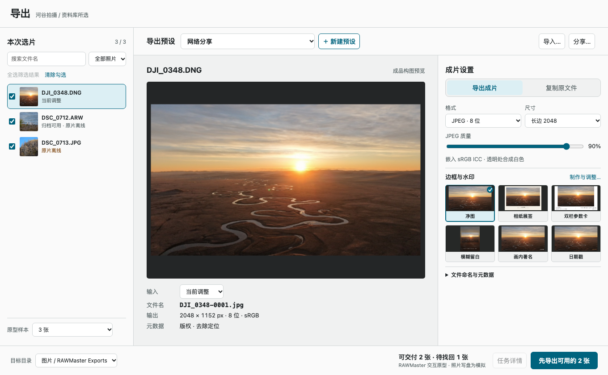
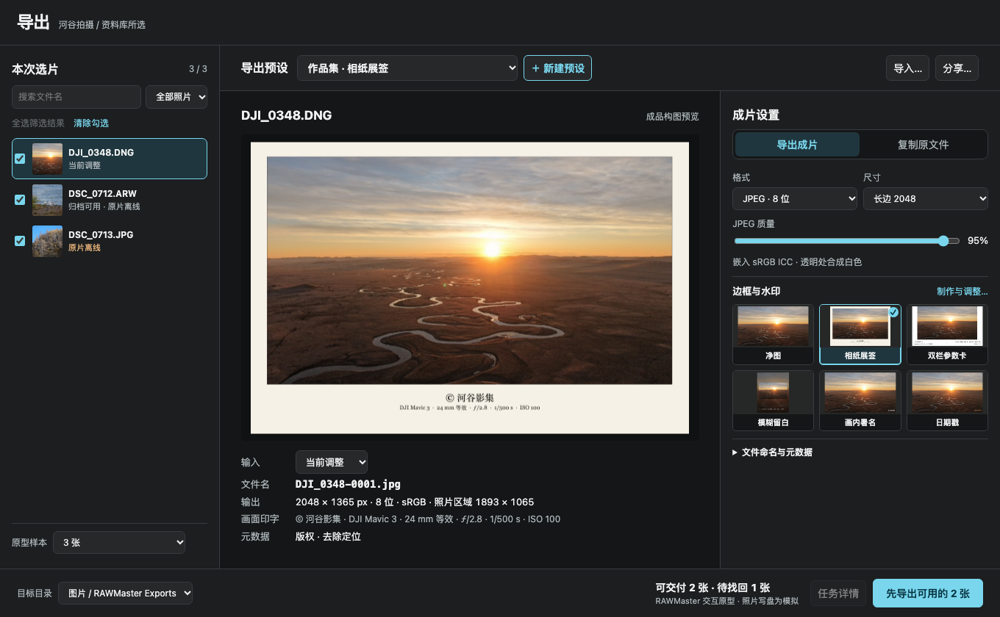

# 032 · 照片导出工作台

2026-11-22 · macOS 产品规格。面向从资料库交付一组照片、从编辑器交付某个版本、或与同事共用一套交付规格的摄影师。[可操作的工作台](prototype.html) · [四款产品调研](research.md) · [单批张数依据](batch-limits.md) · [Reframe 本机取证](reframe-styles.md) · [实现与验收](plan.md)

**保留标题栏的「导出」，把本次会生成的文件摆在用户面前。** 先确认照片和版本，再选用途。每次修改格式、尺寸、文件名或目标目录，当前照片的输出摘要和底部可交付数都随之更新。点下导出后，任务拥有自己的输入和设置，用户可以返回编辑。

## 从哪个入口进来

从[整机 HTML 原型](../../docs/ui/prototype/index.html)可用资料库选片、编辑草稿、指定候选和原件交付进入本页。专项入口保留固定样本，用于大批量与超限走查。[跨工作区走查](../../docs/ui/coverage.md)

| 入口 | 初始范围与动作 |
| --- | --- |
| 编辑器、版本列表的「导出此版本…」 | 一张照片。编辑器带入画布当前调整，版本菜单带入明确点选的版本，包含未采用的归档版本。标题显示来源，切换版本会刷新预览与可用性。正在提交的手势先结束，未完成的计算显示原因。 |
| 资料库工具栏、右键「导出所选成片…」 | 按当前显示顺序列出显式选中的照片。单击一行查看它的版本和输出名，独立的勾选框决定是否交付。返回资料库改选，再打开时取新选择。 |
| 资料库无选择，打开「导出」 | 有筛选时显示「当前筛选结果 · N 张」。无筛选时先显示范围选择，可显式选择「当前项目全部 N 张」。零结果显示空态。焦点、上一次选片和后台项目均不能自行扩大范围。 |
| 「复制原文件…」「交付精选」 | 直接打开「复制原文件」。前者按选中物理文件，后者沿用已保留、参与序列、RAW/JPEG 伴随格式和仅输出清单的既有语义。先列出最终物理文件和清单覆盖数，再执行复制。 |

折叠的 RAW+JPEG 在成片列表占一行，注明实际采用的成员和扩展名。默认使用本次正在编辑的成员，资料库中没有明确编辑成员时沿用所见代表图。用户可在当前范围内换成员，或展开后显式导出两份。原件交付中，只有显式选择的格式与伴随策略才可扩展文件，成员仍须在已确认的范围内。视频、尚未纳入项目或该入口不可用的素材给出原因。延时视频的制作入口沿用现有流程。

文件菜单的「导出成片…」使用 ⇧⌘E，另列「复制原文件…」。编辑器顶部「导出」和文件菜单进入同一工作台。如果照片仍在载入，预览和实际写出会等待同一个作品版本就绪。初修带入按下导出时的配方，版本列表带入明确选中的版本。返回「编辑」恢复此前的初修或版本视图。单张的「复制原文件…」保留当前物理文件的范围。应用「上次设置」只载入交付参数，目的地由底栏管理。[作品版本与离线归档回归](../../Tests/RAWMasterUITests/EditingExportHandoffTests.swift) · [配对原件范围回归](../../Tests/RAWMasterUITests/WorkbenchActionTests.swift)

## 面板如何使用

| 位置 | 首次打开 | 操作后的反馈 |
| --- | --- | --- |
| 照片预览上方 | 当前导出预设的名称、切换控件与「新建预设」并列。就近提供导入及分享 | 切换一次载入成片或原件的整套设置。手动改动会标出当前设置已修改，可另存。当前照片、勾选和底栏目的地继续可见。 |
| 左侧照片列表 | 候选总数、全局勾选数、搜索、筛选、批量勾选与照片行 | 查看和勾选独立。筛选后仍显示全局勾选数。查看一张离线照片可以解释该项原因。 |
| 中间预览 | 当前焦点照片的最终构图和边框。图下给出输出名、成品像素、位深、色域及实际印字 | 调整画布、查看另一张或换版本时，照片区域和逐张印字随之更新。无可用输入时只显示资料库缩略图与待找回状态。编码体积有可信估计时标「约」。 |
| 右侧设置 | 交付方式、格式、尺寸、条件质量、命名、元数据与当前版式。点击「编辑边框与水印」进入独立对话框 | 切到复制原件后可选格式、复制文件或仅写清单。切回成片恢复这套设置里的成片参数。 |
| 底部工具栏 | 常驻的目的地选择器、勾选与可交付数、主按钮 | 成片、原件和仅清单共用这个出口。只在这里变更目录；切换、导入、新建预设或加载上次设置均保留当前路径。 |

在窄窗口保留当前照片、文件名、目录和主操作，设置可滚动。键盘焦点按照片、设置、主操作移动。空格切换勾选，方向键查看当前列表，Escape 关闭展开层。文件名框接收正常文本输入。导出页空白区、列表、输入框均隔离资料库的 P/X/U、星级和选片菜单。VoiceOver 可读出照片、来源、是否勾选、阻塞原因及任务结果。

### 在上千张候选照片里工作

**一批最多勾选 200 张输入照片。** 限制适用于成片、复制原件和仅写清单。候选列表可超过 200 张。计数按已确认的唯一照片 ID，包含已勾选的离线项。生成的 CSV、JSON 和页内显示的行数均不占照片名额。199 和 200 张可提交。201 张留在原选择中，显示超出 1 张并禁用提交。用户可以减选、按筛选结果批量调整，或明确选择按候选原顺序保留前 200 张已勾选项。

左侧仅绘制可见行及少量邻近行。按文件名查找、筛 RAW/JPEG 或已选项时，勾选集合和文件序号跨筛选保留。批量勾选只影响当前筛选结果。预览聚焦一张照片，滚动时不会触发整批解码。可在原型左上切换三张、1,200 张和 201 张示例，验证快滚、末行、筛选、清空与超限后的恢复。[1,200 张列表截图](assets/selection-1200.png)

原件交付产生一份可在表格软件中打开的 CSV，每张照片占一行，列出实际状态、是否请求复制及交付路径。行内的清单文件名指向同目录 JSON，整批原始请求、允许范围及缺失格式在 JSON 中完整列出。数千张交付时也能逐行核对。

Adobe 的桌面版及 Classic 本地导出帮助没有公布单批照片数。所查 AlcedoStudio 版本中，36 控制检查器预览行数，200 决定预览排序，实际队列接收整个选区。200 是 RAWMaster 自定的首版交互限制，为选片、渲染及交付规模设定一致的边界。真实 RAW 耗时和内存另行测量。[逐项出处与代码位置](batch-limits.md)

## 首版交付设置

| 用途 | 实际输出 | 首次默认值 |
| --- | --- | --- |
| 网络分享（默认） | JPEG 8 位，sRGB，白底合成透明区域 | 长边 2048 px，质量 90%，写入可用版权，去除定位 |
| 作品集 · 相纸展签 | JPEG 8 位，sRGB，暖白底板与 3∶2 横向成品 | 长边 2048 px，质量 95%，完整保留照片，底部留给署名和拍摄信息，仅写版权，去定位 |
| 社交竖幅 · 4∶5 | JPEG 8 位，sRGB，4∶5 模糊底板 | 成品长边 1350 px，质量 90%，完整保留照片，底部按张显示 EXIF，仅写版权，去定位 |
| 全尺寸 JPEG | JPEG 8 位，sRGB | 当前版本完整像素，质量 95%，与分享预设相同的元数据策略 |
| 继续修图 | TIFF 16 位，sRGB，保留有效透明通道 | 当前版本完整像素。归档图若来自 8 位源，在版本详情标明有效源位深 |
| 自定义 | JPEG 8 / TIFF 16 / PNG 16，嵌入对应 sRGB ICC | 保留已有的 1080、2048、4096、自定长边和全尺寸。PNG 保留透明。只有 JPEG 显示质量调节 |
| 复制原文件 | 文件原始字节、原扩展名、原有目录关系，按现有服务生成 CSV/JSON | 显式选片默认交付这些文件的原有格式。保留「仅清单」和精选交付的格式筛选 |

- **长边约束整个成品。** 从已定方向、已裁切的版本起算。净图模式下，6000 × 3375 导出 2048 长边得到 2048 × 1152，1200 × 800 仍为 1200 × 800。加框后，同一张横图可装入 1080 × 1350 画布。图下分别显示成品尺寸及照片区域。「版本全尺寸」以版本长边为画布预算。两种适配方式均避免放大源像素，必要时按比例缩小整张画布。
- **元数据用可解释的选项。** 成片可选「仅版权」「拍摄信息与版权」「移除描述性元数据」。首版仅在「拍摄信息与版权」下可显式保留已有 GPS。ICC、输出尺寸和正确方向始终随成片写入。界面逐项说明源中缺失的版权或定位。原文件的嵌入信息随字节交付。原件清单可能含本地路径，收件前可单独查看。
- **文件名先给实样。** 默认沿用现有成片模板 `{name}-{index}`，序号从 0001 起，按预检冻结的队列顺序计算。保留 `{date}` 的导出日语义，整批共用同一日期。新增 `{captureDate}`，源中缺拍摄日期时预检给出原因并允许换模板。普通点号属于文件名，扩展名由格式追加一次。遇重名默认「保留两份」（如 `河谷.v2-0001-2.jpg`），也可明确「跳过」。提交时遇到新冲突继续按同一策略处理。
- **常用设置可复用。** 内置预设可直接切换，改参数后可新建个人预设。目的地单独记在本机。首次使用 `~/Pictures/RAWMaster Exports`，以后沿用用户在底栏选定的路径。
- **每一项都有去向。** 独立的读取或编码错误只影响该项。目标卷掉线、空间耗尽时暂停余项，显示已落盘路径、待处理项以及恢复办法。成功项可在 Finder 定位。恢复或「重试未完成」复用原设置、序号和版本，已经成功的文件保留原状。

## 在一批照片上制作边框和水印

日常交付默认「净图」。独立的「边框与水印」对话框用**当前同一张照片**绘制六张候选卡，点击卡片就能看到大图，无需先读一组参数。进入时复制当前版式为草案，选样式、换照片底板或调文字均更新对话框预览。「应用」一次提交本轮修改，「取消」或 Escape 丢弃修改。主工作台可直接使用已选样式；需要制作新变体时才进入对话框。

| 样式 | 在最终照片上看到的效果 |
| --- | --- |
| 净图 | 使用原构图交付，画面无印字、无外框。 |
| 相纸展签 | 暖白相纸包住照片，较宽的底边居中排列署名或机型和逐张参数。 |
| 双栏参数卡 | 白色底栏左右独立排版。左侧为机型、镜头或署名，右侧为曝光参数及拍摄日期。 |
| 模糊留白 | 同一张照片生成 4∶5 模糊背景，中间完整放入清晰照片。 |
| 画内署名 | 在照片内部叠印署名，默认右下，保留安全边距。支持自有透明 Logo。 |
| 日期戳 | 在画内用等宽数字显示该张的拍摄日期。缺日期时省略印字。 |

Reframe 1.4.2（88）的发行包和开发者截图提供布局依据。双栏、相纸的底边比例来自截图测量，RAWMaster 以自己的绘图代码、系统字体和当前照片重建。同一张 DJI 照片的两份实际 JPEG 可直接比较文字和留白。[原生双栏参数卡](assets/native-split.jpg) · [原生相纸展签](assets/native-paper.jpg) · [macOS 制作窗口截图](assets/native-watermark.png) · [Reframe 证据和测量](reframe-styles.md)

| 制作项 | 可调整的内容 | 批量行为 |
| --- | --- | --- |
| 画布与照片 | 纯色或由当前照片生成的模糊底板。可随照片或固定为 1∶1、4∶5、3∶2、16∶9。边距按成品短边计，细线可调颜色、粗细，投影可开关 | 默认完整保留当前版本的裁切。选择「居中填满」会提示再次裁切并显示结果。固定比例在横、竖照片间一致，逐张取对应的底图。 |
| 水印 | 文字署名、EXIF、两者组合或仅 Logo。文字可搭配一个自有 Logo，支持 PNG 透明图或 JPEG。字号、字体类别、色彩及整体不透明度可调 | 画内可在九个位置对齐，底部留白可左、中、右对齐。关闭水印即释放题注位置。画内署名可独立用于无框照片。 |
| EXIF 展签 | 可选机型、镜头、焦距、光圈、快门、ISO、拍摄日期。署名由摄影师填写，原型中的「河谷影集」为示例署名 | 按当前项身份读取。一张缺 ISO 就略去 ISO 和相应分隔符，在摘要注明原因。全部缺失时仍保留该批底部版式。移除文件 EXIF 后，用户选中的画面印字仍然可见。 |

## 保存和交换一套导出设置

| 操作 | 用户会得到什么 |
| --- | --- |
| 切换导出预设 | 一次切换交付方式、原件格式与复制/仅清单、成片格式与位深、JPEG 质量、最终尺寸和自定长边、色彩策略、命名与重名规则、元数据与定位策略、版式、水印及 Logo。暂未启用的参数也会恢复。 |
| 单换版式 | 替换边框、布局和水印呈现方式，保留草案里已填的署名和自有 Logo。切到净图时两者都隐藏，切回带水印的版式可继续用。当前格式、尺寸、命名、元数据和目录继续生效。手动调整版式参数后可随整套设置另存。 |
| 新建与分享 | 从预览上方「新建预设」保存当前整套设置。「分享」可以把内置、个人或尚未保存的设置写成 `.rmexport.json`。确认时列出交付方式、原件复制策略、成片元数据、署名和 Logo。关闭中的署名或 Logo 也会随文件传递，摘要明确标识其状态。[可导入的作品集示例](assets/portfolio.rmexport.json) |
| 导入 | 先预览设置、实际署名与 Logo 及是否保留已有 GPS，再点「添加并应用」。同名同内容复用已有项，同名不同内容自动加序号，两份都能再选。取消或文件有误时维持工作台原状。 |

范围分为两类。**预设保存所有交付控件**，包括当前隐藏的 JPEG 质量、自定长边、定位勾选、原件格式、署名和内嵌 Logo。**本批单独持有选片和目的地**，包括照片 ID 与顺序、焦点、所选版本、输出目录及其设备访问权。真实 EXIF 值在收件方按张取得。导出使用 v2，读入 v1 时补齐原件和交付方式的默认值。显影预设仍由编辑器管理。[文件契约](plan.md#导出预设的文件契约) · [显影预设规格](../031-preset-browser/spec.md)

## 典型走查

1. 摄影师从筛选结果里选三张，一张原片离线但有归档 TIFF，一张完全离线。进入「网络分享」，列表显示三张，底栏显示两张可交付。查看归档图能看到所用版本和缩小后的尺寸。点击「先导出可用的 2 张」，切回编辑继续工作，再回任务看到两个文件、一个待处理项。找回最后一张后，只重试该项，沿用 0003。
2. 摄影师从版本列表交付一张 16 位 TIFF，又从资料库复制同一张 RAW。前者的收据记录版本、配方与 ICC，后者保留 RAW 字节并产生清单。两个命令各自只需要选择一次目的地，任务详情能分别定位成片和原件。
3. 摄影师给一组横竖照片交 4∶5 竖幅。选「社交竖幅」，横图完整放在模糊底板中，竖图沿用相同外框。逐张查看展签，镜头或 ISO 缺失的照片仍可交付。需要满版时，切换适配方式后逐张复核构图。
4. 工作室把自有 Logo 加到「作品集」底栏，修改署名与命名模板，再点击「分享」。同事导入文件先看到署名、Logo 和去定位策略。点「添加并应用」后，自己的照片、选用的版本和客户目录仍在。点击导出时才启动这批任务。

## 后续能力和开放条件

| 批次 | 用户价值 | 开放条件 |
| --- | --- | --- |
| 首版 | 可靠交付成片或原件，带可编辑的边框、署名、Logo、EXIF 展签和可分享的导出预设 | [实施计划中的 M1、M2a、M2b](plan.md) 通过实际文件回读、混合方向批量、预设往返和任务恢复验收 |
| 第二批 | Display P3 / Adobe RGB、宽高边界和印刷尺寸、介质相关的输出锐化 | 每种颜色转换有参考色块对照，印刷尺寸与 PPI 语义独立，锐化在最终照片区域上有图像样张。可按单项开放 |
| 第三批 | 一批同时交网页和印刷两套文件，或输出经验证的 HDR、AVIF 等格式 | 先展示照片数 × 预设数和各目的地。每个格式有编码、文件标签及外部查看器实测。增益图、传递函数与高位深分别验收 |

HTML 原型支持三档规模、照片像素预览、模拟队列及真正的预设文件下载和导入。研发先完成可复用于 Server 的 Rust 导出内核，再集成 SwiftUI。测试涵盖实际成片、与参照软件同机的性能和独立工作台。跨重启的批次恢复单独排期。[验证记录](evidence.json) · [原生代码与阶段范围](plan.md)
