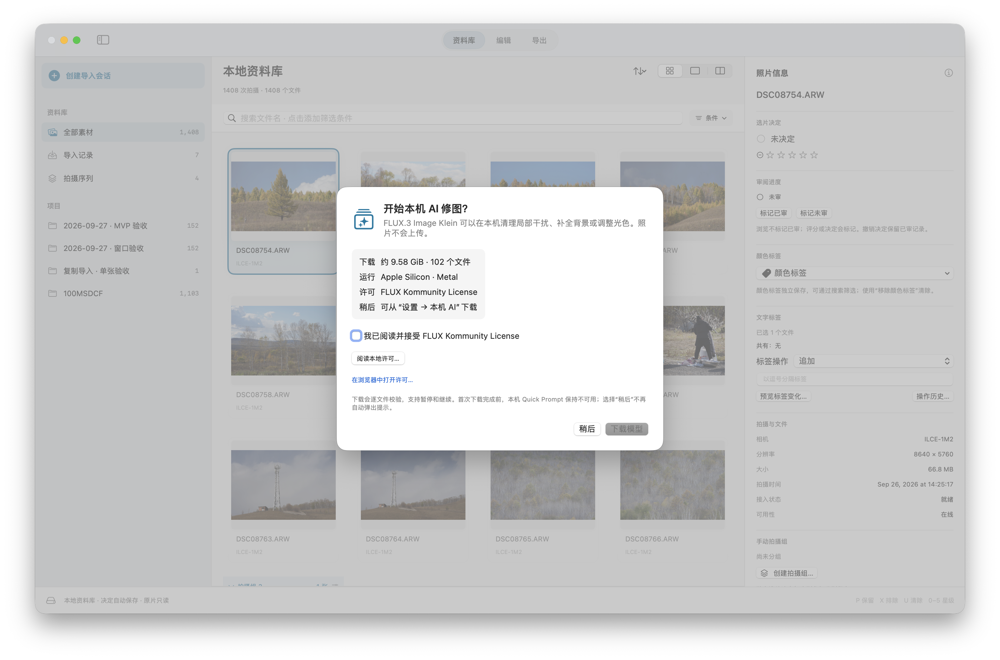
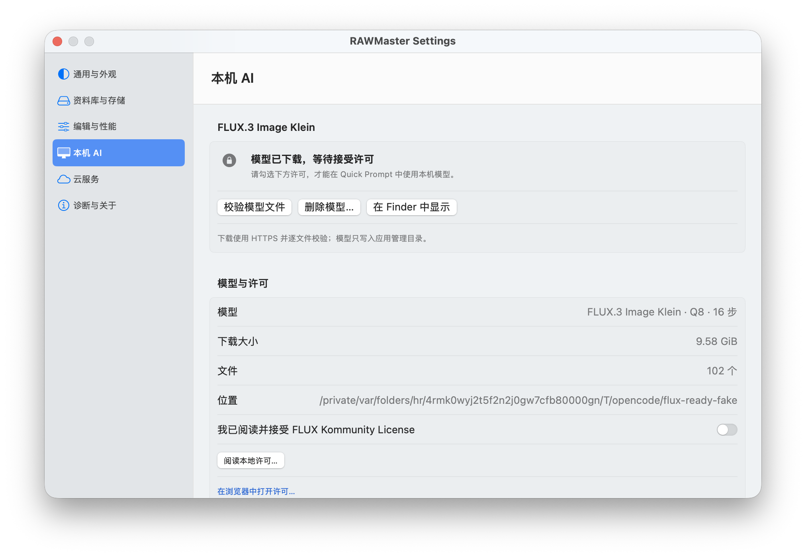

# 034 · 本机 AI 模型设置与首次下载

2026-11-26 · 本机 FLUX.3 Klein 的设置、首次启动提示和权重下载任务。原型在[摄影工作台](../../../docs/ui/prototype/index.html#settings/runtime)，首次启动提示可点「预览首次启动提示」查看。原生入口是本应用设置窗口的「本机 AI」页和 Quick Prompt 的本机模型准备提示。

## 用户从哪里进入

| 入口 | 对象与完成条件 |
|---|---|
| 应用首次启动且没有可用的 FLUX.3 Klein 权重 | 显示一次性说明：约 9.58 GiB、102 个文件、FLUX Kommunity License、只在本机运行。选择「下载模型」进入「设置 → 本机 AI」；选择「稍后」不再自动弹出，本机模型保持不可用。 |
| 设置 → 本机 AI | 查看模型状态、下载大小与目录；阅读许可；下载、暂停、继续、重试、校验、删除、在 Finder 中显示。关闭设置后下载继续，返回原照片不改变当前编辑。 |
| Quick Prompt → 本机模型未准备 | 只显示模型状态和「打开设置 → 本机 AI」，不再要求选择 Python、MLX 运行时或权重目录。模型就绪后返回同一 Prompt 草稿。 |
| 设置 → 本机 AI → 高级 | 实验性 Qwen2.1 / ComfyUI 运行时仍可展开；普通 FLUX 修图不需要它。 |
| 设置 → 云服务 | Seedream 凭证与地址保持独立；下载本机模型不会上传照片或创建云端任务。 |

## 下载与任务状态

| 状态 | 界面与动作 |
|---|---|
| 未安装 | 显示约 9.58 GiB、目标目录、许可。未勾选许可时下载不可用。 |
| 下载中 | 进度条、已完成/总量、当前文件、速度与剩余时间；可暂停。关闭设置或切换照片不取消任务。 |
| 已暂停 / 中断 | 已完成且通过校验的文件保留，当前文件的已下载字节也保留；继续时用 HTTP Range 从断点续传。 |
| 校验中 | 对完整文件做逐文件 SHA-256；失败的文件从模型中移除，重新下载时只补该文件，不把校验失败降级为警告。 |
| 已就绪 | 可离线生成候选；显示校验、删除和 Finder 入口。 |
| 失败 | 显示可操作原因（网络、磁盘、权限、校验）；保留已验证文件，重新开始只补缺项。 |
| 删除 | 仅在已就绪或已暂停时提供，二次确认；删除不改变作品版本、已采用候选或编辑历史。 |

下载在应用管理目录中进行，默认位置为 `Application Support/RAWMaster/Models/Flux3Klein/<weightsRevision>`。同一时间只允许一个 FLUX 下载任务；任务归属于应用，不归属于某张照片，关闭设置窗口不会取消。应用退出时已完成文件与当前文件的 `.part` 断点都保留；下次继续从断点续传，已下载字节不重复。

## 首次启动

首次启动提示只在没有就绪模型且用户尚未处理过该提示时出现。它不阻塞资料库浏览；用户可以先进入项目、编辑或导出。选择「稍后」后不再自动弹出，但「设置 → 本机 AI」和 Quick Prompt 的模型提示仍保留入口。模型更新到新的 weights revision 时，视为新的模型包，重新显示一次提示。

## 边界与验收

- 许可：FLUX.3 Klein 权重使用 FLUX Kommunity License，不是 Apache-2.0；下载前明确展示版本和链接，接受记录与版本哈希绑定。
- 数据：下载、校验和本地推理不上传照片、提示词或编辑配方；云端需要单独的发送核对。
- 已有内容：删除或更换模型不删除已采用版本、候选文件、回执或导出结果；旧任务继续可读。
- 失败：离线、磁盘不足、权限、部分文件损坏、应用退出、重复点击和取消各有一条可恢复路径；不自动重复已完成的文件。
- 可访问性：进度具有文本替代；暂停/继续/删除可用键盘；浅深色、减少动态效果和窄设置窗口不丢操作。
- 原生验证：下载状态机、已完成文件保留、暂停/继续、逐文件 SHA-256、损坏文件移除、首次提示只出现一次、删除后配置回退，由 `FluxModelManagerStateTests` 的 8 个测试覆盖（含 Range 断点续传、跨管理器重开、无设置观察者时后台完成、网络中断自动重试）；真实 Hugging Face 单文件下载 + SHA-256 通过。另通过 Swift `LocalFluxProvider` → Rust worker 的 64×64、16 步 live test。完整 9.58 GiB 下载已通过：102 个文件、10,281,769,642 bytes，续传跳过已完成文件并逐文件校验，346s 完成；真实 HTTP Range 断点测试在 130 MB 文件上从 1 MB 处继续并得到 206，25s 完成。记录见[下载与 worker 联调](evidence/local-ai-download-validation.md)。正式签名/公证包仍待验收。

## 原型走查

原生首次启动提示已在 M4 Max / macOS 27 上实际出现：无模型时显示 9.58 GiB、102 个文件、FLUX Kommunity License；未勾选许可时「下载模型」不可用，「稍后」可关闭并保留设置入口。设置页在测试模型目录上显示「模型已下载，等待接受许可」、9.58 GiB、102 个文件、校验/删除/Finder 入口；许可未接受时不把状态写成「已就绪」。

1. 打开[本机 AI 设置](../../../docs/ui/prototype/index.html#settings/runtime)，确认未勾选许可时下载不可用；勾选后下载，观察进度、暂停、继续。
2. 点「预览首次启动提示」，选择「稍后」，再回到设置确认入口仍在。
3. 模拟下载完成，确认「校验」「删除」「在 Finder 中显示」出现；删除后回到 Quick Prompt，本机模型显示待准备并提供设置入口。
4. 展开「实验：Qwen2.1 / ComfyUI 运行时」，确认旧实验入口仍可用，但不阻塞 FLUX 下载。
5. 窄设置窗口、浅色和深色下重复 1–4；键盘可完成勾选、下载、暂停和删除确认。
