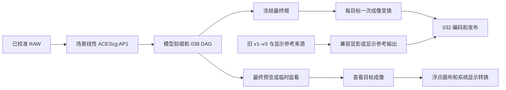

# 035–039 · 图像引擎、HDR 与 DAG 联合实施和验收

首轮审核的本地基线为 `b238c0ab`。2026-11-27 在 `1e5a1ceb` 上继续实施，同一条场景路径贯穿色彩管理、HDR、Rust + Metal 与可持久化 DAG。以一张实拍照片从暗房编辑、查看、重开到 032 冻结交付的闭环为验收单位，同时核对旧照片回放与导出。默认显示入口、组件通过和产品签收各有凭据。

阶段 1 已在同一签名 Release 上跑通暗房入口。雪景和人像的 032 PQ／SDR 批次均使用各自同一冻结候选，雪景窗口完成实体 HDR→SDR→HDR 往返。资料库网格送交的故障、修复与实拍复验见 [032 网格交付](../032-export-workspace/spec.md#资料库网格直接交付)。[037 实拍验收](../037-color-film-hdr/validation.md#同一签名-release-首条闭环) · [038 Graph 实拍验收](../038-node-dag-workflow/validation.md#与-037-同包的首条-graph-闭环)

前一轮以 Sony ILCE-7RM5 的 9504 × 6336 原片复验原生编辑、显式保存旧候选、全尺寸双格式交付与重开后逐项读取的 Rust 执行回执。工作台初次分页和选区恢复也进入签名包走查。[安装包与实拍回执](../025-editing-workspace/evidence/editor-rails/release-acceptance.json) · [成像与内存测量](../037-color-film-hdr/evidence/real-60mp-bayer-budget.json)

## 规格归属

| 规格 | 负责的契约 |
| --- | --- |
| [035 可移植内核](spec.md) | 本地目录与任务、图像库 ABI、旧显影的等价回放、跨端能力边界。 |
| [036 渲染性能](../036-render-pipeline-performance/spec.md) | FIT、原图取样、定稿、缓存、资源预算和性能测量。 |
| [037 色彩、胶片与 HDR](../037-color-film-hdr/spec.md) | 来源准入、颜色空间和成像、版本与查看状态、显示诊断及文件信号。 |
| [038 DAG 工作流](../038-node-dag-workflow/spec.md) | 版本化图、命令、预览与最终根、模板及批量。 |
| [039 Rust 场景后端](../039-rust-scene-backend/spec.md) | 038 图的 Rust 编译和执行、Metal 资源、严格模式与回执。 |
| [039 界面规范](../039-design-system/spec.md) | HDR、Graph 和 032 使用的控件、焦点、状态、辅助功能与原型证据。保留现有目录名，引用 039 时写明全名。 |

当前产品把 SDR、HDR 和黑白放在同一照片的「色彩外观」内。当前图、显示目标和交付输入各有独立身份。编辑和资料库都能冻结自动保存的 HDR 草稿。显式查看旧结果时可导出该结果。检查器、示波器与 032 的本次实拍交付共用这一约定。[编辑与成片复验](../025-editing-workspace/appearance-acceptance.md) · [两条管线的参数覆盖](../037-color-film-hdr/evidence/appearance-roundtrip-20261127.md)

## 当前实现和签收缺口

| 路径 | `main` 已实现 | 尚缺的产品证据或接线 |
| --- | --- | --- |
| 旧显影 | v1–v3 等价回放、Core Image／Metal 产品路径，035 部分 Rust 算子可重放，部分通过 QA 开关接入预览。旧 Graph 是只读兼容投影。 | 035 Batch 34 的 161 个控件 ID 有封存证据。首次精确、定稿及缩放平移在同包正式复验中仍超门。控件记录不证明 Rust 路径已接管。 [035 发布复验](acceptance.md#同一封存构建的两次正式运行) · [旧配方验证](../038-node-dag-workflow/validation.md#原生兼容图与冻结-sdr-导出) |
| 场景显影与 DAG | 已准入的 Bayer ARW 可创建 v4 场景草稿。可编辑 Graph 已有串行、Parallel、Layer、组、连接草案、监看、模板和批量候选。本阶段检查器有曝光、强度和混合等参数。 | 九类调色、画布工具及来源绑定资产仍需逐项接入。组内监看的实际后端可从预览帧回执核对。20／200 张验过候选事务，主要样本是同一 RAW 的多目标身份。异源整批成片、实际窗口指针操作及 VoiceOver 未签收。 [038 原生图](../038-node-dag-workflow/validation.md#原生可编辑-graph) · [候选批次](../038-node-dag-workflow/validation.md#原生模板与可恢复批量) |
| HDR 显示与输出 | 固定 ACES 2 输出，浮点 `CAMetalLayer`，有限的示波器和诊断，032 的 SDR JPEG／PNG 和全尺寸 10 位 Rec.2020/PQ AVIF。已有两张固定 ARW 的 PQ 进程中断、恢复和独立回读证据。 | 实际屏幕余量的数值测试、绘制完成和文件回读分别验证不同环节。签名包已完成 HDR↔SDR 跨屏。亮度变化、比较、FIT／1:1、真实客户端观片和多目标／卷恢复仍需独立验收。 [037 验收](../037-color-film-hdr/validation.md) · [EDR 数值测试](../../Tests/RAWMasterImagingTests/DevelopmentSceneEDRCrossScreenTests.swift) |
| Rust 场景执行 | 顶层、组内和最终图可在 Rust Metal 上执行。预览帧、示波器结果和 032 队列的已准备／已交付条目分别保存本次求值的回执。 | 9504×6336 实片已用产品预算验证。强制 Rust 暴露并修复了零权重分支和长链多分配一幅纹理的问题。继续逐项量化兼容算子、模型及编码的实际工作集。 [60 MP 实片与产品预算](../037-color-film-hdr/evidence/real-60mp-bayer-budget.json) · [039 性能与边界](../039-rust-scene-backend/validation.md) |
| 确定性模型 | v4 配方支持图文档 v2，冻结模型阶段、参数、算法标识及顺序。无模型的旧图继续使用图文档 v1。预览、示波器和冻结交付读同一份模型程序。 | PhotoVGG7、PhotoUpconv7、Vision 和可选 EfficientViT 各有独立资源要求。缺资源和超出全图模型预算须给出明确原因。不同模型的大图作用尺度和额外算子按实测逐项放行。 [配方](../../Sources/RAWMasterCore/DevelopmentSceneGraphV1.swift) · [场景模型](../../Sources/RAWMasterCore/DevelopmentSceneModelV1.swift) |

### 为什么迁移和验收没有闭合

1. **迁移按算子和探针计进度，产品链路仍分开。** 035 的点配方解决旧 V3 像素等价和跨端重放，039 执行的是新的 AP1 场景图。旧配方中的解码白平衡、滤镜插值、几何与空间算子绑定既有顺序。即使曝光可替换，完整 V3 组合也不会自动改用 Rust。已验证的纹理借用只覆盖部分配方，跨边界物化和有限值校验仍会吞掉收益。迁移单位改为「来源 × 算子链 × 查看或交付意图 × 后端」的实际产品路径。
2. **大图瓶颈出在完整中间纹理。** 旧版在 FIT 之前就申请超过 976 MiB 的整幅 AP1 与标志图。新入口上传一次 Bayer，在原始坐标计算所需区域；大图交付在每个区域完成图求值和输出变换。本次保留 440 MiB 解码预算、640 MiB 预览图预算和 1.5 GiB 交付图预算。编码器、模型工作区及传统显影的全图归约仍须单独量化。[60 MP 实片与产品预算](../037-color-film-hdr/evidence/real-60mp-bayer-budget.json) · [036 原生窗口](../036-render-pipeline-performance/validation.md#画布接线后的出厂窗口)
3. **安装包入口和端到端验收没有绑定。** `b238c0ab` 修复 Finder 启动的默认入口。对应 JPEG 用例断言模式条和只读 Graph 按钮；实拍暗房测试原先从控制器创建草稿。实际签名包的旧确认弹窗中，创建和取消均禁用，用户到不了可编辑图。随后一版用工作表修复了无法进入的问题。现行签名包从「色彩外观」一键创建或恢复当前照片的 HDR 调整，并以同一份活动图直接进入 032。FlashRaw 运行库不可用、原片无法解码及机型不准入分别处理。日常 CI 会跳过依赖固定原片、进程恢复或报告变量的用例。发布性能工作流仍需加入同一签名包的 HDR、Graph、PQ 和实屏清单。[Release 修复](../038-node-dag-workflow/validation.md#release-默认入口修复) · [当前签名包入口与交付](../025-editing-workspace/appearance-acceptance.md) · [CI](../../.github/workflows/ci.yml) · [发布性能工作流](../../.github/workflows/image-release-performance.yml)

## 统一的颜色和执行边界



- **颜色和版本。** 新场景主干采用 F32、AP1、ACES 白和预乘 alpha，显式保留负值及超白。R32F coverage 独立于颜色。输出目标独立选择固定 ACES 2 Rec.709 SDR（参考白／峰值 100 nits）或 Rec.2020 HDR（参考白 100、峰值 1000 nits）。SDR 派生从同一母版求值。将新的场景 SDR 编辑也接入这条主干，显式保存编辑意图，早期 v4 按既有 HDR 意图读取。旧 v1–v3 按原色彩、解码、配方和像素语义回放。已成像的光栅按来源标签解释，无法确证场景参考的文件留在显示参考路径。胶片资产声明场景 Look、显示域 Look 或替代成像的作用，每支路只发生一次成像渲染。[037 颜色与状态](../037-color-film-hdr/spec.md#从输入到输出的域)
- **图和平台。** 038 持久化图及其版本扩展是唯一场景文档。035 的点配方继续承担旧 SDR 兼容执行，两个入口向同一 Rust 算子登记、带域的执行计划、资源调度和诊断收据逐步收敛。macOS 优先使用 Rust 控制的原生 Metal。Swift 保留 AppKit 呈现、授权和文件发布，FlashRaw、图像编码及设备模型可由适配器提供。Linux CPU／Vulkan 逐路验收，先按能力表拒绝尚无等价实现的 scene 作业。[035 ABI](spec.md#两个库以及宿主) · [039 执行器](../039-rust-scene-backend/spec.md) · [041 能力约束](../041-server-image-editing/spec.md)
- **冻结与缓存。** 版本和交付票据冻结原片摘要、校准／解码、图及资源版本、输出计划。模型另冻结阶段 ID、权重／提供者身份、分析 View、输入尺度和来源映射。模型更改使受影响的前缀、节点和末端缓存失效。同一遮罩依据目标照片重新计算或明确绑定已验证资产。换屏只改查看末段，切 SDR 派生只重算对应末端。监看、旁路、连接草案和屏幕参数不进入交付票据。所有异步结果核对来源、版本、作用域及请求代际后发布。

## 实施顺序与退出条件

| 顺序 | 交付 | 可判定的退出条件 |
| --- | --- | --- |
| 1 · 验收现有闭环 | 用同一签名 Release 和固定 SHA 的雪景／人像 ARW，从资料库进入 HDR、编辑 DAG、监看、撤销、保存重开，从 032 发布 PQ 和同源 SDR。JPEG／旧配方核对只读图及旧成片。用源码相同的测试包跑严格 Rust 与强制 Swift。 | 报告写明 commit、构建／运行库摘要、样片、支持系统和屏幕、实际后端及跳过原因。测试或样片不可用时对应验收项标阻塞。生产默认安装入口可达。旧配方和基线成片等价。监看与非法草案误发布、错片／错版本、重复发布均为 0。HDR 需另有实屏和独立文件的双份证据。 [037 放行](../037-color-film-hdr/plan.md) · [038 放行](../038-node-dag-workflow/plan.md) |
| 2 · 接通统一图与模型 | 给预览、诊断、冻结成片和 032 共用带类型的场景输入及执行回执。版本化接入模型。先验 AP1 有符号／超白和模型输出域。组内查看已由 Rust 按路径求值，示波器与队列条目已接收各自的实际执行回执。 | 旧 v4 重开等价，模型资源变更、缺失、离线或模板重绑有明确结果。同一输入的预览、示波器与导出能追溯至同一版本化输入。严格 Rust 对合格请求有本次 Rust 回执，无法执行给明确错误。自动只回退到等价路径并记录原因。 [039 迁移](../039-rust-scene-backend/spec.md#迁移顺序) |
| 3 · 迁移重算最多的渲染段 | 先接曝光、EV 曲线、覆盖与混合等同域点运算的融合，再移植纹理／清晰度的有界 halo 与后继失效，最后重做去雾、brilliance 等全图确定性归约。优先打通输入瓦片、末端编码和画布复用。核算模型、DRT、缓存、在途帧和导出的共同预算。 | 严格双跑验证整幅与 ROI 的接缝、负值、超白、零覆盖、旧算法精度及批量交付。真实 24／60 MP 按实际产品预算完成，同机和同质量取得性能与峰值报告。一次只切换有等价性及收益证据的路由，回滚仍可重放该版本。 [036 测量](../036-render-pipeline-performance/spec.md) |
| 4 · 扩大产品能力 | 按支持矩阵补 RAW 校准与输入、剩余 Corrector 和画布工具、SDR 派生、异源批量、多目标／更多 HDR 格式与胶片。Linux Scene worker 由 041 独立放行。 | 每项标明来源、操作、后端、显示和格式。用工作台同一路径复验 AppKit 可访问性、真实摄影质量与故障恢复。20 张全成功及 200 张异源部分失败、取消、重启、接回、重试和撤销各有目录与文件独立回执。 |

## 证据与测量口径

- **交互。** 复用[摄影工作台覆盖表](../../docs/ui/coverage.md)的兼容图、HDR、可编辑图、PQ 和批量阶段场景，逐步记录浏览器与原生动作。安装实测从资料库正常导航，用同素材查离线、取消、失败重试、返回选片、键盘焦点、窄窗及浅深色。VoiceOver、减少动态和降低透明度在真实 AppKit 窗口验证。
- **像素。** 以 037 的独立颜色向量、038 的固定混合与 ROI 判据、035 的旧版本成片见证为基础。实拍补肤色、饱和灯光、负值与超白、暗部噪声和高光过渡。PQ 读回实际位深、原色、传递函数、矩阵、范围及独立解码像素。SDR 读回 ICC，分别在真实 HDR／SDR 客户端看样。目标峰值不能当作实测 MaxCLL／MaxFALL。
- **显示。** 同一已冻结版本实测从 HDR 屏到 SDR 屏再返回，变化亮度／余量，核对真实合成、参考白、界面和叠加、对比分割两侧及重新出图。记录系统、ICC、当前余量、实际呈现分支与像素见证。需要宣称绝对亮度时保留光度测量。版本指纹、HDR／SDR 文件与受影响的缓存计数一起核对。
- **性能。** 035 的封存发布门槛、036 的 V3 视口和原图窗口、037／038 的热态 drawable 与 039 的常驻图分别保留原判据。新增同机同源同分辨率交错双跑，每个必测组合预热 5 次、记录至少 30 次并独立复跑。冷启动单列。记录首个可见、首次符合目标质量、定稿、监看、1:1 平移、出片和批量吞吐，另列解码、上传、GPU、验证、显示、编码／发布、峰值及 fallback 次数。只有同测量区间、同质量的数据用于切换判断。发布脚本应对必需用例校验实际执行、报告完整及硬件条件，保留失败与跳过原样。

迁移完成以能力矩阵中的实际路由判定。macOS 新场景公开组合的 FIT、定稿、原图 ROI、监看及最终交付须有本次 Rust 执行或确定性的直通回执，严格模式的支持组合回退为 0。可等价替换的旧 V3 路由须有同包回放和性能证据，历史配方继续有版本化读取能力。已通过的同质量路线保持原判据，首次纳入复杂图和真 60 MP 时先冻结合理的设备预算、尾延迟及旧实现的对照。每轮至少保留完整的慢项、失败和资源预算证据。

## 本次 main 复验

Apple M4 Max、macOS 27.0.1（26A434）。本节历史 Release 测试包在 `b238c0ab` 构建，Imaging、UI、Rust runtime 的 SHA-256 分别以 `5f580bbef9f1`、`b897791db403`、`8b891ef3bd6e` 开头。`person.ARW`、`snow.ARW` 的实际 SHA 与 037 夹具一致。测试使用隔离资料库和工作目录。本机原始记录在 `output/035-039-main-audit/`。[RAW 样本清单](../037-color-film-hdr/evidence/scene-raw-m2.json)

| 复验 | 结果与边界 |
| --- | --- |
| Release Swift 与 Rust | Swift 主跑 66 通过，1 个画廊截图项跳过。补跑 14 项均通过，含该截图项，去重共 76 项 Swift。Rust 场景解析器 4 项通过。首轮缺 `RAWMASTER_FLASHRAW_LIBRARY` 时实拍测试失败，补传固定运行库后通过。 |
| 实拍应用阶段 | 雪景草稿、浮点呈现、DAG 连接／监看、撤销、另存及重开通过。FIT 命令到 SDR drawable p50／p95 为 17.79／22.87 ms，组内监看 18.06／18.97 ms。相同 ARW 反复登记的候选测试通过 20／200 项的预定事务与冲突检查。原生暗房及 Graph 测试仍报告 `setSceneHeadroom` 在视图更新期间发布的 SwiftUI 警告，列入跨屏修复。[HDR 计划](../037-color-film-hdr/plan.md#当前实现与验收边界) |
| 032 PQ 恢复与文件 | 人像和雪景的独立进程恢复通过。第一份文件 inode 保留，第二份暂存摘要保留，拒绝替换目录和错误原片。dav1d 1.5.4 解码两份 4000×6000、10 位全范围 AVIF，CICP 9/16/1，图片光量未指定。 |
| EDR 环境 | 数值复验读取内建屏及 LG，当前余量在不同时间记录约 1.20×／1.20× 和 6.94×／3.35×。软件分支与有限值通过。真实合成与 HDR↔SDR 窗口实测仍待签收。 |
| Rust Metal | 旧常驻 6 MP 合成图 15 个暖样本记录为 14.08／16.92 ms。参考侧实际后端未锁定。61.4 MP 合成图 6 瓦片、42 派发，图峰值 4.70 GiB，采用 6 GiB 测试预算。两项均为组件探针。实拍 60 MP 的产品预算另见[60 MP 实片与产品预算](../037-color-film-hdr/evidence/real-60mp-bayer-budget.json)。035 封存发布门沿用未通过的历史结果，本轮未重跑该矩阵。 |
| 摄影工作台 | 默认 60 个场景通过。兼容图 5、完整 HDR 4、阶段 HDR 3、示波器 2、PQ 3、原生 Graph 模拟 4、批量 2 项定向脚本分别通过。相同阶段有浏览器与 Release 测试证据，安装窗口、真实屏幕和 VoiceOver 仍需分别签收。 |

在仓库根执行以下闭环复现。原片用 037 的授权固定 SHA，运行库用相同的 FlashRaw 0.3.1，首次构建去掉 `--skip-build`。报告选项见 [037 FIT](../037-color-film-hdr/validation.md#原生场景查看与显影阶段)、[038 监看](../038-node-dag-workflow/validation.md#原生可编辑-graph)和[039 EDR、60 MP 及严格 Metal](../039-rust-scene-backend/validation.md)。

```sh
audit_dir="$(mktemp -d)"
export RAWMASTER_FLASHRAW_LIBRARY="$PWD/output/tools/flashraw-target/release/libflashraw_capi.dylib"
export RAWMASTER_SCENE_RAW_FIXTURES="$PWD/output/preset-mask-fixtures"
export RAWMASTER_SCENE_DELIVERY_SNOW_ARW="$RAWMASTER_SCENE_RAW_FIXTURES/snow.ARW"
export RAWMASTER_SCENE_RAW_REPORT="$audit_dir/raw.json"
swift test -c release --skip-build --jobs 4 -Xswiftc -enable-testing \
  --filter 'DevelopmentSceneRAWV1Tests|DevelopmentSceneDeliveryServiceV1Tests|EditingCompatibilityGraphTests|EditingSceneDarkroomTests|EditingSceneGraphWindowTests|SceneWorkflowBatchTests'
cargo test --release --offline --locked --manifest-path Modules/ImageEdit/Cargo.toml --lib scene::tests
python3 specs/037-color-film-hdr/verify-pq-restart.py --products-dir .build/release \
  --fixtures "$RAWMASTER_SCENE_RAW_FIXTURES" --output "$audit_dir/pq"
npm exec --yes --package=agent-browser@0.26.0 -- python3 scripts/check-ui-prototype.py
```
