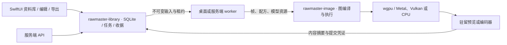

# 035 · 可移植资料库与图像处理内核

**技术方案待审，PoC 已完成。** 建议沿用 `rawmaster-library` 作为目录的唯一写入入口，新增独立的 `rawmaster-image`。桌面和服务端共用同一份配方编译器。交互预览优先把中间数据留在 GPU，批处理按每张照片冻结输入，资料库、编辑和导出共用有资源预算的任务调度。评审时可先看[实测与复现](validation.md)、[AlcedoStudio 源码](alcedo.md)、[LightFlow 发布包与 GPU 复演](lightflow.md)和[资料库与队列实验](catalog-queue.md)。

## 影响选型的实证

| 评审问题 | 实验给出的答案 |
| --- | --- |
| 能否直接照搬参考项目的 DAG？ | 固定提交的 AlcedoStudio 通用图可拓扑排序，产品 RGB 主链会拒绝扇出。LightFlow 发布版在 WebGPU 上交换两支路合成端口后，整帧结果改变，恢复连线后逐字节还原。采用有序端口、独立计划和资源寿命管理，RAWMaster 自己实现 RGB 分支与合成。[上游 C++ 对照](alcedo.md) · [发布包复演](lightflow.md) |
| 单张处理怎么提速？ | 同一 4K 浮点图从 4 次 dispatch 合成 1 次，常驻 GPU 的逐帧完成 P50 从 4.21 降到 1.56 ms。若每次完整回主存，融合 GPU 仍需 37.58 ms，CPU 参考为 4.92 ms。生产预览优先验证纹理直达画布，急需主存结果的小图也保留 CPU 路径。[计时与边界](validation.md) |
| 桌面／服务端能否共用？ | 两张真实照片的浮点输入用单一配方在 Linux CPU 批量重放，完整输出与 macOS CPU 各自同摘要。Linux 还用已有 CFlashRaw 桥从真实 ARW 直接解出裁块。Swift 的集成测试把两个内核连到产品画布。队列经 8 进程竞争和杀进程重领，旧 token 无法发布。[跨端回执](evidence/image-replay.json) · [任务恢复](catalog-queue.md) |

## 审阅边界与用户场景

本次交付技术调研、实验实现和实施准入条件。公开的两个 Rust 领域库是后续发布目标。PoC 在独立目录运行，Swift 验证复用产品的 `ZoomableImageView`。本规格把节点配方应用于**单张照片的版本，以及一批照片各自的版本**。可视化节点编辑器的交互另行立项。既有三条入口构成切换内核时的验收场景。

| 从哪里进入 | 对象、完成与退出 |
| --- | --- |
| [资料库 → 项目](../../docs/ui/prototype/index.html#library/project/river) | 给当前项目的照片筛选、打分、查询下一页。在后台提取缩略图。切走再返回同一项目时按已保存的排序、筛选和选择恢复。离线原片可浏览已有预览，重连按内容身份核验。[033](../033-library-lifecycle/spec.md) |
| [基础编辑](../../docs/ui/prototype/index.html#edit/basic)、[蒙版](../../docs/ui/prototype/index.html#edit/masks)、左栏预设和滤镜 | 开一张照片的指定版本，拖动曝光、采用滤镜、调蒙版范围。拖动只显示当前会话最新的请求。应用形成可撤销的新修订。取消或换片后，迟到的模型或 GPU 结果只能回到原请求，不能覆盖新照片。[025](../025-editing-workspace/prototype-review.md) · [027](../027-mask-ai-raw-integration/spec.md) · [028](../028-filter-experience/spec.md) |
| [导出工作台](../032-export-workspace/prototype.html) | 从选区或当前编辑版本发起。提交时冻结逐张来源、修订、输出预设、命名和目标。关闭视图不影响已提交批次。完成、取消和单项重试均关联原批次。成功交付可回到原选片或编辑上下文。[032](../032-export-workspace/spec.md) |

后续若改变这些入口的控件、状态提示、重试或退出行为，按仓库 UI 流程先评审可操作原型，再用同一输入复验原生应用。[功能覆盖表](../../docs/ui/coverage.md)

## 从当前实现出发

| 当前边界 | 实施决定 |
| --- | --- |
| 工作树中的目录基线是 v8。Swift `LibraryStore` 仍处理部分业务，`Modules/LibraryCatalog` 已有 Rust 权威目录、查询分页、资源登记、备份及迁移 API，SwiftPM 插件已有装载流程。 | 以现有库为起点，把跨平台查询与事务逐项收口，沿用原件、逻辑照片、版本、作品和位置的身份。SwiftUI 只请求当前页、订阅增量。先采查询计划、首屏和锁等待，再决定索引。 [v8 schema](../../Sources/RAWMasterCore/DatabaseSchema.swift) · [Rust 入口](../../Modules/LibraryCatalog/src/lib.rs) · [Swift 适配](../../Modules/LibraryCatalog/Swift/LibraryEngine.swift) |
| 当前 V3 使用扩展线性 sRGB、Core Image 与 Metal。RAW 原生曝光、白平衡等可发生在解码中。调整顺序含基础、曲线、滤镜、分级 LUT、局部细节、蒙版、修复及最终几何，部分路径有版本化的专门顺序。 | 用现有引擎制作逐种算子和组合的基准。每个可替代的旧语义有单独版本映射。迁移过程保留照片原配方、原引擎标记、资源摘要及回放能力。[V3 入口和顺序](../../Sources/RAWMasterImaging/DevelopmentRendererV3.swift) · [颜色上下文](../../Sources/RAWMasterImaging/DevelopmentColorEngineV3.swift) · [旧配方结构](../../Sources/RAWMasterCore/EditingModels.swift) |
| 预览服务已有请求替代、缓存和原生 worker 生命周期管理。批量导出可走中性 JPEG 捷径、开发后像素或既有成片，有的路线会写 TIFF 中间文件。独立的 PhotoExport 负责交付相关工作。 | 把已有选择语义适配到共享调度，保留原件直交、元数据和有效快路径。需要显影的导出及预览调用同一个图，输出意图不同。既有 `PhotoExport` 作为布局／编码／文件交付依赖，避免引入另一套色调算子。[预览](../../Sources/RAWMasterImaging/DevelopmentPreviewService.swift) · [批量导出](../../Sources/RAWMasterImaging/PhotoBatchRenderExporter.swift) · [交付库](../../Modules/PhotoExport/) |
| 现有 MaskAI 已有模型身份、取消、来源绑定、蒙版快照和性能用例。工作台还有原位修复和生成补丁的独立来源记录。 | 分割、去噪、超分和修复各声明输入与输出端口。生成候选是不可变资产，只有采用操作才生成新编辑版本。重放优先使用确切快照。[蒙版契约](../../experiments/MaskAI/Sources/MaskAI/SemanticModels.swift) · [修复规格](../030-ai-retouching/spec.md) |

## 两个库以及宿主

| 边界 | 对外契约与所有权 |
| --- | --- |
| `rawmaster-library`（现有 Rust crate） | SQLite 事务、keyset 查询、导入与去重、外部／受管原件、资产／版本／集合、快照引用、派生对象、任务日志和发布收据。引用内容用 SHA-256，卷、路径和客户端书签允许变化。对外提供分页、修订条件写入、不可变输入清单、任务状态差量及一致备份。生产状态与资源登记在同一权威事务提交。 |
| `rawmaster-image`（PoC 为 `rawmaster-image-poc`） | Rust 拥有配方 IR、校验、算子规格、执行计划和作业取消检查。输入是有颜色、几何和所有权说明的帧／瓦片、资源解析器及设备能力。输出是帧、覆盖、候选资产或结构化错误。C 接口封装第三方 RAW／CMS／推理句柄。C++ 可实现经测量的向量化内核或接成熟后端。该库能独立从内存运行，无目录数据库、Swift、AppKit 或专属文件结构依赖。 |
| SwiftUI／服务端 worker | 同一进程可同时调用两库。宿主负责书签／对象存储授权、设备选择、主线程呈现、任务心跳与编码交付。服务端按来源摘要取内容，显式报告模型、解码器、后端和精度能力。任务发送版本化消息和内容身份。进程指针、本地绝对路径、GPU 纹理句柄只在本机适配器内使用。 |

**绑定与发布。** 两个 crate 各自输出 Rust `rlib`，桌面发布提供稳定 C ABI 的 `cdylib` 或静态包。SwiftPM 使用和目录库相同的版本／加载检查。能力与 ABI 握手先于打开会话。C 调用使用定长整数、显式长度、结构体大小、返回状态及配对释放函数。只在工作线程等待 GPU 或推理。Swift actor 负责一份会话的串行访问，MainActor 只接受与当前帧 ID／修订一致的完成事件。传出驻留纹理时持有原资源直到 GPU fence 和画布释放，客户端销毁请求仅撤销交付资格。[实际图像 C ABI](../../experiments/portable-processing/image/include/image_probe.h) · [实际队列 C ABI](../../experiments/portable-processing/catalog/include/queue_probe.h) · [Swift 双库验证](../../Tests/RAWMasterUITests/PortableProcessing035Tests.swift)

**服务端部署。** 单机 SQLite 使用本机磁盘和单一目录写入所有者。多机 worker 通过该所有者的 claim／heartbeat／complete 协议取租约。对象存储以内容键或条件写入发布，收到相同键和相同摘要可重放。提交结果需要当前 fencing token 与输入修订。Linux 无加速设备时仅调度有 CPU 等价实现的节点，缺少指定解码器或模型时返回能力错误。已物化的旧版本成片可按摘要交付。WAL 的共享内存要求决定远程 worker 不能直接打开网络共享目录里的同一 WAL 数据库。[SQLite WAL](https://www.sqlite.org/wal.html)

## 通用图、精度和 GPU 的决定

1. **同一张图有三个层次。** 版本化配方描述输入端口、节点语义和资源。Rust 编译器从输出回溯验证、有序拓扑排序、推断类型及尺寸、找出共享子图及融合边界。执行计划绑定设备、工作区和帧。改变参数只更新所需常量和下游结果。改变节点顺序或连接时重新规划。具体域、缓存键、批量绑定和失败规则见[管线契约](pipeline.md)。
2. **兼容基线为扩展线性 sRGB、D65、预乘 RGBA、FP32。** 阴影负值与大于 1 的高光要穿过线性节点。RAW 解码及相机配置、编码域 LUT、模型归一化、显示变换与导出 ICC 都有显式边界。蒙版是一张数值覆盖图。先用独立 CPU 结果与现有 V3 校准，再按算子批准 FP16 存储和误差预算。
3. **GPU 后端先验证 wgpu / WGSL。** 同一算子描述面向 macOS Metal 和无窗口 Vulkan。Apple 特有解码／纹理互操作放在适配器。逐像素分支可在寄存器中汇合。直方图、卷积、多分辨率、提交模型和导出编码都有明确屏障。前台复用编译和输入资源，批量复用执行计划，每张照片分别计算输出键。独立 CPU 后端覆盖无设备服务端与像素对照。[wgpu 固定实验版本](https://docs.rs/wgpu/27.0.1/wgpu/) · [WGSL](https://www.w3.org/TR/WGSL/)
4. **调度按资源和可重放性分配。** 交互拖动在内存中只保留每个会话最新请求。可恢复的导入、索引、已提交 AI、批导出持久化到 SQLite。队列控制全局 CPU、GPU、内存、IO、模型驻留与单目标写入，按步骤申请和释放。离线待重连，瞬态失败有限退避，永久错误终止，外部提交结果未知先对账。崩溃后的重领使用新 token，文件与收据一起校验。详见[租约、跨视图公平和恢复实验](catalog-queue.md)。

## 实施顺序和退出条件

| 批次 | 交付与放量条件 |
| --- | --- |
| A · 建立双跑基线 | 冻结 V1／V2／V3、RAW 解码配置、滤镜表、曲线、软边蒙版、几何与成片的参照清单。建立 macOS arm64、Linux CPU、目标物理 Vulkan GPU CI。给 Swift 既有入口后增加后端能力判断。相同输入在旧引擎可独立重放，才能启用影子渲染。 |
| B · 目录和调度 | 备份并恢复一个有旧版本、离线卷和受管原件的真实 v8 库。在副本上迁移任务／收据表，核对行数、关系、资源摘要和分页顺序。切换一种命令的唯一写入者，先接入可重建索引与缩略图，再接入已提交的编辑与导出。用崩溃、磁盘满、断卷和取消／重领竞态做恢复验证。 |
| C · 单张快速预览 | 先移植可独立验算的曝光、点颜色、矩阵和混合，再实现现有滤镜 LUT 的实际算子。把驻留帧接到产品画布，连测 4K＋真实 60MP RAW 的输入到可见帧 P50/P95、内存和上传／读回。试验开关按配方和设备放量。 |
| D · 蒙版、空间计算与批处理 | 把绑定来源的覆盖、模型推理、光晕／降噪的 halo、全局统计、分级／输出 ICC 纳入同图执行。批次逐张发布、取消和重试。已有成片和原件直交保留快路径。Mac 和 Linux 对同一冻结输入产出可追溯的解码／模型／颜色指纹。 |
| E · 迁移和回退 | 在复制的目录上跑旧配方与新图双读比对。按算子、文件类型、设备分批启用。每批记录出图差异、错误与性能。回退开关把后续工作分配给已验证引擎。已生成的版本、收据和原配方仍可读取。只有备份还原与版本兼容矩阵通过后才退役旧写入路径。 |

**建议评审批准的门槛（待实施验证）。** 像素方面，PoC 的有界输入点算子最大通道绝对差 ≤ `2e-6`，透明度与覆盖端点单独检查。正式兼容验收采用每个旧算法原有阈值，并用灰阶、ColorChecker、饱和广色域、透明边缘及真实 RAW 对照。性能方面先让相同 4K 驻留图的融合方案相对逐节点 GPU 的 P50 提升至少 25%。生产切换还须在同照片、同原生画布下达到既有预览／导出的 P95 和首件基线，冷启动、峰值常驻内存与显存也分别记账。资料库沿用 033 的常用查询温态首屏 P95 ≤ 300 ms 目标，必须同时报告首屏可见和后台导入时延。恢复方面，以乱序 ACK、多领取者、模型中断和写盘故障验证每个任务最多一份有效发布收据。 [既有编辑测量](../024-jpeg-display-proxy/editing-performance-comparison.md) · [032 导出基线](../032-export-workspace/performance.md) · [033 目录目标](../033-library-lifecycle/spec.md)

**请评审的取舍。** 第一，认可继续以 v8 目录和扩展线性 sRGB/FP32 承接旧版本。第二，认可先部署 wgpu＋CPU，原生 Metal 专用内核按同口径的端到端收益引入。第三，认可本机单目录写入者＋可重领任务。多机共享通过服务协议实现。第四，确定下一个交付里用于放量的真实目录、RAW／ICC 组合和物理 Linux GPU 型号。PoC 的实测范围、反例及尚待验证项随[验证报告](validation.md)保留。
