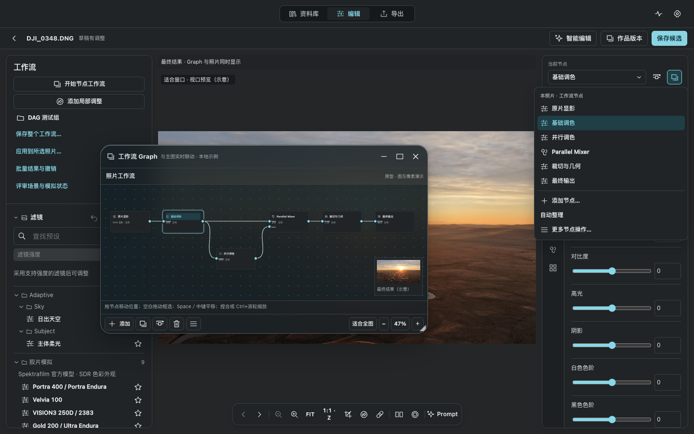
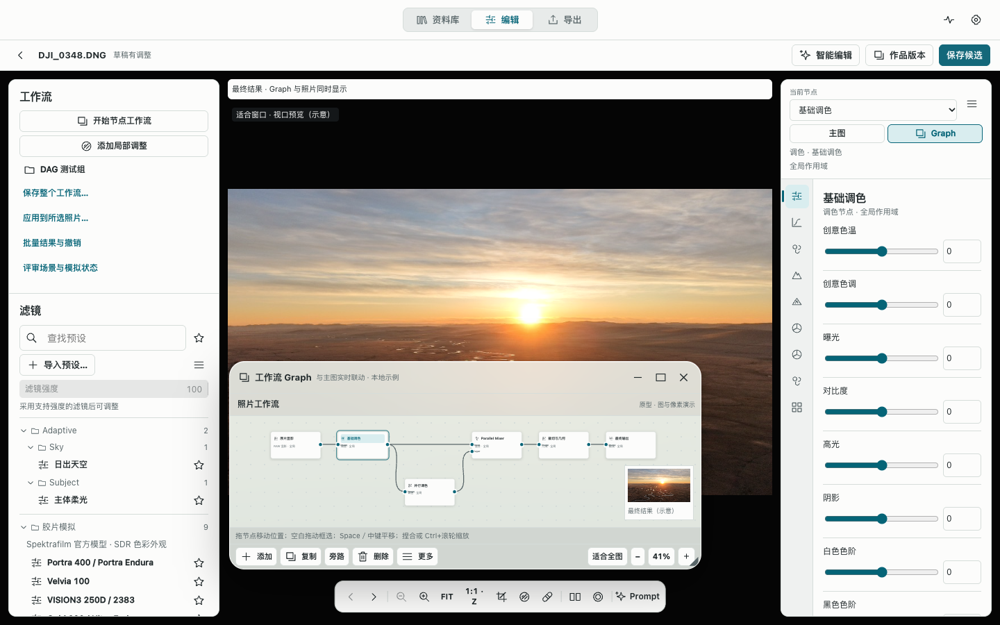

# 038 · Node 能力域、画布工具与悬浮 Graph 验证

日期：2026-11-26。HTML 原型及规格已交付，原生研发已开始，不等于原生默认行为获准。首个原生证据是 [037 固定场景工作流组件复验](../037-color-film-hdr/validation.md#固定场景工作流的原生组件复验)：严格保存串行节点身份、顺序与启停；预览对最终输出的隔离已在 Metal 像素层验证。旧配方适配、产品历史、自由拓扑／混合／组、原生界面与批次还没有通过。以下为浏览器证据，不是上述原生场景的签收。

## 节点上下文菜单及 HDR 联合回归

在[工作台的悬浮 Graph](../../docs/ui/prototype/index.html#edit/dag)用鼠标右击「基础调色」或按 Shift+F10，确认菜单有 Solo、查看输出和复位，不混入空白画布的「适合全图」。Escape 返回节点焦点，不关闭 Graph。此前右键会进入左键选点／拖动处理；现在右键不捕获拖动指针，左键和中键保持原用途。独立 Chrome 的 Graph 专项 **16 项通过，退出码 0**（沿用下文 v3 的完整执行段，不启用视觉证据开关），包含真实右键，短窗关闭与恢复、四组宽度／主题、画布草案与焦点。内置浏览器另用真实按键核验 Shift+F10 / Escape，用真实点击确认 900×360 窗口可关闭且主图保留。

HDR 模式只在「基础」内，不影响 Graph 作用域；Solo 和临时旁路的历史、导出及模式隔离见 [037 验收](../037-color-film-hdr/validation.md#右栏色彩模式与节点面板分区)。本轮全量回归 **65 个场景通过，退出码 0**，并检查了浏览器错误列表。复现：`RAWMASTER_UI_DAG_EVIDENCE="$(mktemp -d)" npm exec --yes --package=agent-browser@0.26.0 -- python3 scripts/check-ui-prototype.py`。

[桌面浅色](evidence/hdr-graph/graph-1440-light.png) · [390px 深色](evidence/hdr-graph/graph-390-dark.png) · [900×360 短窗](evidence/hdr-graph/graph-short-window.png) · [主图中间预览](evidence/hdr-graph/photo-node-preview-status.png)。上述仅为 HTML 验证。

## 可读 Graph 与暗房减项

第五轮原型。[摄影工作台](../../docs/ui/prototype/index.html) → 选中河湾 → 编辑 → 右栏 Graph；也可直接打开 [Graph 评审页](../../docs/ui/prototype/index.html#edit/dag)。本次只更改原型、规格与浏览器检查，不改原生渲染和预设文件格式。

1. **默认可读，概览另选。** 第一次打开检查 100% 及居中取景。加入并行支路后，过宽轴保留当前卡片完整可见，不为塞下全图主动缩小。「适合全图」用实际卡片外接框居中，允许缩到 100% 以下；百分比按钮恢复可读取景。手动缩放后关闭重开，图视角保留，照片的倍率、平移和历史不变。将窗高缩到 360px，检查标题条仍可关闭；恢复高度后从右栏重新打开。
2. **检查器与节点菜单分工。** 逐一打开九个 Corrector 分类，控件末尾不再重复显示「复位本节点」和「查看此节点输出」。用节点菜单查看输出并返回；复位仍可从节点菜单执行，沿用编辑历史。
3. **滤镜低频操作归位。** 左栏滤镜标题只保留复位、圆形启停和「…」。分别打开保存当前设置、导入 Lightroom／Camera Raw 及导出原生预设。取消返回滤镜菜单入口及原照片，导入不自动采用。原有的 `+` 是保存，不是导入。
4. **状态小提示。** 只含一个可操作节点时，健康终稿不显示例行提示；明确查看中间结果或模拟渲染失败时仍能看到「不用于导出」「返回最终结果」或「重试预览」。多节点且 Graph 可见时可显示「最终结果」。提示悬浮在照片上方，不改变照片排版。按 CSS 颜色计算，白字对深灰、中灰、浅灰、纯黑四种画布底色的提示背景，最低对比度为 4.80:1。

[桌面 100% 可读取景](evidence/v5/graph-readable-desktop.png) · [桌面全图](evidence/v5/graph-1440-light.png) · [中间预览提示](evidence/v5/photo-node-preview-status.png) · [900×360 短窗](evidence/v5/graph-short-window.png) · [390px 浅色](evidence/v5/graph-390-light.png) · [390px 深色](evidence/v5/graph-390-dark.png)

[DAG 专项日志](evidence/v5/dag-check.log)：20 个场景通过，退出码 0。沿用下文 v3 的完整 DAG 执行段与 `agent-browser@0.26.0`，证据目录改为 `evidence/v5`。覆盖九域去重、单节点终稿与异常、手动缩放、真实节点选择、900×360 短窗真实关闭和恢复，以及 1440×900／390×844 浅深色外观。短窗用浏览器选择器等待收起，再检查画布、阈值和标题范围；用真实点击关闭并断言主图保留，未靠增大超时通过。

在工作台用真实点击验证了「适合全图」切到 55%，再点百分比恢复 100%；滤镜省略号内可见保存、导入、导出三项。全量检查已通过滤镜场景；[最后一次全量原始日志](evidence/v5/workbench-check.log)显示在 Spec 032「从制作任务重开，授权同路径的另一卷仍保留原票据」的 `exact task` 断言停止，退出码 1，未运行其后的 DAG 场景。本轮不改动该导出流程，也不将全量视作通过。

## 紧凑画布工具与照片列表入口

第四轮原型。正常入口：[摄影工作台](../../docs/ui/prototype/index.html) → 编辑 → 照片底部 Mask / Remove；或 [河谷拍摄照片列表](../../docs/ui/prototype/index.html#library/project/river) → 多选 → 底栏「更多」。编辑左栏只显示滤镜、快照和历史，本张模板由 Graph 高级操作承接。批量预检和最近结果不再出现在编辑工具栏。

1. **选片与返回。** 先选水鸟，再多选河湾，使河湾成为焦点。打开批量工作流，核对河湾为源、水鸟为目标。单选不能起批；可展开「原型评审样本」切换 20／200 张，或回到本次目标。核对模板选择、取消保留原选区、20 张创建并撤销，以及 200 张取消余项与修订冲突保护。源草稿始终未写入。
2. **Mask。** 点当前类型可展开三组图标，选范围类型后才显示上下限。添加、减去、相交与组件图标可核对；启停、叠加、反转相互独立。滚动细化时保留拥有者和内部位置；素材缺失后可重建。打开即完成不新建空蒙版，取消和 Escape 返回原工具条，完成有效草案只写一笔历史。
3. **Remove。** 四种方式直接选择。仿制标点后提示再次取样；移除和 AI 填充标点后才出现生成，模拟失败后原位显示重试。离线或严格纪实时说明禁用原因。取消不发布，采用后可撤销。
4. **版式。** 桌面及 390px 浅深色复验。面板随内容展开，照片不被工具条覆盖，窄窗实际照片视口至少 150px 高。常用选择用图标加短标签，滑杆同时保留精确输入，撤销/重做采用有文字标签的图标按钮。浏览器可信输入另核对了类型选择、仿制模式和取消返回。

设计参考是 RAWMaster 兼容蒙版中的语义图标、分组与图层动作，以及 [已复核的 LightFlow 工具分类](node-capabilities.md#mask修饰与执行边界)。未定位到可确认是用户所指的 LightDev 面板源码，因此这轮是基于已核实参考的重新布局，不是 LightDev 源码迁移。

- [桌面 Mask](evidence/v4/canvas-mask-desktop.png) · [桌面 Remove／失败重试](evidence/v4/canvas-remove-desktop.png) · [窄窗浅色 Mask](evidence/v4/canvas-mask-390-light.png) · [窄窗深色 Mask](evidence/v4/canvas-mask-390-dark.png)
- [DAG 定向回归](evidence/v4/dag-check.log)：18 个场景通过，复用下方 DAG 执行段，证据目录改为 `evidence/v4`。
- [整机回归阻塞](evidence/v4/workbench-blocked.log)：左栏分区断言按当前 `aria-labelledby` 读取，仍要求滤镜、快照、历史按顺序排列。全量随后在既有滤镜采用场景失败：当前工作树已无 `.filter-actions`，旧脚本仍访问其 `compareDocumentPosition`。未改无关滤镜功能或放宽该断言，不称整机通过。

## 节点工具条精简与选择联动

2026-11-26，用户反馈后的第三轮原型（历史）。当轮评审使用 [v3 桌面浅色](evidence/v3/graph-1440-light.png)、[统一节点下拉](evidence/v3/node-picker-desktop.png) 与 [六项节点菜单](evidence/v3/node-menu-desktop.png)，下文 v2 记录仅证明上轮版本。

正常入口：[摄影工作台](../../docs/ui/prototype/index.html) → 编辑 → 右栏「当前节点」下拉及其右侧 Graph 开关。已有浏览器页刷新即可载入新模块。修改仅限 HTML 原型、检查脚本及交互文档，未实施原生或提交/发布工作区。

### 本轮方案与走查结果

- 节点下拉上半部为当前照片、当前组内节点，下半部仅添加、自动整理、更多节点操作。原独立菜单按钮及下方主图/Graph 双按钮已删除；右侧只保留「忽略该节点」与 Graph 开关。
- 更多菜单首层为命名、复制插入、参数粘贴、复位、查看输出和删除六项。组、连接、监看、模板及整图操作折叠在高级区。前插、末尾追加和 Outside 移到添加菜单的「更多插入方式」，没有删掉功能。
- “Bypass” 的可见文案统一为忽略；当前节点被忽略时按钮显示按下状态，提示「恢复该节点（已忽略）」，卡片及列表标出已忽略。参数、覆盖与结构保留。固定阶段、多选、连接或画布草案时禁用当前节点忽略并说明原因。
- 修复真实指针在 Graph 上由画布捕获后没有选中标题按钮的问题：无拖动的 pointerup 明确选择该卡片，节点内部工具按钮不再被画布捕获。下拉、Graph、检查器和忽略状态共用选择，选择清除旧连线选择。下拉发起的选择返回下拉焦点，Graph 发起的选择保留图内焦点。
- 最小外框 520×392，桌面实际画布至少 480×240；390px 视口下外框 366px、实际画布约 364px 宽，仍保留 240px 高度。标题、路径、状态与操作条各有独立空间，连接草稿增加 44px。900×360 短窗自动只显示可关闭标题条，说明需增高窗口，恢复高度后可展开。此数值是 RAWMaster 设计取值，不是 LightFlow 原值或原生窗口签收。
- 内置浏览器补充可信输入：从下拉选择并行调色，Graph 卡片选中状态同步；旧布局中重叠的卡片先用下拉「自动整理」解除重叠，再真实点击已忽略的调色 3，右栏名称及恢复按钮同步。Graph 开关关闭/重开后仍为并行调色。没有用强制点击绕过遮挡。

### 本轮回归与整机阻塞

独立执行原检查脚本全部 **16 个 DAG 场景，退出码 0**：[原始输出](evidence/v3/dag-check.log)。覆盖九域、图事务、模板/组路径、批量取消与冲突、画布工具事务、单行工具条、六项菜单、忽略与撤销、真实节点点击、键盘、多选冻结、短窗，以及 1440×900 / 390×844 的浅深色实际布局。新断言检查实际 viewport 宽高和三个工具条按钮的位置，而非仅判断外框存在；既有图/蒙版/模板断言保留。

整机编辑专项执行到第 6 个场景失败：[阻塞输出](evidence/v3/workbench-blocked.log)。`stacked left sections` 仍寻找 `.edit-left > section h2` 中的「滤镜」，当前工作树滤镜标题已改成折叠按钮内的 `#preset-heading`，该选择器只返回快照和历史。未回退这部分 UI，也未放宽或跳过该断言冒充整机通过。当前版本 **没有获得新一轮整机全量 PASS**；需滤镜改版对应的用例同步后复跑。

为避开无关前置场景，使用 Python AST 只选择原脚本的完整 DAG 执行段，复用原 helpers、场景、浏览器期限和 finally 清理，未改写任何场景断言或伪造测试数据。重现命令（仓库根目录）：

```sh
RAWMASTER_UI_DAG_EVIDENCE="$PWD/specs/038-node-dag-workflow/evidence/v3" \
  npm exec --yes --package=agent-browser@0.26.0 -- python3 - <<'PY'
import ast
from pathlib import Path
p = Path('scripts/check-ui-prototype.py').resolve()
tree = ast.parse(p.read_text(), filename=str(p))
main = next(n for n in tree.body if isinstance(n, ast.FunctionDef) and n.name == 'main')
server = next(n for n in main.body if isinstance(n, ast.With))
run = next(n for n in server.body if isinstance(n, ast.Try))
start = next(i for i, n in enumerate(run.body)
    if isinstance(n, ast.Expr) and isinstance(n.value, ast.Call)
    and isinstance(n.value.func, ast.Name) and n.value.func.id == 'scenario'
    and isinstance(n.value.args[0], ast.Constant)
    and n.value.args[0].value.startswith('Node DAG'))
run.body = [run.body[0], *ast.parse(
    "browser(*options, 'open', host + ENTRY)\nbrowser('set', 'viewport', '1440', '900')"
).body, *run.body[start:]]
ast.fix_missing_locations(tree)
exec(compile(tree, str(p), 'exec'), {'__name__': '__main__', '__file__': str(p)})
PY
```

### 当前证据与边界

- [桌面深色](evidence/v3/graph-1440-dark.png) · [桌面浅色](evidence/v3/graph-1440-light.png) · [窄窗深色](evidence/v3/graph-390-dark.png) · [窄窗浅色](evidence/v3/graph-390-light.png)
- [统一下拉](evidence/v3/node-picker-desktop.png) · [六项菜单](evidence/v3/node-menu-desktop.png)
- [Crop](evidence/v3/canvas-crop-desktop.png) · [Mask](evidence/v3/canvas-mask-desktop.png) · [Remove 失败](evidence/v3/canvas-remove-desktop.png)



截图用原脚本的中性基础、0.2EV 并行支路、50% Mixer 样本，未重置用户内置浏览器的照片配方。FIT 保证包含所有卡片，不保证长图缩小后的文字可读；窄窗仍需放大/平移或键盘选点。浅深色、最小面积、关闭及焦点均为浏览器证据，不能代替系统 NSPanel、VoiceOver、像素、模型或原生性能验收。默认尺寸与视觉密度仍待用户通过原型评审。

## 入口与上轮采用方案（v2）

[摄影工作台](../../docs/ui/prototype/index.html) → 编辑 → 右栏节点工具条 → Graph。[直接入口](../../docs/ui/prototype/index.html#edit/dag) · [Spec Kit 规格](spec.md) · [能力及 LightFlow 对照](node-capabilities.md) · [功能覆盖表](../../docs/ui/coverage.md)。旧浏览器页需刷新；本地链接不支持片段时使用普通工作台入口，再点 Graph。

- 主图一直存在。Graph 改为非模态 Liquid Glass 悬浮面板，可拖动、调整大小、收起、复位和关闭；不再替换照片或重排主窗口三栏。
- Corrector 只开放基础、色轮/分级、HDR、曲线、混色、切片、变形、细节、效果/LUT 九类域。Mixer、Group、输入、几何和输出分别显示自身能力。
- Crop、Mask、Remove 从照片底部工具条展开，完成或取消后收回。Crop 属于照片几何，Remove 属于有序照片修饰；Mask 的入口在画布，但数据拥有者仍是明确的调色节点。
- 画布草案与节点提交、Prompt、版本保存和其他调整采用互斥。有效完成至多一笔历史，取消不改正式配方，修订变化时拒绝覆盖。
- 工具展开期间 Graph 暂时收起并移至上方，不遮挡工具；结束后恢复窗体表现状态。Mask 拥有者在内部滚动时仍可见。
- 第一版图视角首次进入新窗体时自动适合实际视口。以后保留 Graph 视角；该适配不改变主图倍率、平移或配方。

本轮新增 `dag-window.js`、`canvas-tools.js` 和 `canvas-tools.css`，继续复用 `dag.js`、现有样片、配方、版本与导出交接。未实施 SwiftUI / AppKit 窗体或 Rust / WASM 运算，也未提交或发布工作区。

## 上轮自动回归（v2，历史）

在仓库根目录执行：

```sh
node --check docs/ui/prototype/dag.js
node --check docs/ui/prototype/dag-window.js
node --check docs/ui/prototype/canvas-tools.js
node --check docs/ui/prototype/quick-prompt.js
node --check docs/ui/prototype/editor.js
node --check docs/ui/prototype/editor-canvas.js
python3 -m py_compile scripts/check-ui-prototype.py
RAWMASTER_UI_DAG_EVIDENCE="$PWD/specs/038-node-dag-workflow/evidence/v2" \
  npm exec --yes --package=agent-browser@0.26.0 -- python3 scripts/check-ui-prototype.py
```

最终退出码 **0，51 个场景全部通过**。[最终输出](evidence/v2/prototype-check.log)。包括 39 个既有资料库、暗房、Prompt、版本、导出和界面规范场景，4 个功能 DAG 场景，1 个视觉样本准备场景，3 个画布工具视觉/取消场景，以及 4 个桌面/窄窗、浅/深色布局场景。证据开关开启时才运行视觉采样场景；不带该开关的全量检查为 47 个场景。

使用项目既有的检查脚本、隔离 Chrome 会话和临时 HTTP 端口。`npm exec` 提供本机原先不在 PATH 中的检查工具，没有新增仓库依赖或改锁文件。规格结构自检也通过：6 个用户故事及独立测试、FR-001…024、SC-001…008、无模板占位符、相对链接有效。仓库没有 `.specify`，没有伪造初始化或 CLI 执行记录。

| 检查 | 输入、动作及实际观察 |
| --- | --- |
| 节点作用域 | 基础节点曝光 1.25、串行节点 0.5、并行支路 1；切换恢复各自值。九类输入带照片及节点身份，多选无数值广播。 |
| 能力边界 | Mixer 只有混合分类，不继承 Corrector。色彩网格初始数值合法，键盘可加控制点；RGB 矩阵显示九个值及独立节点强度。 |
| Parallel / Layer | 并行插入初始 0% 不改示例结果。13 个 Layer 模式逐项保存；新输入权重 0，移动输入后其 25% 权重和 multiply 模式一起移动。 |
| Outside / 依赖 | 新建中性 Corrector，复制并反转覆盖，而非虚构新 kind。Mask 自引用被拒绝；图自连、缺输入和无效草稿不能正式应用。 |
| Crop | 范围、比例、角度、旋转、翻转及复位可操作。草案不发布，完成一笔几何历史，取消/撤销恢复。采用其他滤镜不能写入裁切草案。 |
| Mask | 捕获拥有者并拒绝中途切节点。范围上下限、组件强度/反转、毛发细化、局部撤销/重做、缺素材/重建可操作；完成只提交一笔。Prompt 不能与 Mask 会话并存。 |
| Remove | Clone 缺取样时禁用完成，第二次标记记录取样。Inpaint 等待候选，失败可重试；预览不发布，完成一笔有序修饰历史，撤销恢复，一次点击只生成一处标记。 |
| 窗体与照片 | 开合、尺寸与收起不改照片身份、主图倍率/平移/几何或像素历史。将旧图平移设为 10000 后重开，新窗体能自动显示实际节点，而不是只出现空窗体。 |
| 组 / 模板 | 合法片段成组、组内模板插入、路径恢复与内部身份重分配通过；未选边的分叉不提交。分段检查还核对同一照片与图的连续性。 |
| 批量 | 20 张全部创建版本并撤销；200 张覆盖部分成功、取消余项、后续修订冲突保护。不把取消场景解释成 200 张完整成功或性能测量。 |
| 视觉与键盘 | 1440×900、390×844 的浅/深色没有文档横向溢出，窗口控制可达，FIT 包含所有实际节点卡片。工具完成按钮有可见主色背景，Mask 内部滚动仍能看到拥有者。 |

规格的 SC 是后续完整产品验收目标；上述场景通过不等于所有原生 SC 已签收，尤其不代表模型回调、精确颜色、真实导出、VoiceOver 或系统窗体已经实现。

## 可信输入补充走查

内置浏览器使用同一张河湾样片，既有并行节点曝光 0.6、混合 50%，通过真实按钮、键盘及拖动复查：

1. Crop 选择 1:1，在照片拖出范围。宽/高显示 63.3 / 69.1，数值校验通过；取消后主图和原节点恢复。
2. Mask 常驻显示拥有者“并行调色”。添加颜色范围组件、强度 40 并拖动覆盖，拥有者不变；取消不采用覆盖。
3. Remove 选择 AI Inpaint、中心标记、模拟失败。完成禁用；重试后可完成，取消保留原配方。
4. Graph 从约 330/520 拖至 410/450，键盘将宽度 660 调至 680 后恢复，收起/展开；原节点曝光仍为 0.6，照片保持可见。
5. 最后刷新，Graph 与主图可见，未完成工具数为 0，曝光仍为 0.6。内置截屏曾发生背景栅格化超时，本轮最终截图采用隔离 Chrome 回归，不为重试抢占用户前台。

## 本轮修正及检查边界

- 旧蒙版滑杆/数值提交曾绕过草案直接写正式配方，已改为工具事务；左栏撤销/重做的启用状态也对齐局部草案历史。
- 刻度布局检查改为检查器内容坐标，排除原生焦点滚动的平移；原有 26px 行高和 10px 间距约束仍保留。
- 旧测试使用已移除的 Crop 关闭按钮和右栏 Mask 菜单，已改为本轮正常底部入口与完成/取消按钮；原作用域、历史和恢复断言保留。
- 旧大视口的图平移可造成新窗体空白，现按新视口首次适配；FIT 使用真实卡片尺寸，检查覆盖实际节点而非只检查窗口边界。
- 裁切拖动浮点值曾不符合 0.1 步长，已量化并检查边界。图层输入重排保留各自权重/模式；Outside 新节点保持中性。
- 综合 DAG 检查曾超过单次 CLI 的 40 秒期限。现分为作用域/图、蒙版/模板、批量三段，保留 40 秒期限和全部断言，并新增跨段照片/图连续性检查。超时检查的自有浏览器会话已清理。
- 一次既有模拟导出完成等待超时，未改等待条件或放宽断言；最终全量复验通过。

## 上轮截图（v2，历史）

最终截图使用新的视觉样本：基础节点中性，新增并行曝光 0.2、Mixer 50%。这是在功能断言完成后、隔离浏览器中的可复现视觉输入，不替代前述复杂图作用域测试。所有范围和处理仍是示意。

- Graph：[桌面深色](evidence/v2/graph-1440-dark.png) · [桌面浅色](evidence/v2/graph-1440-light.png) · [窄窗深色](evidence/v2/graph-390-dark.png) · [窄窗浅色](evidence/v2/graph-390-light.png)
- 画布工具：[Crop](evidence/v2/canvas-crop-desktop.png) · [Mask 与常驻拥有者](evidence/v2/canvas-mask-desktop.png) · [Remove 失败状态](evidence/v2/canvas-remove-desktop.png)



## 未签收与待评审

- 默认窗体尺寸/位置、复杂图适合全图时的文字密度、默认分类、模板底稿与批量结果反馈仍由用户通过原型确认。窄窗可操作，不代表签收窄窗精细调色或拖线密度。
- 颜色域、RGB 矩阵、HDR/色轮、混合、裁切范围、覆盖细化、补区和延迟是交互示意；准确默认值/单位、RAW 顺序、像素质量、模型、GPU 缓存与真实性能须原生验收。
- 浏览器提供点击端口、连接选择器及端口拖线；无效连接草稿已检查，但未对每一种拖线手势、系统减少透明设置或原生可访问性作全面签收。
- 模拟批量不保证浏览器关闭后的后台续跑。原生任务恢复、跨片素材重建、旧配方迁移和真实文件输出均未在本轮实施。
- 第一版 43 PASS 与原目录四张截图仅保留作历史，不能用于证明本轮悬浮布局。已作废的空白 Graph 探索图不作为当前证据。
