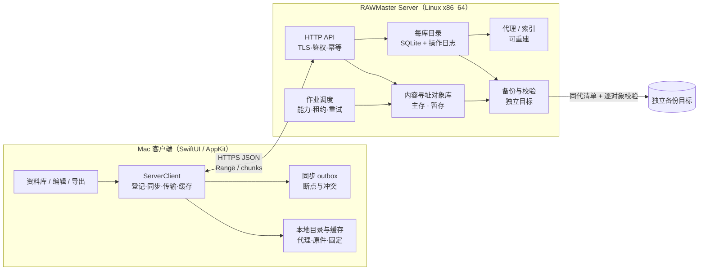

# 040 · Server 技术方案与交付计划

2026-11-26 · 推荐架构、部署、验证与阶段门。**本轮只做设计，不写服务端代码。** 产品要求见[规格](spec.md)，实体见[数据模型](data-model.md)，接口见[协议](protocol.md)。所有技术选择在 S1 冻结前可调整；一旦影响身份、归档资格或备份语义，必须回写规格并重新评审。

## 1. 推荐架构



**核心选择。**

| 层 | 推荐 | 理由 | 备选／升级路径 |
| --- | --- | --- | --- |
| 服务端语言 | Rust 单二进制 | 复用现有 `rawmaster-library`、`rawmaster-photo-export` 与可移植图像核；内存安全、部署简单 | 拆分服务只在测量证明需要时进行 |
| 每库目录 | SQLite（WAL）＋现有目录 schema | 复用已验证的归档视图、操作收据、封存不可变和备份包；快照与恢复直接 | 并发或规模不足时迁移 PostgreSQL，API 与业务身份不变 |
| 服务器元数据 | 独立 SQLite `server.sqlite` | 设备、库、作业、备份代次、冲突；单节点单写足够 | 多节点时迁移 PostgreSQL／外部队列 |
| 内容存储 | 本地内容寻址文件系统 | 简单、可校验、可离线；与现有 `objects/<sha>/...` 一致 | S3 兼容对象存储作为后续适配器 |
| 备份 | 同代清单＋独立目标复制＋逐对象校验 | 不依赖同池快照；可恢复到新机 | restic／borg／ZFS send 作为实现手段，产品契约不变 |
| 认证 | TLS＋一次性登记码＋按设备令牌＋指纹确认 | 自托管简单，可撤销，不要求公网 CA 客户端 | mTLS、OIDC 作为后续增强 |
| 代理 | 服务端生成 JPEG 代理＋客户端按需取回 | 冷片浏览不传 RAW；代理可重建 | 客户端本地生成或按需生成 |
| 远程计算 | 能力登记＋可移植引擎 worker | Mac 专用 Metal 链路不假装跨端一致 | 只开放已单独验收的作业类型 |

### 1.1 为什么不直接共享 SQLite

活动目录是单写、短事务、WAL 和本机文件锁模型。把运行中的数据库放到 SMB／NFS 或多端共写会破坏事务语义、锁和恢复边界。服务器通过业务操作接收变化，通过内容传输接收原件；这是[08 同步评估](../../docs/planning/08-local-database-and-sync-evaluation.md)已确定的方向。

### 1.2 为什么 V1 先每库 SQLite

- 现有目录内核已经提供归档资格视图、封存不可变、操作收据、内容身份、资源登记、备份包和作业表；复用比重新实现更安全。
- 单用户、单节点、多设备的写入量有限；每库一个单写队列可以避免长事务和跨库锁。
- 备份代次可以直接取得可打开的目录快照，异机恢复不需要另写一套投影。
- 若并发写、跨库查询或 200 万文件测量不足，再把服务器元数据迁移 PostgreSQL；每库目录仍可作为可重建投影或继续 SQLite。迁移决策以测量为准，不提前引入运维复杂度。

## 2. 组件职责

| 组件 | 职责 | 不负责 |
| --- | --- | --- |
| HTTP API | TLS、登记、鉴权、版本校验、幂等、分页、限流 | 像素处理、业务合并规则之外的 UI |
| 目录服务 | 打开每库 SQLite、应用命令、生成收据、维护操作水位 | 直接接收客户端数据库文件 |
| 归档服务 | 解析资格、生成计划、创建上传、校验内容、登记引用 | 遍历来源目录、按组扩大范围 |
| 对象库 | 内容寻址、暂存、原子发布、Range 读取、周期校验 | 业务关系与人工决定 |
| 备份服务 | 取同代快照、生成清单、复制、逐对象校验、恢复 | 把同池快照标成独立备份 |
| 代理／索引 | 生成 JPEG 代理、缩略图、搜索索引；可重建 | 作为原件或唯一副本 |
| 作业服务 | 能力登记、输入解析、排队、租约、取消、重试、结果暂存与登记 | 未经许可的模型下载、跨端静默换引擎 |
| 客户端 ServerClient | 登记、同步 outbox、拉取、上传下载、缓存、状态展示 | 把服务器状态覆盖本地未同步决定 |
| 管理 CLI | 初始化、配置、备份、恢复、诊断、设备撤销、升级 | 日常照片编辑 |

## 3. 关键数据流

### 3.1 归档

1. 客户端在封存会话后从本地目录生成候选清单；排除项只带历史和内容身份。
2. `POST /archive/plans` 服务端复核 `libraryID`、封存状态、逐文件基础和内容身份；不信任客户端单方面声明。
3. 已存在对象直接登记引用；缺对象创建上传。
4. 上传暂存、完成校验、原子发布对象、登记 `archiveRef`。
5. 主存可用与独立备份覆盖分别异步推进；客户端按状态显示，不等待备份完成才显示主存。

### 3.2 同步

1. 客户端把业务操作写入本地 `sync_outbox`，本地照常生效。
2. 重连后按批次推送；服务器按 `(libraryID, commandID)` 去重，按字段规则合并或记录冲突。
3. 服务器返回收据、`serverRevision` 和冲突；客户端清出已应用操作，保留冲突。
4. 客户端按游标拉取远端操作；回声按 `commandID` 跳过。
5. 新设备先取分页快照，再追平；内容按需取代理或原件。

### 3.3 冷片取回

1. 客户端显示代理和“需联网”。
2. 用户请求原件；客户端检查服务器归档引用和对象状态。
3. `GET /objects/{contentID}` 带 Range，断点续传。
4. 完整长度＋SHA-256 校验通过后标记本地原件可用；固定状态写入设备本地缓存表。
5. 释放前检查固定、服务器可回取、独立备份覆盖、无未同步编辑。

### 3.4 远程作业

1. 客户端生成冻结输入清单，选择执行位置。
2. `POST /jobs`；服务端校验输入、能力、引擎／模型／许可，返回缺项或排队。
3. worker 领取租约，读取对象，执行可移植引擎，输出到私有暂存。
4. 输出校验后 `staged`；客户端预览，用户采用或登记；`published` 只发生一次。
5. 断线按 `jobID` 查询；取消／失败清理暂存；旧结果不覆盖当前版本。

## 4. 部署

### 4.1 目标环境

- Linux x86_64，Ubuntu／Debian LTS；单节点；系统盘＋数据盘＋独立备份目标。
- 服务器可运行在 NAS、迷你主机或工作站；不要求 GPU 才能完成 S1–S3。
- 客户端 Apple Silicon Mac，macOS 最低版本沿用应用现有要求。

### 4.2 布局

```
/etc/rawmaster/server.toml       # 监听、数据目录、备份目标、日志级别
/var/lib/rawmaster/
  server.sqlite
  libraries/<libraryID>/
  objects/
  staging/
  proxies/
  logs/
/var/backups/rawmaster/          # 仅当它是独立故障域时
```

- 配置文件和令牌不进资料库包；备份目标凭据加密保存或由系统密钥环提供。
- 服务用专用系统用户运行；数据目录权限最小化；上传暂存和对象库分开。
- 默认只监听局域网地址；公开暴露需显式配置 TLS 终止、防火墙和速率限制。

### 4.3 命令

```sh
rawmaster-server init --data /var/lib/rawmaster
rawmaster-server serve --config /etc/rawmaster/server.toml
rawmaster-server backup --library <id> --target <target>
rawmaster-server restore --generation <id> --target <path>
rawmaster-server doctor --library <id>
rawmaster-server devices revoke <deviceID>
```

命令是建议入口；最终以 S1 实现为准。管理动作必须可脚本化，便于演练和自动化测试。

### 4.4 升级

1. 升级前创建一致备份并校验。
2. 在私有副本上迁移 `server.sqlite` 和每库目录 schema。
3. 运行完整性与抽样对账；通过后短写入屏障切换。
4. 保留旧版本只读路径或明确拒绝写入；不静默忽略未知 schema。
5. 失败回到升级前快照，不覆盖用户数据。

## 5. 客户端接入

| 模块 | 责任 |
| --- | --- |
| `ServerClient` | URLSession／HTTPS、TLS 指纹、令牌、重试、请求 ID |
| `ServerEnrollment` | 登记码、设备名、指纹确认、令牌写入钥匙串 |
| `SyncOutbox` | 持久操作队列、批量、重试、冲突、游标 |
| `SyncApplier` | 将远端操作应用到现有目录；按实体去重，不覆盖本地未同步冲突 |
| `ServerLibraryBinding` | 服务器／库／设备绑定；多库 |
| `CacheManager` | 代理、原件、固定、取回、释放条件 |
| `ServerTransfer` | 分块上传、Range 下载、断点、校验 |
| `RemoteJobClient` | 作业提交、查询、取消、重试、结果核对 |
| `ServerStatusModel` | 状态摘要、冲突数、作业数、错误；供 SwiftUI 观察 |

同步必须复用现有本地命令／收据，不在 UI 层直接写服务器。服务端返回的实体修订不能覆盖本地未同步的人工决定；冲突由用户解决后才写入。

## 6. 验证策略

### 6.1 测试层

| 层 | 内容 |
| --- | --- |
| 契约夹具 | 操作信封、归档计划、上传完成、备份清单、作业输出的固定 JSON 与 schema |
| 服务端单元 | 资格派生、去重、幂等、修订、冲突矩阵、路径安全、版本拒绝 |
| 服务端集成 | 真实 SQLite 目录、对象库、HTTP、Range、断点、备份目标、恢复 |
| 故障注入 | 断网、超时、乱序、重复、磁盘满、权限、哈希不符、对象损坏、进程崩溃 |
| 客户端集成 | outbox、游标、冲突、缓存、取回、释放、状态展示 |
| 端到端 | 五文件样本、双设备、异机恢复、远程作业重连 |
| 性能 | 归档吞吐、冷片首屏、取回、同步批次、恢复时长、内存与存储 |
| 安全 | 错误令牌、过期登记码、撤销设备、指纹变化、路径逃逸、日志泄漏 |

### 6.2 验收证据

- 五文件样本的归档计划、服务器引用、备份清单、恢复清单和逐对象哈希。
- 断点上传的区间记录、重试收据和最终对象摘要。
- 双设备操作日志、冲突记录、解决后的修订和最终目录。
- 远程作业的输入快照、尝试记录、输出暂存、发布收据和断线重连。
- 恢复演练的目标机器、恢复前后清单、缺项和校验结果。
- 性能报告必须注明硬件、网络、样本、冷热、文件数和字节，不混用 API 返回与屏幕呈现。

## 7. 风险与对策

| 风险 | 影响 | 对策 |
| --- | --- | --- |
| 服务器成为单点 | 离线工作受阻 | 客户端完整目录与本地能力；服务器不可用只影响归档／取回／同步／远程作业 |
| 同步规则过度复杂 | 冲突不可解释 | 领域字段矩阵，不做通用 CRDT；同字段冲突显式解决 |
| SQLite 单写瓶颈 | 多设备或作业写入排队 | 每库单写队列；测量后迁移 PostgreSQL；队列和 API 不暴露引擎 |
| 备份“看起来完成” | 灾难时不可恢复 | 独立故障域、逐对象校验、周期演练；同池快照不计独立 |
| 远程引擎不一致 | 输出与本地不同 | 能力登记；只开放已验证引擎；缺依赖禁用；旧结果不自动采用 |
| 代理质量不足 | 冷片无法判断 | 代理规格按真实样片验收；代理与机内 JPEG 分标；需要时取回原件 |
| 运维门槛高 | 自托管失败 | 单二进制、CLI、健康检查、升级前备份、恢复演练；不强制 Kubernetes |
| 公开暴露风险 | 未授权访问 | 默认局域网、TLS、强登记码、令牌、限流、审计；公开部署需显式确认 |
| 规格范围膨胀 | 交付失焦 | Server 1.0 只做 S1–S3；远程作业 1.1；容量专项独立 |

## 8. 阶段计划

| 阶段 | 交付 | 退出条件 |
| --- | --- | --- |
| S0 · 契约 | 操作／归档／备份／作业夹具；schema 草案；错误码；身份规则 | 规格、数据模型、协议和任务评审通过；无未决的 P0 语义 |
| S1 · 连接与目录 | 服务端骨架、TLS、登记、设备、库绑定、目录打开、操作日志、健康 | 新服务器可连接；错误指纹／过期码／撤销设备被拒；本地离线不受影响 |
| S2 · 归档与备份 | 资格、计划、断点上传、对象校验、去重、独立备份、异机恢复 | 五文件样本精确；断点不重复；恢复逐对象哈希一致；排除项零引用 |
| S3 · 冷热与同步 | 代理、固定、取回、释放、outbox、拉取、冲突、双设备 | 冷片可切换；断网修改不丢；同字段冲突可见；释放门槛正确 |
| S4 · 远程作业 | 能力、输入、队列、租约、取消、重试、输出登记 | 断线重试单结果；缺能力禁用；旧结果不覆盖；取消可清理 |
| S5 · 容量与运维 | 百万级／100 TB 参照、监控、保留、升级、演练 | 容量报告和恢复演练通过；未测规模不标完成 |

**S2 是首个可发布增量。** S1 单独不能称为 Server 1.0；S3 完成后才满足“归档＋冷热＋同步”的 1.0 口径。S4 不阻塞 1.0，但作业描述和身份必须从 S1 起兼容。

## 9. 待验证问题

1. 每库 SQLite 在目标设备数、操作批次和并发作业下的写等待是否可接受；何时需要 PostgreSQL。
2. 归档吞吐在 1 Gbps／10 Gbps 局域网、机械盘／SSD／NAS 上的实际瓶颈；分块大小和并发数。
3. 代理长边、质量、色彩和生成位置对冷片首屏、带宽和判读的影响。
4. 同字段冲突、组顺序和配方分支在真实多设备工作流中的可理解性。
5. 独立备份目标的最小可用方案（第二块盘、NAS、远端）及校验频率。
6. Mac 专用显影与 Linux 可移植引擎的作业类型边界；哪些结果可称一致。
7. 百万级目录的分页、引导快照、索引重建和恢复时长。
8. 公开暴露时的认证、速率限制、审计和密钥轮换要求。

## 10. 与现有规格的接口

- [033 资料库生命周期](../033-library-lifecycle/spec.md)：归档资格、五文件样本、备份与恢复、100 TB 参照。
- [033 Server 产品规格](../033-library-lifecycle/server.md)：存储、冷热、同步、远程计算四条验收。
- [035 可移植处理内核](../035-portable-processing-cores/spec.md)：服务端复用算子与资源契约。
- [032 导出工作台](../032-export-workspace/spec.md)：服务端导出复用 Rust 编码与发布契约。
- [08 本地数据库与同步评估](../../docs/planning/08-local-database-and-sync-evaluation.md)：业务级同步与冲突原则。
- [AGENTS](../../AGENTS.md)：UI 变更先在摄影工作台更新原型并走查。
