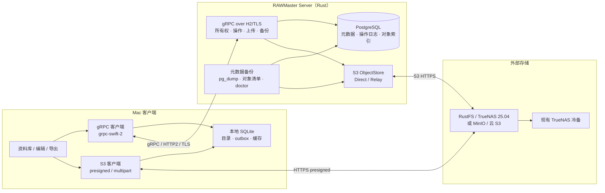

# 040 · 技术方案与部署

2026-11-27 · 推荐架构、技术栈、部署、验证和阶段门。**本轮只做设计，不写服务端代码。** 产品要求见[规格](spec.md)，存储见[存储](storage.md)，元数据备份见[元数据备份](metadata-backup.md)，安全见[安全](security.md)，协议见[协议](protocol.md)。

## 1. 架构

**核心选择：**

| 层 | 推荐 | 理由 |
| --- | --- | --- |
| 控制面 | gRPC over HTTP/2/TLS | 类型化、流式、deadline、取消、拦截器；Swift 2 官方支持 |
| 内容面 | S3 兼容 API | RustFS／MinIO／云 S3 同一协议；presigned 直传；大文件成熟 |
| 元数据 | PostgreSQL | 事务、约束、JSONB、并发、外部 HA；不存字节 |
| 服务端语言 | Rust | 复用可移植内核；单二进制；tonic + sqlx + S3 SDK |
| 客户端 | Swift + grpc-swift-2 + AWS SDK for Swift／Soto | 原生 macOS；不引入 ZMQ |
| 本地磁盘 | 日志、临时、有限 Relay 缓冲 | Server 可容器化／无状态；元数据和对象都在外部 |
| 存储可靠性 | 外部 TrueNAS／S3／冷备 | RAWMaster 不做 RAID／EC／跨站复制 |
| 证书 | 私有 CA + leaf；客户端固定 | 自建服务无公共 CA；轮换友好 |

## 2. 组件职责

| 组件 | 职责 | 不负责 |
| --- | --- | --- |
| gRPC API | TLS、认证、库所有权、操作收据、上传意图、事件流 | 文件字节、数据库共享 |
| PostgreSQL | 库、设备、令牌哈希、操作、对象、引用、快照、作业、配额、审计 | 媒体字节 |
| ObjectStore | S3 profile、presigned、multipart、HEAD、Range、Relay | 业务资格、元数据事务 |
| Metadata backup | 一致快照、pg_dump、对象清单、验证、恢复、doctor | S3/ZFS 可靠性 |
| S3 provider | RustFS／MinIO／云 S3 | 业务逻辑 |
| 客户端 | 本地 SQLite、outbox、缓存、gRPC、S3 | 直连 PostgreSQL |

## 3. 关键数据流

### 3.1 操作

1. 客户端本地写入 SQLite 和 outbox。
2. gRPC `ApplyOperation`（`commandID`、`baseRevision`、payload hash）。
3. Server 校验所有权／版本／依赖；PostgreSQL 事务写 operation、receipt、outbox。
4. 返回 `serverRevision`；重复命令返回原收据。
5. 客户端拉取 changes；单客户端单写者，不做字段级冲突合并。

### 3.2 归档 Direct

1. `CreateUpload`：PostgreSQL 写 intent；S3 multipart；返回 presigned part URL。
2. 客户端直传 RustFS／云 S3。
3. `CompleteUpload`：完成 multipart；HEAD／SHA-256；PostgreSQL 事务登记对象和归档引用。
4. 失败 abort／过期；内容寻址幂等。

### 3.3 Relay

1. Direct part 失败；客户端 `RelayUpload` 缺失 part。
2. Server 流式写同一 S3 multipart；跳过已存在 part。
3. `CompleteUpload`；收据记录 `direct`／`relay`／`mixed`。
4. 本地不落完整文件；有界缓冲。

### 3.4 元数据备份

1. PostgreSQL `REPEATABLE READ` + `pg_export_snapshot`。
2. `pg_dump --snapshot` + 对象清单。
3. 上传 S3 `backups/metadata/<id>/`。
4. 隔离恢复 + `metadata doctor` + 对象抽样。
5. 写 `verifiedAt`；未验证不可恢复。

### 3.5 恢复

1. 校验备份文件。
2. `pg_restore` 到隔离 PostgreSQL；迁移；doctor。
3. HEAD S3 对象；分类 missing／corrupt。
4. 重置上传意图、租约、运行作业、outbox。
5. 只读启动；客户端重连补交；切换生产。

## 4. 技术栈

### 4.1 服务端

- Rust 2021；`tonic`（gRPC）、`prost`（proto）、`sqlx`（PostgreSQL）、`aws-sdk-s3` 或 `object_store`（S3）、`tracing`、`serde`。
- PostgreSQL 16／17；外部 HA；连接池；迁移工具（sqlx migrate）。
- 单二进制；容器友好；本地磁盘只挂载 `/tmp`、`/var/log/rawmaster`。
- 健康／就绪、指标、结构化日志；admin CLI。
- 不依赖本地 SQLite；不依赖本地对象目录。

### 4.2 客户端

- `grpc-swift-2` + `GRPCNIOTransportHTTP2`；TLS trust roots；设备令牌。
- AWS SDK for Swift（Transfer Manager／presigned）或 Soto；RustFS path-style、自定义 endpoint。
- 本地 SQLite + outbox + cache；钥匙串存令牌；固定 CA／SPKI。
- WAN：H2 gRPC；S3 直传或 Relay；资料库浏览完整；编辑／导出后续差异化。

### 4.3 S3 profile

- `provider`：rustfs、minio、aws-s3、other。
- `endpoint`、`region`、`bucket`、`addressing`、`tls`、`partSize`、`checksum`。
- RustFS／MinIO path-style；云 S3 virtual-host。
- 客户端 presigned URL host 与证书 SAN 一致。

## 5. 部署

### 5.1 同机（TrueNAS 25.04）

- RustFS App + Server VM/App + PostgreSQL（VM／外部）。
- 客户端 gRPC + S3 直传。
- 注意 CPU／内存／10GbE 争用；容器 MTU；端口 >9000；TLS。
- 适合单机、低运维；冷备在另一台 TrueNAS。

### 5.2 分离

- Linux Server + PostgreSQL 独立；RustFS 在 TrueNAS。
- 客户端 gRPC 到 Server；S3 直传 RustFS。
- 计算与存储隔离；多一跳 10GbE。
- 推荐给正式使用和后续 HA。

### 5.3 本地磁盘

- `/var/log/rawmaster`、`/tmp/rawmaster`、有限 Relay 缓冲。
- `pg_dump` 流式上传；临时文件清理；日志轮换。
- 不持久化对象、目录数据库、代理缓存；代理可放 S3。

### 5.4 升级

1. 元数据备份并验证。
2. 隔离数据库迁移预演。
3. 短写屏障；迁移生产；`metadata doctor`。
4. 启动新版本；客户端版本握手。
5. 失败回到隔离恢复；不覆盖备份。

## 6. 测试策略

| 层 | 内容 |
| --- | --- |
| 契约 | proto、PostgreSQL schema、S3 profile、备份格式、证书／令牌 |
| 单元 | 所有权、操作收据、上传状态机、对象 key、doctor |
| 集成 | 真实 RustFS、PostgreSQL、presigned、multipart、Relay |
| 故障 | 断网、TLS 失败、S3 5xx、multipart 中断、磁盘满、Postgres 重启 |
| 备份 | 一致快照、pg_dump、对象清单、验证、恢复、doctor |
| 安全 | 自签名固定、证书轮换、令牌撤销、secret bundle、日志脱敏 |
| 性能 | 10GbE／jumbo、10TB、Direct／Relay、pg_dump／restore、HEAD |
| 客户端 | gRPC、S3 SDK、钥匙串、缓存、重连、单客户端所有权 |

证据必须包含真实对象、真实网络、真实 PostgreSQL；不能用 mock 代替对象校验和恢复。

## 7. 阶段

| 阶段 | 交付 | 退出条件 |
| --- | --- | --- |
| S0 | 契约、proto、schema、S3 profile、备份格式、证书／令牌 | 评审通过；无未决 P0 |
| S1 | gRPC、PostgreSQL、所有权、自签名 CA、令牌 | 错误证书／令牌被拒；第二客户端不能写 |
| S2 | 归档、Direct、Relay、校验、去重、引用 | 五文件样本；中断续传；Direct／Relay 一致 |
| S3 | metadata doctor、备份、验证、恢复、secret bundle | 空 PostgreSQL 恢复；对象缺失报告；证书／令牌恢复 |
| S4 | 冷热、代理、固定、释放、过期、客户端重连 | 冷片切换；释放门槛；旧备份不倒带 |
| S5 | 10TB／10GbE、证书轮换、演练、容量报告 | 真实基线；未测规模不标完成 |
| S5.1 | 远程作业 | 按 [041](../041-server-image-editing/spec.md)；场景图／HDR 需 Linux scene executor 和色彩门 |

## 8. 风险

| 风险 | 对策 |
| --- | --- |
| RustFS／S3 兼容性 | 固定版本；兼容矩阵；Direct／Relay；回归 |
| 自签名证书客户端信任 | 私有 CA + 钥匙串／trust roots；失败 Relay；不关 TLS |
| PostgreSQL／S3 双写不一致 | upload intent 状态机、内容寻址、outbox、orphan 对账 |
| 元数据备份不可恢复 | 隔离恢复 + doctor + 对象清单 + 演练 |
| 证书／令牌备份泄露 | secret bundle 加密；权限最小化；日志脱敏 |
| 10GbE 单流瓶颈 | multipart 并发；jumbo 端到端；测 RustFS 容器 MTU |
| Relay 成瓶颈 | Direct 默认；Relay 流式、有界、仅回退 |
| 单客户端限制 | 明确产品边界；后续共享库另立规格 |
| 远程作业引擎不一致 | 只开放已验证 Linux 引擎；039 scene executor 当前 Metal-only，041 另立 Linux 端口与色彩门 |

## 9. 待验证

1. RustFS 在 TrueNAS 25.04 App 的真实吞吐、presigned multipart、checksum、TLS、升级兼容。
2. gRPC Swift 2 + TLS 私有 CA 在 macOS 的构建、流式、重连、证书固定。
3. AWS SDK for Swift／Soto 对 RustFS path-style、presigned、multipart 的兼容。
4. PostgreSQL 一致快照 + `pg_dump --snapshot` 的实际行为与锁影响。
5. 10TB 库的 pg_dump／restore、doctor、全量 HEAD 时长和临时磁盘占用。
6. 自签名证书轮换、S3 证书变化、Relay 回退的客户端体验。
7. 单客户端所有权转移和旧 epoch fencing 的真实故障矩阵。
8. 元数据备份加密、secret bundle 密钥管理和恢复演练。
