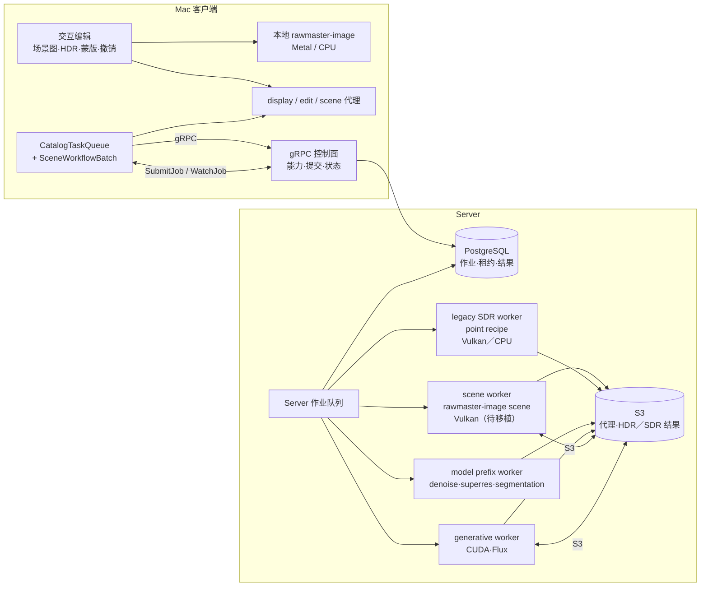

# 041 · Server 图像编辑技术方案

2026-11-27 · 客户端交互、场景图／HDR 代理、客户端／Server 队列、Vulkan 图像 worker、CUDA 生成式 worker。**本轮只做设计，不写实现。** 产品要求见[规格](spec.md)，队列语义见[queues.md](queues.md)。

## 1. 架构

**不存在的路径：** Server 交互帧、逐滑杆 RPC、客户端／Server 同请求并行、Server 会话级交互缓存。

## 2. 组件

| 组件 | 职责 | 不负责 |
| --- | --- | --- |
| 客户端编辑器 | 全部交互、场景图、撤销、历史、版本采用 | Server 往返帧 |
| 客户端队列 | `CatalogTaskQueue` 持久任务 + `SceneWorkflowBatch` 批次；代理、远端作业、缓存 | 交互帧、Server 作业执行 |
| gRPC 控制面 | 能力、提交、状态、取消、重试、结果 | 文件字节 |
| Server 队列 | 持久作业、lane、公平、租约、重试、发布 | 交互 |
| scene worker | 037／038 场景图、HDR／SDR；`rawmaster-image` scene executor | 旧 SDR 兼容；Flux |
| legacy SDR worker | 旧点配方／兼容显影图 | 场景图／HDR |
| model prefix worker | `DevelopmentSceneModelV1` 确定性前缀 | 生成式候选 |
| generative worker | Flux CUDA AI 栈 | 普通编辑算子 |
| S3 | 代理、结果、输入按需 | 作业状态 |

## 3. 客户端

### 3.1 交互

- 本地 `rawmaster-image`（Metal／CPU）和既有 Core Image 路径；不依赖 Server。
- 场景图编辑使用本地 `DevelopmentSceneGraphV1`、`DevelopmentSceneOutputStateV1`、`DevelopmentSceneModelV1`。
- 拖动按视口分辨率；松手按 sceneProxy／editProxy 分辨率；1:1／最终／导出用原件。
- 交互帧 latest-wins，取消旧请求；不进入持久队列。
- 前台资源优先；后台队列在拖动时暂停或降并发。

### 3.2 代理

| 代理 | 规格 | 来源 |
| --- | --- | --- |
| displayProxy | 2400 长边、8-bit SDR、JPEG/HEIF | Server 或客户端 |
| editProxy | 原生或高分辨率、10-bit 广色域 SDR；AVIF/HEIF | Server 或客户端 |
| sceneProxy | 场景线性／HDR：AP1 FP16／FP32 优先，或明确定义的 10／12-bit PQ 表示 | Server 或客户端；按需 |
| linearProxy | 旧线性代理；按需 | 客户端／Server |
| 原件 | RAW／JPEG／TIFF | S3／本地 |

- 代理键：`sourceHash + decoderVersion + profile + orientation + resolution + bitDepth + codec + sceneGraph/outputState + engineVersion`。
- `sceneProxy` 不能由 SDR JPEG 代替；颜色、几何、蒙版坐标和 HDR／SDR 分支必须与最终一致。
- 缓存：LRU、TTL、固定、离线、校验；显示、编辑、场景代理分开。
- 存储预算：全量 16-bit 线性不默认落盘；`sceneProxy` 0.5–1× 按需；1:1 用原件。

### 3.3 远端作业的客户端接入

- 复用 [042 的业务记录、资源预算和会话](../042-local-library-workbench/plan.md)。在现有「制作任务」中增加远端作业详情、提交意图和事件游标。
- 观察和下载是同一个任务的阶段。场景批次项映射到一份稳定的远端作业 ID，沿用已冻结的父版本、目标 head、场景图和输出状态。返回时按原来批次或版本登记。
- 客户端重启先查持久收据，已发送的操作按原 ID 核对。切库停止在旧会话中应用事件，重开所属库后补差。按需取回和后台预取共用 042 的前台资源限制。

## 4. Server

### 4.1 能力层级

| 能力 | 条件 | 后端 |
| --- | --- | --- |
| `library_core` | 总是 | gRPC + PostgreSQL + S3 |
| `image_proxy` | `image_module`（CUDA GPU + Vulkan + flag）；无模块时客户端生成 | Vulkan；CPU 回退另定 |
| `image_sdr_batch` | 旧点配方；`image_module` | `rawmaster-image` Vulkan／CPU |
| `image_scene_batch` | 037／038 场景图；**Linux／Vulkan scene executor** + `image_module` + 色彩门 | `rawmaster-image` scene executor；当前仅 Metal，Linux 待移植 |
| `model.prefix` | 确定性 denoise／superres／segmentation；模型／显存 | 模型 provider |
| `generative` | CUDA GPU + 模型／许可／显存 + flag | Flux/CUDA AI 栈 |

- CUDA GPU 是图像模块硬件准入；影像计算优先 Vulkan。
- `rawmaster-image` 当前：点配方图有 CPU／Metal／Vulkan；scene executor 仅 macOS Metal（039）。
- 无 Linux scene executor 时 `image_scene_batch` 不开放；legacy SDR 不能被标成场景／HDR。
- 能力清单返回后端、显存、scene backend、模型、引擎版本；客户端按能力显示入口。
- 无 GPU Server 仍提供 `library_core`。

### 4.2 作业

- 类型：`proxy.generate`、`scene.proxy`、`scene.render.final`、`scene.render.batch`、`legacy.render.final`、`model.prefix`、`generative`。
- 冻结：原件、`sceneGraph`／旧配方、`outputState`（route／sdrTrim）、`modelProgram`、模板／批次、目标 head、引擎／模型、`deliveryTarget`、`format`。
- PostgreSQL `jobs`／`job_attempts`／`job_inputs`／`job_outputs`／`job_events`；字段含 scene graph／output state／model program hash、compatibility route、target、format。
- 状态、租约、重试、取消、发布见 [Server 作业与准入](queues.md#3-server-作业和准入)。
- 结果先 S3 暂存，校验后登记；同一作业只发布一次。
- HDR AVIF 10 位 Rec.2020／PQ、SDR JPEG8、PNG16 分别记录 target、format、位深、ICC／CICP；不自动采用。
- 旧 SDR 兼容版本不迁移为 scene graph；不把 HDR 目标降为 SDR。

### 4.3 Scene worker

- 输入：S3 原件或冻结输入；RAW 解码、037 色彩管理、scene graph、coverage、模型前缀。
- 输出：scene proxy／HDR／SDR；S3；PostgreSQL 收据。
- 依赖：039 scene executor 的 Linux／Vulkan（或 CPU）端口；未实现前 worker 不接收 `scene.*`。
- 039 已有 tiled 60MP 执行、source-revision 前缀缓存、analytic coverage 缓存和 completion receipt；Linux 端口必须保留同等语义。
- 作业收据记录 backend、tiles、evaluated nodes、dispatches、cache hits、peak bytes、budget、CPU time；结果可复现性依赖这些字段。
- 精度：CPU／Vulkan／Metal 差异按 037／035 门槛；未过门只候选。
- 不能用 displayProxy 代替原件做 final；不能把旧 SDR 结果当场景输出。

### 4.4 Legacy 与生成式

- Legacy worker：旧 SDR 点配方／兼容显影图；输出 SDR JPEG/PNG；不参与 HDR 母版。
- 生成式 worker：Flux CUDA；`rawmaster-image` 负责输入准备、色彩、蒙版、合成、后处理；结果候选。
- 模型前缀：`DevelopmentSceneModelV1` 的 denoise → superResolution? → segmentation*；不是 Flux；不产生候选版本。
- 缺模型／显存／许可 → 禁用，不自动换模型。

## 5. 队列协同

- 客户端 SQLite；Server PostgreSQL；不共享数据库。
- 提交：稳定 `jobID` + `requestHash`；同 ID 幂等。
- 观察：`WatchJob` server streaming 或 `GetJob` 轮询，断线补 sequence，游标过期或恢复换代时先取权威快照。
- 取消：客户端 → Server → worker；已发布保留。
- 未知：同 ID 查询，提交可否重送以同一权威代次的未接收回执为准。恢复旧备份后保留跨代核对。
- 结果：S3 presigned／Relay。客户端核验并登记候选、代理或 032 渲染阶段。032 交付收据须在本地写盘后登记。
- 场景批次：本地 `SceneWorkflowBatch` 与远端 `scene.render.*` 通过 batch／item／target head 绑定；结果回批次，不直接采用。
- 公平：library lane 保留；每库加权；GPU／显存配额。
- 详细见 [queues.md](queues.md)。

## 6. 协议

新增能力／作业方法（与 040 `JobService` 对齐）：

| 方法 | 作用 |
| --- | --- |
| `GetCapabilities` | `library_core`、`image_proxy`、`image_sdr_batch`、`image_scene_batch`、`model.prefix`、`generative`、后端、显存、scene backend、模型、引擎 |
| `SubmitJob` | 提交冻结作业；返回 jobID／状态／队列信息 |
| `GetJob` | 作业详情、attempt、输出、错误 |
| `WatchJob` | server streaming 状态／进度／结果 |
| `CancelJob` | 协作取消 |
| `RetryJob` | 同 jobID 新 attempt |
| `ListJobs` | 按库／状态分页 |
| `GetJobResult` | 结果元数据／presigned URL |

- Protobuf 只增不删；未知版本拒绝。
- 进度事件只用于状态，不驱动交互帧。
- 结果绑定 `inputHash`、`sceneGraphHash`、`outputStateHash`、`modelProgramHash`、`compatibilityRoute`、`deliveryTarget`、`format`、`engineVersion`、`outputHash`。

## 7. 数据与失效

- 代理键、作业请求 hash、输出 hash 都是内容身份；路径不是身份。
- 输入／场景图／输出状态／模型／引擎变化 → 旧作业结果过期；不覆盖当前采用。
- 缓存失效：源变化、解码器／profile／算子版本、场景图 schema、输出状态、代理契约变化。
- 结果候选：`workID`、`versionID`、`jobID`、`inputHash`、`targetHead`；客户端核对当前版本。
- 场景批次：head 冲突保留；undo 仍检查版本依赖；旧 SDR 兼容路径独立。
- 失败／取消清理暂存；已发布母版不删除。

## 8. 部署

- 资料库 Server：无 GPU 必需；gRPC/PostgreSQL/S3。
- 图像节点：NVIDIA CUDA GPU；Vulkan 驱动／ICD；`rawmaster-image` Vulkan。
- Scene 节点：Linux／Vulkan scene executor（待实现）；没有时 `image_scene_batch` 关闭。
- 生成节点：CUDA、模型权重、许可、显存；可与图像节点同机或分离。
- 同机或分离均通过能力清单和队列；不把 GPU 依赖加到资料库基线。
- Feature flag：`image_proxy`、`image_sdr_batch`、`image_scene_batch`、`model.prefix`、`generative`；按服务器／部署配置。
- 容器／驱动／Vulkan ICD／CUDA toolkit 固定版本；升级前跑能力与精度回归。

### 8.1 执行节点的工作存储

S3 保存原件及已登记的输出，PostgreSQL 保存作业和收据。计算节点按输入接口使用内存缓冲区或可寻址的文件。首版以可配置的工作目录验证现有解码和模型路径，优先采用计算节点就近的 SSD／NVMe。S3 保持对象接口，ZFS 可以作 S3 的底层存储。共享文件系统作为可选部署方式，按实测吞吐和多节点复用收益选用。

| 路径 | 数据流 |
| --- | --- |
| RAW 解码、代理与普通渲染 | 从 S3 拉取冻结输入并校验。需要文件路径或随机访问的解码器从工作目录打开。支持缓冲区的解码链路可直接消费字节。解码后的像素供 CPU／GPU 算子复用，分块从已准备的源取样。批量按有界并发预取下一项 |
| Flux／模型前缀 | 部署时将已核验的权重和所需资源准备到模型目录。按模型、权重版本和摘要复用工作节点上的磁盘缓存。进程／显存常驻由实际 CUDA 内存和吞吐测量决定。现有 Mac Flux worker 从文件加载权重，生成阶段使用张量。[权重加载](../../Modules/FluxWorker/src/weights.rs) · [现有生成循环](../../Modules/FluxWorker/src/pipeline.rs) |
| 输出与恢复 | 需要路径的编码器先写入当前尝试的暂存区。将编码字节或暂存文件上传 S3，校验后按租约登记唯一结果。工作盘可回收或重建。原件缓存按库和内容身份复用，任务临时数据按尝试隔离 |

预留每个可并行尝试的暂存空间，分别限制输入读取、缓存占用、计算和输出上传。空间不足进入等待或失败，已登记的对象不受影响。首轮比较三个条件。冷缓存包含输入取回及模型准备。热磁盘缓存仍记录权重加载与初始化。采用常驻模型时另外记录稳态推理。逐段报告 S3 取回及校验、解码、加载与上传显存、推理或渲染、编码、写回以及作业端到端时间。使用同一批冻结输入和输出规格记录 P50／P95、缓存命中和 GPU 等待，再判断瓶颈所在。[Amazon S3 性能指南](https://docs.aws.amazon.com/AmazonS3/latest/userguide/optimizing-performance-guidelines.html)

## 9. 测试

| 层 | 内容 |
| --- | --- |
| 代理 | display／edit／sceneProxy 分辨率、位深、色彩、几何、方向、HDR 语义、缓存键、失效 |
| 场景图 | schema 4、输出状态、模板、批量 head、旧 SDR 兼容、无效图拒绝 |
| 客户端队列 | `CatalogTaskQueue`／`SceneWorkflowBatch` 重启、离线、抢占、去重、取消、重试、未知 |
| Server 队列 | 能力、lane、公平、租约、重启、取消、发布、过期 |
| Scene worker | Linux Vulkan scene executor 像素／性能；tiling、前缀缓存、receipt；未移植时关闭 |
| Legacy worker | 旧 SDR 配方像素、导出、兼容图 |
| HDR 交付 | AVIF 10 位 Rec.2020／PQ、SDR 派生 JPEG/PNG16、ICC／CICP、色彩门 |
| 模型前缀 | denoise／superres／segmentation 顺序、身份、provider、预算 |
| 生成式 | CUDA、模型、显存、许可、取消、结果 |
| 工作盘与对象 I/O | 冷输入、热磁盘、模型常驻分别测。并发批次核对预取、空间不足、暂存清理与 S3 发布收据 |
| 协同 | 提交／观察／取消／重试／结果；断线；同 ID；批次 head |
| 规模 | 10TB／10GbE、20 万对象、队列等待、sceneProxy、final、HDR 编码、Flux；60MP 合成图只作起点 |

## 10. 阶段

| 阶段 | 交付 | 退出条件 |
| --- | --- | --- |
| Q0 | 代理／队列／scene job 契约、能力清单、色彩门 | 评审通过 |
| Q1 | display／edit／sceneProxy 预取、缓存、本地生成 | 冷片／HDR 进入编辑无空白；1:1 用原件 |
| Q2 | 042 基础上的远端提交、镜像、核对与取回 | 切库与重启后仍按原作业核对，结果回到原批次／作品 |
| Q3 | Server 队列 + legacy SDR worker | 作业幂等、公平、重启恢复、发布一次 |
| Q4 | Linux scene executor + scene worker／HDR | 场景图／HDR 像素与色彩门通过；旧 SDR 不迁移 |
| Q5 | model prefix + Flux/CUDA | 模型准入；结果候选；取消／重试 |
| Q6 | 10TB／10GbE、监控、恢复 | 真实基线；未测能力不标完成 |

## 11. 风险

| 风险 | 对策 |
| --- | --- |
| sceneProxy 存储／带宽爆炸 | 原生或 0.5×；按需；只对冷／远程生成；linearProxy 不默认全量 |
| scene executor 仅 Metal | Q4 前 `image_scene_batch` 关闭；legacy SDR 独立；不混用 |
| 场景图／旧 SDR 混淆 | 冻结 `compatibility_route`；不自动迁移；逐图测试 |
| 60MP／大图内存 | 复用 039 tiling、预算、receipt；Server 另测真实 60MP RAW，不用合成图外推 |
| HDR 色彩不一致 | 037 色彩门；AVIF／SDR 分别验证；未过门只候选 |
| 本地交互被后台任务拖慢 | 前台抢占；资源类；暂停 prefetch |
| 场景批次 head 冲突 | 复用 `SceneWorkflowBatch`；候选不自动采用；undo 检查 |
| 队列重复／丢失 | 持久化、jobID、幂等、未知核对 |
| 队列公平 | lane、每库加权、GPU 配额、library 保留 |
| CUDA/Vulkan 后端差异 | 能力清单；Vulkan 图像；CUDA 生成；精度回归 |
| 模型许可／显存 | 独立准入；缺项禁用；不换模型 |
| 10TB sceneProxy 成本 | 预算／采样；按需；缓存；不默认全量 |
