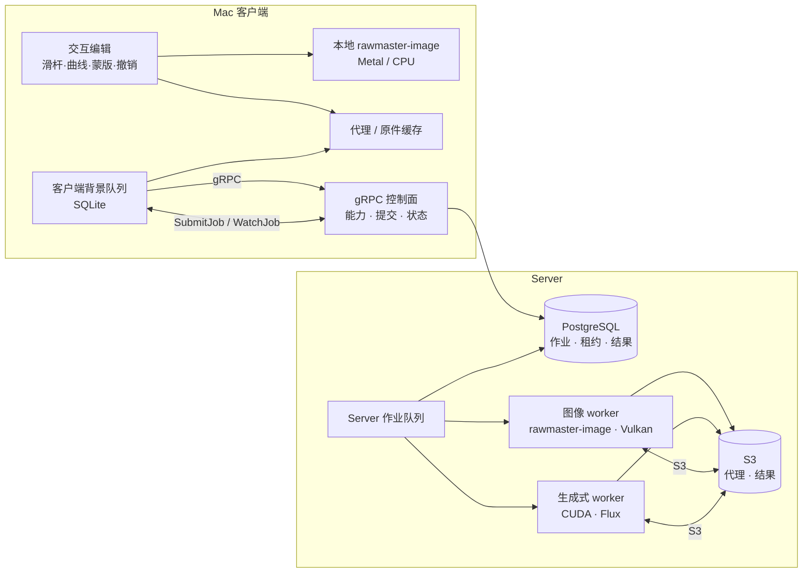

# 041 · Server 图像编辑技术方案

2026-11-27 · 客户端交互、代理、客户端／Server 队列、Vulkan 图像 worker、CUDA 生成式 worker。**本轮只做设计，不写实现。** 产品要求见[规格](spec.md)，队列语义见[queues.md](queues.md)。

## 1. 架构

**不存在的路径：** Server 交互帧、逐滑杆 RPC、客户端／Server 同请求并行、Server 会话级交互缓存。

## 2. 组件

| 组件 | 职责 | 不负责 |
| --- | --- | --- |
| 客户端编辑器 | 全部交互、撤销、历史、版本采用 | Server 往返帧 |
| 客户端队列 | 代理预取／生成、远端作业提交／观察／取回、缓存维护 | 交互帧、Server 作业执行 |
| gRPC 控制面 | 能力、提交、状态、取消、重试、结果 | 文件字节 |
| Server 队列 | 持久作业、优先级、公平、租约、重试、发布 | 交互 |
| 图像 worker | `rawmaster-image` CPU／Vulkan；代理／final／batch／heavy AI | 生成式模型 |
| 生成式 worker | Flux CUDA AI 栈；前后处理调用 `rawmaster-image` | 普通编辑交互 |
| S3 | 代理、结果、输入按需 | 作业状态 |

## 3. 客户端

### 3.1 交互

- 本地 `rawmaster-image`（Metal / CPU）和既有 Core Image 路径；不依赖 Server。
- 拖动按视口分辨率；松手按 editProxy 分辨率；1:1／最终／导出用原件。
- 交互帧 latest-wins，取消旧请求；不进入持久队列。
- 前台资源优先；后台队列在拖动时暂停或降并发。

### 3.2 代理

| 代理 | 规格 | 来源 |
| --- | --- | --- |
| displayProxy | 2400 长边、8-bit sRGB、JPEG/HEIF | Server 或客户端 |
| editProxy | 原生或高分辨率、10-bit 广色域、AVIF/HEIF；可按需 linearProxy | Server 图像模块或客户端 |
| linearProxy | 原生或 0.5×、FP16/FP32 | 按需生成、缓存 |
| 原件 | RAW／JPEG／TIFF | S3／本地 |

- 代理键：`sourceHash + decoderVersion + profile + orientation + resolution + bitDepth + codec + engineVersion`。
- `editProxy` 颜色／几何／蒙版坐标与原件一致；分辨率可降低，语义不能变。
- 缓存：LRU、TTL、固定、离线、校验；显示代理和编辑代理分开。
- 预取：选中／悬停／进入编辑；先用 displayProxy；editProxy 到达后替换不闪烁。
- 存储预算：editProxy 默认原生或高分辨率；全量 16-bit 线性不默认落盘；linearProxy 按需。

### 3.3 客户端队列

- SQLite `client_tasks`；状态、优先级、资源类、dedupe、重试、租约、结果。
- 类型与优先级见 [queues.md](queues.md#2-客户端背景队列)。
- 前台 `foregroundBlocking` 可抢占；拖动时暂停 prefetch。
- 提交远端作业：本地 `submit.remoteJob` → `watch.remoteJob` → `fetch.remoteResult`。
- 未知结果用同 `jobID` 查询，不新建。
- 重启：`running` → `waiting`／重试；不假装完成。

## 4. Server

### 4.1 能力

| 能力 | 条件 | 后端 |
| --- | --- | --- |
| `library_core` | 总是 | gRPC + PostgreSQL + S3 |
| `image_proxy` | `image_module`：NVIDIA CUDA GPU + Vulkan + feature flag + 最小显存；无图像模块时由客户端生成 | Vulkan；CPU 回退另定 |
| `image_batch` | 同 `image_module` | `rawmaster-image` Vulkan；CPU 回退另定 |
| `generative` | CUDA GPU + 模型／许可／显存 + flag | Flux/CUDA AI 栈 |

- CUDA GPU 是图像模块的硬件准入；图像算子优先 Vulkan。
- `rawmaster-image` 当前后端：CPU、wgpu Metal、wgpu Vulkan；**没有 CUDA 后端**。NVIDIA 上使用 Vulkan；CUDA 用于生成式模型。
- 能力清单返回后端、显存、模型、引擎版本；客户端按能力显示入口。
- 无 GPU Server 仍提供 `library_core`。

### 4.2 作业

- 类型：`proxy.generate`、`render.final`、`render.batch`、`ai.heavy`、`generative`。
- 冻结输入、配方、蒙版、引擎／模型、输出。
- PostgreSQL `jobs`／`job_attempts`／`job_inputs`／`job_outputs`／`job_events`。
- 状态、租约、重试、取消、发布见 [queues.md](queues.md#3-server-作业队列)。
- 结果先 S3 暂存，校验后登记；同一作业只发布一次。
- 不自动采用；客户端取回候选。

### 4.3 图像 worker

- 输入：S3 原件或冻结输入；RAW 解码、色彩管理、蒙版；`rawmaster-image` Vulkan。
- 输出：displayProxy/editProxy/final/batch；S3；PostgreSQL 收据。
- 资源：显存、内存、CPU、Vulkan 队列；按能力准入。
- 精度：CPU／Vulkan／Metal 差异按色彩规格和 035 门槛；未过门只候选。
- 不能用 displayProxy 代替原件做 final。

### 4.4 生成式 worker

- Flux 等模型；CUDA 栈；模型、权重、许可、显存独立。
- `rawmaster-image` 负责输入准备、色彩、蒙版、合成、后处理；不让模型库承担编辑算子。
- 结果候选；模型版本、输入、种子、参数可追溯。
- 缺模型／显存／许可 → 禁用，不自动换模型。

## 5. 队列协同

- 客户端 SQLite；Server PostgreSQL；不共享数据库。
- 提交：稳定 `jobID` + `requestHash`；同 ID 幂等。
- 观察：`WatchJob` server streaming 或 `GetJob` 轮询；断线补 sequence。
- 取消：客户端 → Server → worker；已发布保留。
- 未知：同 ID 查询；不新 ID 重发。
- 结果：S3 presigned／Relay；客户端 SHA-256 校验；候选。
- 公平：library lane 保留；每库加权；GPU 配额。
- 背压：队列满／显存不足明确错误；客户端延后。
- 详细见 [queues.md](queues.md)。

## 6. 协议

新增 gRPC 能力／作业方法（可与 040 的 `JobService` 合并）：

| 方法 | 作用 |
| --- | --- |
| `GetCapabilities` | `library_core`、`image_proxy`、`image_batch`、`generative`、后端、显存、模型、引擎 |
| `SubmitJob` | 提交冻结作业；返回 jobID／状态／队列信息 |
| `GetJob` | 作业详情、attempt、输出、错误 |
| `WatchJob` | server streaming 状态／进度／结果 |
| `CancelJob` | 协作取消 |
| `RetryJob` | 同 jobID 新 attempt |
| `ListJobs` | 按库／状态分页 |
| `CreateProxyJob` | 专用代理生成（可复用 SubmitJob） |
| `GetJobResult` | 结果元数据／presigned URL |

- Protobuf 只增不删；未知版本拒绝。
- 进度事件只用于状态，不驱动交互帧。
- 结果绑定 `inputHash`、`recipeHash`、`engineVersion`、`outputHash`。

## 7. 数据与失效

- 代理键、作业请求 hash、输出 hash 都是内容身份；路径不是身份。
- 输入／配方／引擎／模型变化 → 旧作业结果过期；不覆盖当前采用。
- 缓存失效：源变化、解码器／profile／算子版本变化、代理契约变化。
- 结果候选：`workID`、`versionID`、`jobID`、`inputHash`；客户端核对当前版本。
- 失败／取消清理暂存；已发布母版不删除。

## 8. 部署

- 资料库 Server：无 GPU 必需；gRPC/PostgreSQL/S3。
- 图像节点：NVIDIA CUDA GPU；Vulkan 驱动／ICD；`rawmaster-image` Vulkan；最低显存。
- 生成节点：CUDA、模型权重、许可、显存；可与图像节点同机或分离。
- 同机或分离均通过能力清单和队列；不把 GPU 依赖加到资料库基线。
- 容器／驱动／Vulkan ICD／CUDA toolkit 固定版本；升级前跑能力与精度回归。
- Feature flag：`image_proxy`、`image_batch`、`generative`；按服务器／部署配置。

## 9. 测试

| 层 | 内容 |
| --- | --- |
| 代理 | 分辨率、位深、色彩、几何、方向、缓存键、失效 |
| 客户端队列 | 重启、离线、前台抢占、去重、取消、重试、未知 |
| Server 队列 | 能力、公平、租约、重启、取消、发布、过期 |
| 图像 worker | CPU/Vulkan 精度、Vulkan 性能、显存、RAW 解码、色彩 |
| 生成式 | CUDA、模型、显存、许可、取消、结果 |
| 协同 | 提交／观察／取消／重试／结果；断线；同 ID |
| 色彩 | final 与本地最终对照；未过门只候选 |
| 规模 | 10TB／10GbE、20 万对象、队列等待、代理、final、Flux |

## 10. 阶段

| 阶段 | 交付 | 退出条件 |
| --- | --- | --- |
| Q0 | 代理契约、队列契约、能力清单、作业 envelope、色彩门 | 评审通过 |
| Q1 | display／editProxy 预取、缓存、本地生成 | 冷片进入编辑无空白；1:1 用原件 |
| Q2 | 客户端队列 | 前台不被阻塞；重启恢复；取消无半成品 |
| Q3 | Server 队列 + Vulkan 图像 worker | 作业幂等、公平、重启恢复、发布一次 |
| Q4 | final／batch + 色彩门 | 结果候选；旧结果过期；色彩门通过 |
| Q5 | Flux/CUDA | 缺模型禁用；结果候选；取消／重试 |
| Q6 | 10TB／10GbE、监控、恢复 | 真实基线；未测能力不标完成 |

## 11. 风险

| 风险 | 对策 |
| --- | --- |
| editProxy 存储／带宽爆炸 | 原生或高分辨率 10-bit；linearProxy 按需；只对冷／远程生成 |
| 本地交互被后台任务拖慢 | 前台抢占；资源类；暂停 prefetch |
| 队列重复／丢失 | 持久化、jobID、幂等、未知核对 |
| 队列公平 | lane、每库加权、GPU 配额、library 保留 |
| Server final 色彩不一致 | 色彩门；未过门只候选 |
| CUDA/Vulkan 后端差异 | 能力清单；Vulkan 图像；CUDA 生成；精度回归 |
| 模型许可／显存 | 独立准入；缺项禁用；不换模型 |
| 结果覆盖当前编辑 | 候选 + 显式采用；绑定 inputHash |
| 10TB 代理成本 | 采样／预算；编辑代理按需；linearProxy 不默认全量 |
| 队列可观测性 | 状态、深度、失败；不伪造 ETA |
